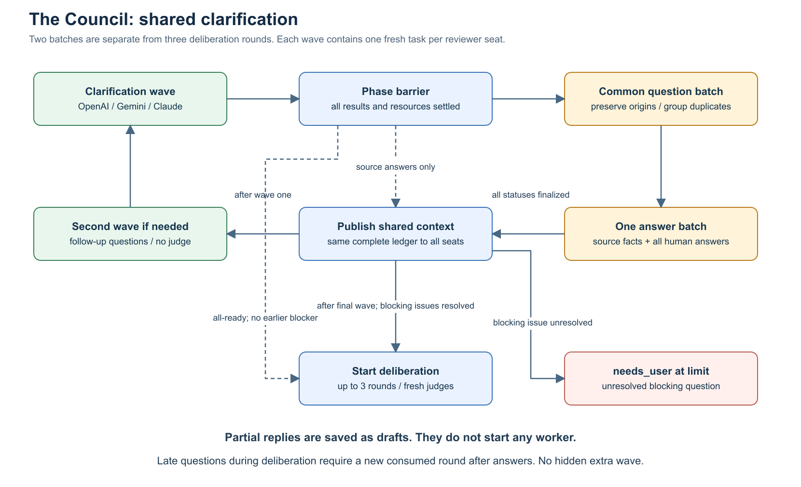
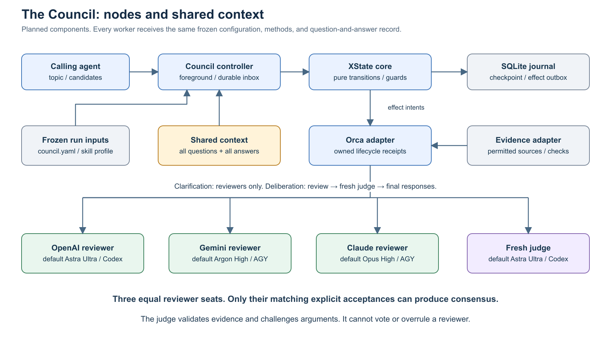
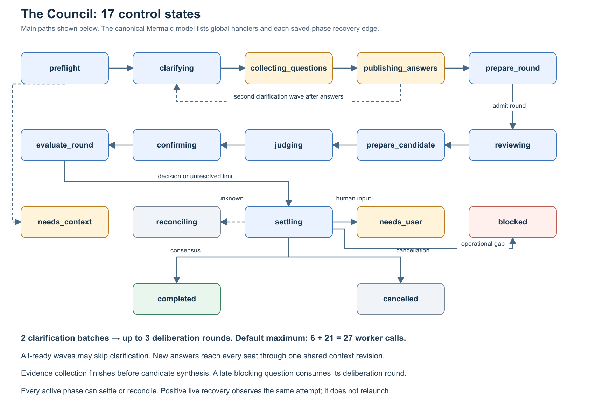
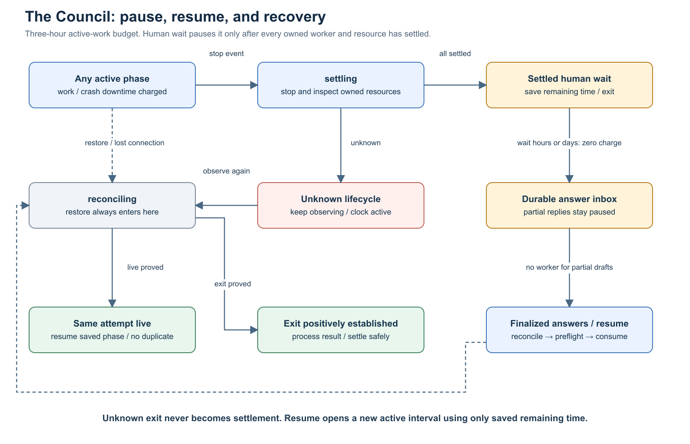

# The Council: nodes and states

These diagrams describe the design before implementation and deployment.

## Shared clarification

Up to two independent waves collect questions from all three seats. The coordinator presents one common batch and publishes every question and answer in the same context snapshot. Partial replies stay paused. Deferred blocking follow-ups remain in the ledger at the limit. No judge runs during clarification.

An all-ready wave can skip the remaining clarification allowance. After the second wave, complete answers with no unresolved blocking question permit deliberation directly. A late missing-input question consumes its deliberation round. Its answers publish a new shared context before the next counted round; they never return the run to clarification.

## Component nodes

The caller writes candidates after the evidence barrier. The pure XState core returns states and effect intents. The controller performs I/O. Configuration, admitted methods, and shared answers are frozen and bound to each packet.

The three reviewers have equal acceptance authority. The fresh judge validates evidence and challenges arguments; it has no acceptance vote. The default roster remains Astra Ultra, Argon High, Opus High, and a fresh Astra Ultra judge, configurable through `council.yaml`.

## Control states

The map displays all 17 control states. The canonical source includes global cancellation, failure, deadline, and recovery edges. Saved-phase guards make return targets exclusive. Restoring a checkpoint enters `reconciling` before effects.

Default reservations are two clarification batches and three deliberation rounds, using separate counters. Admission counts with the first launch intent, even when external start is uncertain. The maximum is six clarification calls plus 21 deliberation calls: 27. Only bounded local JSON surface normalization is allowed; there is no model repair call.

## Pause and recovery

An intentional human wait pauses the three-hour active-work budget only after all owned resources have positive settlement evidence. Answers can queue after the controller exits. Resume reconciles, rechecks preflight, and consumes queued controls before new effects. It preserves remaining time and counters.

The live owner also consumes queued candidates without a restart. Per-attempt watchdogs are recorded stop-only resources and must settle with the workers. Crashes, lost connections, and unknown shutdown do not pause the budget. An empty observation or final model message does not prove process exit. Positive live recovery reconnects the same attempt without duplicate inference.

## Editable source and evidence

- [Canonical diagram model](the-council.json) and [Mermaid source](the-council.md).
- SVG illustrations: [components](components-map.svg), [states](states-map.svg), [recovery](recovery-map.svg), and [clarification](clarification-map.svg).
- [Implementation plan](../plans/2026-10-23-the-council-implementation-plan.md).

The diagram skill validates the canonical model and exports source using compatibility profile `11.16.1`. A separate readable SVG layout supplies the illustrations; Sharp rasterizes those SVGs to PNG. These are static checks, not proof of native Mermaid rendering, XState execution, provider qualification, or deployment.
