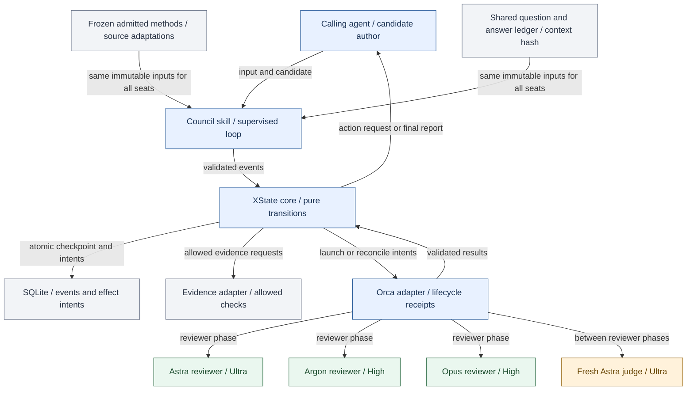

# The Council: nodes and states

Implementation planning diagrams for the approved Council design. They show proposed software, not a deployed system.

## Council component nodes

The calling agent authors candidates. The state machine selects transitions. Orca owns worker lifecycle.

<!-- mermaid:id=components -->


## Council control states

Normative 17-state contract. New runs start at preflight; restoreForReconciliation externally selects reconciling before effects. Guards on saved phase/target make return edges mutually exclusive.

<!-- mermaid:id=states -->
```mermaid
stateDiagram-v2
  accTitle: Council control states
  accDescr: Up to two shared clarification waves precede three deliberation rounds. Human wait occurs only with settled resources. Every answer is shared. Unknown lifecycle remains in reconciliation.
  state "preflight" as preflight
  state "needs_context" as needs_context
  state "clarifying" as clarifying
  state "collecting_questions" as collecting_questions
  state "publishing_answers" as publishing_answers
  state "prepare_round" as prepare_round
  state "reviewing" as reviewing
  state "prepare_candidate" as prepare_candidate
  state "judging" as judging
  state "confirming" as confirming
  state "evaluate_round" as evaluate_round
  state "settling" as settling
  state "reconciling" as reconciling
  state "needs_user" as needs_user
  state "blocked" as blocked
  state "completed" as completed
  state "cancelled" as cancelled
  [*] --> preflight
  preflight --> needs_context: missing context&#59; no owned live resources
  preflight --> blocked: policy or route gap&#59; no owned live resources
  preflight --> clarifying: checks pass&#59; no eligible publication/collection&#59; no open unfinalized QuestionBatch&#59; &#40;checks pass&#59; admit new/next batch once OR saved clarifying remedy with original admission/reservations and no repeated inference&#41;
  preflight --> publishing_answers: checks pass&#59; valid finalized queued AnswerBatch OR current-hash AnswerRevision&#59; highest continuation priority
  preflight --> collecting_questions: checks pass&#59; no eligible publication&#59; saved staged-question collection target
  preflight --> prepare_round: checks pass&#59; no eligible publication/collection&#59; no open unfinalized QuestionBatch&#59; &#40;saved next-round target&#59; no blocking ledger item&#59; roundsUsed &lt; effective.maxRounds&#59; budget/attestation/inference gates pass&#41;
  clarifying --> collecting_questions: three valid clarification results and resources settled
  collecting_questions --> publishing_answers: source/empty answers complete&#59; answer_batch kind&#59; empty all-ready ledger preserves context hash/revision
  collecting_questions --> settling: human questions frozen&#59; pending needs_user
  publishing_answers --> clarifying: answer_batch only&#59; clarification origin&#59; roundsUsed = 0&#59; current wave had questions&#59; used &lt; effective.maxClarificationBatches
  publishing_answers --> prepare_round: &#40;no blocking ledger item&#41; AND &#40;roundsUsed &lt; effective.maxRounds&#41; AND &#40;all-ready OR final clarification OR deliberation continuation OR answer_revision target&#41;
  publishing_answers --> settling: &#40;blocking ledger item AND &#40;final clarification OR all-ready wave OR deliberation OR answer revision&#41;&#41; OR &#40;roundsUsed &gt;= effective.maxRounds&#41;
  prepare_round --> reviewing: journaled ADMIT_ROUND&#59; reserve round/calls once&#59; launch three independent reviews
  reviewing --> prepare_candidate: pendingContextUpdate = null AND &#40;three valid reviews and resources settled&#41;
  prepare_candidate --> prepare_candidate: pendingContextUpdate = null AND &#40;complete permitted evidence before candidate request&#41;
  prepare_candidate --> judging: pendingContextUpdate = null AND &#40;evidence complete&#59; immutable candidate and evidence frozen&#41;
  judging --> confirming: pendingContextUpdate = null AND &#40;judge report and all judge resources settled&#41;
  confirming --> evaluate_round: pendingContextUpdate = null AND &#40;three valid responses/resources settled&#59; commit evaluate-round intent&#41;
  evaluate_round --> prepare_round: pendingContextUpdate = null AND &#40;journaled EVALUATE_ROUND&#59; disagreement&#59; effective round allowance remains&#41;
  evaluate_round --> settling: pendingContextUpdate = null AND &#40;journaled EVALUATE_ROUND&#59; unanimous OR effective round limit&#41;
  preflight --> settling: cancel / operational failure / deadline / required user input
  preflight --> reconciling: external identity or lifecycle uncertain&#59; no new launch
  clarifying --> settling: cancel / operational failure / deadline / required user input
  clarifying --> reconciling: external identity or lifecycle uncertain&#59; no new launch
  collecting_questions --> settling: cancel / operational failure / deadline / required user input
  collecting_questions --> reconciling: external identity or lifecycle uncertain&#59; no new launch
  publishing_answers --> reconciling: external identity or lifecycle uncertain&#59; no new launch
  prepare_round --> settling: cancel / operational failure / deadline / required user input
  prepare_round --> reconciling: external identity or lifecycle uncertain&#59; no new launch
  reviewing --> settling: cancel / operational failure / deadline / required user input
  reviewing --> reconciling: external identity or lifecycle uncertain&#59; no new launch
  prepare_candidate --> settling: cancel / operational failure / deadline / required user input
  prepare_candidate --> reconciling: external identity or lifecycle uncertain&#59; no new launch
  judging --> settling: cancel / operational failure / deadline / required user input
  judging --> reconciling: external identity or lifecycle uncertain&#59; no new launch
  confirming --> settling: cancel / operational failure / deadline / required user input
  confirming --> reconciling: external identity or lifecycle uncertain&#59; no new launch
  evaluate_round --> settling: cancel / operational failure / deadline / required user input
  evaluate_round --> reconciling: external identity or lifecycle uncertain&#59; no new launch
  reconciling --> preflight: &#40;origin preflight AND current ownership&#41; OR &#40;origin settled pause AND prior exit/resources settled AND valid saved target&#41;
  reconciling --> clarifying: reconcileOriginState = this exact active phase&#59; all tasks live/valid-exited/proven pending&#59; no unknown&#59; resume attestation before new launch
  reconciling --> collecting_questions: reconcileOriginState = this exact active phase&#59; all tasks live/valid-exited/proven pending&#59; no unknown&#59; resume attestation before new launch
  reconciling --> publishing_answers: reconcileOriginState = this exact active phase&#59; all tasks live/valid-exited/proven pending&#59; no unknown&#59; resume attestation before new launch
  reconciling --> prepare_round: reconcileOriginState = this exact active phase&#59; all tasks live/valid-exited/proven pending&#59; no unknown&#59; resume attestation before new launch
  reconciling --> reviewing: reconcileOriginState = this exact active phase&#59; all tasks live/valid-exited/proven pending&#59; no unknown&#59; resume attestation before new launch
  reconciling --> prepare_candidate: reconcileOriginState = this exact active phase&#59; all tasks live/valid-exited/proven pending&#59; no unknown&#59; resume attestation before new launch
  reconciling --> judging: reconcileOriginState = this exact active phase&#59; all tasks live/valid-exited/proven pending&#59; no unknown&#59; resume attestation before new launch
  reconciling --> confirming: reconcileOriginState = this exact active phase&#59; all tasks live/valid-exited/proven pending&#59; no unknown&#59; resume attestation before new launch
  reconciling --> evaluate_round: reconcileOriginState = this exact active phase&#59; all tasks live/valid-exited/proven pending&#59; no unknown&#59; resume attestation before new launch
  reconciling --> settling: failed / invalid / timed-out / cancelled attempt OR saved settling phase&#59; account resources
  reconciling --> reconciling: unverifiable&#59; observe existing resources
  settling --> reconciling: lifecycle unknown&#59; keep budget active
  settling --> completed: consensus&#59; every owned resource positively settled
  settling --> needs_user: human action&#59; every owned resource positively settled
  settling --> blocked: operational gap&#59; every owned resource positively settled
  settling --> cancelled: cancelled&#59; every owned resource positively settled
  needs_user --> reconciling: correlated input or authorized remedy&#59; acquire prior owner settlement
  needs_context --> reconciling: correlated input or authorized remedy&#59; acquire prior owner settlement
  blocked --> reconciling: specific remedy&#59; excludes invalid/missing-result inference replacement
  reviewing --> collecting_questions: pendingContextUpdate = null AND &#40;all results/resources settled&#59; commit objections/dispositions&#59; any missingInputQuestions diverts&#59; freeze round-origin batch&#41;
  confirming --> collecting_questions: pendingContextUpdate = null AND &#40;all results/resources settled&#59; commit objections/dispositions&#59; any missingInputQuestions diverts&#59; freeze round-origin batch&#41;
  preflight --> reviewing: checks pass&#59; no eligible publication/collection&#59; no open unfinalized QuestionBatch&#59; &#40;saved remedy target only&#59; valid preserved results / unissued effects&#59; no issued inference retry&#41;
  preflight --> prepare_candidate: checks pass&#59; no eligible publication/collection&#59; no open unfinalized QuestionBatch&#59; &#40;saved remedy target only&#59; valid preserved results / unissued effects&#59; no issued inference retry&#41;
  preflight --> judging: checks pass&#59; no eligible publication/collection&#59; no open unfinalized QuestionBatch&#59; &#40;saved remedy target only&#59; valid preserved results / unissued effects&#59; no issued inference retry&#41;
  preflight --> confirming: checks pass&#59; no eligible publication/collection&#59; no open unfinalized QuestionBatch&#59; &#40;saved remedy target only&#59; valid preserved results / unissued effects&#59; no issued inference retry&#41;
  preflight --> evaluate_round: checks pass&#59; no eligible publication/collection&#59; no open unfinalized QuestionBatch&#59; &#40;saved remedy target only&#59; valid preserved results / unissued effects&#59; no issued inference retry&#41;
  publishing_answers --> settling: cancel / operational failure / deadline / required user input
  reviewing --> preflight: accepted pending ContextUpdate&#59; phase resources settled&#59; commit ledger&#59; invalidate consumed round&#59; next-round/question/limit target
  prepare_candidate --> preflight: accepted pending ContextUpdate&#59; phase resources settled&#59; commit ledger&#59; invalidate consumed round&#59; next-round/question/limit target
  judging --> preflight: accepted pending ContextUpdate&#59; phase resources settled&#59; commit ledger&#59; invalidate consumed round&#59; next-round/question/limit target
  confirming --> preflight: accepted pending ContextUpdate&#59; phase resources settled&#59; commit ledger&#59; invalidate consumed round&#59; next-round/question/limit target
  evaluate_round --> preflight: accepted pending ContextUpdate&#59; phase resources settled&#59; commit ledger&#59; invalidate consumed round&#59; next-round/question/limit target
  preflight --> settling: no eligible publication&#59; no collection target&#59; &#40;open unfinalized QuestionBatch OR unresolved/unavailable requested continuation&#41;&#59; a valid admitted mid-round remedy is not next-round exhaustion
  settling --> needs_context: missing required context&#59; all owned external resources positively settled
%% portable-canonical-v2:eyJhY2Nlc3NpYmlsaXR5IjoiVXAgdG8gdHdvIHNoYXJlZCBjbGFyaWZpY2F0aW9uIHdhdmVzIHByZWNlZGUgdGhyZWUgZGVsaWJlcmF0aW9uIHJvdW5kcy4gSHVtYW4gd2FpdCBvY2N1cnMgb25seSB3aXRoIHNldHRsZWQgcmVzb3VyY2VzLiBFdmVyeSBhbnN3ZXIgaXMgc2hhcmVkLiBVbmtub3duIGxpZmVjeWNsZSByZW1haW5zIGluIHJlY29uY2lsaWF0aW9uLiIsImRhdGEiOnsiaW5pdGlhbCI6InByZWZsaWdodCIsInN0YXRlcyI6W3siaWQiOiJwcmVmbGlnaHQiLCJsYWJlbCI6InByZWZsaWdodCJ9LHsiaWQiOiJuZWVkc19jb250ZXh0IiwibGFiZWwiOiJuZWVkc19jb250ZXh0In0seyJpZCI6ImNsYXJpZnlpbmciLCJsYWJlbCI6ImNsYXJpZnlpbmcifSx7ImlkIjoiY29sbGVjdGluZ19xdWVzdGlvbnMiLCJsYWJlbCI6ImNvbGxlY3RpbmdfcXVlc3Rpb25zIn0seyJpZCI6InB1Ymxpc2hpbmdfYW5zd2VycyIsImxhYmVsIjoicHVibGlzaGluZ19hbnN3ZXJzIn0seyJpZCI6InByZXBhcmVfcm91bmQiLCJsYWJlbCI6InByZXBhcmVfcm91bmQifSx7ImlkIjoicmV2aWV3aW5nIiwibGFiZWwiOiJyZXZpZXdpbmcifSx7ImlkIjoicHJlcGFyZV9jYW5kaWRhdGUiLCJsYWJlbCI6InByZXBhcmVfY2FuZGlkYXRlIn0seyJpZCI6Imp1ZGdpbmciLCJsYWJlbCI6Imp1ZGdpbmcifSx7ImlkIjoiY29uZmlybWluZyIsImxhYmVsIjoiY29uZmlybWluZyJ9LHsiaWQiOiJldmFsdWF0ZV9yb3VuZCIsImxhYmVsIjoiZXZhbHVhdGVfcm91bmQifSx7ImlkIjoic2V0dGxpbmciLCJsYWJlbCI6InNldHRsaW5nIn0seyJpZCI6InJlY29uY2lsaW5nIiwibGFiZWwiOiJyZWNvbmNpbGluZyJ9LHsiaWQiOiJuZWVkc191c2VyIiwibGFiZWwiOiJuZWVkc191c2VyIn0seyJpZCI6ImJsb2NrZWQiLCJsYWJlbCI6ImJsb2NrZWQifSx7ImlkIjoiY29tcGxldGVkIiwibGFiZWwiOiJjb21wbGV0ZWQifSx7ImlkIjoiY2FuY2VsbGVkIiwibGFiZWwiOiJjYW5jZWxsZWQifV0sInRyYW5zaXRpb25zIjpbeyJmcm9tIjoicHJlZmxpZ2h0IiwibGFiZWwiOiJtaXNzaW5nIGNvbnRleHQ7IG5vIG93bmVkIGxpdmUgcmVzb3VyY2VzIiwidG8iOiJuZWVkc19jb250ZXh0In0seyJmcm9tIjoicHJlZmxpZ2h0IiwibGFiZWwiOiJwb2xpY3kgb3Igcm91dGUgZ2FwOyBubyBvd25lZCBsaXZlIHJlc291cmNlcyIsInRvIjoiYmxvY2tlZCJ9LHsiZnJvbSI6InByZWZsaWdodCIsImxhYmVsIjoiY2hlY2tzIHBhc3M7IG5vIGVsaWdpYmxlIHB1YmxpY2F0aW9uL2NvbGxlY3Rpb247IG5vIG9wZW4gdW5maW5hbGl6ZWQgUXVlc3Rpb25CYXRjaDsgKGNoZWNrcyBwYXNzOyBhZG1pdCBuZXcvbmV4dCBiYXRjaCBvbmNlIE9SIHNhdmVkIGNsYXJpZnlpbmcgcmVtZWR5IHdpdGggb3JpZ2luYWwgYWRtaXNzaW9uL3Jlc2VydmF0aW9ucyBhbmQgbm8gcmVwZWF0ZWQgaW5mZXJlbmNlKSIsInRvIjoiY2xhcmlmeWluZyJ9LHsiZnJvbSI6InByZWZsaWdodCIsImxhYmVsIjoiY2hlY2tzIHBhc3M7IHZhbGlkIGZpbmFsaXplZCBxdWV1ZWQgQW5zd2VyQmF0Y2ggT1IgY3VycmVudC1oYXNoIEFuc3dlclJldmlzaW9uOyBoaWdoZXN0IGNvbnRpbnVhdGlvbiBwcmlvcml0eSIsInRvIjoicHVibGlzaGluZ19hbnN3ZXJzIn0seyJmcm9tIjoicHJlZmxpZ2h0IiwibGFiZWwiOiJjaGVja3MgcGFzczsgbm8gZWxpZ2libGUgcHVibGljYXRpb247IHNhdmVkIHN0YWdlZC1xdWVzdGlvbiBjb2xsZWN0aW9uIHRhcmdldCIsInRvIjoiY29sbGVjdGluZ19xdWVzdGlvbnMifSx7ImZyb20iOiJwcmVmbGlnaHQiLCJsYWJlbCI6ImNoZWNrcyBwYXNzOyBubyBlbGlnaWJsZSBwdWJsaWNhdGlvbi9jb2xsZWN0aW9uOyBubyBvcGVuIHVuZmluYWxpemVkIFF1ZXN0aW9uQmF0Y2g7IChzYXZlZCBuZXh0LXJvdW5kIHRhcmdldDsgbm8gYmxvY2tpbmcgbGVkZ2VyIGl0ZW07IHJvdW5kc1VzZWQgPCBlZmZlY3RpdmUubWF4Um91bmRzOyBidWRnZXQvYXR0ZXN0YXRpb24vaW5mZXJlbmNlIGdhdGVzIHBhc3MpIiwidG8iOiJwcmVwYXJlX3JvdW5kIn0seyJmcm9tIjoiY2xhcmlmeWluZyIsImxhYmVsIjoidGhyZWUgdmFsaWQgY2xhcmlmaWNhdGlvbiByZXN1bHRzIGFuZCByZXNvdXJjZXMgc2V0dGxlZCIsInRvIjoiY29sbGVjdGluZ19xdWVzdGlvbnMifSx7ImZyb20iOiJjb2xsZWN0aW5nX3F1ZXN0aW9ucyIsImxhYmVsIjoic291cmNlL2VtcHR5IGFuc3dlcnMgY29tcGxldGU7IGFuc3dlcl9iYXRjaCBraW5kOyBlbXB0eSBhbGwtcmVhZHkgbGVkZ2VyIHByZXNlcnZlcyBjb250ZXh0IGhhc2gvcmV2aXNpb24iLCJ0byI6InB1Ymxpc2hpbmdfYW5zd2VycyJ9LHsiZnJvbSI6ImNvbGxlY3RpbmdfcXVlc3Rpb25zIiwibGFiZWwiOiJodW1hbiBxdWVzdGlvbnMgZnJvemVuOyBwZW5kaW5nIG5lZWRzX3VzZXIiLCJ0byI6InNldHRsaW5nIn0seyJmcm9tIjoicHVibGlzaGluZ19hbnN3ZXJzIiwibGFiZWwiOiJhbnN3ZXJfYmF0Y2ggb25seTsgY2xhcmlmaWNhdGlvbiBvcmlnaW47IHJvdW5kc1VzZWQgPSAwOyBjdXJyZW50IHdhdmUgaGFkIHF1ZXN0aW9uczsgdXNlZCA8IGVmZmVjdGl2ZS5tYXhDbGFyaWZpY2F0aW9uQmF0Y2hlcyIsInRvIjoiY2xhcmlmeWluZyJ9LHsiZnJvbSI6InB1Ymxpc2hpbmdfYW5zd2VycyIsImxhYmVsIjoiKG5vIGJsb2NraW5nIGxlZGdlciBpdGVtKSBBTkQgKHJvdW5kc1VzZWQgPCBlZmZlY3RpdmUubWF4Um91bmRzKSBBTkQgKGFsbC1yZWFkeSBPUiBmaW5hbCBjbGFyaWZpY2F0aW9uIE9SIGRlbGliZXJhdGlvbiBjb250aW51YXRpb24gT1IgYW5zd2VyX3JldmlzaW9uIHRhcmdldCkiLCJ0byI6InByZXBhcmVfcm91bmQifSx7ImZyb20iOiJwdWJsaXNoaW5nX2Fuc3dlcnMiLCJsYWJlbCI6IihibG9ja2luZyBsZWRnZXIgaXRlbSBBTkQgKGZpbmFsIGNsYXJpZmljYXRpb24gT1IgYWxsLXJlYWR5IHdhdmUgT1IgZGVsaWJlcmF0aW9uIE9SIGFuc3dlciByZXZpc2lvbikpIE9SIChyb3VuZHNVc2VkID49IGVmZmVjdGl2ZS5tYXhSb3VuZHMpIiwidG8iOiJzZXR0bGluZyJ9LHsiZnJvbSI6InByZXBhcmVfcm91bmQiLCJsYWJlbCI6ImpvdXJuYWxlZCBBRE1JVF9ST1VORDsgcmVzZXJ2ZSByb3VuZC9jYWxscyBvbmNlOyBsYXVuY2ggdGhyZWUgaW5kZXBlbmRlbnQgcmV2aWV3cyIsInRvIjoicmV2aWV3aW5nIn0seyJmcm9tIjoicmV2aWV3aW5nIiwibGFiZWwiOiJwZW5kaW5nQ29udGV4dFVwZGF0ZSA9IG51bGwgQU5EICh0aHJlZSB2YWxpZCByZXZpZXdzIGFuZCByZXNvdXJjZXMgc2V0dGxlZCkiLCJ0byI6InByZXBhcmVfY2FuZGlkYXRlIn0seyJmcm9tIjoicHJlcGFyZV9jYW5kaWRhdGUiLCJsYWJlbCI6InBlbmRpbmdDb250ZXh0VXBkYXRlID0gbnVsbCBBTkQgKGNvbXBsZXRlIHBlcm1pdHRlZCBldmlkZW5jZSBiZWZvcmUgY2FuZGlkYXRlIHJlcXVlc3QpIiwidG8iOiJwcmVwYXJlX2NhbmRpZGF0ZSJ9LHsiZnJvbSI6InByZXBhcmVfY2FuZGlkYXRlIiwibGFiZWwiOiJwZW5kaW5nQ29udGV4dFVwZGF0ZSA9IG51bGwgQU5EIChldmlkZW5jZSBjb21wbGV0ZTsgaW1tdXRhYmxlIGNhbmRpZGF0ZSBhbmQgZXZpZGVuY2UgZnJvemVuKSIsInRvIjoianVkZ2luZyJ9LHsiZnJvbSI6Imp1ZGdpbmciLCJsYWJlbCI6InBlbmRpbmdDb250ZXh0VXBkYXRlID0gbnVsbCBBTkQgKGp1ZGdlIHJlcG9ydCBhbmQgYWxsIGp1ZGdlIHJlc291cmNlcyBzZXR0bGVkKSIsInRvIjoiY29uZmlybWluZyJ9LHsiZnJvbSI6ImNvbmZpcm1pbmciLCJsYWJlbCI6InBlbmRpbmdDb250ZXh0VXBkYXRlID0gbnVsbCBBTkQgKHRocmVlIHZhbGlkIHJlc3BvbnNlcy9yZXNvdXJjZXMgc2V0dGxlZDsgY29tbWl0IGV2YWx1YXRlLXJvdW5kIGludGVudCkiLCJ0byI6ImV2YWx1YXRlX3JvdW5kIn0seyJmcm9tIjoiZXZhbHVhdGVfcm91bmQiLCJsYWJlbCI6InBlbmRpbmdDb250ZXh0VXBkYXRlID0gbnVsbCBBTkQgKGpvdXJuYWxlZCBFVkFMVUFURV9ST1VORDsgZGlzYWdyZWVtZW50OyBlZmZlY3RpdmUgcm91bmQgYWxsb3dhbmNlIHJlbWFpbnMpIiwidG8iOiJwcmVwYXJlX3JvdW5kIn0seyJmcm9tIjoiZXZhbHVhdGVfcm91bmQiLCJsYWJlbCI6InBlbmRpbmdDb250ZXh0VXBkYXRlID0gbnVsbCBBTkQgKGpvdXJuYWxlZCBFVkFMVUFURV9ST1VORDsgdW5hbmltb3VzIE9SIGVmZmVjdGl2ZSByb3VuZCBsaW1pdCkiLCJ0byI6InNldHRsaW5nIn0seyJmcm9tIjoicHJlZmxpZ2h0IiwibGFiZWwiOiJjYW5jZWwgLyBvcGVyYXRpb25hbCBmYWlsdXJlIC8gZGVhZGxpbmUgLyByZXF1aXJlZCB1c2VyIGlucHV0IiwidG8iOiJzZXR0bGluZyJ9LHsiZnJvbSI6InByZWZsaWdodCIsImxhYmVsIjoiZXh0ZXJuYWwgaWRlbnRpdHkgb3IgbGlmZWN5Y2xlIHVuY2VydGFpbjsgbm8gbmV3IGxhdW5jaCIsInRvIjoicmVjb25jaWxpbmcifSx7ImZyb20iOiJjbGFyaWZ5aW5nIiwibGFiZWwiOiJjYW5jZWwgLyBvcGVyYXRpb25hbCBmYWlsdXJlIC8gZGVhZGxpbmUgLyByZXF1aXJlZCB1c2VyIGlucHV0IiwidG8iOiJzZXR0bGluZyJ9LHsiZnJvbSI6ImNsYXJpZnlpbmciLCJsYWJlbCI6ImV4dGVybmFsIGlkZW50aXR5IG9yIGxpZmVjeWNsZSB1bmNlcnRhaW47IG5vIG5ldyBsYXVuY2giLCJ0byI6InJlY29uY2lsaW5nIn0seyJmcm9tIjoiY29sbGVjdGluZ19xdWVzdGlvbnMiLCJsYWJlbCI6ImNhbmNlbCAvIG9wZXJhdGlvbmFsIGZhaWx1cmUgLyBkZWFkbGluZSAvIHJlcXVpcmVkIHVzZXIgaW5wdXQiLCJ0byI6InNldHRsaW5nIn0seyJmcm9tIjoiY29sbGVjdGluZ19xdWVzdGlvbnMiLCJsYWJlbCI6ImV4dGVybmFsIGlkZW50aXR5IG9yIGxpZmVjeWNsZSB1bmNlcnRhaW47IG5vIG5ldyBsYXVuY2giLCJ0byI6InJlY29uY2lsaW5nIn0seyJmcm9tIjoicHVibGlzaGluZ19hbnN3ZXJzIiwibGFiZWwiOiJleHRlcm5hbCBpZGVudGl0eSBvciBsaWZlY3ljbGUgdW5jZXJ0YWluOyBubyBuZXcgbGF1bmNoIiwidG8iOiJyZWNvbmNpbGluZyJ9LHsiZnJvbSI6InByZXBhcmVfcm91bmQiLCJsYWJlbCI6ImNhbmNlbCAvIG9wZXJhdGlvbmFsIGZhaWx1cmUgLyBkZWFkbGluZSAvIHJlcXVpcmVkIHVzZXIgaW5wdXQiLCJ0byI6InNldHRsaW5nIn0seyJmcm9tIjoicHJlcGFyZV9yb3VuZCIsImxhYmVsIjoiZXh0ZXJuYWwgaWRlbnRpdHkgb3IgbGlmZWN5Y2xlIHVuY2VydGFpbjsgbm8gbmV3IGxhdW5jaCIsInRvIjoicmVjb25jaWxpbmcifSx7ImZyb20iOiJyZXZpZXdpbmciLCJsYWJlbCI6ImNhbmNlbCAvIG9wZXJhdGlvbmFsIGZhaWx1cmUgLyBkZWFkbGluZSAvIHJlcXVpcmVkIHVzZXIgaW5wdXQiLCJ0byI6InNldHRsaW5nIn0seyJmcm9tIjoicmV2aWV3aW5nIiwibGFiZWwiOiJleHRlcm5hbCBpZGVudGl0eSBvciBsaWZlY3ljbGUgdW5jZXJ0YWluOyBubyBuZXcgbGF1bmNoIiwidG8iOiJyZWNvbmNpbGluZyJ9LHsiZnJvbSI6InByZXBhcmVfY2FuZGlkYXRlIiwibGFiZWwiOiJjYW5jZWwgLyBvcGVyYXRpb25hbCBmYWlsdXJlIC8gZGVhZGxpbmUgLyByZXF1aXJlZCB1c2VyIGlucHV0IiwidG8iOiJzZXR0bGluZyJ9LHsiZnJvbSI6InByZXBhcmVfY2FuZGlkYXRlIiwibGFiZWwiOiJleHRlcm5hbCBpZGVudGl0eSBvciBsaWZlY3ljbGUgdW5jZXJ0YWluOyBubyBuZXcgbGF1bmNoIiwidG8iOiJyZWNvbmNpbGluZyJ9LHsiZnJvbSI6Imp1ZGdpbmciLCJsYWJlbCI6ImNhbmNlbCAvIG9wZXJhdGlvbmFsIGZhaWx1cmUgLyBkZWFkbGluZSAvIHJlcXVpcmVkIHVzZXIgaW5wdXQiLCJ0byI6InNldHRsaW5nIn0seyJmcm9tIjoianVkZ2luZyIsImxhYmVsIjoiZXh0ZXJuYWwgaWRlbnRpdHkgb3IgbGlmZWN5Y2xlIHVuY2VydGFpbjsgbm8gbmV3IGxhdW5jaCIsInRvIjoicmVjb25jaWxpbmcifSx7ImZyb20iOiJjb25maXJtaW5nIiwibGFiZWwiOiJjYW5jZWwgLyBvcGVyYXRpb25hbCBmYWlsdXJlIC8gZGVhZGxpbmUgLyByZXF1aXJlZCB1c2VyIGlucHV0IiwidG8iOiJzZXR0bGluZyJ9LHsiZnJvbSI6ImNvbmZpcm1pbmciLCJsYWJlbCI6ImV4dGVybmFsIGlkZW50aXR5IG9yIGxpZmVjeWNsZSB1bmNlcnRhaW47IG5vIG5ldyBsYXVuY2giLCJ0byI6InJlY29uY2lsaW5nIn0seyJmcm9tIjoiZXZhbHVhdGVfcm91bmQiLCJsYWJlbCI6ImNhbmNlbCAvIG9wZXJhdGlvbmFsIGZhaWx1cmUgLyBkZWFkbGluZSAvIHJlcXVpcmVkIHVzZXIgaW5wdXQiLCJ0byI6InNldHRsaW5nIn0seyJmcm9tIjoiZXZhbHVhdGVfcm91bmQiLCJsYWJlbCI6ImV4dGVybmFsIGlkZW50aXR5IG9yIGxpZmVjeWNsZSB1bmNlcnRhaW47IG5vIG5ldyBsYXVuY2giLCJ0byI6InJlY29uY2lsaW5nIn0seyJmcm9tIjoicmVjb25jaWxpbmciLCJsYWJlbCI6IihvcmlnaW4gcHJlZmxpZ2h0IEFORCBjdXJyZW50IG93bmVyc2hpcCkgT1IgKG9yaWdpbiBzZXR0bGVkIHBhdXNlIEFORCBwcmlvciBleGl0L3Jlc291cmNlcyBzZXR0bGVkIEFORCB2YWxpZCBzYXZlZCB0YXJnZXQpIiwidG8iOiJwcmVmbGlnaHQifSx7ImZyb20iOiJyZWNvbmNpbGluZyIsImxhYmVsIjoicmVjb25jaWxlT3JpZ2luU3RhdGUgPSB0aGlzIGV4YWN0IGFjdGl2ZSBwaGFzZTsgYWxsIHRhc2tzIGxpdmUvdmFsaWQtZXhpdGVkL3Byb3ZlbiBwZW5kaW5nOyBubyB1bmtub3duOyByZXN1bWUgYXR0ZXN0YXRpb24gYmVmb3JlIG5ldyBsYXVuY2giLCJ0byI6ImNsYXJpZnlpbmcifSx7ImZyb20iOiJyZWNvbmNpbGluZyIsImxhYmVsIjoicmVjb25jaWxlT3JpZ2luU3RhdGUgPSB0aGlzIGV4YWN0IGFjdGl2ZSBwaGFzZTsgYWxsIHRhc2tzIGxpdmUvdmFsaWQtZXhpdGVkL3Byb3ZlbiBwZW5kaW5nOyBubyB1bmtub3duOyByZXN1bWUgYXR0ZXN0YXRpb24gYmVmb3JlIG5ldyBsYXVuY2giLCJ0byI6ImNvbGxlY3RpbmdfcXVlc3Rpb25zIn0seyJmcm9tIjoicmVjb25jaWxpbmciLCJsYWJlbCI6InJlY29uY2lsZU9yaWdpblN0YXRlID0gdGhpcyBleGFjdCBhY3RpdmUgcGhhc2U7IGFsbCB0YXNrcyBsaXZlL3ZhbGlkLWV4aXRlZC9wcm92ZW4gcGVuZGluZzsgbm8gdW5rbm93bjsgcmVzdW1lIGF0dGVzdGF0aW9uIGJlZm9yZSBuZXcgbGF1bmNoIiwidG8iOiJwdWJsaXNoaW5nX2Fuc3dlcnMifSx7ImZyb20iOiJyZWNvbmNpbGluZyIsImxhYmVsIjoicmVjb25jaWxlT3JpZ2luU3RhdGUgPSB0aGlzIGV4YWN0IGFjdGl2ZSBwaGFzZTsgYWxsIHRhc2tzIGxpdmUvdmFsaWQtZXhpdGVkL3Byb3ZlbiBwZW5kaW5nOyBubyB1bmtub3duOyByZXN1bWUgYXR0ZXN0YXRpb24gYmVmb3JlIG5ldyBsYXVuY2giLCJ0byI6InByZXBhcmVfcm91bmQifSx7ImZyb20iOiJyZWNvbmNpbGluZyIsImxhYmVsIjoicmVjb25jaWxlT3JpZ2luU3RhdGUgPSB0aGlzIGV4YWN0IGFjdGl2ZSBwaGFzZTsgYWxsIHRhc2tzIGxpdmUvdmFsaWQtZXhpdGVkL3Byb3ZlbiBwZW5kaW5nOyBubyB1bmtub3duOyByZXN1bWUgYXR0ZXN0YXRpb24gYmVmb3JlIG5ldyBsYXVuY2giLCJ0byI6InJldmlld2luZyJ9LHsiZnJvbSI6InJlY29uY2lsaW5nIiwibGFiZWwiOiJyZWNvbmNpbGVPcmlnaW5TdGF0ZSA9IHRoaXMgZXhhY3QgYWN0aXZlIHBoYXNlOyBhbGwgdGFza3MgbGl2ZS92YWxpZC1leGl0ZWQvcHJvdmVuIHBlbmRpbmc7IG5vIHVua25vd247IHJlc3VtZSBhdHRlc3RhdGlvbiBiZWZvcmUgbmV3IGxhdW5jaCIsInRvIjoicHJlcGFyZV9jYW5kaWRhdGUifSx7ImZyb20iOiJyZWNvbmNpbGluZyIsImxhYmVsIjoicmVjb25jaWxlT3JpZ2luU3RhdGUgPSB0aGlzIGV4YWN0IGFjdGl2ZSBwaGFzZTsgYWxsIHRhc2tzIGxpdmUvdmFsaWQtZXhpdGVkL3Byb3ZlbiBwZW5kaW5nOyBubyB1bmtub3duOyByZXN1bWUgYXR0ZXN0YXRpb24gYmVmb3JlIG5ldyBsYXVuY2giLCJ0byI6Imp1ZGdpbmcifSx7ImZyb20iOiJyZWNvbmNpbGluZyIsImxhYmVsIjoicmVjb25jaWxlT3JpZ2luU3RhdGUgPSB0aGlzIGV4YWN0IGFjdGl2ZSBwaGFzZTsgYWxsIHRhc2tzIGxpdmUvdmFsaWQtZXhpdGVkL3Byb3ZlbiBwZW5kaW5nOyBubyB1bmtub3duOyByZXN1bWUgYXR0ZXN0YXRpb24gYmVmb3JlIG5ldyBsYXVuY2giLCJ0byI6ImNvbmZpcm1pbmcifSx7ImZyb20iOiJyZWNvbmNpbGluZyIsImxhYmVsIjoicmVjb25jaWxlT3JpZ2luU3RhdGUgPSB0aGlzIGV4YWN0IGFjdGl2ZSBwaGFzZTsgYWxsIHRhc2tzIGxpdmUvdmFsaWQtZXhpdGVkL3Byb3ZlbiBwZW5kaW5nOyBubyB1bmtub3duOyByZXN1bWUgYXR0ZXN0YXRpb24gYmVmb3JlIG5ldyBsYXVuY2giLCJ0byI6ImV2YWx1YXRlX3JvdW5kIn0seyJmcm9tIjoicmVjb25jaWxpbmciLCJsYWJlbCI6ImZhaWxlZCAvIGludmFsaWQgLyB0aW1lZC1vdXQgLyBjYW5jZWxsZWQgYXR0ZW1wdCBPUiBzYXZlZCBzZXR0bGluZyBwaGFzZTsgYWNjb3VudCByZXNvdXJjZXMiLCJ0byI6InNldHRsaW5nIn0seyJmcm9tIjoicmVjb25jaWxpbmciLCJsYWJlbCI6InVudmVyaWZpYWJsZTsgb2JzZXJ2ZSBleGlzdGluZyByZXNvdXJjZXMiLCJ0byI6InJlY29uY2lsaW5nIn0seyJmcm9tIjoic2V0dGxpbmciLCJsYWJlbCI6ImxpZmVjeWNsZSB1bmtub3duOyBrZWVwIGJ1ZGdldCBhY3RpdmUiLCJ0byI6InJlY29uY2lsaW5nIn0seyJmcm9tIjoic2V0dGxpbmciLCJsYWJlbCI6ImNvbnNlbnN1czsgZXZlcnkgb3duZWQgcmVzb3VyY2UgcG9zaXRpdmVseSBzZXR0bGVkIiwidG8iOiJjb21wbGV0ZWQifSx7ImZyb20iOiJzZXR0bGluZyIsImxhYmVsIjoiaHVtYW4gYWN0aW9uOyBldmVyeSBvd25lZCByZXNvdXJjZSBwb3NpdGl2ZWx5IHNldHRsZWQiLCJ0byI6Im5lZWRzX3VzZXIifSx7ImZyb20iOiJzZXR0bGluZyIsImxhYmVsIjoib3BlcmF0aW9uYWwgZ2FwOyBldmVyeSBvd25lZCByZXNvdXJjZSBwb3NpdGl2ZWx5IHNldHRsZWQiLCJ0byI6ImJsb2NrZWQifSx7ImZyb20iOiJzZXR0bGluZyIsImxhYmVsIjoiY2FuY2VsbGVkOyBldmVyeSBvd25lZCByZXNvdXJjZSBwb3NpdGl2ZWx5IHNldHRsZWQiLCJ0byI6ImNhbmNlbGxlZCJ9LHsiZnJvbSI6Im5lZWRzX3VzZXIiLCJsYWJlbCI6ImNvcnJlbGF0ZWQgaW5wdXQgb3IgYXV0aG9yaXplZCByZW1lZHk7IGFjcXVpcmUgcHJpb3Igb3duZXIgc2V0dGxlbWVudCIsInRvIjoicmVjb25jaWxpbmcifSx7ImZyb20iOiJuZWVkc19jb250ZXh0IiwibGFiZWwiOiJjb3JyZWxhdGVkIGlucHV0IG9yIGF1dGhvcml6ZWQgcmVtZWR5OyBhY3F1aXJlIHByaW9yIG93bmVyIHNldHRsZW1lbnQiLCJ0byI6InJlY29uY2lsaW5nIn0seyJmcm9tIjoiYmxvY2tlZCIsImxhYmVsIjoic3BlY2lmaWMgcmVtZWR5OyBleGNsdWRlcyBpbnZhbGlkL21pc3NpbmctcmVzdWx0IGluZmVyZW5jZSByZXBsYWNlbWVudCIsInRvIjoicmVjb25jaWxpbmcifSx7ImZyb20iOiJyZXZpZXdpbmciLCJsYWJlbCI6InBlbmRpbmdDb250ZXh0VXBkYXRlID0gbnVsbCBBTkQgKGFsbCByZXN1bHRzL3Jlc291cmNlcyBzZXR0bGVkOyBjb21taXQgb2JqZWN0aW9ucy9kaXNwb3NpdGlvbnM7IGFueSBtaXNzaW5nSW5wdXRRdWVzdGlvbnMgZGl2ZXJ0czsgZnJlZXplIHJvdW5kLW9yaWdpbiBiYXRjaCkiLCJ0byI6ImNvbGxlY3RpbmdfcXVlc3Rpb25zIn0seyJmcm9tIjoiY29uZmlybWluZyIsImxhYmVsIjoicGVuZGluZ0NvbnRleHRVcGRhdGUgPSBudWxsIEFORCAoYWxsIHJlc3VsdHMvcmVzb3VyY2VzIHNldHRsZWQ7IGNvbW1pdCBvYmplY3Rpb25zL2Rpc3Bvc2l0aW9uczsgYW55IG1pc3NpbmdJbnB1dFF1ZXN0aW9ucyBkaXZlcnRzOyBmcmVlemUgcm91bmQtb3JpZ2luIGJhdGNoKSIsInRvIjoiY29sbGVjdGluZ19xdWVzdGlvbnMifSx7ImZyb20iOiJwcmVmbGlnaHQiLCJsYWJlbCI6ImNoZWNrcyBwYXNzOyBubyBlbGlnaWJsZSBwdWJsaWNhdGlvbi9jb2xsZWN0aW9uOyBubyBvcGVuIHVuZmluYWxpemVkIFF1ZXN0aW9uQmF0Y2g7IChzYXZlZCByZW1lZHkgdGFyZ2V0IG9ubHk7IHZhbGlkIHByZXNlcnZlZCByZXN1bHRzIC8gdW5pc3N1ZWQgZWZmZWN0czsgbm8gaXNzdWVkIGluZmVyZW5jZSByZXRyeSkiLCJ0byI6InJldmlld2luZyJ9LHsiZnJvbSI6InByZWZsaWdodCIsImxhYmVsIjoiY2hlY2tzIHBhc3M7IG5vIGVsaWdpYmxlIHB1YmxpY2F0aW9uL2NvbGxlY3Rpb247IG5vIG9wZW4gdW5maW5hbGl6ZWQgUXVlc3Rpb25CYXRjaDsgKHNhdmVkIHJlbWVkeSB0YXJnZXQgb25seTsgdmFsaWQgcHJlc2VydmVkIHJlc3VsdHMgLyB1bmlzc3VlZCBlZmZlY3RzOyBubyBpc3N1ZWQgaW5mZXJlbmNlIHJldHJ5KSIsInRvIjoicHJlcGFyZV9jYW5kaWRhdGUifSx7ImZyb20iOiJwcmVmbGlnaHQiLCJsYWJlbCI6ImNoZWNrcyBwYXNzOyBubyBlbGlnaWJsZSBwdWJsaWNhdGlvbi9jb2xsZWN0aW9uOyBubyBvcGVuIHVuZmluYWxpemVkIFF1ZXN0aW9uQmF0Y2g7IChzYXZlZCByZW1lZHkgdGFyZ2V0IG9ubHk7IHZhbGlkIHByZXNlcnZlZCByZXN1bHRzIC8gdW5pc3N1ZWQgZWZmZWN0czsgbm8gaXNzdWVkIGluZmVyZW5jZSByZXRyeSkiLCJ0byI6Imp1ZGdpbmcifSx7ImZyb20iOiJwcmVmbGlnaHQiLCJsYWJlbCI6ImNoZWNrcyBwYXNzOyBubyBlbGlnaWJsZSBwdWJsaWNhdGlvbi9jb2xsZWN0aW9uOyBubyBvcGVuIHVuZmluYWxpemVkIFF1ZXN0aW9uQmF0Y2g7IChzYXZlZCByZW1lZHkgdGFyZ2V0IG9ubHk7IHZhbGlkIHByZXNlcnZlZCByZXN1bHRzIC8gdW5pc3N1ZWQgZWZmZWN0czsgbm8gaXNzdWVkIGluZmVyZW5jZSByZXRyeSkiLCJ0byI6ImNvbmZpcm1pbmcifSx7ImZyb20iOiJwcmVmbGlnaHQiLCJsYWJlbCI6ImNoZWNrcyBwYXNzOyBubyBlbGlnaWJsZSBwdWJsaWNhdGlvbi9jb2xsZWN0aW9uOyBubyBvcGVuIHVuZmluYWxpemVkIFF1ZXN0aW9uQmF0Y2g7IChzYXZlZCByZW1lZHkgdGFyZ2V0IG9ubHk7IHZhbGlkIHByZXNlcnZlZCByZXN1bHRzIC8gdW5pc3N1ZWQgZWZmZWN0czsgbm8gaXNzdWVkIGluZmVyZW5jZSByZXRyeSkiLCJ0byI6ImV2YWx1YXRlX3JvdW5kIn0seyJmcm9tIjoicHVibGlzaGluZ19hbnN3ZXJzIiwibGFiZWwiOiJjYW5jZWwgLyBvcGVyYXRpb25hbCBmYWlsdXJlIC8gZGVhZGxpbmUgLyByZXF1aXJlZCB1c2VyIGlucHV0IiwidG8iOiJzZXR0bGluZyJ9LHsiZnJvbSI6InJldmlld2luZyIsImxhYmVsIjoiYWNjZXB0ZWQgcGVuZGluZyBDb250ZXh0VXBkYXRlOyBwaGFzZSByZXNvdXJjZXMgc2V0dGxlZDsgY29tbWl0IGxlZGdlcjsgaW52YWxpZGF0ZSBjb25zdW1lZCByb3VuZDsgbmV4dC1yb3VuZC9xdWVzdGlvbi9saW1pdCB0YXJnZXQiLCJ0byI6InByZWZsaWdodCJ9LHsiZnJvbSI6InByZXBhcmVfY2FuZGlkYXRlIiwibGFiZWwiOiJhY2NlcHRlZCBwZW5kaW5nIENvbnRleHRVcGRhdGU7IHBoYXNlIHJlc291cmNlcyBzZXR0bGVkOyBjb21taXQgbGVkZ2VyOyBpbnZhbGlkYXRlIGNvbnN1bWVkIHJvdW5kOyBuZXh0LXJvdW5kL3F1ZXN0aW9uL2xpbWl0IHRhcmdldCIsInRvIjoicHJlZmxpZ2h0In0seyJmcm9tIjoianVkZ2luZyIsImxhYmVsIjoiYWNjZXB0ZWQgcGVuZGluZyBDb250ZXh0VXBkYXRlOyBwaGFzZSByZXNvdXJjZXMgc2V0dGxlZDsgY29tbWl0IGxlZGdlcjsgaW52YWxpZGF0ZSBjb25zdW1lZCByb3VuZDsgbmV4dC1yb3VuZC9xdWVzdGlvbi9saW1pdCB0YXJnZXQiLCJ0byI6InByZWZsaWdodCJ9LHsiZnJvbSI6ImNvbmZpcm1pbmciLCJsYWJlbCI6ImFjY2VwdGVkIHBlbmRpbmcgQ29udGV4dFVwZGF0ZTsgcGhhc2UgcmVzb3VyY2VzIHNldHRsZWQ7IGNvbW1pdCBsZWRnZXI7IGludmFsaWRhdGUgY29uc3VtZWQgcm91bmQ7IG5leHQtcm91bmQvcXVlc3Rpb24vbGltaXQgdGFyZ2V0IiwidG8iOiJwcmVmbGlnaHQifSx7ImZyb20iOiJldmFsdWF0ZV9yb3VuZCIsImxhYmVsIjoiYWNjZXB0ZWQgcGVuZGluZyBDb250ZXh0VXBkYXRlOyBwaGFzZSByZXNvdXJjZXMgc2V0dGxlZDsgY29tbWl0IGxlZGdlcjsgaW52YWxpZGF0ZSBjb25zdW1lZCByb3VuZDsgbmV4dC1yb3VuZC9xdWVzdGlvbi9saW1pdCB0YXJnZXQiLCJ0byI6InByZWZsaWdodCJ9LHsiZnJvbSI6InByZWZsaWdodCIsImxhYmVsIjoibm8gZWxpZ2libGUgcHVibGljYXRpb247IG5vIGNvbGxlY3Rpb24gdGFyZ2V0OyAob3BlbiB1bmZpbmFsaXplZCBRdWVzdGlvbkJhdGNoIE9SIHVucmVzb2x2ZWQvdW5hdmFpbGFibGUgcmVxdWVzdGVkIGNvbnRpbnVhdGlvbik7IGEgdmFsaWQgYWRtaXR0ZWQgbWlkLXJvdW5kIHJlbWVkeSBpcyBub3QgbmV4dC1yb3VuZCBleGhhdXN0aW9uIiwidG8iOiJzZXR0bGluZyJ9LHsiZnJvbSI6InNldHRsaW5nIiwibGFiZWwiOiJtaXNzaW5nIHJlcXVpcmVkIGNvbnRleHQ7IGFsbCBvd25lZCBleHRlcm5hbCByZXNvdXJjZXMgcG9zaXRpdmVseSBzZXR0bGVkIiwidG8iOiJuZWVkc19jb250ZXh0In1dfSwiZGVzY3JpcHRpb24iOiJOb3JtYXRpdmUgMTctc3RhdGUgY29udHJhY3QuIE5ldyBydW5zIHN0YXJ0IGF0IHByZWZsaWdodDsgcmVzdG9yZUZvclJlY29uY2lsaWF0aW9uIGV4dGVybmFsbHkgc2VsZWN0cyByZWNvbmNpbGluZyBiZWZvcmUgZWZmZWN0cy4gR3VhcmRzIG9uIHNhdmVkIHBoYXNlL3RhcmdldCBtYWtlIHJldHVybiBlZGdlcyBtdXR1YWxseSBleGNsdXNpdmUuIiwiaWQiOiJzdGF0ZXMiLCJraW5kIjoic3RhdGUiLCJzb3VyY2VTaGEyNTYiOiI4YzUxYmI4MjMwZWZhN2Q0MTU1OWFjYjExMjc0NzRhNjBmMjIyNzVhMzBjZDc2MTk5OWQ3MzQ0Y2I5MzBkYzg0Iiwic3R5bGVzIjpbXSwidGl0bGUiOiJDb3VuY2lsIGNvbnRyb2wgc3RhdGVzIiwidmVyc2lvbiI6MX0
```

## Global cancellation and recovery

This view summarizes transitions that apply to every active phase. It does not introduce another model role.

```mermaid
flowchart TB
  active["Any active phase / worker and owned watchdog"]
  class active coord
  settling["settling / stop owned work"]
  class settling coord
  reconciling["reconciling / inspect ownership"]
  class reconciling store
  live["Same attempt proved live"]
  class live reviewer
  unknown["Unknown / keep state unknown"]
  class unknown judge
  exit["Exit proved / safe cleanup"]
  class exit reviewer
  outcome["Publish recorded outcome"]
  class outcome store
  restore["Restart / persisted checkpoint"]
  class restore store
  humanpause["Verified settled human wait / save remaining active budget"]
  class humanpause store
  durableinbox["Durable answers / partial drafts do not launch"]
  class durableinbox store
  resumeinbox["Resume / reconcile then consume queued controls"]
  class resumeinbox coord
  active -->|error, cancellation, or deadline| settling
  settling -->|missing exit proof| reconciling
  restore -->|no blind re-launch| reconciling
  reconciling -->|positive liveness| live
  live -->|reconnect&#59; preserve attempt| active
  reconciling -->|insufficient evidence| unknown
  unknown -->|observe again| reconciling
  reconciling -->|positive exit evidence| exit
  exit -->|settle and release| settling
  settling -->|all owned resources settled| outcome
  humanpause -->|overnight wait consumes zero active budget| durableinbox
  durableinbox -->|finalized complete answer batch| resumeinbox
  resumeinbox -->|partial or unresolved&#59; remain paused| humanpause
  outcome -->|settled needs_user| humanpause
  resumeinbox -->|recheck ownership&#59; then preflight and queued controls| reconciling
classDef coord fill:#e8f1ff,stroke:#285b9a,color:#172f52
classDef store fill:#f2f4f7,stroke:#667085,color:#273142
classDef reviewer fill:#eaf7ef,stroke:#35724c,color:#194a2b
classDef judge fill:#fff2db,stroke:#9a6a17,color:#664300
%% portable-canonical-v2:eyJhY2Nlc3NpYmlsaXR5IjpudWxsLCJkYXRhIjp7ImRpcmVjdGlvbiI6IlRCIiwiZWRnZXMiOlt7ImZyb20iOiJhY3RpdmUiLCJsYWJlbCI6ImVycm9yLCBjYW5jZWxsYXRpb24sIG9yIGRlYWRsaW5lIiwidG8iOiJzZXR0bGluZyJ9LHsiZnJvbSI6InNldHRsaW5nIiwibGFiZWwiOiJtaXNzaW5nIGV4aXQgcHJvb2YiLCJ0byI6InJlY29uY2lsaW5nIn0seyJmcm9tIjoicmVzdG9yZSIsImxhYmVsIjoibm8gYmxpbmQgcmUtbGF1bmNoIiwidG8iOiJyZWNvbmNpbGluZyJ9LHsiZnJvbSI6InJlY29uY2lsaW5nIiwibGFiZWwiOiJwb3NpdGl2ZSBsaXZlbmVzcyIsInRvIjoibGl2ZSJ9LHsiZnJvbSI6ImxpdmUiLCJsYWJlbCI6InJlY29ubmVjdDsgcHJlc2VydmUgYXR0ZW1wdCIsInRvIjoiYWN0aXZlIn0seyJmcm9tIjoicmVjb25jaWxpbmciLCJsYWJlbCI6Imluc3VmZmljaWVudCBldmlkZW5jZSIsInRvIjoidW5rbm93biJ9LHsiZnJvbSI6InVua25vd24iLCJsYWJlbCI6Im9ic2VydmUgYWdhaW4iLCJ0byI6InJlY29uY2lsaW5nIn0seyJmcm9tIjoicmVjb25jaWxpbmciLCJsYWJlbCI6InBvc2l0aXZlIGV4aXQgZXZpZGVuY2UiLCJ0byI6ImV4aXQifSx7ImZyb20iOiJleGl0IiwibGFiZWwiOiJzZXR0bGUgYW5kIHJlbGVhc2UiLCJ0byI6InNldHRsaW5nIn0seyJmcm9tIjoic2V0dGxpbmciLCJsYWJlbCI6ImFsbCBvd25lZCByZXNvdXJjZXMgc2V0dGxlZCIsInRvIjoib3V0Y29tZSJ9LHsiZnJvbSI6Imh1bWFucGF1c2UiLCJsYWJlbCI6Im92ZXJuaWdodCB3YWl0IGNvbnN1bWVzIHplcm8gYWN0aXZlIGJ1ZGdldCIsInRvIjoiZHVyYWJsZWluYm94In0seyJmcm9tIjoiZHVyYWJsZWluYm94IiwibGFiZWwiOiJmaW5hbGl6ZWQgY29tcGxldGUgYW5zd2VyIGJhdGNoIiwidG8iOiJyZXN1bWVpbmJveCJ9LHsiZnJvbSI6InJlc3VtZWluYm94IiwibGFiZWwiOiJwYXJ0aWFsIG9yIHVucmVzb2x2ZWQ7IHJlbWFpbiBwYXVzZWQiLCJ0byI6Imh1bWFucGF1c2UifSx7ImZyb20iOiJvdXRjb21lIiwibGFiZWwiOiJzZXR0bGVkIG5lZWRzX3VzZXIiLCJ0byI6Imh1bWFucGF1c2UifSx7ImZyb20iOiJyZXN1bWVpbmJveCIsImxhYmVsIjoicmVjaGVjayBvd25lcnNoaXA7IHRoZW4gcHJlZmxpZ2h0IGFuZCBxdWV1ZWQgY29udHJvbHMiLCJ0byI6InJlY29uY2lsaW5nIn1dLCJub2RlcyI6W3siY2xhc3MiOiJjb29yZCIsImlkIjoiYWN0aXZlIiwibGFiZWwiOiJBbnkgYWN0aXZlIHBoYXNlIC8gd29ya2VyIGFuZCBvd25lZCB3YXRjaGRvZyJ9LHsiY2xhc3MiOiJjb29yZCIsImlkIjoic2V0dGxpbmciLCJsYWJlbCI6InNldHRsaW5nIC8gc3RvcCBvd25lZCB3b3JrIn0seyJjbGFzcyI6InN0b3JlIiwiaWQiOiJyZWNvbmNpbGluZyIsImxhYmVsIjoicmVjb25jaWxpbmcgLyBpbnNwZWN0IG93bmVyc2hpcCJ9LHsiY2xhc3MiOiJyZXZpZXdlciIsImlkIjoibGl2ZSIsImxhYmVsIjoiU2FtZSBhdHRlbXB0IHByb3ZlZCBsaXZlIn0seyJjbGFzcyI6Imp1ZGdlIiwiaWQiOiJ1bmtub3duIiwibGFiZWwiOiJVbmtub3duIC8ga2VlcCBzdGF0ZSB1bmtub3duIn0seyJjbGFzcyI6InJldmlld2VyIiwiaWQiOiJleGl0IiwibGFiZWwiOiJFeGl0IHByb3ZlZCAvIHNhZmUgY2xlYW51cCJ9LHsiY2xhc3MiOiJzdG9yZSIsImlkIjoib3V0Y29tZSIsImxhYmVsIjoiUHVibGlzaCByZWNvcmRlZCBvdXRjb21lIn0seyJjbGFzcyI6InN0b3JlIiwiaWQiOiJyZXN0b3JlIiwibGFiZWwiOiJSZXN0YXJ0IC8gcGVyc2lzdGVkIGNoZWNrcG9pbnQifSx7ImNsYXNzIjoic3RvcmUiLCJpZCI6Imh1bWFucGF1c2UiLCJsYWJlbCI6IlZlcmlmaWVkIHNldHRsZWQgaHVtYW4gd2FpdCAvIHNhdmUgcmVtYWluaW5nIGFjdGl2ZSBidWRnZXQifSx7ImNsYXNzIjoic3RvcmUiLCJpZCI6ImR1cmFibGVpbmJveCIsImxhYmVsIjoiRHVyYWJsZSBhbnN3ZXJzIC8gcGFydGlhbCBkcmFmdHMgZG8gbm90IGxhdW5jaCJ9LHsiY2xhc3MiOiJjb29yZCIsImlkIjoicmVzdW1laW5ib3giLCJsYWJlbCI6IlJlc3VtZSAvIHJlY29uY2lsZSB0aGVuIGNvbnN1bWUgcXVldWVkIGNvbnRyb2xzIn1dfSwiZGVzY3JpcHRpb24iOiJUaGlzIHZpZXcgc3VtbWFyaXplcyB0cmFuc2l0aW9ucyB0aGF0IGFwcGx5IHRvIGV2ZXJ5IGFjdGl2ZSBwaGFzZS4gSXQgZG9lcyBub3QgaW50cm9kdWNlIGFub3RoZXIgbW9kZWwgcm9sZS4iLCJpZCI6InJlY292ZXJ5Iiwia2luZCI6ImZsb3djaGFydCIsInNvdXJjZVNoYTI1NiI6Ijk3NWFkZGQ2NThjYjRhM2ZhMjE3MzQ1ZWIyZTNlNjAyMTk2Njk5Mzk0ZjExMzQ3ZDUwYTcyMDlmODE2MDhiYzQiLCJzdHlsZXMiOlt7ImRlZmluaXRpb24iOiJmaWxsOiNlOGYxZmYsc3Ryb2tlOiMyODViOWEsY29sb3I6IzE3MmY1MiIsIm5hbWUiOiJjb29yZCJ9LHsiZGVmaW5pdGlvbiI6ImZpbGw6I2YyZjRmNyxzdHJva2U6IzY2NzA4NSxjb2xvcjojMjczMTQyIiwibmFtZSI6InN0b3JlIn0seyJkZWZpbml0aW9uIjoiZmlsbDojZWFmN2VmLHN0cm9rZTojMzU3MjRjLGNvbG9yOiMxOTRhMmIiLCJuYW1lIjoicmV2aWV3ZXIifSx7ImRlZmluaXRpb24iOiJmaWxsOiNmZmYyZGIsc3Ryb2tlOiM5YTZhMTcsY29sb3I6IzY2NDMwMCIsIm5hbWUiOiJqdWRnZSJ9XSwidGl0bGUiOiJHbG9iYWwgY2FuY2VsbGF0aW9uIGFuZCByZWNvdmVyeSIsInZlcnNpb24iOjF9
```

<!-- mermaid:id=recovery -->


## Shared clarification and budgets

Two optional clarification waves are separate from three deliberation rounds. No judge is called for questions.

```mermaid
flowchart TB
  wave["Clarification wave / three fresh seats"]
  barrier["Settle all three / freeze common questions"]
  ready["All seats ready / no questions"]
  answers["One user batch / source answers / durable drafts"]
  publish["Publish common context / every question and answer"]
  followup["Wave one had questions / run second wave"]
  limit["Unresolved blocking or deferred question at limit / needs_user"]
  deliberate["Deliberation / up to three rounds / fresh judge per round"]
  wave --> barrier
  barrier -->|no questions| ready
  ready -->|no earlier blocking issue| deliberate
  barrier -->|questions exist| answers
  answers -->|all statuses finalized&#59; no partial launch| publish
  publish -->|after wave one| followup
  followup -->|reserve second batch| wave
  publish -->|after wave two&#59; blocking issues resolved| deliberate
  publish -->|blocking unknown or declined at limit| limit
  ready -->|earlier blocking answer still unresolved, even with unused extended allowance| limit
  barrier -->|questions answered entirely from authorized sources| publish
%% portable-canonical-v2:eyJhY2Nlc3NpYmlsaXR5IjpudWxsLCJkYXRhIjp7ImRpcmVjdGlvbiI6IlRCIiwiZWRnZXMiOlt7ImZyb20iOiJ3YXZlIiwidG8iOiJiYXJyaWVyIn0seyJmcm9tIjoiYmFycmllciIsImxhYmVsIjoibm8gcXVlc3Rpb25zIiwidG8iOiJyZWFkeSJ9LHsiZnJvbSI6InJlYWR5IiwibGFiZWwiOiJubyBlYXJsaWVyIGJsb2NraW5nIGlzc3VlIiwidG8iOiJkZWxpYmVyYXRlIn0seyJmcm9tIjoiYmFycmllciIsImxhYmVsIjoicXVlc3Rpb25zIGV4aXN0IiwidG8iOiJhbnN3ZXJzIn0seyJmcm9tIjoiYW5zd2VycyIsImxhYmVsIjoiYWxsIHN0YXR1c2VzIGZpbmFsaXplZDsgbm8gcGFydGlhbCBsYXVuY2giLCJ0byI6InB1Ymxpc2gifSx7ImZyb20iOiJwdWJsaXNoIiwibGFiZWwiOiJhZnRlciB3YXZlIG9uZSIsInRvIjoiZm9sbG93dXAifSx7ImZyb20iOiJmb2xsb3d1cCIsImxhYmVsIjoicmVzZXJ2ZSBzZWNvbmQgYmF0Y2giLCJ0byI6IndhdmUifSx7ImZyb20iOiJwdWJsaXNoIiwibGFiZWwiOiJhZnRlciB3YXZlIHR3bzsgYmxvY2tpbmcgaXNzdWVzIHJlc29sdmVkIiwidG8iOiJkZWxpYmVyYXRlIn0seyJmcm9tIjoicHVibGlzaCIsImxhYmVsIjoiYmxvY2tpbmcgdW5rbm93biBvciBkZWNsaW5lZCBhdCBsaW1pdCIsInRvIjoibGltaXQifSx7ImZyb20iOiJyZWFkeSIsImxhYmVsIjoiZWFybGllciBibG9ja2luZyBhbnN3ZXIgc3RpbGwgdW5yZXNvbHZlZCwgZXZlbiB3aXRoIHVudXNlZCBleHRlbmRlZCBhbGxvd2FuY2UiLCJ0byI6ImxpbWl0In0seyJmcm9tIjoiYmFycmllciIsImxhYmVsIjoicXVlc3Rpb25zIGFuc3dlcmVkIGVudGlyZWx5IGZyb20gYXV0aG9yaXplZCBzb3VyY2VzIiwidG8iOiJwdWJsaXNoIn1dLCJub2RlcyI6W3siaWQiOiJ3YXZlIiwibGFiZWwiOiJDbGFyaWZpY2F0aW9uIHdhdmUgLyB0aHJlZSBmcmVzaCBzZWF0cyJ9LHsiaWQiOiJiYXJyaWVyIiwibGFiZWwiOiJTZXR0bGUgYWxsIHRocmVlIC8gZnJlZXplIGNvbW1vbiBxdWVzdGlvbnMifSx7ImlkIjoicmVhZHkiLCJsYWJlbCI6IkFsbCBzZWF0cyByZWFkeSAvIG5vIHF1ZXN0aW9ucyJ9LHsiaWQiOiJhbnN3ZXJzIiwibGFiZWwiOiJPbmUgdXNlciBiYXRjaCAvIHNvdXJjZSBhbnN3ZXJzIC8gZHVyYWJsZSBkcmFmdHMifSx7ImlkIjoicHVibGlzaCIsImxhYmVsIjoiUHVibGlzaCBjb21tb24gY29udGV4dCAvIGV2ZXJ5IHF1ZXN0aW9uIGFuZCBhbnN3ZXIifSx7ImlkIjoiZm9sbG93dXAiLCJsYWJlbCI6IldhdmUgb25lIGhhZCBxdWVzdGlvbnMgLyBydW4gc2Vjb25kIHdhdmUifSx7ImlkIjoibGltaXQiLCJsYWJlbCI6IlVucmVzb2x2ZWQgYmxvY2tpbmcgb3IgZGVmZXJyZWQgcXVlc3Rpb24gYXQgbGltaXQgLyBuZWVkc191c2VyIn0seyJpZCI6ImRlbGliZXJhdGUiLCJsYWJlbCI6IkRlbGliZXJhdGlvbiAvIHVwIHRvIHRocmVlIHJvdW5kcyAvIGZyZXNoIGp1ZGdlIHBlciByb3VuZCJ9XX0sImRlc2NyaXB0aW9uIjoiVHdvIG9wdGlvbmFsIGNsYXJpZmljYXRpb24gd2F2ZXMgYXJlIHNlcGFyYXRlIGZyb20gdGhyZWUgZGVsaWJlcmF0aW9uIHJvdW5kcy4gTm8ganVkZ2UgaXMgY2FsbGVkIGZvciBxdWVzdGlvbnMuIiwiaWQiOiJjbGFyaWZpY2F0aW9uIiwia2luZCI6ImZsb3djaGFydCIsInNvdXJjZVNoYTI1NiI6IjdkYmRmNWY0MTIxOTNmYjk3MWY2NDRhMDFhZWFiNzgyZjIzZmU3MzFmN2NiN2ZlZGNkMmM0NGI5Y2E0MzU3ZGMiLCJzdHlsZXMiOltdLCJ0aXRsZSI6IlNoYXJlZCBjbGFyaWZpY2F0aW9uIGFuZCBidWRnZXRzIiwidmVyc2lvbiI6MX0
```

<!-- mermaid:id=clarification -->

