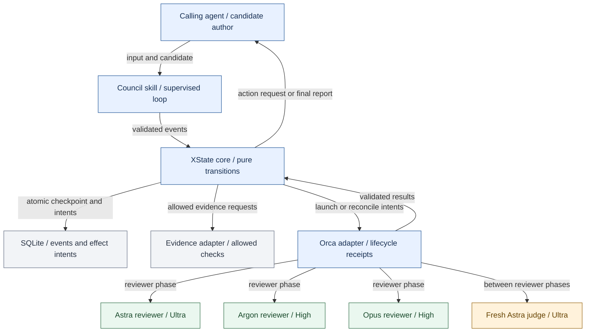

# The Council: nodes and states

Implementation planning diagrams for the approved Council design. They show proposed software, not a deployed system.

## Council component nodes

The calling agent authors candidates. The state machine selects transitions. Orca owns worker lifecycle.

<!-- mermaid:id=components -->

## Council control states

New runs start at preflight. Restored runs enter reconciling. Every decision outcome requires resource settlement.

```mermaid
stateDiagram-v2
  accTitle: Council control states
  accDescr: The workflow collects three reviews, freezes a candidate, obtains a fresh judge report, and collects three final responses. Unanimous acceptance completes the run. The third unresolved round returns to the user.
  state "preflight" as preflight
  state "needs_context" as needs_context
  state "prepare_round" as prepare_round
  state "reviewing" as reviewing
  state "prepare_candidate" as prepare_candidate
  state "judging" as judging
  state "confirming" as confirming
  state "evaluate_round" as evaluate_round
  state "settling" as settling
  state "completed" as completed
  state "needs_user" as needs_user
  state "blocked" as blocked
  state "cancelled" as cancelled
  state "reconciling" as reconciling
  [*] --> preflight
  preflight --> needs_context: missing input
  needs_context --> preflight: context supplied
  preflight --> blocked: policy or route gap
  preflight --> prepare_round: checks pass
  prepare_round --> reviewing: admit round and launch three
  reviewing --> prepare_candidate: three reviews settled
  reviewing --> settling: same missing input / needs_user
  prepare_candidate --> judging: candidate frozen
  judging --> confirming: judge report and exit verified
  confirming --> evaluate_round: three final responses settled
  evaluate_round --> prepare_round: disagreement and rounds remain
  evaluate_round --> settling: unanimous or round limit
  settling --> completed: consensus&#59; all resources settled
  settling --> needs_user: unresolved&#59; all resources settled
  settling --> blocked: operational gap&#59; settled
  settling --> cancelled: cancel requested&#59; settled
  settling --> reconciling: lifecycle unknown
  reconciling --> settling: exit and ownership established
  needs_user --> preflight: new input and rounds authorized
  blocked --> preflight: specific remedy authorized
%% portable-canonical-v2:eyJhY2Nlc3NpYmlsaXR5IjoiVGhlIHdvcmtmbG93IGNvbGxlY3RzIHRocmVlIHJldmlld3MsIGZyZWV6ZXMgYSBjYW5kaWRhdGUsIG9idGFpbnMgYSBmcmVzaCBqdWRnZSByZXBvcnQsIGFuZCBjb2xsZWN0cyB0aHJlZSBmaW5hbCByZXNwb25zZXMuIFVuYW5pbW91cyBhY2NlcHRhbmNlIGNvbXBsZXRlcyB0aGUgcnVuLiBUaGUgdGhpcmQgdW5yZXNvbHZlZCByb3VuZCByZXR1cm5zIHRvIHRoZSB1c2VyLiIsImRhdGEiOnsiaW5pdGlhbCI6InByZWZsaWdodCIsInN0YXRlcyI6W3siaWQiOiJwcmVmbGlnaHQiLCJsYWJlbCI6InByZWZsaWdodCJ9LHsiaWQiOiJuZWVkc19jb250ZXh0IiwibGFiZWwiOiJuZWVkc19jb250ZXh0In0seyJpZCI6InByZXBhcmVfcm91bmQiLCJsYWJlbCI6InByZXBhcmVfcm91bmQifSx7ImlkIjoicmV2aWV3aW5nIiwibGFiZWwiOiJyZXZpZXdpbmcifSx7ImlkIjoicHJlcGFyZV9jYW5kaWRhdGUiLCJsYWJlbCI6InByZXBhcmVfY2FuZGlkYXRlIn0seyJpZCI6Imp1ZGdpbmciLCJsYWJlbCI6Imp1ZGdpbmcifSx7ImlkIjoiY29uZmlybWluZyIsImxhYmVsIjoiY29uZmlybWluZyJ9LHsiaWQiOiJldmFsdWF0ZV9yb3VuZCIsImxhYmVsIjoiZXZhbHVhdGVfcm91bmQifSx7ImlkIjoic2V0dGxpbmciLCJsYWJlbCI6InNldHRsaW5nIn0seyJpZCI6ImNvbXBsZXRlZCIsImxhYmVsIjoiY29tcGxldGVkIn0seyJpZCI6Im5lZWRzX3VzZXIiLCJsYWJlbCI6Im5lZWRzX3VzZXIifSx7ImlkIjoiYmxvY2tlZCIsImxhYmVsIjoiYmxvY2tlZCJ9LHsiaWQiOiJjYW5jZWxsZWQiLCJsYWJlbCI6ImNhbmNlbGxlZCJ9LHsiaWQiOiJyZWNvbmNpbGluZyIsImxhYmVsIjoicmVjb25jaWxpbmcifV0sInRyYW5zaXRpb25zIjpbeyJmcm9tIjoicHJlZmxpZ2h0IiwibGFiZWwiOiJtaXNzaW5nIGlucHV0IiwidG8iOiJuZWVkc19jb250ZXh0In0seyJmcm9tIjoibmVlZHNfY29udGV4dCIsImxhYmVsIjoiY29udGV4dCBzdXBwbGllZCIsInRvIjoicHJlZmxpZ2h0In0seyJmcm9tIjoicHJlZmxpZ2h0IiwibGFiZWwiOiJwb2xpY3kgb3Igcm91dGUgZ2FwIiwidG8iOiJibG9ja2VkIn0seyJmcm9tIjoicHJlZmxpZ2h0IiwibGFiZWwiOiJjaGVja3MgcGFzcyIsInRvIjoicHJlcGFyZV9yb3VuZCJ9LHsiZnJvbSI6InByZXBhcmVfcm91bmQiLCJsYWJlbCI6ImFkbWl0IHJvdW5kIGFuZCBsYXVuY2ggdGhyZWUiLCJ0byI6InJldmlld2luZyJ9LHsiZnJvbSI6InJldmlld2luZyIsImxhYmVsIjoidGhyZWUgcmV2aWV3cyBzZXR0bGVkIiwidG8iOiJwcmVwYXJlX2NhbmRpZGF0ZSJ9LHsiZnJvbSI6InJldmlld2luZyIsImxhYmVsIjoic2FtZSBtaXNzaW5nIGlucHV0IC8gbmVlZHNfdXNlciIsInRvIjoic2V0dGxpbmcifSx7ImZyb20iOiJwcmVwYXJlX2NhbmRpZGF0ZSIsImxhYmVsIjoiY2FuZGlkYXRlIGZyb3plbiIsInRvIjoianVkZ2luZyJ9LHsiZnJvbSI6Imp1ZGdpbmciLCJsYWJlbCI6Imp1ZGdlIHJlcG9ydCBhbmQgZXhpdCB2ZXJpZmllZCIsInRvIjoiY29uZmlybWluZyJ9LHsiZnJvbSI6ImNvbmZpcm1pbmciLCJsYWJlbCI6InRocmVlIGZpbmFsIHJlc3BvbnNlcyBzZXR0bGVkIiwidG8iOiJldmFsdWF0ZV9yb3VuZCJ9LHsiZnJvbSI6ImV2YWx1YXRlX3JvdW5kIiwibGFiZWwiOiJkaXNhZ3JlZW1lbnQgYW5kIHJvdW5kcyByZW1haW4iLCJ0byI6InByZXBhcmVfcm91bmQifSx7ImZyb20iOiJldmFsdWF0ZV9yb3VuZCIsImxhYmVsIjoidW5hbmltb3VzIG9yIHJvdW5kIGxpbWl0IiwidG8iOiJzZXR0bGluZyJ9LHsiZnJvbSI6InNldHRsaW5nIiwibGFiZWwiOiJjb25zZW5zdXM7IGFsbCByZXNvdXJjZXMgc2V0dGxlZCIsInRvIjoiY29tcGxldGVkIn0seyJmcm9tIjoic2V0dGxpbmciLCJsYWJlbCI6InVucmVzb2x2ZWQ7IGFsbCByZXNvdXJjZXMgc2V0dGxlZCIsInRvIjoibmVlZHNfdXNlciJ9LHsiZnJvbSI6InNldHRsaW5nIiwibGFiZWwiOiJvcGVyYXRpb25hbCBnYXA7IHNldHRsZWQiLCJ0byI6ImJsb2NrZWQifSx7ImZyb20iOiJzZXR0bGluZyIsImxhYmVsIjoiY2FuY2VsIHJlcXVlc3RlZDsgc2V0dGxlZCIsInRvIjoiY2FuY2VsbGVkIn0seyJmcm9tIjoic2V0dGxpbmciLCJsYWJlbCI6ImxpZmVjeWNsZSB1bmtub3duIiwidG8iOiJyZWNvbmNpbGluZyJ9LHsiZnJvbSI6InJlY29uY2lsaW5nIiwibGFiZWwiOiJleGl0IGFuZCBvd25lcnNoaXAgZXN0YWJsaXNoZWQiLCJ0byI6InNldHRsaW5nIn0seyJmcm9tIjoibmVlZHNfdXNlciIsImxhYmVsIjoibmV3IGlucHV0IGFuZCByb3VuZHMgYXV0aG9yaXplZCIsInRvIjoicHJlZmxpZ2h0In0seyJmcm9tIjoiYmxvY2tlZCIsImxhYmVsIjoic3BlY2lmaWMgcmVtZWR5IGF1dGhvcml6ZWQiLCJ0byI6InByZWZsaWdodCJ9XX0sImRlc2NyaXB0aW9uIjoiTmV3IHJ1bnMgc3RhcnQgYXQgcHJlZmxpZ2h0LiBSZXN0b3JlZCBydW5zIGVudGVyIHJlY29uY2lsaW5nLiBFdmVyeSBkZWNpc2lvbiBvdXRjb21lIHJlcXVpcmVzIHJlc291cmNlIHNldHRsZW1lbnQuIiwiaWQiOiJzdGF0ZXMiLCJraW5kIjoic3RhdGUiLCJzb3VyY2VTaGEyNTYiOiIwYzhiYjQ0NDc1MjMwYjBkM2U0ZWJlZjhhZGVlOTQyN2I1M2Y3ODQ0NmI5MDMzYTY2YzBjOTg0NDNjNGJhZGM3Iiwic3R5bGVzIjpbXSwidGl0bGUiOiJDb3VuY2lsIGNvbnRyb2wgc3RhdGVzIiwidmVyc2lvbiI6MX0
```

<!-- mermaid:id=states -->

## Global cancellation and recovery

This view summarizes transitions that apply to every active phase. It does not introduce another model role.

```mermaid
flowchart TB
  active["Any active phase"]
  class active coord
  settling["settling / stop owned work"]
  class settling coord
  reconciling["reconciling / inspect ownership"]
  class reconciling store
  live["Same attempt proved live"]
  class live reviewer
  unknown["Unknown / keep state unknown"]
  class unknown judge
  exit["Exit proved / safe cleanup"]
  class exit reviewer
  outcome["Publish recorded outcome"]
  class outcome store
  restore["Restart / persisted checkpoint"]
  class restore store
  active -->|error, cancellation, or deadline| settling
  settling -->|missing exit proof| reconciling
  restore -->|no blind re-launch| reconciling
  reconciling -->|positive liveness| live
  live -->|reconnect&#59; preserve attempt| active
  reconciling -->|insufficient evidence| unknown
  unknown -->|observe again| reconciling
  reconciling -->|positive exit evidence| exit
  exit -->|settle and release| settling
  settling -->|all owned resources settled| outcome
classDef coord fill:#e8f1ff,stroke:#285b9a,color:#172f52
classDef store fill:#f2f4f7,stroke:#667085,color:#273142
classDef reviewer fill:#eaf7ef,stroke:#35724c,color:#194a2b
classDef judge fill:#fff2db,stroke:#9a6a17,color:#664300
%% portable-canonical-v2:eyJhY2Nlc3NpYmlsaXR5IjpudWxsLCJkYXRhIjp7ImRpcmVjdGlvbiI6IlRCIiwiZWRnZXMiOlt7ImZyb20iOiJhY3RpdmUiLCJsYWJlbCI6ImVycm9yLCBjYW5jZWxsYXRpb24sIG9yIGRlYWRsaW5lIiwidG8iOiJzZXR0bGluZyJ9LHsiZnJvbSI6InNldHRsaW5nIiwibGFiZWwiOiJtaXNzaW5nIGV4aXQgcHJvb2YiLCJ0byI6InJlY29uY2lsaW5nIn0seyJmcm9tIjoicmVzdG9yZSIsImxhYmVsIjoibm8gYmxpbmQgcmUtbGF1bmNoIiwidG8iOiJyZWNvbmNpbGluZyJ9LHsiZnJvbSI6InJlY29uY2lsaW5nIiwibGFiZWwiOiJwb3NpdGl2ZSBsaXZlbmVzcyIsInRvIjoibGl2ZSJ9LHsiZnJvbSI6ImxpdmUiLCJsYWJlbCI6InJlY29ubmVjdDsgcHJlc2VydmUgYXR0ZW1wdCIsInRvIjoiYWN0aXZlIn0seyJmcm9tIjoicmVjb25jaWxpbmciLCJsYWJlbCI6Imluc3VmZmljaWVudCBldmlkZW5jZSIsInRvIjoidW5rbm93biJ9LHsiZnJvbSI6InVua25vd24iLCJsYWJlbCI6Im9ic2VydmUgYWdhaW4iLCJ0byI6InJlY29uY2lsaW5nIn0seyJmcm9tIjoicmVjb25jaWxpbmciLCJsYWJlbCI6InBvc2l0aXZlIGV4aXQgZXZpZGVuY2UiLCJ0byI6ImV4aXQifSx7ImZyb20iOiJleGl0IiwibGFiZWwiOiJzZXR0bGUgYW5kIHJlbGVhc2UiLCJ0byI6InNldHRsaW5nIn0seyJmcm9tIjoic2V0dGxpbmciLCJsYWJlbCI6ImFsbCBvd25lZCByZXNvdXJjZXMgc2V0dGxlZCIsInRvIjoib3V0Y29tZSJ9XSwibm9kZXMiOlt7ImNsYXNzIjoiY29vcmQiLCJpZCI6ImFjdGl2ZSIsImxhYmVsIjoiQW55IGFjdGl2ZSBwaGFzZSJ9LHsiY2xhc3MiOiJjb29yZCIsImlkIjoic2V0dGxpbmciLCJsYWJlbCI6InNldHRsaW5nIC8gc3RvcCBvd25lZCB3b3JrIn0seyJjbGFzcyI6InN0b3JlIiwiaWQiOiJyZWNvbmNpbGluZyIsImxhYmVsIjoicmVjb25jaWxpbmcgLyBpbnNwZWN0IG93bmVyc2hpcCJ9LHsiY2xhc3MiOiJyZXZpZXdlciIsImlkIjoibGl2ZSIsImxhYmVsIjoiU2FtZSBhdHRlbXB0IHByb3ZlZCBsaXZlIn0seyJjbGFzcyI6Imp1ZGdlIiwiaWQiOiJ1bmtub3duIiwibGFiZWwiOiJVbmtub3duIC8ga2VlcCBzdGF0ZSB1bmtub3duIn0seyJjbGFzcyI6InJldmlld2VyIiwiaWQiOiJleGl0IiwibGFiZWwiOiJFeGl0IHByb3ZlZCAvIHNhZmUgY2xlYW51cCJ9LHsiY2xhc3MiOiJzdG9yZSIsImlkIjoib3V0Y29tZSIsImxhYmVsIjoiUHVibGlzaCByZWNvcmRlZCBvdXRjb21lIn0seyJjbGFzcyI6InN0b3JlIiwiaWQiOiJyZXN0b3JlIiwibGFiZWwiOiJSZXN0YXJ0IC8gcGVyc2lzdGVkIGNoZWNrcG9pbnQifV19LCJkZXNjcmlwdGlvbiI6IlRoaXMgdmlldyBzdW1tYXJpemVzIHRyYW5zaXRpb25zIHRoYXQgYXBwbHkgdG8gZXZlcnkgYWN0aXZlIHBoYXNlLiBJdCBkb2VzIG5vdCBpbnRyb2R1Y2UgYW5vdGhlciBtb2RlbCByb2xlLiIsImlkIjoicmVjb3ZlcnkiLCJraW5kIjoiZmxvd2NoYXJ0Iiwic291cmNlU2hhMjU2IjoiNWQzOWI2OGQ3NDNiMDE1YTc3MTVlZjNlMzA4ZTkwYTRjZjM1NDExOWVkOTY3YTRmN2JkNWY5NDQ1Njk3Y2QwZCIsInN0eWxlcyI6W3siZGVmaW5pdGlvbiI6ImZpbGw6I2U4ZjFmZixzdHJva2U6IzI4NWI5YSxjb2xvcjojMTcyZjUyIiwibmFtZSI6ImNvb3JkIn0seyJkZWZpbml0aW9uIjoiZmlsbDojZjJmNGY3LHN0cm9rZTojNjY3MDg1LGNvbG9yOiMyNzMxNDIiLCJuYW1lIjoic3RvcmUifSx7ImRlZmluaXRpb24iOiJmaWxsOiNlYWY3ZWYsc3Ryb2tlOiMzNTcyNGMsY29sb3I6IzE5NGEyYiIsIm5hbWUiOiJyZXZpZXdlciJ9LHsiZGVmaW5pdGlvbiI6ImZpbGw6I2ZmZjJkYixzdHJva2U6IzlhNmExNyxjb2xvcjojNjY0MzAwIiwibmFtZSI6Imp1ZGdlIn1dLCJ0aXRsZSI6Ikdsb2JhbCBjYW5jZWxsYXRpb24gYW5kIHJlY292ZXJ5IiwidmVyc2lvbiI6MX0
```

<!-- mermaid:id=recovery -->

