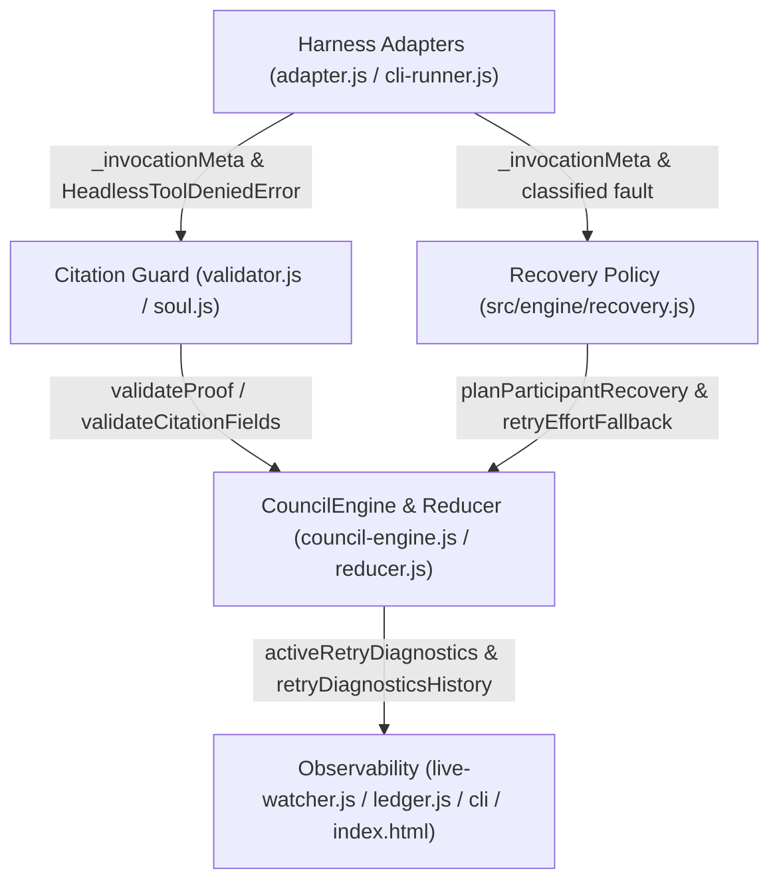

# Issue #102 Live Workspace Resilience, Self-Contained Recovery & Retry Attribution Implementation Plan

> **For agentic workers:** REQUIRED SUB-SKILL: Use superpowers:subagent-driven-development to implement this plan task-by-task. Steps use checkbox (`- [ ]`) syntax for tracking.

**Goal:** Eliminate silent headless tool denials, PID-collision false provider faults, ephemeral workspace leaks, and evidence-blind tool-free fallbacks while adding opt-in bounded retry effort fallback (`--retry-effort-fallback`) and end-to-end retry attribution across telemetry, CLI, and live replay.

**Architecture:** The design centralizes every recovery/termination decision in a pure policy module ([`src/engine/recovery.js`](file:///Users/aaat/projects/the-council/src/engine/recovery.js)) parameterized by adapter-captured invocation context (`_invocationMeta`) and explicit opt-in config (`selfContainedInput`, `retryEffortFallback`), paired with portable citation normalization in [`src/proofs/validator.js`](file:///Users/aaat/projects/the-council/src/proofs/validator.js), structured Antigravity denial/error parsing in [`src/harness/cli-runner.js`](file:///Users/aaat/projects/the-council/src/harness/cli-runner.js), and lossless sparse replay deltas in [`src/visualizer/live-watcher.js`](file:///Users/aaat/projects/the-council/src/visualizer/live-watcher.js). Full rationale and invariants live in the [Issue #102 Design Spec](file:///Users/aaat/projects/the-council/docs/superpowers/specs/2026-11-13-issue-102-live-cwd-resilience-design.md).

**Architecture Diagram:**



**Tech Stack:** Node.js ESM (`>=22`), zero external runtime dependencies, built-in `node:test` and `node:assert/strict`.

## Global Constraints

- **Zero Claude models anywhere:** Never dispatch Claude models in live verification, subagents, or cross-family reviews; use Gemini (`gemini-4-argon`, `gemini-4-carbon`), Codex (`gpt-6.1-sol`, `gpt-6-astra`), or Cursor (`composer-2.5`, `grok-4.7`).
- **Preserve unrelated workspace state:** Leave unstaged `M configs/best-of-families.json` untouched; use explicit `git add <file>` paths on every commit (never `git add .` or `git add -A`).
- **Preserve prior issue contracts:** Maintain Issue `#90` (strict JSON output contracts, zero shell/MCP prose scraping), Issue `#95` (roster-ordered pre-collapse proof/vote preservation and terminal `'thinking'` settlement), Issue `#96` (isolated `.council`-free relative-`.` prompt guarantees), and Issue `#97` (`cli-runner.js` child-process tracking and visualizer UX).
- **Deterministic ESM module graph:** Keep `src/harness/cli-runner.js` independent of `src/harness/adapter.js` (`adapter.js` re-exports from `cli-runner.js`) to prevent circular ESM initialization hazards.

---

### Task 1: Harness Workspace Resolution, PID-Safe Provider Errors, Ephemeral Copy Hygiene & Antigravity Denial Envelopes

**Files:**
- Modify: `src/types.js:178-305` (add `'HeadlessToolDeniedError'` to `ErrorClass`, plus `retryEffortFallback` and `selfContainedInput` on `CouncilConfig`)
- Modify: `src/harness/cli-runner.js:3357-3399,3820-4406`
- Modify: `src/harness/adapter.js:1-165,490-650`
- Modify: `src/harness/index.js` (re-export `HeadlessToolDeniedError`, `PROVIDER_HTTP_429_REGEX`, `PROVIDER_HTTP_AUTH_REGEX`, `resolveAttemptExecutionWorkspace`)
- Modify: `src/index.js` (re-export `HeadlessToolDeniedError`)
- Modify: `src/harness/antigravity.js:65-88,125-186,230-286`
- Modify: `src/harness/codex.js:70-95,135-199,248-306`
- Modify: `src/harness/cursor.js:60-85,123-184,232-287`
- Modify: `src/harness/mock.js:165-218,275-315`
- Create: `test/unit/issue-102-harness-workspace-and-denial.test.js`

**Interfaces:**
- Consumes: Adapter invocation arguments (`role`, `phase`, `participant`, `state`, `tools`, `cwd`, `callerContext`, `adapter`).
- Produces:
  - `PROVIDER_HTTP_429_REGEX`, `PROVIDER_HTTP_AUTH_REGEX` (defined in `src/harness/cli-runner.js`, re-exported from `src/harness/adapter.js` and `src/harness/index.js`).
  - `HeadlessToolDeniedError` (exported from `src/harness/adapter.js`, `src/harness/index.js`, and `src/index.js`; created in `cli-runner.js` via `createHeadlessToolDeniedError` with `.code === 'HEADLESS_TOOL_DENIED'` and wrapped by `HarnessAdapter.prototype.classifyError` / `AntigravityAdapter.prototype.classifyError`).
  - `resolveAttemptExecutionWorkspace({ role, phase, participant, state, tools, cwd, callerContext, adapter })` exported from `src/harness/adapter.js` and `src/harness/index.js`.
  - `stripKnownBenignAntigravityWarning(stderr)`, `hasExplicitProviderErrorSignature(text)`, and `listAntigravityModels(options)` exported from `src/harness/cli-runner.js`.
  - `context._invocationMeta` (`{ effectiveTools, configuredWorkspaceCwd, effectiveCwd, trustedEphemeralRoots?, forbiddenWorkspaceRoots? }`).

- [ ] **Step 1: Write the failing test**

Create `test/unit/issue-102-harness-workspace-and-denial.test.js`:

```javascript
import { describe, it } from 'node:test';
import assert from 'node:assert/strict';
import fs from 'node:fs';
import os from 'node:os';
import path from 'node:path';
import { HeadlessToolDeniedError as RootHeadlessToolDeniedError } from '../../src/index.js';
import { HeadlessToolDeniedError as HarnessIndexHeadlessToolDeniedError } from '../../src/harness/index.js';
import {
  PROVIDER_HTTP_429_REGEX,
  PROVIDER_HTTP_AUTH_REGEX,
  HeadlessToolDeniedError,
  QuotaExhaustionError,
  HarnessExecutionError,
  InvalidResponseError,
  resolveAttemptExecutionWorkspace
} from '../../src/harness/adapter.js';
import {
  prepareIsolatedCliWorkspace,
  runAntigravityCli,
  stripKnownBenignAntigravityWarning,
  hasExplicitProviderErrorSignature,
  listAntigravityModels,
  normalizeProviderTrace
} from '../../src/harness/cli-runner.js';
import { AntigravityAdapter } from '../../src/harness/antigravity.js';
import { CodexAdapter } from '../../src/harness/codex.js';
import { CursorAdapter } from '../../src/harness/cursor.js';

describe('Issue #102 Task 1: Workspace resolution, PID-safe errors, ephemeral copy hygiene & Antigravity denial envelopes', () => {
  it('exports HeadlessToolDeniedError across adapter.js, harness/index.js, and src/index.js', () => {
    assert.equal(RootHeadlessToolDeniedError, HeadlessToolDeniedError);
    assert.equal(HarnessIndexHeadlessToolDeniedError, HeadlessToolDeniedError);
  });

  it('resolves effectiveTools and effectiveCwd identically to adapter precedence, including adapter.cwd and empty seat/state cwd', () => {
    const adapterWithDirectCwd = { cwd: '/repo/direct-adapter', config: { cwd: '/repo/config-adapter' } };
    const resAdapterCwd = resolveAttemptExecutionWorkspace({
      role: 'seat',
      phase: 'DELIBERATION',
      participant: { id: 's1', cwd: '' },
      state: { cwd: '   ' },
      adapter: adapterWithDirectCwd
    });
    assert.deepEqual(resAdapterCwd, {
      effectiveTools: 'read-only',
      configuredWorkspaceCwd: '/repo/direct-adapter',
      effectiveCwd: '/repo/direct-adapter'
    });

    const adapter = { config: { cwd: '/repo/adapter' } };
    const resNone = resolveAttemptExecutionWorkspace({
      role: 'seat',
      phase: 'VOTING',
      participant: { id: 's1', votingTools: 'read-only', cwd: '/repo/seat' },
      state: { cwd: '/repo/state' },
      tools: 'none',
      cwd: '/repo/call',
      callerContext: {},
      adapter
    });
    assert.deepEqual(resNone, {
      effectiveTools: 'none',
      configuredWorkspaceCwd: '/repo/call',
      effectiveCwd: undefined
    });

    const resSeatVoting = resolveAttemptExecutionWorkspace({
      role: 'seat',
      phase: 'VOTING',
      participant: { id: 's1', tools: 'none', votingTools: 'read-only', cwd: '  ' },
      state: { cwd: '/repo/state' },
      adapter
    });
    assert.deepEqual(resSeatVoting, {
      effectiveTools: 'read-only',
      configuredWorkspaceCwd: '/repo/state',
      effectiveCwd: '/repo/state'
    });

    const resJudge = resolveAttemptExecutionWorkspace({
      role: 'judge',
      phase: 'JUDGE_AUDIT_SYNTHESIS',
      participant: { id: 'j1', cwd: ' /repo/judge ' },
      state: { cwd: '/repo/state' },
      adapter
    });
    assert.deepEqual(resJudge, {
      effectiveTools: 'read-only',
      configuredWorkspaceCwd: '/repo/judge',
      effectiveCwd: '/repo/judge'
    });
  });

  it('rejects bare node PID warnings (429, 401, 403) while matching explicit provider HTTP/status context across adapters', () => {
    for (const pid of [429, 401, 403]) {
      const warning = `(node:${pid}) ExperimentalWarning: Example harmless warning`;
      assert.equal(PROVIDER_HTTP_429_REGEX.test(warning), false, `429 regex false positive on PID ${pid}`);
      assert.equal(PROVIDER_HTTP_AUTH_REGEX.test(warning), false, `auth regex false positive on PID ${pid}`);
      assert.equal(hasExplicitProviderErrorSignature(warning), false, `provider error false positive on PID ${pid}`);
    }

    assert.equal(PROVIDER_HTTP_429_REGEX.test('HTTP 429 Too Many Requests from upstream'), true);
    assert.equal(PROVIDER_HTTP_429_REGEX.test('status=429 rate_limit'), true);
    assert.equal(PROVIDER_HTTP_AUTH_REGEX.test('HTTP 401 Unauthorized: invalid token'), true);
    assert.equal(PROVIDER_HTTP_AUTH_REGEX.test('status: 403 Forbidden'), true);
    assert.equal(hasExplicitProviderErrorSignature('Notice: forbidden characters in filename'), false);

    for (const AdapterClass of [AntigravityAdapter, CodexAdapter, CursorAdapter]) {
      const adapter = new AdapterClass();
      const classified = adapter.classifyError(new Error('(node:429) ExperimentalWarning: sqlite warning'), {
        seatId: 's1',
        model: 'test-model'
      });
      assert.equal(classified instanceof QuotaExhaustionError, false, `${AdapterClass.name} must not map node:429 warning to QuotaExhaustionError`);
      assert.equal(classified instanceof HarnessExecutionError, true);
    }
  });

  it('excludes .codegraph and .council recursively and via symlinks, canonicalizes realpathSync, and sets isolated root metadata only for temp copies', async () => {
    const tmpParent = fs.mkdtempSync(path.join(os.tmpdir(), 'council-102-hygiene-'));
    const repoDir = path.join(tmpParent, 'repo');
    const externalSecret = path.join(tmpParent, 'external-council');
    fs.mkdirSync(path.join(repoDir, '.council'), { recursive: true });
    fs.mkdirSync(path.join(repoDir, '.codegraph'), { recursive: true });
    fs.mkdirSync(path.join(repoDir, 'packages', 'sub', '.CodeGraph'), { recursive: true });
    fs.mkdirSync(path.join(repoDir, 'src'), { recursive: true });
    fs.mkdirSync(externalSecret, { recursive: true });
    fs.writeFileSync(path.join(repoDir, '.council', 'secret.json'), '{}');
    fs.writeFileSync(path.join(repoDir, '.codegraph', 'graph.db'), 'binary');
    fs.writeFileSync(path.join(repoDir, 'packages', 'sub', '.CodeGraph', 'index.json'), '{}');
    fs.writeFileSync(path.join(repoDir, 'src', 'index.js'), 'export const ok = true;\n');
    fs.writeFileSync(path.join(externalSecret, 'leak.txt'), 'secret');
    fs.symlinkSync(externalSecret, path.join(repoDir, '.council-link'));

    try {
      const ctx = { _invocationMeta: {} };
      const isolated = await prepareIsolatedCliWorkspace(repoDir, ctx);
      try {
        assert.equal(isolated.isolated, true);
        assert.equal(isolated.effectiveCwd, fs.realpathSync(isolated.effectiveCwd));
        assert.equal(isolated.env.PWD, isolated.effectiveCwd);
        assert.equal(fs.existsSync(path.join(isolated.effectiveCwd, '.council')), false);
        assert.equal(fs.existsSync(path.join(isolated.effectiveCwd, '.codegraph')), false);
        assert.equal(fs.existsSync(path.join(isolated.effectiveCwd, 'packages', 'sub', '.CodeGraph')), false);
        assert.equal(fs.existsSync(path.join(isolated.effectiveCwd, 'src', 'index.js')), true);
        assert.ok(ctx._invocationMeta.trustedEphemeralRoots.includes(isolated.effectiveCwd));
        assert.ok(ctx._invocationMeta.forbiddenWorkspaceRoots.includes(path.resolve(repoDir)));
        assert.ok(ctx._invocationMeta.forbiddenWorkspaceRoots.includes(fs.realpathSync(repoDir)));
      } finally {
        await isolated.cleanup();
      }

      const cleanDir = path.join(tmpParent, 'clean-repo');
      fs.mkdirSync(cleanDir, { recursive: true });
      const ctxClean = { _invocationMeta: {} };
      const inPlace = await prepareIsolatedCliWorkspace(cleanDir, ctxClean);
      assert.equal(inPlace.isolated, false);
      assert.equal(inPlace.effectiveCwd, fs.realpathSync(cleanDir));
      assert.equal(ctxClean._invocationMeta.trustedEphemeralRoots, undefined);
      await inPlace.cleanup();

      const missingDir = path.join(tmpParent, 'does-not-exist-yet');
      const ctxMissing = { _invocationMeta: {} };
      const missingRes = await prepareIsolatedCliWorkspace(missingDir, ctxMissing);
      assert.equal(missingRes.isolated, false);
      assert.equal(missingRes.effectiveCwd, path.resolve(missingDir));
      await missingRes.cleanup();
    } finally {
      fs.rmSync(tmpParent, { recursive: true, force: true });
    }
  });

  it('strips only exact --mode plan warning line and enforces exact exitCode 0 precedence including empty-response PID warnings', async () => {
    const cleaned = stripKnownBenignAntigravityWarning(
      'warning: --mode plan has no effect while slash command expansion is disabled.\nOther error line\n'
    );
    assert.equal(cleaned, 'Other error line');

    // 1. Primary output + deniedActions => succeeds without throwing (#97 preserved)
    const okWithDenied = await runAntigravityCli(
      'Return JSON',
      { cwd: process.cwd(), model: 'gemini-4-argon-low' },
      {
        runner: async () => ({
          exitCode: 0,
          stdout: JSON.stringify({
            response: '{"ok":true}',
            denied_actions: [{ tool: 'read_file', reason: 'outside root' }],
            finished_reason: 'STOP'
          }),
          stderr: 'warning: --mode plan has no effect while slash command expansion is disabled.\n'
        })
      }
    );
    assert.equal(okWithDenied.output, '{"ok":true}');
    assert.equal(okWithDenied.trace.deniedActions.length, 1);

    // 2. Empty primary output + denied_actions + exitCode 0 => HeadlessToolDeniedError preserving exitCode: 0 & sanitized stderr
    await assert.rejects(
      () => runAntigravityCli(
        'Return JSON',
        { cwd: process.cwd(), model: 'gemini-4-argon-low' },
        {
          runner: async () => ({
            exitCode: 0,
            stdout: JSON.stringify({
              response: '',
              denied_actions: [{ tool: 'list_dir', path: 'src', reason: 'Permission denied' }],
              finished_reason: 'STOP'
            }),
            stderr: 'warning: --mode plan has no effect while slash command expansion is disabled.\nHeadless denial detail\n'
          })
        }
      ),
      (err) => {
        assert.equal(err.code, 'HEADLESS_TOOL_DENIED');
        assert.equal(err.exitCode, 0);
        assert.ok(Array.isArray(err.deniedActions) && err.deniedActions.length === 1);
        assert.ok(!err.stderr.includes('--mode plan has no effect'));
        assert.ok(err.stderr.includes('Headless denial detail'));
        return true;
      }
    );

    // 3. Empty primary output + harmless (node:429)/(node:401)/(node:403) warnings + exitCode 0 => returns "" cleanly (becomes InvalidResponseError downstream)
    for (const pid of [429, 401, 403]) {
      const adapter = new AntigravityAdapter({
        cliRunner: async () => ({
          output: '',
          trace: normalizeProviderTrace({
            durationMs: 100,
            outcome: 'error',
            stderr: `(node:${pid}) ExperimentalWarning: Example harmless warning`
          })
        })
      });
      const resEmpty = await runAntigravityCli(
        'Return JSON',
        { cwd: process.cwd(), model: 'gemini-4-argon-low' },
        {
          runner: async () => ({
            exitCode: 0,
            stdout: JSON.stringify({ response: '' }),
            stderr: `(node:${pid}) ExperimentalWarning: Example harmless warning\n`
          })
        }
      );
      assert.equal(resEmpty.output, '');
      assert.match(resEmpty.trace.stderr, new RegExp(`node:${pid}`));
      await assert.rejects(
        () => adapter.executeSeat({ seat: { id: 's1', model: 'gemini-4-argon-low' }, topic: 'T' }),
        (err) => err instanceof InvalidResponseError
      );
    }

    // 4. Adapter classifyError preserves HeadlessToolDeniedError with exitCode: 0, trace, and retryable flag
    const adapter = new AntigravityAdapter();
    const classified = adapter.classifyError(
      Object.assign(new Error('denied'), {
        code: 'HEADLESS_TOOL_DENIED',
        exitCode: 0,
        deniedActions: [{ tool: 'grep_search', reason: 'blocked in headless' }],
        trace: normalizeProviderTrace({ durationMs: 1200, deniedActions: [{ tool: 'grep_search' }] })
      }),
      { seatId: 's1', model: 'gemini-4-argon-low' }
    );
    assert.equal(classified instanceof HeadlessToolDeniedError, true);
    assert.equal(classified.isRetryable, true);
    assert.equal(classified.exitCode, 0);
    assert.equal(classified.deniedActions.length, 1);

    // 5. Empty output + exitCode 0 + explicit 429 in envelope/stderr => throws with quota signature
    await assert.rejects(
      () => runAntigravityCli(
        'Return JSON',
        { cwd: process.cwd(), model: 'gemini-4-argon-low' },
        {
          runner: async () => ({
            exitCode: 0,
            stdout: JSON.stringify({ response: '', error: { code: 429, message: 'RESOURCE_EXHAUSTED: HTTP 429 quota reached' } }),
            stderr: ''
          })
        }
      ),
      (err) => /429|RESOURCE_EXHAUSTED/i.test(err.message)
    );
  });

  it('parses agy models output by stripping carriage-return spinner frames', async () => {
    const rawCatalog = [
      '\r⠋ Fetching available models...\r⠙ Fetching available models...\r                      \rAVAILABLE MODELS:',
      '  gemini-4-argon-high    Gemini 4 Argon (High)',
      '  gemini-4-argon-medium  Gemini 4 Argon (Medium)',
      '  gemini-4-argon-low     Gemini 4 Argon (Low)',
      '  claude-sonnet-5-5-medium Claude Sonnet 5.5 (Medium)'
    ].join('\n');

    const res = await listAntigravityModels({
      runner: async () => ({ exitCode: 0, stdout: rawCatalog, stderr: '' })
    });
    assert.equal(res.ok, true);
    assert.ok(res.selectors.includes('gemini-4-argon-medium'));
    assert.ok(res.selectors.includes('gemini-4-argon-low'));
  });
});
```

- [ ] **Step 2: Run test to verify it fails**

Run: `node --test test/unit/issue-102-harness-workspace-and-denial.test.js`
Expected: FAIL (`SyntaxError` / missing exports).

- [ ] **Step 3: Implement updates in `src/types.js`, `cli-runner.js`, `adapter.js`, `harness/index.js`, `src/index.js`, and all adapters**

1. Update `src/types.js`:
   - Add `'HeadlessToolDeniedError'` to `ErrorClass`.
   - Add optional `retryEffortFallback` (`boolean`) and `selfContainedInput` (`Object`) to `CouncilConfig`.

2. Update `src/harness/cli-runner.js`:
   - Export Spec §3's exact PID-safe matchers and Antigravity helpers:
     ```javascript
     export const PROVIDER_HTTP_429_REGEX =
       /(?:\bhttp(?:\/\d(?:\.\d)?)?\s*429\b|\b(?:status(?:\s*code)?|error(?:\s*code)?|response(?:\s*code)?)\s*[:=]?\s*429\b|"status"\s*:\s*429\b|"code"\s*:\s*429\b|\b429\s+(?:too\s+many\s+requests|resource[\s_-]*exhausted|rate[\s_-]*limit))/i;

     export const PROVIDER_HTTP_AUTH_REGEX =
       /(?:\bhttp(?:\/\d(?:\.\d)?)?\s*(?:401|403)\b|\b(?:status(?:\s*code)?|error(?:\s*code)?|response(?:\s*code)?)\s*[:=]?\s*(?:401|403)\b|"status"\s*:\s*(?:401|403)\b|"code"\s*:\s*(?:401|403)\b|\b(?:401|403)\s+(?:unauthorized|forbidden|unauthenticated|permission[\s_-]*denied))/i;

     const BENIGN_AGY_MODE_PLAN_WARNING_LINE =
       /^[ \t]*warning:\s+--mode\s+plan\s+has\s+no\s+effect\s+while\s+slash\s+command\s+expansion\s+is\s+disabled\.?[ \t]*$/i;

     export function stripKnownBenignAntigravityWarning(stderr) {
       if (typeof stderr !== 'string' || !stderr) return '';
       return stderr
         .split(/\r?\n/)
         .filter((line) => !BENIGN_AGY_MODE_PLAN_WARNING_LINE.test(line))
         .join('\n')
         .trim();
     }

     export function hasExplicitProviderErrorSignature(text) {
       if (typeof text !== 'string' || !text.trim()) return false;
       return (
         PROVIDER_HTTP_429_REGEX.test(text) ||
         PROVIDER_HTTP_AUTH_REGEX.test(text) ||
         /\b(?:resource_exhausted|rate_limit_error|overloaded_error|quota\s+window\s+exhausted|token_budget_exceeded|quota\s+exceeded)\b/i.test(text) ||
         /\b(?:unauthenticated|unauthorized|authentication\s+failed|invalid[\s_-]*api[\s_-]*key|permission_denied)\b/i.test(text) ||
         /\b(?:model_not_found|unknown\s+model|unsupported\s+model|invalid_argument)\b/i.test(text)
       );
     }

     export function createHeadlessToolDeniedError(message, options = {}) {
       const err = new Error(message);
       err.name = 'HeadlessToolDeniedError';
       err.code = 'HEADLESS_TOOL_DENIED';
       err.exitCode = options.exitCode ?? 0;
       err.deniedActions = Array.isArray(options.deniedActions) ? options.deniedActions : [];
       err.trace = options.trace || null;
       err.stderr = options.stderr ?? '';
       err.isRetryable = options.isRetryable ?? true;
       err.isQuotaFault = false;
       if (options._providerCallRecorded) {
         err._providerCallRecorded = true;
       }
       return err;
     }

     export async function listAntigravityModels(options = {}) {
       const runner = typeof options.runner === 'function' ? options.runner : null;
       const timeoutMs = options.timeoutMs ?? 15000;
       const res = runner
         ? await runner({ command: 'agy', args: ['models'], timeoutMs })
         : await execCliProcess('agy', ['models'], { timeoutMs, signal: options.signal });
       if (!res || res.exitCode !== 0) {
         return { ok: false, selectors: [], raw: res?.stdout || '', error: res?.stderr || 'agy models failed' };
       }
       const cleaned = String(res.stdout || '')
         .replace(/\x1B\[[0-9;]*[A-Za-z]/g, '')
         .split('\n')
         .map((line) => (line.includes('\r') ? line.split('\r').pop() : line).trim())
         .filter(Boolean);
       const selectors = [];
       for (const line of cleaned) {
         if (/^available\s+models:?$/i.test(line)) continue;
         const match = line.match(/^([a-z0-9][a-z0-9._-]+)\s{2,}/i) || line.match(/^([a-z0-9][a-z0-9._-]+)$/i);
         if (match && !selectors.includes(match[1])) {
           selectors.push(match[1]);
         }
       }
       return { ok: true, selectors, raw: cleaned.join('\n') };
     }
     ```
   - Update `normalizeProviderTrace` to retain optional `stderr`, `deniedActions`, `envelopeError`, `finishedReason` when present on `rawTrace`.
   - Update `recordProviderCall` to preserve optional `phase`, `round`, `attempt`, `requestedModel`, `requestedEffort`, `effectiveEffort`, `capabilityProvenance`, `fallbackApplied`, `fallbackReason` from `record` or `context?.retryDiagnostics`.
   - Update `parseAntigravityOutput(rawStdout, { forbiddenWorkspaceRoots })` to extract sanitized `deniedActions` (`json.denied_actions` / `json.deniedActions`), `envelopeError` (`json.error`), `finishedReason`, and `forbiddenStateAccess` (scanning **both** `toolCalls` and `deniedActions`).
   - Replace `hasDotCouncilEntry` with `requiresIsolatedSafeWorkspaceCopy(dirPath)` (checks case-insensitively for `.council` OR `.codegraph`, returning `false` on `ENOENT`/`ENOTDIR` and rethrowing permission errors).
   - Update `copySafeWorkspace` to omit `.council`, `.codegraph` (case-insensitive), and `node_modules` at every depth, plus symlinks whose targets traverse them.
   - Update `prepareIsolatedCliWorkspace` to canonicalize `effectiveCwd` and `env.PWD` (delete `OLDPWD` & `INIT_CWD`) via `fs.realpathSync` across all 3 branches (`ENOENT` fallback to `path.resolve(cwd)`), and ONLY in the `council-safe-cwd-*` copy branch populate:
     ```javascript
     if (context && typeof context === 'object') {
       context._invocationMeta = context._invocationMeta || {};
       context._invocationMeta.trustedEphemeralRoots = [...new Set([tempSafeCwd, realTempSafeCwd])];
       context._invocationMeta.forbiddenWorkspaceRoots = [...new Set([resolvedRoot, realRoot])];
     }
     ```
   - Update `runAntigravityCli` to enforce Spec §3's exact `exitCode === 0` 5-step order (using `diagnosticStderr = stripKnownBenignAntigravityWarning(stderr)`):
     1. `parsedOut.forbiddenStateAccess === true` -> record provider call (`exitCode: 0`, `trace.outcome: 'error'`), throw `FORBIDDEN_STATE_ACCESS` (`_providerCallRecorded: true`).
     2. Non-empty `resolvedOutput` (`resolvedOutput.trim().length > 0`) -> record `trace.outcome: parsedOut.hasFailureMetadata ? 'error' : 'success'` (with non-empty `diagnosticStderr` on `trace.stderr`) and return `{ output: resolvedOutput, trace }` verbatim.
     3. Empty `resolvedOutput` (`""`) with `parsedOut.deniedActions.length > 0` -> record provider call (`exitCode: 0`, `trace` with `outcome: 'error'`, `deniedActions`, `stderr: diagnosticStderr`) and throw `createHeadlessToolDeniedError(..., { exitCode: 0, deniedActions, stderr: diagnosticStderr, trace, _providerCallRecorded: true })`.
     4. Empty `resolvedOutput` (`""`) with `deniedActions.length === 0` AND (`parsedOut.envelopeError` non-empty OR `hasExplicitProviderErrorSignature(diagnosticStderr)`) -> record provider call (`exitCode: 0`, `trace.outcome: 'error'`) and throw sanitized CLI `Error` (`exitCode: 0`, `stderr: [parsedOut.envelopeError, diagnosticStderr].filter(Boolean).join(' — ')`, `trace`, `_providerCallRecorded: true`).
     5. Empty `resolvedOutput` (`""`) otherwise (including `{"response":""}` and harmless `(node:429)` / `(node:401)` / `(node:403)` warnings) -> record provider call (`exitCode: 0`, `trace.outcome: 'error'`, attaching `trace.stderr: diagnosticStderr` if non-empty) and **return `{ output: '', trace }` without throwing**.
   - Update `runAntigravityCli`'s nonzero `catch (err)`: strip only `BENIGN_AGY_MODE_PLAN_WARNING_LINE` from `err.stderr`, parse `err.stdout` when non-empty, escalate `FORBIDDEN_STATE_ACCESS` first, preserve `ABORT_ERR` / `ETIMEDOUT` / `ERR_CHILD_PROCESS_STDIO_MAXBUFFER` second, convert to `HeadlessToolDeniedError` (preserving actual nonzero `exitCode`, `stderr`, `deniedActions`, `trace`) when `parsedErr?.deniedActions.length > 0` and no quota/auth signature is present, otherwise attach `parsedErr?.envelopeError` + `errorTrace`, record `providerCalls` once (`_providerCallRecorded = true`), and rethrow.

3. Update `src/harness/adapter.js`, `src/harness/index.js`, and `src/index.js`:
   - Re-export `PROVIDER_HTTP_429_REGEX`, `PROVIDER_HTTP_AUTH_REGEX` from `./cli-runner.js` in `adapter.js`.
   - Export `HeadlessToolDeniedError` and `resolveAttemptExecutionWorkspace` from `adapter.js`, re-export from `src/harness/index.js`, and re-export `HeadlessToolDeniedError` from `src/index.js`:
     ```javascript
     export { PROVIDER_HTTP_429_REGEX, PROVIDER_HTTP_AUTH_REGEX };

     export class HeadlessToolDeniedError extends HarnessError {
       constructor(message, options = {}) {
         super(message, {
           ...options,
           isQuotaFault: false,
           isRetryable: options.isRetryable !== undefined ? Boolean(options.isRetryable) : true
         });
         this.code = options.code || 'HEADLESS_TOOL_DENIED';
         this.deniedActions = Array.isArray(options.deniedActions) ? options.deniedActions : [];
         this.trace = options.trace || null;
       }
     }

     export function resolveAttemptExecutionWorkspace({
       role = 'seat',
       phase = 'DELIBERATION',
       participant = {},
       state = {},
       tools,
       cwd,
       callerContext,
       adapter
     } = {}) {
       const isVoting = phase === 'VOTING' || phase === 'confirming';
       let effectiveTools;
       if (tools === 'none' || callerContext?.tools === 'none') {
         effectiveTools = 'none';
       } else if (role === 'judge') {
         effectiveTools = tools ?? callerContext?.tools ?? participant?.tools ?? 'read-only';
       } else {
         effectiveTools =
           tools ??
           callerContext?.tools ??
           (isVoting ? participant?.votingTools ?? participant?.tools : participant?.tools) ??
           'read-only';
       }

       const configuredWorkspaceCwd = [
         cwd,
         callerContext?.cwd,
         participant?.cwd,
         state?.cwd,
         adapter?.cwd,
         adapter?.config?.cwd
       ]
         .find((c) => typeof c === 'string' && c.trim())
         ?.trim();

       const effectiveCwd = effectiveTools === 'none' ? undefined : configuredWorkspaceCwd;
       return { effectiveTools, configuredWorkspaceCwd, effectiveCwd };
     }
     ```
   - In `HarnessAdapter.prototype.classifyError`, handle `err instanceof HeadlessToolDeniedError || err?.code === 'HEADLESS_TOOL_DENIED'` (preserving `exitCode`, `stderr`, `deniedActions`, `trace`), and replace bare `/\b(?:401|403)\b/` & `/\b429\b/` with `PROVIDER_HTTP_AUTH_REGEX` & `PROVIDER_HTTP_429_REGEX`.

4. Update `src/harness/antigravity.js`, `src/harness/codex.js`, `src/harness/cursor.js`, and `src/harness/mock.js`:
   - Replace bare `/\b429\b/` checks with `PROVIDER_HTTP_429_REGEX`; handle `HeadlessToolDeniedError` cleanly in `AntigravityAdapter.prototype.classifyError`.
   - Call `resolveAttemptExecutionWorkspace({ role, phase, participant, state, tools, cwd, callerContext: context, adapter: this })` in `executeSeat*` and `executeJudge*`, write `{ effectiveTools, configuredWorkspaceCwd, effectiveCwd }` into `(context._invocationMeta ||= {})`, and forward `_invocationMeta` + `retryDiagnostics: context?.retryDiagnostics` inside the dispatch `context` object.

- [ ] **Step 4: Run tests to verify they pass**

Run: `node --test test/unit/issue-102-harness-workspace-and-denial.test.js test/unit/harness.test.js test/unit/issue-97-cli-runner-cleanup.test.js`
Expected: PASS (0 failed).

- [ ] **Step 5: Commit**

```bash
git add src/types.js src/harness/cli-runner.js src/harness/adapter.js src/harness/index.js src/index.js src/harness/antigravity.js src/harness/codex.js src/harness/cursor.js src/harness/mock.js test/unit/issue-102-harness-workspace-and-denial.test.js
git commit -m "fix(harness): add workspace meta capture, PID-safe errors, .codegraph exclusion, and headless denial envelope"
```

---

### Task 2: Portable Citation Normalization, Ephemeral/Artifact Reference Guards & Read Budget Prompt Caps

**Files:**
- Modify: `src/proofs/validator.js:1-99`
- Modify: `src/seats/soul.js:204-215,375-419,497-535,667-715`
- Modify: `src/engine/council-engine.js:1195-1240,1735-1755,1878-1935`
- Modify: `test/unit/issue-96-soul-isolated-workspace.test.js`
- Create: `test/unit/issue-102-citation-guards.test.js`

**Interfaces:**
- Consumes: `context._invocationMeta.trustedEphemeralRoots` and `forbiddenWorkspaceRoots` (Task 1).
- Produces: `normalizeTrustedInvocationCitations`, `validateCitationFields`, `validateProof(input, options)` in `src/proofs/validator.js`; read-budgeted prompts in `src/seats/soul.js`.

- [ ] **Step 1: Write the failing test**

Create `test/unit/issue-102-citation-guards.test.js`:

```javascript
import { describe, it } from 'node:test';
import assert from 'node:assert/strict';
import os from 'node:os';
import path from 'node:path';
import {
  validateProof,
  normalizeTrustedInvocationCitations,
  validateCitationFields
} from '../../src/proofs/validator.js';
import {
  formatDeliberationPrompt,
  formatVotingPrompt,
  formatJudgePrompt,
  STANDARD_SOULS
} from '../../src/seats/soul.js';
import { CouncilEngine } from '../../src/engine/council-engine.js';
import { MockAdapter } from '../../src/harness/mock.js';

describe('Issue #102 Task 2: Portable citation normalization, forbidden path/artifact guards & read caps', () => {
  it('strips ONLY valid relative subpaths under trustedEphemeralRoots while leaving .. traversal, .council, and untrusted temp/host paths for rejection', () => {
    const trustedRoot = path.join(os.tmpdir(), 'council-safe-cwd-seat1');
    const otherSeatRoot = path.join(os.tmpdir(), 'council-safe-cwd-other');
    const normalized = normalizeTrustedInvocationCitations(
      {
        scope: 'Harness',
        kind: 'citation',
        source: `${trustedRoot}/src/harness/cli-runner.js:4200`,
        statement: `Verified ${trustedRoot}/src/engine/config.js and prose... with ellipsis.`
      },
      { trustedEphemeralRoots: [trustedRoot] }
    );

    assert.equal(normalized.source, 'src/harness/cli-runner.js:4200');
    assert.equal(normalized.statement, 'Verified src/engine/config.js and prose... with ellipsis.');
    assert.equal(validateProof(normalized, { forbiddenWorkspaceRoots: ['/Users/aaat/repo'] }).valid, true);

    // <trustedRoot>/../outside.js MUST remain unstripped and fail validation
    const traversal = normalizeTrustedInvocationCitations(
      {
        scope: 'Harness',
        kind: 'citation',
        source: `${trustedRoot}/../outside.js:3`,
        statement: 'Attempted escape'
      },
      { trustedEphemeralRoots: [trustedRoot] }
    );
    assert.ok(traversal.source.includes('..'));
    assert.equal(validateProof(traversal, { forbiddenWorkspaceRoots: ['/Users/aaat/repo'] }).valid, false);

    // <trustedRoot>/.council/state.json MUST remain unstripped and fail validation
    const councilTarget = normalizeTrustedInvocationCitations(
      {
        scope: 'Harness',
        kind: 'citation',
        source: `${trustedRoot}/.council/state.json:1`,
        statement: 'Attempted state leak'
      },
      { trustedEphemeralRoots: [trustedRoot] }
    );
    assert.ok(councilTarget.source.includes('.council'));
    assert.equal(validateProof(councilTarget, { forbiddenWorkspaceRoots: ['/Users/aaat/repo'] }).valid, false);

    // Foreign temp root MUST fail validation
    const tampered = normalizeTrustedInvocationCitations(
      {
        scope: 'Harness',
        kind: 'citation',
        source: `${otherSeatRoot}/src/harness/cli-runner.js`,
        statement: 'Should still fail'
      },
      { trustedEphemeralRoots: [trustedRoot] }
    );
    const badRes = validateProof(tampered, { forbiddenWorkspaceRoots: ['/Users/aaat/repo'] });
    assert.equal(badRes.valid, false);
    assert.match(badRes.errors.join(' '), /temporary|ephemeral/i);
  });

  it('rejects parent traversal (..), .council/telemetry artifacts, and forbiddenWorkspaceRoots while allowing prose ellipses (...)', () => {
    const allowedProse = validateCitationFields(
      [{ label: 'summary', text: 'First condition... then second condition.' }],
      { forbiddenWorkspaceRoots: ['/Users/aaat/private-repo'] }
    );
    assert.equal(allowedProse.valid, true);

    const badInputs = [
      [{ label: 'source', text: '../secret/file.js:10' }],
      [{ label: 'source', text: '.council/runs/latest.js' }],
      [{ label: 'statement', text: 'Inspect telemetry-summary.json for answer' }],
      [{ label: 'reason', text: 'Checked /Users/aaat/private-repo/src/index.js:12' }],
      [{ label: 'note', text: 'Found at /tmp/council-seat-cwd-xyz/src/index.js:5' }]
    ];
    for (const fields of badInputs) {
      const res = validateCitationFields(fields, {
        forbiddenWorkspaceRoots: ['/Users/aaat/private-repo']
      });
      assert.equal(res.valid, false, `Expected rejection for ${JSON.stringify(fields)}`);
    }
  });

  it('emits phase-specific read caps (5-8 R1, 3-5 R2+/Vote/Judge incl. Round 2+ objections, 0 uncited) without regressing #96', () => {
    const soul = STANDARD_SOULS.ARCHITECT;
    const pR1 = formatDeliberationPrompt({
      soul,
      seat: { id: 's1', cwd: '/Users/secret/repo' },
      topic: 'Inspect src/index.js',
      round: 1,
      maxRounds: 3,
      tools: 'read-only'
    });
    assert.match(pR1, /5.?8/);
    assert.match(pR1, /repository-relative/i);

    const pR2 = formatDeliberationPrompt({
      soul,
      seat: { id: 's1', cwd: '/Users/secret/repo' },
      topic: 'Rebuttal',
      round: 2,
      maxRounds: 3,
      rebuttalMode: true,
      previousCandidate: { round: 1, summary: 'Prev', clauses: [] },
      openObjections: [{ id: 'O1', seatId: 's2', proofId: 'P1', reason: 'Mismatch' }],
      tools: 'read-only'
    });
    assert.match(pR2, /3.?5/);

    const pVote = formatVotingPrompt({
      soul,
      seat: { id: 's1', cwd: '/Users/secret/repo', votingTools: 'read-only' },
      candidate: { round: 1, summary: 'Cand', clauses: [] },
      admittedProofs: [],
      tools: 'read-only'
    });
    assert.match(pVote, /3.?5/);

    // Judge with uncited conceptual proof MUST still get 3-5 spot-check budget when Round 2+ open objection cites a workspace file
    const pJudgeWithCitedObjection = formatJudgePrompt({
      judge: { id: 'j', cwd: '/Users/secret/repo' },
      topic: 'Topic',
      round: 2,
      previousCandidate: { round: 1, summary: 'Prev', clauses: [] },
      openObjections: [{ id: 'O1', seatId: 's2', proofId: 'P0', reason: 'Check src/engine/council-engine.js:42 mismatch' }],
      proofs: [{ id: 'P1', statement: 'Concept', source: 'internal reasoning' }],
      tools: 'read-only'
    });
    assert.match(pJudgeWithCitedObjection, /3.?5/);

    const pJudgeUncited = formatJudgePrompt({
      judge: { id: 'j', cwd: '/Users/secret/repo' },
      topic: 'Topic',
      round: 1,
      proofs: [{ id: 'P1', statement: 'Concept', source: 'internal reasoning' }],
      tools: 'read-only'
    });
    assert.match(pJudgeUncited, /0 local workspace reads|uncited/i);
  });

  it('rejects leaked temp/forbidden paths returned in Vote reason and Judge synthesis via retryable InvalidResponseError', async () => {
    const adapter = new MockAdapter({ cwd: '/Users/aaat/host-secret-repo' });
    let judgeAttempts = 0;
    adapter.executeSeatProof = async ({ seat }) => ({
      scope: 'Core',
      kind: 'check',
      source: 'src/a.js:1',
      statement: `Valid proof from ${seat.id}`
    });
    adapter.executeJudgeAuditAndSynthesis = async () => {
      judgeAttempts += 1;
      if (judgeAttempts === 1) {
        return {
          summary: 'Checked /Users/aaat/host-secret-repo/src/a.js:1',
          clauses: [{ id: 'C1', context: 'Core', conclusion: 'Ok', citedProofIds: ['P1'] }],
          proofDecisions: { P1: { status: 'admitted', note: 'OK' } }
        };
      }
      return {
        summary: 'Checked src/a.js:1 clean relative path.',
        clauses: [{ id: 'C1', context: 'Core', conclusion: 'Ok', citedProofIds: ['P1'] }],
        proofDecisions: { P1: { status: 'admitted', note: 'OK' } }
      };
    };

    const engine = new CouncilEngine(
      {
        topic: 'Citation sanitization',
        cwd: '/Users/aaat/host-secret-repo',
        maxRounds: 1,
        minQuorum: 2,
        maxRetriesPerJudge: 1,
        judge: { id: 'judge', harness: 'mock', model: 'gpt-6-astra (max)', soul: 'Judge' },
        seats: [
          { id: 's1', harness: 'mock', model: 'gpt-6-astra (max)', soul: 'A' },
          { id: 's2', harness: 'mock', model: 'gemini-4-argon-high', soul: 'B' }
        ]
      },
      { harnessResolver: () => adapter }
    );
    engine.initRoster();
    const res = await engine.run();
    assert.equal(res.ok, true);
    assert.equal(judgeAttempts, 2);
  });
});
```

- [ ] **Step 2: Run test to verify it fails**

Run: `node --test test/unit/issue-102-citation-guards.test.js`
Expected: FAIL because `normalizeTrustedInvocationCitations` and `validateCitationFields` do not exist.

- [ ] **Step 3: Implement `src/proofs/validator.js`, `src/seats/soul.js`, `src/engine/council-engine.js`, and append test in `test/unit/issue-96-soul-isolated-workspace.test.js`**

1. Add to `src/proofs/validator.js`:

```javascript
function escapeRegex(value) {
  return String(value).replace(/[.*+?^${}()|[\]\\]/g, '\\$&');
}

const PARENT_TRAVERSAL_REGEX = /(?:^|[\\/\s"'`(=])\.\.(?:[\\/]|(?=$|\s|["'`]))/;
const FORBIDDEN_ARTIFACT_REGEX =
  /(?:^|[\\/\s"'`])\.council(?:[\\/\s"'`]|$)|\blatest\.js\b|\*\.meta\.json|\*\.events\.jsonl|\btelemetry-summary(?:\.\*|\.[a-z0-9]+)?\b|\b[a-z0-9._-]+\.(?:meta\.json|events\.jsonl)\b/i;
const UNSTRIPPED_TEMP_ROOT_REGEX =
  /(?:\/|\\|[a-z]:\\)[^\s"'`<>]*?council-(?:safe|seat)-cwd-[a-z0-9_-]+/i;

export function normalizeTrustedInvocationCitations(payload, invocationMeta) {
  const roots = Array.isArray(invocationMeta?.trustedEphemeralRoots)
    ? invocationMeta.trustedEphemeralRoots.filter((r) => typeof r === 'string' && r.length > 0)
    : [];
  if (roots.length === 0 || payload == null) return payload;
  const sorted = [...roots].sort((a, b) => b.length - a.length);

  const rewriteText = (str) => {
    let out = str;
    for (const root of sorted) {
      const normalized = root.replace(/[\\/]+$/, '');
      if (!normalized) continue;
      // Only strip <trustedRoot>/<relPath> when <relPath> is non-empty, has zero '..' segments, and does not target .council
      const prefixRe = new RegExp(`${escapeRegex(normalized)}[\\\\/]+([^\\s"'`<>)]+)`, 'g');
      out = out.replace(prefixRe, (fullMatch, relPath) => {
        if (!relPath || PARENT_TRAVERSAL_REGEX.test(relPath) || /(?:^|[\\/])\.council(?:[\\/]|$)/i.test(relPath)) {
          return fullMatch;
        }
        return relPath.replace(/\\/g, '/');
      });
    }
    return out;
  };

  const walk = (node) => {
    if (typeof node === 'string') return rewriteText(node);
    if (Array.isArray(node)) return node.map(walk);
    if (node && typeof node === 'object') {
      const copy = {};
      for (const [k, v] of Object.entries(node)) copy[k] = walk(v);
      return copy;
    }
    return node;
  };
  return walk(payload);
}

export function validateCitationFields(fields = [], options = {}) {
  const errors = [];
  const forbiddenRoots = Array.isArray(options?.forbiddenWorkspaceRoots)
    ? options.forbiddenWorkspaceRoots.filter((r) => typeof r === 'string' && r.trim().length > 0)
    : [];

  for (const entry of fields) {
    if (!entry || typeof entry.text !== 'string' || !entry.text) continue;
    const { label = 'field', text } = entry;
    if (PARENT_TRAVERSAL_REGEX.test(text)) {
      errors.push(`${label} must not contain parent directory traversal ("..")`);
    }
    if (FORBIDDEN_ARTIFACT_REGEX.test(text)) {
      errors.push(`${label} must not cite internal .council or telemetry artifacts`);
    }
    if (UNSTRIPPED_TEMP_ROOT_REGEX.test(text)) {
      errors.push(`${label} must not cite unstripped temporary workspace directory paths`);
    }
    for (const root of forbiddenRoots) {
      if (text.includes(root)) {
        errors.push(`${label} must not cite host workspace root path (${root})`);
      }
    }
  }
  return { valid: errors.length === 0, errors };
}
```

Update `validateProof(input, options = {})` to run `validateCitationFields([{ label: 'proof.scope', text: input.scope }, { label: 'proof.source', text: input.source }, { label: 'proof.statement', text: input.statement }], options)` and append any errors.

2. Update `src/seats/soul.js`:
   - In `ISOLATED_WORKSPACE_PATH_DIRECTIVE` (`207-208`) and `CLARIFICATION_WORKSPACE_DIRECTIVE` (`210-211`): keep every Issue `#96` token, note that `.` is an isolated `.council`-free and `.codegraph`-free workspace copy when `.council` or `.codegraph` exists on host, prefer native read/search tools (`Read`/`read_file`, `Glob`, `Grep`, `LS`) over headless `Bash`/`codegraph` CLI when sufficient, and forbid echoing temporary copy directory names, raw temp filesystem paths, or host repository paths in final citations (`cite repository-relative paths only`).
   - In `formatDeliberationPrompt` (`384`): add read cap `5–8` targeted reads on Round 1 and `3–5` targeted reads on Round 2+/rebuttal (addressing `Unresolved Objections` without re-inspecting settled clauses).
   - In `formatVotingPrompt` (`504`): add `Cap local file reads to at most 3–5 targeted spot-check reads within "."`.
   - In `formatJudgePrompt` (`683-693`): check workspace path citations across **both** current-round `proofs` AND `resolvedOpenObjections`; emit `3–5` targeted spot-check reads when either cites workspace paths, or `0 local workspace reads` when neither does (without reopening `Prior-Round Admitted Proofs`).

3. Wire `normalizeTrustedInvocationCitations` & `validateCitationFields` in `src/engine/council-engine.js` around `SUBMIT_PROOF` (`validateDelibWave`), `CAST_VOTE` (`validateVoteWave`), and `JUDGE_AUDIT_AND_SYNTHESIZE` (before `_step`). Merge `[slot.invocationMeta?.forbiddenWorkspaceRoots, seat.cwd, this.config.cwd]` into `forbiddenWorkspaceRoots`.

4. Append a test block in `test/unit/issue-96-soul-isolated-workspace.test.js` asserting the read caps and anti-temp-path rules while keeping all `#96` assertions green.

- [ ] **Step 4: Run tests to verify they pass**

Run: `node --test test/unit/issue-102-citation-guards.test.js test/unit/issue-96-soul-isolated-workspace.test.js`
Expected: PASS (0 failed).

- [ ] **Step 5: Commit**

```bash
git add src/proofs/validator.js src/seats/soul.js src/engine/council-engine.js test/unit/issue-96-soul-isolated-workspace.test.js test/unit/issue-102-citation-guards.test.js
git commit -m "fix(citations): normalize trusted ephemeral citations, guard temp/artifact refs, and cap read budgets"
```

---

### Task 3: Centralized Recovery Policy Engine, State/Reducer Integration & Legacy Test Migration

**Files:**
- Create: `src/engine/recovery.js`
- Modify: `src/engine/index.js:1-7`
- Modify: `src/engine/config.js:1-200,961-1260`
- Modify: `src/machine/state.js:32-68`
- Modify: `src/machine/reducer.js:62-71,120-134,206,248,316,334,511,588-690,752-773`
- Modify: `src/engine/council-engine.js:550-615,745-896,1021-1067,1085-1812,1819-2290`
- Create: `test/unit/issue-102-recovery-policy.test.js`
- Modify legacy single-retry `TimeoutError` tests (`9` conceptual opt-ins + `1` `cwd: tmpDir` evidence opt-in):
  - `test/unit/issue-83-judge-budget-concurrent-retries.test.js:75,145,232,342,426,472,537,591,674`
  - `test/unit/issue-89-engine-judge-context.test.js:970-1035`
  - `test/unit/live-watcher.test.js:347,406,784`
  - `test/unit/engine.test.js:952-978,1090-1115,1177-1200`
  - `test/unit/challenger-m3-concurrency.test.js:675`
  - `test/unit/challenger-m5-1-stress.test.js:226,276,328,376,424,480,546,635,693,780`
  - `test/unit/challenger-m5-2-stress.test.js:407,514`
  - `test/unit/challenger-m5-it2-1-stress.test.js:69,164,249,346,438,508,583,682,769`
  - `test/unit/challenger-m7-1-stress.test.js:175-260,287-337,355-505`
  - `test/unit/issue-85-rebuttal-downshift.test.js:981-1060`
- Modify Amendment #3 multi-retry legacy tests (`3` tests):
  - `test/unit/challenger-m7-1-stress.test.js:175-260` (`1.3`)
  - `test/unit/voting.test.js:355-430`
  - `test/unit/challenger-m5-it2-1-stress.test.js:734-815` (`2e`)

**Interfaces:**
- Consumes: `PROVIDER_HTTP_429_REGEX`, `PROVIDER_HTTP_AUTH_REGEX`, `HeadlessToolDeniedError`, `resolveAttemptExecutionWorkspace` from `src/harness/adapter.js`; `parseModelAndEffort`, `extractCanonicalBaseModel` from `src/harness/cli-runner.js`.
- Produces: `extractVerificationDependencies`, `evaluateToolFreeEvidenceReadiness`, `resolveRetryModelAndEffort`, `validateRetryFallbackCapability`, `planParticipantRecovery` in `src/engine/recovery.js`, re-exported via `src/engine/index.js`.

- [ ] **Step 1: Write the failing test**

Create `test/unit/issue-102-recovery-policy.test.js`:

```javascript
import { describe, it } from 'node:test';
import assert from 'node:assert/strict';
import {
  extractVerificationDependencies,
  evaluateToolFreeEvidenceReadiness,
  resolveRetryModelAndEffort,
  validateRetryFallbackCapability,
  planParticipantRecovery,
  resolveConfig,
  CouncilEngine
} from '../../src/engine/index.js';
import { MockAdapter } from '../../src/harness/mock.js';
import {
  HeadlessToolDeniedError,
  InvalidResponseError,
  QuotaExhaustionError
} from '../../src/harness/adapter.js';
import { transitionCouncil } from '../../src/machine/reducer.js';
import { createInitialCouncilState } from '../../src/machine/state.js';

describe('Issue #102 Task 3: Centralized recovery policy, readiness veto, single tool-free guard & opt-in effort fallback', () => {
  it('extracts file/line/broad/URL verification dependencies while ignoring prose/version numbers', () => {
    const deps = extractVerificationDependencies([
      'Inspect src/auth.js:120-145, src/engine/, and https://datatracker.ietf.org/doc/html/rfc9110 (node v22.1.0).'
    ]);
    assert.deepEqual(deps.workspaceFileDeps, [{ source: 'src/auth.js', startLine: 120, endLine: 145 }]);
    assert.ok(deps.workspaceBroadDeps.includes('src/engine/'));
    assert.deepEqual(deps.externalDeps, ['https://datatracker.ietf.org/doc/html/rfc9110']);
  });

  it('rejects partial/irrelevant [E1] stubs, roundScope round_1_only in Round 2, and unverified cwd timeouts without matching selfContainedInput', () => {
    const resStub = evaluateToolFreeEvidenceReadiness({
      phase: 'DELIBERATION',
      round: 1,
      errorClass: 'TimeoutError',
      topic: 'Using [E1], verify token expiry in src/auth.js',
      evidence: [{ id: 'E1', label: 'Header', source: 'src/auth.js', text: '// Copyright 2026' }],
      originalInvocationMeta: { effectiveTools: 'read-only', effectiveCwd: '/repo' }
    });
    assert.equal(resStub.ready, false);

    // Partial line coverage { startLine: 1, endLine: 5 } MUST be refused when topic cites unbounded src/auth.js or lines 120-145
    const resPartial = evaluateToolFreeEvidenceReadiness({
      phase: 'DELIBERATION',
      round: 1,
      errorClass: 'TimeoutError',
      topic: 'Verify token expiry in src/auth.js:120-145',
      evidence: [{ id: 'E1', label: 'Header', source: 'src/auth.js', text: '// Copyright 2026' }],
      selfContainedInput: {
        phases: ['DELIBERATION'],
        coveredArtifacts: [{ source: 'src/auth.js', evidenceId: 'E1', coverage: { startLine: 1, endLine: 5 } }]
      },
      originalInvocationMeta: { effectiveTools: 'read-only', effectiveCwd: '/repo' }
    });
    assert.equal(resPartial.ready, false);

    // Round > 1 requires roundScope === 'all_rounds' (default is 'round_1_only')
    const resRound2Blocked = evaluateToolFreeEvidenceReadiness({
      phase: 'DELIBERATION',
      round: 2,
      errorClass: 'TimeoutError',
      topic: 'Conceptual topic',
      previousCandidate: { round: 1, summary: 'Prev', clauses: [] },
      openObjections: [{ id: 'O1', seatId: 's2', proofId: 'P1', reason: 'Dispute' }],
      selfContainedInput: {
        phases: ['DELIBERATION'],
        conceptualNoExternalVerification: true
      }
    });
    assert.equal(resRound2Blocked.ready, false);

    // Valid complete_artifact covers unbounded or enclosing line range
    const resCovered = evaluateToolFreeEvidenceReadiness({
      phase: 'DELIBERATION',
      round: 1,
      errorClass: 'TimeoutError',
      topic: 'Verify src/auth.js',
      evidence: [{ id: 'E1', label: 'Auth', source: 'src/auth.js', text: 'export function checkTokenExpiry() { return true; }' }],
      selfContainedInput: {
        phases: ['DELIBERATION'],
        coveredArtifacts: [{ source: 'src/auth.js', evidenceId: 'E1', coverage: 'complete_artifact' }]
      },
      originalInvocationMeta: { effectiveTools: 'read-only', effectiveCwd: '/repo' }
    });
    assert.equal(resCovered.ready, true);
  });

  it('enforces single tool-free recovery across subsequent errors and exact terminationKind values', () => {
    const decisionAfterToolFree = planParticipantRecovery({
      participantId: 's1',
      role: 'seat',
      error: new InvalidResponseError('Bad JSON after tool-free retry', { harness: 'mock', seatId: 's1' }),
      errorClass: 'InvalidResponseError',
      isRetryable: true,
      retries: 1,
      maxRetries: 3,
      remainingBudget: 50000,
      minViable: 5000,
      toolFreeRecoveryUsed: true,
      originalAttemptTools: 'none'
    });
    assert.equal(decisionAfterToolFree.canRetry, false);
    assert.equal(decisionAfterToolFree.terminationKind, 'tool_free_already_used');

    const decisionNormalQuotaRetry = planParticipantRecovery({
      participantId: 's1',
      role: 'seat',
      error: new QuotaExhaustionError('HTTP 429', { harness: 'mock', seatId: 's1' }),
      errorClass: 'QuotaExhaustionError',
      isRetryable: true,
      retries: 1,
      maxRetries: 3,
      remainingBudget: 50000,
      minViable: 5000,
      toolFreeRecoveryUsed: false,
      originalAttemptTools: 'read-only',
      retryEffortFallback: true,
      harness: 'antigravity',
      model: 'gemini-4-argon-high'
    });
    assert.equal(decisionNormalQuotaRetry.canRetry, true);
    assert.equal(decisionNormalQuotaRetry.nextTools, 'read-only');
    assert.equal(decisionNormalQuotaRetry.nextModel, 'gemini-4-argon-high');
    assert.equal(decisionNormalQuotaRetry.setsToolFreeRecoveryUsed, false);
    assert.equal(decisionNormalQuotaRetry.retryDiagnostics.fallbackApplied, false);
    assert.equal(decisionNormalQuotaRetry.retryDiagnostics.attempt, 2);
  });

  it('preserves flag-off compatibility, handles composer-2.5/unverified selectors, and checks static capability matrices', () => {
    const flagOff = resolveConfig({
      retryEffortFallback: false,
      seats: [
        { id: 's1', harness: 'codex', model: 'gpt-6-astra (max)', reasoningEffort: 'low', soul: 'S' },
        { id: 's2', harness: 'mock', model: 'gpt-6-astra (max)', soul: 'A' }
      ]
    });
    assert.equal(flagOff.retryEffortFallback, false);

    const composerPlan = resolveRetryModelAndEffort({
      harness: 'cursor',
      model: 'composer-2.5',
      retryEffortFallback: true
    });
    assert.equal(composerPlan.supported, true);
    assert.equal(composerPlan.effectiveModel, 'composer-2.5');
    assert.equal(composerPlan.requestedEffort, null);
    assert.equal(composerPlan.effectiveEffort, null);
    assert.equal(composerPlan.fallbackApplied, false);
    assert.equal(composerPlan.provenance, 'adapter_static_policy');

    const keepLow = resolveRetryModelAndEffort({
      harness: 'antigravity',
      model: 'claude-opus-5-5-low',
      retryEffortFallback: true,
      capabilityCatalog: { selectors: ['claude-opus-5-5-low', 'claude-opus-5-5-medium'], source: 'live_cli_catalog' }
    });
    assert.equal(keepLow.supported, true);
    assert.equal(keepLow.effectiveEffort, 'low');

    const capCodexMedium = resolveRetryModelAndEffort({
      harness: 'codex',
      model: 'gpt-6-astra',
      reasoningEffort: 'max',
      retryEffortFallback: true
    });
    assert.equal(capCodexMedium.supported, true);
    assert.equal(capCodexMedium.effectiveModel, 'gpt-6-astra (medium)');
    assert.equal(capCodexMedium.effectiveEffort, 'medium');
    assert.equal(capCodexMedium.provenance, 'adapter_static_policy');

    const unverifiedDated = validateRetryFallbackCapability({
      config: {
        seats: [{ id: 's1', harness: 'antigravity', model: 'claude-opus-5-5-20260501' }]
      },
      catalogByHarness: {}
    });
    assert.equal(unverifiedDated.valid, false);
    assert.match(unverifiedDated.errors[0], /UNSUPPORTED_MODEL_EFFORT/);

    const conflictOptIn = resolveRetryModelAndEffort({
      harness: 'codex',
      model: 'gpt-6-astra (max)',
      explicitReasoningEffort: 'low',
      hasExplicitReasoningEffort: true,
      retryEffortFallback: true
    });
    assert.equal(conflictOptIn.supported, false);
    assert.equal(conflictOptIn.errorCode, 'CONFLICTING_MODEL_EFFORT');
  });

  it('excuses HeadlessToolDeniedError or TimeoutError with evidence_access_failure when selfContainedInput is absent and preserves #95 valid siblings', async () => {
    const mockHarness = new MockAdapter();
    let seat1Calls = 0;
    mockHarness.executeSeatProof = async ({ seat }) => {
      if (seat.id === 's1') {
        seat1Calls += 1;
        throw new HeadlessToolDeniedError('Headless tool denied', { seatId: 's1', harness: 'mock', exitCode: 0 });
      }
      return { scope: 'Core', kind: 'check', source: 'spec.md', statement: 'Sibling proof preserved' };
    };

    const engine = new CouncilEngine(
      {
        topic: 'Inspect src/index.js',
        cwd: '/Users/secret/repo',
        maxRounds: 1,
        minQuorum: 2,
        maxRetriesPerSeat: 1,
        judge: { id: 'j', harness: 'mock', model: 'gpt-6-astra (max)', soul: 'Judge' },
        seats: [
          { id: 's1', harness: 'mock', model: 'gemini-4-argon-high', soul: 'A' },
          { id: 's2', harness: 'mock', model: 'gpt-6-astra (max)', soul: 'B' }
        ]
      },
      { harnessResolver: () => mockHarness }
    );
    engine.initRoster();
    const res = await engine.run();
    assert.equal(res.ok, true);
    assert.equal(seat1Calls, 1);
    const excused = engine.state.seats.find((s) => s.id === 's1');
    assert.equal(excused.status, 'excused');
    assert.match(excused.excusedReason, /Tool-free recovery refused \(insufficient self-contained evidence:/);
    assert.equal(engine.state.proofs.length, 1);
  });

  it('populates and clears activeRetryDiagnostics across reducer transitions while retaining history', () => {
    let state = createInitialCouncilState({
      topic: 'Reducer retry diagnostics',
      seats: [
        { id: 's1', harness: 'mock', model: 'gemini-4-argon-high', soul: 'A' },
        { id: 's2', harness: 'mock', model: 'gpt-6-astra (max)', soul: 'B' }
      ],
      judge: { id: 'j', harness: 'mock', model: 'gpt-6-astra (max)', soul: 'J' }
    });
    state = transitionCouncil(state, { type: 'BEGIN_ROUND' });
    const diag = {
      participantId: 's1',
      role: 'seat',
      phase: 'DELIBERATION',
      round: 1,
      attempt: 1,
      requestedModel: 'gemini-4-argon-high',
      requestedEffort: 'high',
      effectiveModel: 'gemini-4-argon-medium',
      effectiveEffort: 'medium',
      capabilityProvenance: 'adapter_static_policy',
      fallbackEnabled: true,
      fallbackApplied: true,
      fallbackReason: 'TimeoutError',
      tools: 'none'
    };
    state = transitionCouncil(state, { type: 'RETRY_SEAT', seatId: 's1', retryDiagnostics: diag });
    assert.deepEqual(state.seats[0].activeRetryDiagnostics, diag);
    assert.equal(state.seats[0].retryDiagnosticsHistory.length, 1);

    state = transitionCouncil(state, { type: 'SUBMIT_PROOF', seatId: 's1', scope: 'A', kind: 'check', source: 'a.js', statement: 'Ok' });
    assert.equal(state.seats[0].activeRetryDiagnostics, null);
    assert.equal(state.seats[0].retryDiagnosticsHistory.length, 1);
  });
});
```

- [ ] **Step 2: Run test to verify it fails**

Run: `node --test test/unit/issue-102-recovery-policy.test.js`
Expected: FAIL (`Cannot find module '../../src/engine/recovery.js'`).

- [ ] **Step 3: Implement `src/engine/recovery.js` and wire into `index.js`, `config.js`, `state.js`, `reducer.js`, and `council-engine.js`**

Create `src/engine/recovery.js`:

```javascript
import { parseModelAndEffort, extractCanonicalBaseModel, downshiftEffort } from '../harness/cli-runner.js';

const FILE_PATH_TOKEN_REGEX =
  /(?:^|[\s"'`(])((?:\.{0,2}\/)?(?:[A-Za-z0-9._-]+\/)*[A-Za-z0-9._-]+\.(?:js|mjs|cjs|ts|tsx|jsx|py|go|rs|java|rb|php|sh|json|md|yaml|yml|toml|html|css|sql))(?::(\d+)(?:-(\d+))?)?/g;
const BROAD_DIR_OR_GLOB_REGEX =
  /(?:^|[\s"'`(])((?:src|lib|test|tests|packages|apps|docs|config|configs|bin)\/[A-Za-z0-9._/*-]*\/|[A-Za-z0-9._-]+\/\*\*|[A-Za-z0-9._-]+\/\*)/g;
const URL_REGEX = /\b(?:https?|file):\/\/[^\s"'`)<>]+/gi;

const STATIC_CATALOG = Object.freeze({
  codex: {
    models: new Set(['gpt-6-astra', 'gpt-6.1-sol']),
    efforts: new Set(['low', 'medium', 'high', 'xhigh', 'max'])
  },
  antigravity: {
    models: new Set(['gemini-4-argon', 'gemini-4-carbon', 'claude-opus-5-5', 'claude-sonnet-5-5']),
    efforts: new Set(['low', 'medium', 'high'])
  },
  cursor: {
    grokEfforts: new Set(['low', 'medium', 'high', 'xhigh'])
  }
});

export function extractVerificationDependencies(inputTexts) {
  const texts = Array.isArray(inputTexts) ? inputTexts : [inputTexts];
  const workspaceFileMap = new Map();
  const workspaceBroadSet = new Set();
  const externalSet = new Set();

  for (const raw of texts) {
    if (typeof raw !== 'string' || !raw) continue;
    const withoutUrls = raw.replace(URL_REGEX, (u) => {
      externalSet.add(u);
      return ' ';
    });

    BROAD_DIR_OR_GLOB_REGEX.lastIndex = 0;
    let broadMatch;
    while ((broadMatch = BROAD_DIR_OR_GLOB_REGEX.exec(withoutUrls)) !== null) {
      workspaceBroadSet.add(broadMatch[1].replace(/^\.\//, ''));
    }

    FILE_PATH_TOKEN_REGEX.lastIndex = 0;
    let fileMatch;
    while ((fileMatch = FILE_PATH_TOKEN_REGEX.exec(withoutUrls)) !== null) {
      const source = fileMatch[1].replace(/^\.\//, '');
      const startLine = fileMatch[2] ? Number(fileMatch[2]) : null;
      const endLine = fileMatch[3] ? Number(fileMatch[3]) : startLine;
      const existing = workspaceFileMap.get(source);
      if (!existing) {
        workspaceFileMap.set(source, startLine ? { source, startLine, endLine } : { source, unbounded: true });
      } else if (!startLine) {
        workspaceFileMap.set(source, { source, unbounded: true });
      } else if (!existing.unbounded) {
        workspaceFileMap.set(source, {
          source,
          startLine: Math.min(existing.startLine, startLine),
          endLine: Math.max(existing.endLine, endLine)
        });
      }
    }
  }

  return {
    workspaceFileDeps: Array.from(workspaceFileMap.values()),
    workspaceBroadDeps: Array.from(workspaceBroadSet),
    externalDeps: Array.from(externalSet)
  };
}

function matchesArtifactCoverage(dep, coveredArtifacts, evidenceById) {
  for (const entry of coveredArtifacts || []) {
    if (!entry || typeof entry !== 'object') continue;
    if (entry.source !== dep.source) continue;
    const ev = evidenceById.get(entry.evidenceId);
    if (!ev || typeof ev.text !== 'string' || ev.text.trim().length === 0) continue;
    if (entry.coverage === 'complete_artifact') return true;
    if (
      !dep.unbounded &&
      entry.coverage &&
      typeof entry.coverage.startLine === 'number' &&
      typeof entry.coverage.endLine === 'number' &&
      entry.coverage.startLine <= dep.startLine &&
      entry.coverage.endLine >= dep.endLine
    ) {
      return true;
    }
  }
  return false;
}

export function evaluateToolFreeEvidenceReadiness({
  phase,
  round = 1,
  errorClass = 'TimeoutError',
  topic = '',
  clarifications = [],
  evidence = [],
  proofs = [],
  candidate = null,
  previousCandidate = null,
  openObjections = [],
  admittedProofs = [],
  selfContainedInput = null,
  originalInvocationMeta = null
} = {}) {
  const effectiveCwd = originalInvocationMeta?.effectiveCwd;
  const originalTools = originalInvocationMeta?.effectiveTools || 'read-only';

  // Already-tool-free attempt (originalTools === 'none')
  if (originalTools === 'none') {
    if (errorClass === 'HeadlessToolDeniedError') {
      return { ready: false, reasonCode: 'evidence_access_failure', reason: 'HeadlessToolDeniedError cannot recover when tools were already "none"' };
    }
    if (phase === 'DELIBERATION' && round === 1 && !String(topic || '').trim()) {
      return { ready: false, reasonCode: 'evidence_access_failure', reason: 'Missing topic for Round 1 deliberation recovery' };
    }
    if (phase === 'DELIBERATION' && round > 1 && (!previousCandidate || !openObjections?.length)) {
      return { ready: false, reasonCode: 'evidence_access_failure', reason: 'Missing previousCandidate or openObjections for Round 2+ deliberation' };
    }
    if (phase === 'JUDGE_AUDIT_SYNTHESIS' && (!proofs || proofs.length === 0)) {
      return { ready: false, reasonCode: 'evidence_access_failure', reason: 'Missing roundProofs for Judge recovery' };
    }
    if (phase === 'VOTING' && !candidate) {
      return { ready: false, reasonCode: 'evidence_access_failure', reason: 'Missing candidate for Voting recovery' };
    }
    return { ready: true, reasonCode: 'already_tool_free_prereqs_met', reason: 'phase prerequisites present' };
  }

  // Tool-removing recovery requires opt-in selfContainedInput contract matching phase & roundScope
  if (!selfContainedInput || typeof selfContainedInput !== 'object') {
    return {
      ready: false,
      reasonCode: 'evidence_access_failure',
      reason: `missing selfContainedInput contract for ${phase} round ${round}`
    };
  }
  const phases = Array.isArray(selfContainedInput.phases) ? selfContainedInput.phases : [];
  if (!phases.includes(phase)) {
    return {
      ready: false,
      reasonCode: 'evidence_access_failure',
      reason: `selfContainedInput.phases does not include ${phase}`
    };
  }
  const roundScope = selfContainedInput.roundScope || 'round_1_only';
  if (round > 1 && roundScope !== 'all_rounds') {
    return {
      ready: false,
      reasonCode: 'evidence_access_failure',
      reason: `selfContainedInput.roundScope (${roundScope}) does not permit round ${round}`
    };
  }

  // Phase prerequisite checks
  if (phase === 'DELIBERATION' && round > 1 && (!previousCandidate || !openObjections?.length)) {
    return { ready: false, reasonCode: 'evidence_access_failure', reason: 'missing previousCandidate or openObjections for Round 2+' };
  }
  if (phase === 'JUDGE_AUDIT_SYNTHESIS' && (!proofs || proofs.length === 0)) {
    return { ready: false, reasonCode: 'evidence_access_failure', reason: 'missing roundProofs for Judge synthesis' };
  }
  if (phase === 'VOTING' && (!candidate || !admittedProofs)) {
    return { ready: false, reasonCode: 'evidence_access_failure', reason: 'missing candidate or admittedProofs for Voting' };
  }

  const promptTexts = [topic];
  for (const c of clarifications || []) {
    if (c?.question) promptTexts.push(c.question);
    if (c?.answer) promptTexts.push(c.answer);
  }
  if (phase === 'DELIBERATION' && round > 1) {
    for (const o of openObjections || []) {
      if (o?.reason) promptTexts.push(o.reason);
    }
  }
  if (phase === 'JUDGE_AUDIT_SYNTHESIS') {
    for (const p of proofs || []) {
      if (p?.source) promptTexts.push(p.source);
      if (p?.statement) promptTexts.push(p.statement);
      if (p?.kind === 'benchmark' || p?.kind === 'check') {
        if (p?.source) promptTexts.push(p.source);
      }
    }
    for (const o of openObjections || []) {
      if (o?.reason) promptTexts.push(o.reason);
    }
  }
  if (phase === 'VOTING') {
    if (candidate?.summary) promptTexts.push(candidate.summary);
    for (const cl of candidate?.clauses || []) {
      if (cl?.conclusion) promptTexts.push(cl.conclusion);
    }
    for (const p of admittedProofs || []) {
      if (p?.source) promptTexts.push(p.source);
      if (p?.statement) promptTexts.push(p.statement);
    }
    for (const o of openObjections || []) {
      if (o?.reason) promptTexts.push(o.reason);
    }
  }

  const deps = extractVerificationDependencies(promptTexts);
  if (deps.workspaceBroadDeps.length > 0) {
    return {
      ready: false,
      reasonCode: 'evidence_access_failure',
      reason: `broad directory/glob dependency cannot be self-contained (${deps.workspaceBroadDeps.join(', ')})`
    };
  }

  const coveredArtifacts = Array.isArray(selfContainedInput.coveredArtifacts) ? selfContainedInput.coveredArtifacts : [];
  if (selfContainedInput.conceptualNoExternalVerification === true) {
    if (effectiveCwd !== undefined) {
      return { ready: false, reasonCode: 'evidence_access_failure', reason: 'conceptualNoExternalVerification invalid when effectiveCwd is attached' };
    }
    if (errorClass !== 'TimeoutError') {
      return { ready: false, reasonCode: 'evidence_access_failure', reason: `conceptualNoExternalVerification invalid for ${errorClass}` };
    }
    if (deps.workspaceFileDeps.length > 0 || deps.externalDeps.length > 0) {
      return {
        ready: false,
        reasonCode: 'evidence_access_failure',
        reason: `conceptualNoExternalVerification contradicts extracted dependencies`
      };
    }
    return { ready: true, reasonCode: 'conceptual_self_contained_verified', reason: 'conceptual contract verified' };
  }

  if (effectiveCwd !== undefined && phase === 'DELIBERATION' && round === 1 && deps.workspaceFileDeps.length === 0 && coveredArtifacts.length === 0) {
    return {
      ready: false,
      reasonCode: 'evidence_access_failure',
      reason: 'open-ended Round 1 workspace exploration cannot execute tool-free without coveredArtifacts'
    };
  }

  const evidenceById = new Map();
  for (const e of evidence || []) {
    if (e?.id) evidenceById.set(e.id, e);
  }

  for (const dep of deps.workspaceFileDeps) {
    if (!matchesArtifactCoverage(dep, coveredArtifacts, evidenceById)) {
      return {
        ready: false,
        reasonCode: 'evidence_access_failure',
        reason: `missing complete/enclosing coveredArtifacts entry for ${dep.source}`
      };
    }
  }
  for (const ext of deps.externalDeps) {
    if (!matchesArtifactCoverage({ source: ext, unbounded: true }, coveredArtifacts, evidenceById)) {
      return {
        ready: false,
        reasonCode: 'evidence_access_failure',
        reason: `missing complete_artifact coveredArtifacts entry for ${ext}`
      };
    }
  }

  if (effectiveCwd !== undefined && coveredArtifacts.length === 0) {
    return {
      ready: false,
      reasonCode: 'evidence_access_failure',
      reason: 'effectiveCwd attached without coveredArtifacts'
    };
  }

  return { ready: true, reasonCode: 'self_contained_input_verified', reason: 'coveredArtifacts verified' };
}

export function resolveRetryModelAndEffort({
  harness = 'mock',
  model = '',
  reasoningEffort,
  explicitReasoningEffort,
  hasExplicitReasoningEffort = false,
  retryEffortFallback = false,
  capabilityCatalog = null,
  verifiedCapabilities = null
} = {}) {
  const parsed = parseModelAndEffort(model, reasoningEffort);
  const inlineEffort = parsed.hasExplicitEffort ? parsed.effort : null;

  if (retryEffortFallback && hasExplicitReasoningEffort && inlineEffort && explicitReasoningEffort && inlineEffort !== explicitReasoningEffort) {
    return {
      supported: false,
      errorCode: 'CONFLICTING_MODEL_EFFORT',
      reason: `Inline effort "${inlineEffort}" on "${model}" conflicts with explicit reasoningEffort "${explicitReasoningEffort}"`,
      requestedModel: model,
      effectiveModel: model,
      requestedEffort: inlineEffort,
      effectiveEffort: inlineEffort,
      provenance: 'unverified',
      fallbackApplied: false
    };
  }

  const baseModel = extractCanonicalBaseModel(model);
  if (baseModel === 'composer-2.5' || (harness === 'cursor' && model === 'composer-2.5')) {
    return {
      supported: true,
      requestedModel: model,
      effectiveModel: 'composer-2.5',
      requestedEffort: null,
      effectiveEffort: null,
      provenance: 'adapter_static_policy',
      fallbackApplied: false
    };
  }

  const requestedEffort = inlineEffort || (hasExplicitReasoningEffort ? explicitReasoningEffort : reasoningEffort) || parsed.effort || 'high';
  if (!retryEffortFallback) {
    return {
      supported: true,
      requestedModel: model,
      effectiveModel: model,
      requestedEffort,
      effectiveEffort: requestedEffort,
      provenance: null,
      fallbackApplied: false
    };
  }

  const effectiveEffort = requestedEffort === 'low' ? 'low' : downshiftEffort(requestedEffort, 'medium');
  const fallbackApplied = requestedEffort !== effectiveEffort;

  // Build synchronized effectiveModel selector per harness
  let effectiveModel = model;
  if (harness === 'antigravity') {
    effectiveModel = `${baseModel}-${effectiveEffort}`;
    if (Array.isArray(capabilityCatalog?.selectors) && capabilityCatalog.selectors.length > 0) {
      const supported = capabilityCatalog.selectors.includes(effectiveModel);
      return {
        supported,
        ...(supported ? {} : { errorCode: 'UNSUPPORTED_MODEL_EFFORT', reason: `Antigravity selector "${effectiveModel}" not found in live CLI catalog` }),
        requestedModel: model,
        effectiveModel,
        requestedEffort,
        effectiveEffort,
        provenance: 'live_cli_catalog',
        fallbackApplied: supported && fallbackApplied
      };
    }
    const isDated = /\bclaude-(?:sonnet|opus)-5-5-\d{8}\b/i.test(model);
    if (isDated || !STATIC_CATALOG.antigravity.models.has(baseModel) || !STATIC_CATALOG.antigravity.efforts.has(effectiveEffort)) {
      const explicitOk = Array.isArray(verifiedCapabilities?.selectors) && verifiedCapabilities.selectors.includes(effectiveModel);
      return {
        supported: explicitOk,
        ...(explicitOk ? {} : { errorCode: 'UNSUPPORTED_MODEL_EFFORT', reason: `Unverified Antigravity retry target "${effectiveModel}"` }),
        requestedModel: model,
        effectiveModel,
        requestedEffort,
        effectiveEffort,
        provenance: explicitOk ? 'adapter_static_policy' : 'unverified',
        fallbackApplied: explicitOk && fallbackApplied
      };
    }
    return {
      supported: true,
      requestedModel: model,
      effectiveModel,
      requestedEffort,
      effectiveEffort,
      provenance: 'adapter_static_policy',
      fallbackApplied
    };
  }

  if (harness === 'codex') {
    effectiveModel = `${baseModel} (${effectiveEffort})`;
    const supported = STATIC_CATALOG.codex.models.has(baseModel) && STATIC_CATALOG.codex.efforts.has(effectiveEffort);
    return {
      supported,
      ...(supported ? {} : { errorCode: 'UNSUPPORTED_MODEL_EFFORT', reason: `Unverified Codex retry target "${effectiveModel}"` }),
      requestedModel: model,
      effectiveModel,
      requestedEffort,
      effectiveEffort,
      provenance: supported ? 'adapter_static_policy' : 'unverified',
      fallbackApplied: supported && fallbackApplied
    };
  }

  if (harness === 'cursor') {
    effectiveModel = baseModel === 'grok-4.7' ? `grok-4.7-${effectiveEffort}` : model;
    const supported = baseModel === 'grok-4.7' && STATIC_CATALOG.cursor.grokEfforts.has(effectiveEffort);
    return {
      supported,
      ...(supported ? {} : { errorCode: 'UNSUPPORTED_MODEL_EFFORT', reason: `Unverified Cursor retry target "${effectiveModel}"` }),
      requestedModel: model,
      effectiveModel,
      requestedEffort,
      effectiveEffort,
      provenance: supported ? 'adapter_static_policy' : 'unverified',
      fallbackApplied: supported && fallbackApplied
    };
  }

  // Mock adapter / custom test harness
  effectiveModel = model.includes('(') ? `${baseModel} (${effectiveEffort})` : model;
  return {
    supported: true,
    requestedModel: model,
    effectiveModel,
    requestedEffort,
    effectiveEffort,
    provenance: 'adapter_static_policy',
    fallbackApplied
  };
}

export function validateRetryFallbackCapability({ config = {}, catalogByHarness = {} } = {}) {
  const errors = [];
  const participants = [...(config.seats || []), ...(config.judge ? [config.judge] : [])];
  for (const p of participants) {
    const res = resolveRetryModelAndEffort({
      harness: p.harness,
      model: p.model,
      reasoningEffort: p.reasoningEffort,
      explicitReasoningEffort: p.reasoningEffort,
      hasExplicitReasoningEffort: Boolean(p._explicitReasoningEffort),
      retryEffortFallback: true,
      capabilityCatalog: catalogByHarness[p.harness],
      verifiedCapabilities: p.verifiedCapabilities
    });
    if (!res.supported) {
      errors.push(`${p.id || 'participant'}: [${res.errorCode}] ${res.reason}`);
    }
  }
  return { valid: errors.length === 0, errors };
}

export function planParticipantRecovery({
  participantId = '',
  role = 'seat',
  error,
  errorClass = 'HarnessError',
  isRetryable = false,
  retries = 0,
  maxRetries = 1,
  remainingBudget = Infinity,
  minViable = 0,
  toolFreeRecoveryUsed = false,
  originalAttemptTools = 'read-only',
  phase = 'DELIBERATION',
  round = 1,
  topic = '',
  clarifications = [],
  evidence = [],
  proofs = [],
  candidate = null,
  previousCandidate = null,
  openObjections = [],
  admittedProofs = [],
  selfContainedInput = null,
  originalInvocationMeta = null,
  harness = 'mock',
  model = '',
  reasoningEffort,
  explicitReasoningEffort,
  hasExplicitReasoningEffort = false,
  retryEffortFallback = false,
  capabilityCatalog = null,
  verifiedCapabilities = null
} = {}) {
  const primaryFaultReason = error?.message || errorClass;
  if (!isRetryable) {
    return { canRetry: false, terminationKind: 'non_retryable', reason: primaryFaultReason };
  }
  if (retries >= maxRetries) {
    return { canRetry: false, terminationKind: 'retries_exhausted', reason: `Exhausted retries (${retries}/${maxRetries})` };
  }
  if (toolFreeRecoveryUsed) {
    return {
      canRetry: false,
      terminationKind: 'tool_free_already_used',
      reason: 'Tool-free recovery already attempted in this phase'
    };
  }
  if (remainingBudget <= 0 || remainingBudget < minViable) {
    return { canRetry: false, terminationKind: 'budget_exhausted', reason: `Remaining budget ${remainingBudget}ms below minimum viable ${minViable}ms` };
  }

  const isToolRemovalError = errorClass === 'TimeoutError' || errorClass === 'HeadlessToolDeniedError';
  const removesTools = isToolRemovalError && originalAttemptTools !== 'none';
  const nextTools = removesTools ? 'none' : originalAttemptTools;
  const nextCwd = removesTools ? undefined : originalInvocationMeta?.configuredWorkspaceCwd;

  if (removesTools || (isToolRemovalError && originalAttemptTools === 'none')) {
    const readiness = evaluateToolFreeEvidenceReadiness({
      phase,
      round,
      errorClass,
      topic,
      clarifications,
      evidence,
      proofs,
      candidate,
      previousCandidate,
      openObjections,
      admittedProofs,
      selfContainedInput,
      originalInvocationMeta: {
        ...(originalInvocationMeta || {}),
        effectiveTools: originalAttemptTools
      }
    });
    if (!readiness.ready) {
      return {
        canRetry: false,
        terminationKind: 'evidence_access_failure',
        reason: `Tool-free recovery refused (insufficient self-contained evidence: ${readiness.reason}): ${primaryFaultReason}`
      };
    }
  }

  let effortPlan = resolveRetryModelAndEffort({
    harness,
    model,
    reasoningEffort,
    explicitReasoningEffort,
    hasExplicitReasoningEffort,
    retryEffortFallback: Boolean(retryEffortFallback && isToolRemovalError),
    capabilityCatalog,
    verifiedCapabilities
  });
  if (!effortPlan.supported) {
    return {
      canRetry: false,
      terminationKind: 'unsupported_fallback',
      reason: `[${effortPlan.errorCode}] ${effortPlan.reason}`
    };
  }

  return {
    canRetry: true,
    nextTools,
    nextCwd,
    nextModel: effortPlan.effectiveModel,
    nextReasoningEffort: effortPlan.effectiveEffort,
    setsToolFreeRecoveryUsed: removesTools,
    retryDiagnostics: {
      participantId,
      role,
      phase,
      round,
      attempt: retries + 1,
      requestedModel: effortPlan.requestedModel,
      requestedEffort: effortPlan.requestedEffort,
      effectiveModel: effortPlan.effectiveModel,
      effectiveEffort: effortPlan.effectiveEffort,
      capabilityProvenance: effortPlan.provenance,
      fallbackEnabled: Boolean(retryEffortFallback),
      fallbackApplied: effortPlan.fallbackApplied,
      fallbackReason: effortPlan.fallbackApplied ? errorClass : null,
      tools: nextTools
    }
  };
}
```

Then integrate cleanly into:
- `src/engine/index.js`: add `export * from './recovery.js';`.
- `src/engine/config.js`: validate boolean `retryEffortFallback` (default `false`) and optional object `selfContainedInput`; in `resolveConfig`, attach non-enumerable `_explicitReasoningEffort: Boolean(rawParticipant?.reasoningEffort !== undefined || rawParticipant?.['reasoning-effort'] !== undefined)` on judge and each seat BEFORE merging defaults while preserving `retryEffortFallback: false` legacy precedence unchanged.
- `src/machine/state.js`: initialize `activeRetryDiagnostics: null, retryDiagnosticsHistory: []` on `judge` and every `seat`.
- `src/machine/reducer.js`: clone and set `activeRetryDiagnostics` & append `retryDiagnosticsHistory` on `RETRY_SEAT` & `RETRY_JUDGE`; reset `activeRetryDiagnostics: null` on `BEGIN_ROUND`, `SUBMIT_PROOF` (seat), `START_JUDGING` (all seats & judge), `JUDGE_AUDIT_AND_SYNTHESIZE` (judge), `CAST_VOTE` (seat), `EXCUSE_SEAT` (seat), terminal `JUDGE_FAULT`, and `succeed` completed phases.
- `src/engine/council-engine.js`: use `PROVIDER_HTTP_429_REGEX` & `PROVIDER_HTTP_AUTH_REGEX` at `_classifyFaultStatus` / `_classifyErrorClass`; add `'HeadlessToolDeniedError'` to `knownClasses`; trim `[seat.cwd, this.config.cwd]` in `initRoster`; implement centralized `_planParticipantRecovery(...)` used identically by `_evaluateSeatFaultRetryability`, `_willSeatFaultExcuseAndCollapseQuorum`, Delib Wave-0 & retry waves, Judge loop, and Vote Wave-0 & retry waves (preserving Issue `#95` pre-collapse commits and tracking `toolFreeRecoveryUsed` + fresh per-attempt `invocationMeta`).

- [ ] **Step 4: Migrate the 11 legacy test suites cleanly**

1. Add `selfContainedInput: { phases: [...], roundScope: 'all_rounds', conceptualNoExternalVerification: true }` to the synthetic no-`cwd` `TimeoutError` configs in:
   - `test/unit/issue-83-judge-budget-concurrent-retries.test.js` (`75, 145, 232, 342, 426, 472, 537, 591, 674`)
   - `test/unit/issue-89-engine-judge-context.test.js` (`970-1035`)
   - `test/unit/live-watcher.test.js` (`347, 406, 784`)
   - `test/unit/engine.test.js` (`952` `DELIBERATION`, `1090` `VOTING`, `1177` `JUDGE_AUDIT_SYNTHESIS`)
   - `test/unit/challenger-m3-concurrency.test.js` (`675`)
   - `test/unit/challenger-m5-1-stress.test.js` (`226, 276, 328, 376, 424, 480, 546, 635, 693, 780`)
   - `test/unit/challenger-m5-2-stress.test.js` (`407, 514`)
   - `test/unit/challenger-m5-it2-1-stress.test.js` (`69, 164, 249, 346, 438, 508, 583, 682`)
   - `test/unit/challenger-m7-1-stress.test.js` (`287, 355-505` for `1.4, 2.1, 2.2`)
2. Update `test/unit/issue-85-rebuttal-downshift.test.js:981-1060` (which runs with `cwd: tmpDir`) to pass:
   ```javascript
   evidence: [{ id: 'E1', label: 'Spec', source: 'rebuttal-spec.md', text: 'Self-contained rebuttal fixture.' }],
   selfContainedInput: {
     phases: ['DELIBERATION'],
     roundScope: 'all_rounds',
     coveredArtifacts: [{ source: 'rebuttal-spec.md', evidenceId: 'E1', coverage: 'complete_artifact' }]
   }
   ```
3. Align Amendment #3's 3 impacted multi-retry tests:
   - `test/unit/challenger-m7-1-stress.test.js:224-230` (`1.3`): set `tools: 'none'` on `multi-retry-seat` so 3-step cumulative timeout budget verification runs without triggering tool removal.
   - `test/unit/challenger-m5-it2-1-stress.test.js:734-815` (`2e`) and `test/unit/voting.test.js:355-430`: add `selfContainedInput: { phases: ['VOTING'], roundScope: 'all_rounds', conceptualNoExternalVerification: true }`; update assertion on Attempt 1 `TimeoutError` (`tools -> 'none'`) followed by Attempt 2 `InvalidResponseError` to verify immediate termination (`calls.length === 2`, excused without a 3rd attempt even with `maxRetriesPerSeat: 2`), AND add a companion case starting with `votingTools: 'none'` confirming 3 attempts (`QuotaExhaustionError -> InvalidResponseError -> accept`) still execute when tools were never stripped.

- [ ] **Step 5: Run tests to verify everything passes**

Run:
```bash
node --test test/unit/issue-102-recovery-policy.test.js test/unit/issue-83-judge-budget-concurrent-retries.test.js test/unit/issue-85-rebuttal-downshift.test.js test/unit/issue-89-engine-judge-context.test.js test/unit/live-watcher.test.js test/unit/engine.test.js test/unit/voting.test.js test/unit/challenger-m3-concurrency.test.js test/unit/challenger-m5-1-stress.test.js test/unit/challenger-m5-2-stress.test.js test/unit/challenger-m5-it2-1-stress.test.js test/unit/challenger-m7-1-stress.test.js
```
Expected: PASS (0 failed).

- [ ] **Step 6: Commit**

```bash
git add src/engine/recovery.js src/engine/index.js src/engine/config.js src/machine/state.js src/machine/reducer.js src/engine/council-engine.js test/unit/issue-102-recovery-policy.test.js test/unit/issue-83-judge-budget-concurrent-retries.test.js test/unit/issue-85-rebuttal-downshift.test.js test/unit/issue-89-engine-judge-context.test.js test/unit/live-watcher.test.js test/unit/engine.test.js test/unit/voting.test.js test/unit/challenger-m3-concurrency.test.js test/unit/challenger-m5-1-stress.test.js test/unit/challenger-m5-2-stress.test.js test/unit/challenger-m5-it2-1-stress.test.js test/unit/challenger-m7-1-stress.test.js
git commit -m "feat(recovery): centralize tool-free readiness, effort fallback, single recovery guard, and state tracking"
```

---

### Task 4: Sparse Replay Deltas, Telemetry Ledger, CLI Preflight & Visualizer Surfaces

**Files:**
- Modify: `src/visualizer/live-watcher.js:62-150,370-607,642-865,919-1015`
- Modify: `src/telemetry/ledger.js:465-502`
- Modify: `src/cli/index.js:32-68,124-252,472-548,638-647,751-935`
- Modify: `src/visualizer/index.html:2195-2260`
- Create: `test/unit/issue-102-cli-and-visualizer.test.js`

**Interfaces:**
- Consumes: `activeRetryDiagnostics`, `retryDiagnosticsHistory`, `validateRetryFallbackCapability`, `listAntigravityModels`.
- Produces: Sparse-safe replay rehydration in `live-watcher.js`, `retryDiagnosticsHistory` in `ledger.js`, `--retry-effort-fallback` CLI preflight & reporting in `cli/index.js`, and retry attribution badges in `index.html`.

- [ ] **Step 1: Write the failing tests in `test/unit/issue-102-cli-and-visualizer.test.js`**

```javascript
import { describe, it } from 'node:test';
import assert from 'node:assert/strict';
import fs from 'node:fs';
import os from 'node:os';
import path from 'node:path';
import { VisualizerLiveWatcher } from '../../src/visualizer/live-watcher.js';
import { buildTelemetryRecord } from '../../src/telemetry/ledger.js';
import { parseCliArgs, runCli, HELP_TEXT } from '../../src/cli/index.js';

describe('Issue #102 Task 4: Sparse replay deltas, ledger retry history, CLI preflight & visualizer rendering', () => {
  it('initializes clean retry fields at step 0, retains omitted sparse deltas across steps, and clears activeRetryDiagnostics only on explicit null', () => {
    const diag = {
      participantId: 's1',
      role: 'seat',
      phase: 'DELIBERATION',
      round: 1,
      attempt: 1,
      requestedModel: 'gemini-4-argon-high',
      requestedEffort: 'high',
      effectiveModel: 'gemini-4-argon-medium',
      effectiveEffort: 'medium',
      capabilityProvenance: 'adapter_static_policy',
      fallbackEnabled: true,
      fallbackApplied: true,
      fallbackReason: 'TimeoutError',
      tools: 'none'
    };
    const finalState = {
      topic: 'Replay test',
      round: 1,
      judge: { id: 'j', harness: 'mock', model: 'gpt-6-astra', status: 'idle', activeRetryDiagnostics: null, retryDiagnosticsHistory: [] },
      seats: [
        { id: 's1', harness: 'mock', model: 'gemini-4-argon-high', status: 'accepted', activeRetryDiagnostics: null, retryDiagnosticsHistory: [diag] }
      ]
    };
    const steps = [
      { type: 'BEGIN_ROUND', seatChanges: [{ id: 's1', status: 'thinking' }] },
      { type: 'RETRY_SEAT', seatChanges: [{ id: 's1', status: 'thinking', activeRetryDiagnostics: diag, retryDiagnosticsHistory: [diag] }] },
      { type: 'CAST_VOTE', seatChanges: [{ id: 's1', status: 'accepted' }] },
      { type: 'SUBMIT_PROOF', seatChanges: [{ id: 's1', status: 'proof_submitted', activeRetryDiagnostics: null }] }
    ];
    const replayedAt0 = VisualizerLiveWatcher.prototype._rehydrateStepAt.call({}, { finalState, steps }, 0);
    assert.equal(replayedAt0.seats[0].activeRetryDiagnostics, null);
    assert.deepEqual(replayedAt0.seats[0].retryDiagnosticsHistory, []);

    const replayedAt2 = VisualizerLiveWatcher.prototype._rehydrateStepAt.call({}, { finalState, steps }, 2);
    assert.deepEqual(replayedAt2.seats[0].activeRetryDiagnostics, diag);
    assert.equal(replayedAt2.seats[0].retryDiagnosticsHistory.length, 1);

    const replayedAt3 = VisualizerLiveWatcher.prototype._rehydrateStepAt.call({}, { finalState, steps }, 3);
    assert.equal(replayedAt3.seats[0].activeRetryDiagnostics, null);
    assert.equal(replayedAt3.seats[0].retryDiagnosticsHistory.length, 1);

    const bundleJs = VisualizerLiveWatcher.prototype._buildBundleScript.call({}, { finalState, steps, events: [] });
    assert.match(bundleJs, /activeRetryDiagnostics/);
    assert.match(bundleJs, /retryDiagnosticsHistory/);
  });

  it('preserves retryDiagnosticsHistory in telemetry ledger without altering canonical modelKey', () => {
    const diag = {
      participantId: 's1',
      role: 'seat',
      phase: 'DELIBERATION',
      round: 1,
      attempt: 1,
      requestedModel: 'gemini-4-argon-high',
      requestedEffort: 'high',
      effectiveModel: 'gemini-4-argon-medium',
      effectiveEffort: 'medium',
      capabilityProvenance: 'adapter_static_policy',
      fallbackEnabled: true,
      fallbackApplied: true,
      fallbackReason: 'TimeoutError',
      tools: 'none'
    };
    const record = buildTelemetryRecord({
      config: { topic: 'T' },
      state: {
        verdict: { kind: 'consensus_reached' },
        judge: { id: 'j', harness: 'mock', model: 'gpt-6-astra (max)', retryDiagnosticsHistory: [] },
        seats: [{ id: 's1', harness: 'antigravity', model: 'gemini-4-argon-high', status: 'accepted', retryDiagnosticsHistory: [diag] }]
      },
      summary: { totalCalls: 0, seats: {} }
    });
    assert.equal(record.seats[0].retryDiagnosticsHistory.length, 1);
    assert.equal(record.seats[0].model, 'gemini-4-argon-high');
  });

  it('parses --retry-effort-fallback, rejects explicit same-seat CONFLICTING_MODEL_EFFORT in --live preflight, and lets inline win when reasoningEffort is inherited globally', async () => {
    assert.match(HELP_TEXT, /--retry-effort-fallback/);
    const parsed = parseCliArgs(['run', '--mock', '--topic', 'Test', '--retry-effort-fallback']);
    assert.equal(parsed.retryEffortFallback, true);

    const tmpDir = fs.mkdtempSync(path.join(os.tmpdir(), 'council-102-cli-'));
    const conflictConfigPath = path.join(tmpDir, 'conflict.json');
    fs.writeFileSync(conflictConfigPath, JSON.stringify({
      topic: 'Same-seat explicit conflict check',
      retryEffortFallback: true,
      judge: { id: 'judge', harness: 'codex', model: 'gpt-6-astra (max)', soul: 'Judge' },
      seats: [
        { id: 's1', harness: 'codex', model: 'gpt-6-astra (max)', reasoningEffort: 'low', soul: 'A' },
        { id: 's2', harness: 'codex', model: 'gpt-6.1-sol (high)', soul: 'B' }
      ]
    }));

    try {
      let stderrStr = '';
      const exitCode = await runCli(
        ['run', '--live', '--retry-effort-fallback', '--config', conflictConfigPath],
        {
          stdout: { write: () => {}, isTTY: false },
          stderr: { write: (s) => { stderrStr += s; } },
          exit: (c) => c
        }
      );
      assert.equal(exitCode, 1);
      assert.match(stderrStr, /CONFLICTING_MODEL_EFFORT/);

      // Inherited global --reasoning-effort low with inline --seat-models antigravity:gemini-4-argon-high must NOT raise CONFLICTING_MODEL_EFFORT
      let globalErr = '';
      await runCli(
        ['run', '--mock', '--retry-effort-fallback', '--topic', 'Global inherited effort', '--seat-models', 'codex:gpt-6-astra (max),codex:gpt-6.1-sol (high)', '--reasoning-effort', 'low', '--json'],
        {
          stdout: { write: () => {}, isTTY: false },
          stderr: { write: (s) => { globalErr += s; } },
          exit: (c) => c
        }
      );
      assert.equal(/CONFLICTING_MODEL_EFFORT/.test(globalErr), false);
    } finally {
      fs.rmSync(tmpDir, { recursive: true, force: true });
    }
  });

  it('renders retry fallback diagnostics badges safely in src/visualizer/index.html', () => {
    const html = fs.readFileSync('src/visualizer/index.html', 'utf8');
    assert.match(html, /activeRetryDiagnostics/);
    assert.match(html, /retryDiagnosticsHistory/);
    assert.match(html, /escapeHtml/);
  });
});
```

- [ ] **Step 2: Run test to verify it fails**

Run: `node --test test/unit/issue-102-cli-and-visualizer.test.js`
Expected: FAIL (`--retry-effort-fallback` unrecognized / `activeRetryDiagnostics` not in replay or `index.html`).

- [ ] **Step 3: Implement `live-watcher.js`, `ledger.js`, `cli/index.js`, and `index.html`**

1. In `src/visualizer/live-watcher.js`:
   - In `_handleStateTransition`, include `activeRetryDiagnostics` and `retryDiagnosticsHistory` in emitted `seatChanges` and `judgeState`, checking deep JSON equality in `_prevSeatMap` (`seatSnapshotChanged`).
   - In `_rehydrateStepAt` AND `_buildBundleScript`:
     - Reset `activeRetryDiagnostics: null` and `retryDiagnosticsHistory: []` when cloning `baseSeats`/`baseJudge` before stepping from index `0`.
     - Preserve accumulated values across sparse step deltas using `Object.prototype.hasOwnProperty.call(change, 'activeRetryDiagnostics')` and `Object.prototype.hasOwnProperty.call(change, 'retryDiagnosticsHistory')` (explicit `null` clears `activeRetryDiagnostics`; omitted retains).
   - Annotate `getTransitionSummary` for `RETRY_SEAT` / `RETRY_JUDGE` with `event.retryDiagnostics` details when present.
2. In `src/telemetry/ledger.js`:
   - In `buildTelemetryRecord`, add `retryDiagnosticsHistory: Array.isArray(seat.retryDiagnosticsHistory) ? [...seat.retryDiagnosticsHistory] : []` to each seat record and to `record.judge`.
3. In `src/cli/index.js`:
   - Add `--retry-effort-fallback` boolean option to `HELP_TEXT`, `parseCliArgs`, and `buildCliFlagsForConfig`.
   - When `--live && config.retryEffortFallback`: fetch `listAntigravityModels()` if any Antigravity participant exists and validate with `validateRetryFallbackCapability({ config, catalogByHarness })`, writing clear errors (`CONFLICTING_MODEL_EFFORT` or `UNSUPPORTED_MODEL_EFFORT`) to `stderr` and returning exit code `1`.
   - Surface retry attribution in `--verbose` events, human verdict summary (`Judge`, `Seat Roll Call`, `Excused Seats`), and `--json` summary payload.
4. In `src/visualizer/index.html` (`2203-2254`):
   - Render `activeRetryDiagnostics` and `retryDiagnosticsHistory` compact badges inside both `judgeHtml` and `seatsHtml`, escaping all dynamic values via `escapeHtml(...)`.

- [ ] **Step 4: Run tests to verify they pass**

Run: `node --test test/unit/issue-102-cli-and-visualizer.test.js test/unit/live-watcher.test.js test/unit/cli.test.js test/unit/ledger.test.js test/unit/issue-97-cli-runner-cleanup.test.js`
Expected: PASS (0 failed).

- [ ] **Step 5: Commit**

```bash
git add src/visualizer/live-watcher.js src/telemetry/ledger.js src/cli/index.js src/visualizer/index.html test/unit/issue-102-cli-and-visualizer.test.js
git commit -m "feat(observability): add sparse retry diagnostics replay, ledger history, CLI preflight, and visualizer badges"
```

---

### Task 5: Full Regression Verification, Targeted Live Probes & Cross-Family Review Gate

**Files:**
- Verify only (zero source edits unless fixing a discovered test failure within Task 1–4 scope).

- [ ] **Step 1: Run complete repository test suite & new targeted suites**

Run:
```bash
npm test
node --test test/unit/issue-102-*.test.js test/unit/issue-95-*.test.js test/unit/issue-96-*.test.js test/unit/issue-97-*.test.js
```
Expected: `fail 0`, `skipped 0`, `cancelled 0`.

- [ ] **Step 2: Run live Antigravity CLI catalog & mock CLI smoke probes**

Run:
```bash
agy models
node bin/council.js run --mock --topic "Smoke retry effort fallback" --retry-effort-fallback --json
git diff --stat main..HEAD
git status --short
```
Expected:
- `agy models` exits `0`.
- `node bin/council.js ... --json` exits `0` with `retryEffortFallback: true`.
- `git status --short` shows ONLY unstaged `M configs/best-of-families.json` and clean committed work on `fix/issue-102-live-cwd-resilience`.

- [ ] **Step 3: Dispatch fresh cross-family Orca review gate (zero Claude models)**

Dispatch a fresh Astra review (`gpt-6-astra`) via Orca against the frozen diff (`git diff main..HEAD`) verifying spec compliance (`§0`–`§7` + all 5 user amendments), zero regression of `#90`/`#95`/`#96`/`#97`, and code quality before invoking `superpowers:finishing-a-development-branch`.

---

## Self-Review Checklist Result

1. **Spec coverage (`§0`–`§7` + 5 User Amendments + 11 Legacy Test Suites):**
   - `§0` State/Reducer & `#95` pre-collapse conservation -> Task 3 & Task 4.
   - `§1` Unified recovery readiness + negative omission veto + caller-attested `selfContainedInput` -> Task 3 (`src/engine/recovery.js`).
   - `§2` Shared workspace resolver `resolveAttemptExecutionWorkspace` + `HeadlessToolDeniedError` exports -> Task 1 & Task 3.
   - `§3` Antigravity `exitCode === 0` 5-step envelope precedence + PID-safe `429`/`401`/`403` + `.codegraph` exclusion + `fs.realpathSync` -> Task 1 (`cli-runner.js`, `adapter.js`).
   - `§4` Trusted ephemeral citation normalization (rejecting `<trustedRoot>/../outside.js` and `<trustedRoot>/.council/state.json`) + path traversal/artifact/forbidden root guards + `soul.js` read caps -> Task 2.
   - `§5` Opt-in `--retry-effort-fallback` & `retryEffortFallback === false` `CONFLICTING_MODEL_EFFORT` scoping + `agy models` preflight -> Tasks 1, 3, 4.
   - `§6` Exact `retryDiagnostics` schema + sparse replay deltas (`hasOwnProperty`) in `_rehydrateStepAt` & `_buildBundleScript` + visualizer badges -> Task 4.
   - `§7` Exact 11 legacy test suites (`9` `conceptualNoExternalVerification`, `1` `cwd: tmpDir` with `complete_artifact`, `3` Amendment #3 multi-retry alignments) -> Task 3.
2. **Placeholder scan:** Zero `TODO`/`TBD`/unimplemented references.
3. **Type & signature consistency:** Every exported identifier (`PROVIDER_HTTP_429_REGEX`, `PROVIDER_HTTP_AUTH_REGEX`, `HeadlessToolDeniedError`, `resolveAttemptExecutionWorkspace`, `stripKnownBenignAntigravityWarning`, `hasExplicitProviderErrorSignature`, `listAntigravityModels`, `normalizeTrustedInvocationCitations`, `validateCitationFields`, `extractVerificationDependencies`, `evaluateToolFreeEvidenceReadiness`, `resolveRetryModelAndEffort`, `validateRetryFallbackCapability`, `planParticipantRecovery`, `activeRetryDiagnostics`, `retryDiagnosticsHistory`) and return contract (`canRetry`, `setsToolFreeRecoveryUsed`, `terminationKind`, `provenance`) matches Spec `§0`–`§7` verbatim.
