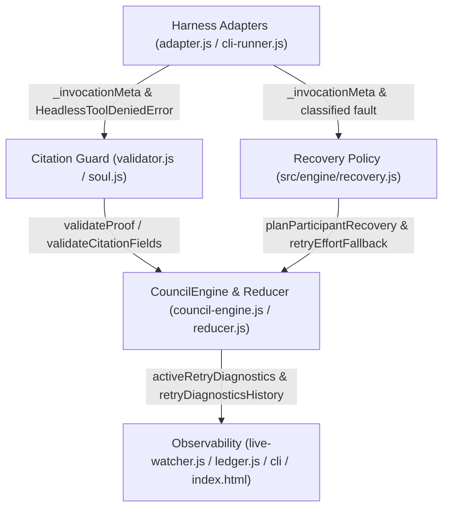

# Issue #102 Live Workspace Resilience, Self-Contained Recovery & Retry Attribution Implementation Plan

> **For agentic workers:** REQUIRED SUB-SKILL: Use superpowers:subagent-driven-development to implement this plan task-by-task. Steps use checkbox (`- [ ]`) syntax for tracking.

**Goal:** Eliminate silent headless tool denials, PID-collision false provider faults, ephemeral workspace leaks, and evidence-blind tool-free fallbacks while adding opt-in bounded retry effort fallback (`--retry-effort-fallback`) and end-to-end retry attribution across telemetry, CLI, and live replay.

**Architecture:** The design centralizes every recovery/termination decision in a pure policy module ([`src/engine/recovery.js`](file:///Users/aaat/projects/the-council/src/engine/recovery.js)) parameterized by adapter-captured invocation context (`_invocationMeta`) and explicit opt-in config (`selfContainedInput`, `retryEffortFallback`), paired with portable citation normalization in [`src/proofs/validator.js`](file:///Users/aaat/projects/the-council/src/proofs/validator.js), structured Antigravity denial/error parsing in [`src/harness/cli-runner.js`](file:///Users/aaat/projects/the-council/src/harness/cli-runner.js), and lossless sparse replay deltas in [`src/visualizer/live-watcher.js`](file:///Users/aaat/projects/the-council/src/visualizer/live-watcher.js). Full rationale and invariants live in the [Issue #102 Design Spec](file:///Users/aaat/projects/the-council/docs/superpowers/specs/2026-11-13-issue-102-live-cwd-resilience-design.md).

**Architecture Diagram:**



**Tech Stack:** Node.js ESM (`>=22`), zero external runtime dependencies, built-in `node:test` and `node:assert/strict`.

## Global Constraints

- **Zero Claude models anywhere:** Never dispatch Claude models in live verification, subagents, or cross-family reviews; use Gemini (`gemini-4-argon`, `gemini-4-carbon`), Codex (`gpt-6.1-sol`, `gpt-6-astra`), or Cursor (`composer-2.5`, `grok-4.7`).
- **Preserve unrelated workspace state:** Leave unstaged `M configs/best-of-families.json` untouched; use explicit `git add <file>` paths on every commit (never `git add .` or `git add -A`).
- **Preserve prior issue contracts:** Maintain Issue `#90` (strict JSON output contracts, zero shell/MCP prose scraping), Issue `#95` (roster-ordered pre-collapse proof/vote preservation and terminal `'thinking'` settlement), Issue `#96` (isolated `.council`-free relative-`.` prompt guarantees), and Issue `#97` (`cli-runner.js` child-process tracking and visualizer UX).
- **Deterministic ESM module graph:** Keep `src/harness/cli-runner.js` independent of `src/harness/adapter.js` (`adapter.js` re-exports from `cli-runner.js`) to prevent circular ESM initialization hazards.

---

### Task 1: Harness Workspace Resolution, PID-Safe Provider Errors, Ephemeral Copy Hygiene & Antigravity Denial Envelopes

**Files:**
- Modify: `src/types.js:178-305`
- Modify: `src/harness/cli-runner.js:3357-3399,3820-4406`
- Modify: `src/harness/adapter.js:1-165,490-650`
- Modify: `src/harness/antigravity.js:65-88,125-186,230-286`
- Modify: `src/harness/codex.js:70-95,135-199,248-306`
- Modify: `src/harness/cursor.js:60-85,123-184,232-287`
- Modify: `src/harness/mock.js:165-218,275-315`
- Create: `test/unit/issue-102-harness-workspace-and-denial.test.js`

**Interfaces:**
- Consumes: Adapter invocation arguments (`role`, `phase`, `participant`, `state`, `tools`, `cwd`, `callerContext`, `adapter`).
- Produces:
  - `PROVIDER_HTTP_429_REGEX`, `PROVIDER_HTTP_AUTH_REGEX` (defined in `src/harness/cli-runner.js`, re-exported from `src/harness/adapter.js`).
  - `HeadlessToolDeniedError` (exported from `src/harness/adapter.js`; created in `cli-runner.js` via `createHeadlessToolDeniedError` with `.code === 'HEADLESS_TOOL_DENIED'` and wrapped by `HarnessAdapter.prototype.classifyError`).
  - `resolveAttemptExecutionWorkspace({ role, phase, participant, state, tools, cwd, callerContext, adapter })` exported from `src/harness/adapter.js`.
  - `stripKnownBenignAntigravityWarning(stderr)`, `hasExplicitProviderErrorSignature(text)`, and `listAntigravityModels(options)` exported from `src/harness/cli-runner.js`.
  - `context._invocationMeta` (`{ effectiveTools, configuredWorkspaceCwd, effectiveCwd, trustedEphemeralRoots?, forbiddenWorkspaceRoots? }`).

- [ ] **Step 1: Write the failing test**

Create `test/unit/issue-102-harness-workspace-and-denial.test.js`:

```javascript
import { describe, it } from 'node:test';
import assert from 'node:assert/strict';
import fs from 'node:fs';
import os from 'node:os';
import path from 'node:path';
import {
  PROVIDER_HTTP_429_REGEX,
  PROVIDER_HTTP_AUTH_REGEX,
  HeadlessToolDeniedError,
  QuotaExhaustionError,
  HarnessExecutionError,
  resolveAttemptExecutionWorkspace
} from '../../src/harness/adapter.js';
import {
  prepareIsolatedCliWorkspace,
  runAntigravityCli,
  stripKnownBenignAntigravityWarning,
  hasExplicitProviderErrorSignature,
  listAntigravityModels,
  normalizeProviderTrace
} from '../../src/harness/cli-runner.js';
import { AntigravityAdapter } from '../../src/harness/antigravity.js';
import { CodexAdapter } from '../../src/harness/codex.js';
import { CursorAdapter } from '../../src/harness/cursor.js';

describe('Issue #102 Task 1: Workspace resolution, PID-safe errors, ephemeral copy hygiene & Antigravity denial envelopes', () => {
  it('resolves effectiveTools and effectiveCwd identically to adapter precedence and clears cwd when tools === "none"', () => {
    const adapter = { config: { cwd: '/repo/adapter' } };
    const resNone = resolveAttemptExecutionWorkspace({
      role: 'seat',
      phase: 'VOTING',
      participant: { id: 's1', votingTools: 'read-only', cwd: '/repo/seat' },
      state: { cwd: '/repo/state' },
      tools: 'none',
      cwd: '/repo/call',
      callerContext: {},
      adapter
    });
    assert.deepEqual(resNone, {
      effectiveTools: 'none',
      configuredWorkspaceCwd: '/repo/call',
      effectiveCwd: undefined
    });

    const resSeatVoting = resolveAttemptExecutionWorkspace({
      role: 'seat',
      phase: 'VOTING',
      participant: { id: 's1', tools: 'none', votingTools: 'read-only', cwd: '  ' },
      state: { cwd: '/repo/state' },
      adapter
    });
    assert.deepEqual(resSeatVoting, {
      effectiveTools: 'read-only',
      configuredWorkspaceCwd: '/repo/adapter',
      effectiveCwd: '/repo/adapter'
    });

    const resJudge = resolveAttemptExecutionWorkspace({
      role: 'judge',
      phase: 'JUDGE_AUDIT_SYNTHESIS',
      participant: { id: 'j1', cwd: ' /repo/judge ' },
      state: { cwd: '/repo/state' },
      adapter
    });
    assert.deepEqual(resJudge, {
      effectiveTools: 'read-only',
      configuredWorkspaceCwd: '/repo/judge',
      effectiveCwd: '/repo/judge'
    });
  });

  it('rejects bare node PID warnings (429, 401, 403) while matching explicit provider HTTP/status context across adapters', () => {
    for (const pid of [429, 401, 403]) {
      const warning = `(node:${pid}) ExperimentalWarning: Example harmless warning`;
      assert.equal(PROVIDER_HTTP_429_REGEX.test(warning), false, `429 regex false positive on PID ${pid}`);
      assert.equal(PROVIDER_HTTP_AUTH_REGEX.test(warning), false, `auth regex false positive on PID ${pid}`);
      assert.equal(hasExplicitProviderErrorSignature(warning), false, `provider error false positive on PID ${pid}`);
    }

    assert.equal(PROVIDER_HTTP_429_REGEX.test('HTTP 429 Too Many Requests from upstream'), true);
    assert.equal(PROVIDER_HTTP_429_REGEX.test('status=429 rate limit exceeded'), true);
    assert.equal(PROVIDER_HTTP_AUTH_REGEX.test('HTTP 401 Unauthorized: invalid token'), true);
    assert.equal(PROVIDER_HTTP_AUTH_REGEX.test('status: 403 Forbidden'), true);

    for (const AdapterClass of [AntigravityAdapter, CodexAdapter, CursorAdapter]) {
      const adapter = new AdapterClass();
      const classified = adapter.classifyError(new Error('(node:429) ExperimentalWarning: sqlite warning'), {
        seatId: 's1',
        model: 'test-model'
      });
      assert.equal(classified instanceof QuotaExhaustionError, false, `${AdapterClass.name} must not map node:429 warning to QuotaExhaustionError`);
      assert.equal(classified instanceof HarnessExecutionError, true);
    }
  });

  it('excludes .codegraph and .council recursively and via symlinks, canonicalizes realpathSync, and sets isolated root metadata only for temp copies', async () => {
    const tmpParent = fs.mkdtempSync(path.join(os.tmpdir(), 'council-102-hygiene-'));
    const repoDir = path.join(tmpParent, 'repo');
    const externalSecret = path.join(tmpParent, 'external-council');
    fs.mkdirSync(path.join(repoDir, '.council'), { recursive: true });
    fs.mkdirSync(path.join(repoDir, '.codegraph'), { recursive: true });
    fs.mkdirSync(path.join(repoDir, 'packages', 'sub', '.CodeGraph'), { recursive: true });
    fs.mkdirSync(path.join(repoDir, 'src'), { recursive: true });
    fs.mkdirSync(externalSecret, { recursive: true });
    fs.writeFileSync(path.join(repoDir, '.council', 'secret.json'), '{}');
    fs.writeFileSync(path.join(repoDir, '.codegraph', 'graph.db'), 'binary');
    fs.writeFileSync(path.join(repoDir, 'packages', 'sub', '.CodeGraph', 'index.json'), '{}');
    fs.writeFileSync(path.join(repoDir, 'src', 'index.js'), 'export const ok = true;\n');
    fs.writeFileSync(path.join(externalSecret, 'leak.txt'), 'secret');
    fs.symlinkSync(externalSecret, path.join(repoDir, '.council-link'));

    try {
      const ctx = { _invocationMeta: {} };
      const isolated = await prepareIsolatedCliWorkspace(repoDir, ctx);
      try {
        assert.equal(isolated.isolated, true);
        assert.equal(isolated.effectiveCwd, fs.realpathSync(isolated.effectiveCwd));
        assert.equal(isolated.env.PWD, isolated.effectiveCwd);
        assert.equal(fs.existsSync(path.join(isolated.effectiveCwd, '.council')), false);
        assert.equal(fs.existsSync(path.join(isolated.effectiveCwd, '.codegraph')), false);
        assert.equal(fs.existsSync(path.join(isolated.effectiveCwd, 'packages', 'sub', '.CodeGraph')), false);
        assert.equal(fs.existsSync(path.join(isolated.effectiveCwd, 'src', 'index.js')), true);
        assert.deepEqual(ctx._invocationMeta.trustedEphemeralRoots, [isolated.effectiveCwd]);
        assert.ok(ctx._invocationMeta.forbiddenWorkspaceRoots.includes(path.resolve(repoDir)));
      } finally {
        await isolated.cleanup();
      }

      const cleanDir = path.join(tmpParent, 'clean-repo');
      fs.mkdirSync(cleanDir, { recursive: true });
      const ctxClean = { _invocationMeta: {} };
      const inPlace = await prepareIsolatedCliWorkspace(cleanDir, ctxClean);
      assert.equal(inPlace.isolated, false);
      assert.equal(inPlace.effectiveCwd, fs.realpathSync(cleanDir));
      assert.equal(ctxClean._invocationMeta.trustedEphemeralRoots, undefined);
      await inPlace.cleanup();

      const missingDir = path.join(tmpParent, 'does-not-exist-yet');
      const ctxMissing = { _invocationMeta: {} };
      const missingRes = await prepareIsolatedCliWorkspace(missingDir, ctxMissing);
      assert.equal(missingRes.isolated, false);
      assert.equal(missingRes.effectiveCwd, path.resolve(missingDir));
      await missingRes.cleanup();
    } finally {
      fs.rmSync(tmpParent, { recursive: true, force: true });
    }
  });

  it('strips only exact benign WORKSPACE_STATE stderr line and enforces exact exitCode 0 and nonzero Antigravity precedence', async () => {
    const benign = stripKnownBenignAntigravityWarning(
      '[antigravity] WORKSPACE_STATE: skipping unreadable workspace directory\n'
    );
    assert.equal(benign.trim(), '');

    const okWithDenied = await runAntigravityCli(
      'Return JSON',
      { cwd: process.cwd(), model: 'gemini-4-argon-low' },
      {
        runner: async () => ({
          exitCode: 0,
          stdout: JSON.stringify({
            response: '{"ok":true}',
            deniedActions: [{ tool: 'read_file', reason: 'outside root' }],
            finishedReason: 'STOP'
          }),
          stderr: '[antigravity] WORKSPACE_STATE: skipping unreadable workspace directory\n'
        })
      }
    );
    assert.equal(okWithDenied.output, '{"ok":true}');
    assert.equal(okWithDenied.trace.deniedActions.length, 1);

    await assert.rejects(
      () => runAntigravityCli(
        'Return JSON',
        { cwd: process.cwd(), model: 'gemini-4-argon-low' },
        {
          runner: async () => ({
            exitCode: 0,
            stdout: JSON.stringify({
              response: '',
              deniedActions: [{ tool: 'list_dir', path: '/Users/secret/host', reason: 'Permission denied' }],
              finishedReason: 'STOP'
            }),
            stderr: '[antigravity] WORKSPACE_STATE: skipping unreadable workspace directory\nPermission denied reading workspace\n'
          })
        }
      ),
      (err) => {
        assert.equal(err.code, 'HEADLESS_TOOL_DENIED');
        assert.equal(err.exitCode, 0);
        assert.ok(Array.isArray(err.deniedActions) && err.deniedActions.length === 1);
        assert.ok(!err.stderr.includes('WORKSPACE_STATE: skipping unreadable workspace directory'));
        assert.ok(err.stderr.includes('Permission denied reading workspace'));
        return true;
      }
    );

    const adapter = new AntigravityAdapter();
    const classified = adapter.classifyError(
      Object.assign(new Error('denied'), {
        code: 'HEADLESS_TOOL_DENIED',
        exitCode: 0,
        deniedActions: [{ tool: 'grep_search', reason: 'blocked in headless' }],
        trace: normalizeProviderTrace({ durationMs: 1200, deniedActions: [{ tool: 'grep_search' }] })
      }),
      { seatId: 's1', model: 'gemini-4-argon-low' }
    );
    assert.equal(classified instanceof HeadlessToolDeniedError, true);
    assert.equal(classified.isRetryable, true);
    assert.equal(classified.exitCode, 0);
    assert.equal(classified.deniedActions.length, 1);

    await assert.rejects(
      () => runAntigravityCli(
        'Return JSON',
        { cwd: process.cwd(), model: 'gemini-4-argon-low' },
        {
          runner: async () => ({
            exitCode: 0,
            stdout: JSON.stringify({ response: '', error: { code: 429, message: 'RESOURCE_EXHAUSTED: HTTP 429 quota reached' } }),
            stderr: ''
          })
        }
      ),
      (err) => err.isQuotaFault === true || /429|RESOURCE_EXHAUSTED/i.test(err.message)
    );
  });

  it('parses agy models output by stripping carriage-return spinner frames', async () => {
    const rawCatalog = [
      '\r⠋ Fetching available models...\r⠙ Fetching available models...\r                      \rAVAILABLE MODELS:',
      '  gemini-4-argon-high    Gemini 4 Argon (High)',
      '  gemini-4-argon-medium  Gemini 4 Argon (Medium)',
      '  gemini-4-argon-low     Gemini 4 Argon (Low)',
      '  claude-sonnet-5-5-medium Claude Sonnet 5.5 (Medium)'
    ].join('\n');

    const res = await listAntigravityModels({
      runner: async () => ({ exitCode: 0, stdout: rawCatalog, stderr: '' })
    });
    assert.equal(res.ok, true);
    assert.ok(res.selectors.includes('gemini-4-argon-medium'));
    assert.ok(res.selectors.includes('gemini-4-argon-low'));
  });
});
```

- [ ] **Step 2: Run test to verify it fails**

Run: `node --test test/unit/issue-102-harness-workspace-and-denial.test.js`
Expected: FAIL (`SyntaxError` / missing exports).

- [ ] **Step 3: Implement updates in `src/types.js`, `cli-runner.js`, `adapter.js`, and all adapters**

1. Update `src/types.js`:
```diff
  * @property {'none' | 'read-only'} [tools] - Global participant tool policy.
+ * @property {boolean} [retryEffortFallback] - Explicit opt-in bounded effort fallback on retryable timeouts/denials.
+ * @property {Object} [selfContainedInput] - Caller-attested self-contained contract permitting tool-free recovery.
  * @property {EvidenceItem[]} [evidence] - Pre-collected grounded evidence items passed to seats and judge.
```

2. Update `src/harness/cli-runner.js`:
   - Define and export PID-safe regexes, Antigravity helpers, `listAntigravityModels`:
     ```javascript
     export const PROVIDER_HTTP_429_REGEX =
       /(?:\bHTTP(?:\/\d+(?:\.\d+)?)?\s+429\b|\bstatus(?:\s*code)?\s*[:=]\s*429\b|\bcode\s*[:=]\s*["']?429["']?|\b429\s+Too Many Requests\b|\bRESOURCE_EXHAUSTED\b)/i;

     export const PROVIDER_HTTP_AUTH_REGEX =
       /(?:\bHTTP(?:\/\d+(?:\.\d+)?)?\s+(?:401|403)\b|\bstatus(?:\s*code)?\s*[:=]\s*(?:401|403)\b|\bcode\s*[:=]\s*["']?(?:401|403)["']?|\b(?:401\s+Unauthorized|403\s+Forbidden|UNAUTHENTICATED|PERMISSION_DENIED)\b)/i;

     const BENIGN_AGY_WORKSPACE_STATE_LINE =
       /^\s*\[antigravity\]\s+WORKSPACE_STATE:\s+skipping unreadable workspace directory\s*$/i;

     export function stripKnownBenignAntigravityWarning(stderr) {
       if (typeof stderr !== 'string' || !stderr) return '';
       return stderr
         .split(/\r?\n/)
         .filter((line) => !BENIGN_AGY_WORKSPACE_STATE_LINE.test(line))
         .join('\n')
         .trim();
     }

     export function hasExplicitProviderErrorSignature(text) {
       if (typeof text !== 'string' || !text.trim()) return false;
       return (
         PROVIDER_HTTP_429_REGEX.test(text) ||
         PROVIDER_HTTP_AUTH_REGEX.test(text) ||
         /\b(?:rate[- ]limit(?:ed|ing)?|quota\s+exceeded|too many requests|authentication required|invalid api key|unauthorized|forbidden)\b/i.test(text)
       );
     }

     export function createHeadlessToolDeniedError(message, options = {}) {
       const err = new Error(message);
       err.name = 'HeadlessToolDeniedError';
       err.code = 'HEADLESS_TOOL_DENIED';
       err.exitCode = options.exitCode ?? 0;
       err.deniedActions = Array.isArray(options.deniedActions) ? options.deniedActions : [];
       err.trace = options.trace || null;
       err.stderr = options.stderr ?? '';
       err.isRetryable = options.isRetryable ?? true;
       err.isQuotaFault = false;
       return err;
     }

     export async function listAntigravityModels(options = {}) {
       const runner = typeof options.runner === 'function' ? options.runner : null;
       const timeoutMs = options.timeoutMs ?? 15000;
       let res;
       if (runner) {
         res = await runner({ command: 'agy', args: ['models'], timeoutMs });
       } else {
         res = await execCliProcess('agy', ['models'], { timeoutMs, signal: options.signal });
       }
       if (!res || res.exitCode !== 0) {
         return { ok: false, selectors: [], raw: res?.stdout || '', error: res?.stderr || 'agy models failed' };
       }
       const cleaned = String(res.stdout || '')
         .replace(/\x1B\[[0-9;]*[A-Za-z]/g, '')
         .split('\n')
         .map((line) => (line.includes('\r') ? line.split('\r').pop() : line).trim())
         .filter(Boolean);
       const selectors = [];
       for (const line of cleaned) {
         if (/^available\s+models:?$/i.test(line)) continue;
         const match = line.match(/^([a-z0-9][a-z0-9._-]+)\s{2,}/i) || line.match(/^([a-z0-9][a-z0-9._-]+)$/i);
         if (match && !selectors.includes(match[1])) {
           selectors.push(match[1]);
         }
       }
       return { ok: true, selectors, raw: cleaned.join('\n') };
     }
     ```
   - Update `normalizeProviderTrace` to retain optional `stderr`, `deniedActions`, `envelopeError`, `finishedReason` when present on `rawTrace`.
   - Update `recordProviderCall` to retain optional `phase`, `round`, `attempt`, `requestedModel`, `requestedEffort`, `effectiveEffort`, `capabilityProvenance`, `fallbackApplied`, `fallbackReason` from `record` or `context?.retryDiagnostics`.
   - Update `parseAntigravityOutput` to capture `deniedActions`, `envelopeError`, `finishedReason` from parsed JSON payloads and check `deniedActions` in addition to `toolCalls` for `.council` / host `forbiddenStateAccess`.
   - Replace `hasDotCouncilEntry` with `requiresIsolatedSafeWorkspaceCopy(dirPath)` (case-insensitive check for `.council`, `.codegraph`, or symlinks whose name/target matches `.council`/`.codegraph`), update `copySafeWorkspace` to exclude `.council`, `.codegraph`, and `node_modules` at every depth + symlinks pointing to `.council`/`.codegraph` targets, and update `prepareIsolatedCliWorkspace` to canonicalize `effectiveCwd` and `env.PWD` via `fs.realpathSync` across all 3 branches (`ENOENT` fallback to `path.resolve(cwd)`) while attaching `trustedEphemeralRoots` and `forbiddenWorkspaceRoots` on `context._invocationMeta` only when `council-safe-cwd-*` is materialized.
   - Update `runAntigravityCli` to implement both precedence tables from Spec §3:
     - `exitCode === 0`: (1) usable primary output succeeds while keeping `trace.deniedActions`; (2) `forbiddenStateAccess` throws `createForbiddenStateAccessError`; (3) `deniedActions.length > 0` without primary output throws `createHeadlessToolDeniedError(..., { exitCode: 0, deniedActions, trace, stderr: sanitizedStderr })`; (4) structured `envelopeError` or `hasExplicitProviderErrorSignature(sanitizedStderr)` throws explicit error (`isQuotaFault: true` on 429/quota); (5) otherwise throw empty output `HarnessExecutionError`-compatible error with `sanitizedStderr`.
     - Nonzero exit / thrown error: inspect `sanitizedStderr` + `envelopeError` with `hasExplicitProviderErrorSignature` first, else check `deniedActions` before generic non-zero error; ignore bare `(node:429)` / `(node:401)` / `(node:403)` warnings and benign `WORKSPACE_STATE` warning.

3. Update `src/harness/adapter.js`:
   - Re-export `PROVIDER_HTTP_429_REGEX`, `PROVIDER_HTTP_AUTH_REGEX` from `./cli-runner.js`.
   - Export `HeadlessToolDeniedError` and `resolveAttemptExecutionWorkspace`:
     ```javascript
     export { PROVIDER_HTTP_429_REGEX, PROVIDER_HTTP_AUTH_REGEX };

     export class HeadlessToolDeniedError extends HarnessError {
       constructor(message, options = {}) {
         super(message, {
           ...options,
           isQuotaFault: false,
           isRetryable: options.isRetryable !== undefined ? Boolean(options.isRetryable) : true
         });
         this.code = options.code || 'HEADLESS_TOOL_DENIED';
         this.deniedActions = Array.isArray(options.deniedActions) ? options.deniedActions : [];
         this.trace = options.trace || null;
       }
     }

     export function resolveAttemptExecutionWorkspace({
       role = 'seat',
       phase = 'DELIBERATION',
       participant = {},
       state = {},
       tools,
       cwd,
       callerContext,
       adapter
     } = {}) {
       const firstNonEmpty = (...vals) => {
         for (const v of vals) {
           if (typeof v === 'string' && v.trim().length > 0) return v.trim();
         }
         return undefined;
       };
       let effectiveTools;
       if (tools !== undefined) {
         effectiveTools = tools;
       } else if (role === 'seat' && phase === 'VOTING') {
         effectiveTools = participant?.votingTools || participant?.tools || callerContext?.tools || 'none';
       } else {
         effectiveTools = participant?.tools || callerContext?.tools || 'read-only';
       }
       const configuredWorkspaceCwd = firstNonEmpty(cwd, callerContext?.cwd, participant?.cwd, state?.cwd, adapter?.config?.cwd);
       const effectiveCwd = effectiveTools === 'none' ? undefined : configuredWorkspaceCwd;
       return { effectiveTools, configuredWorkspaceCwd, effectiveCwd };
     }
     ```
   - In `HarnessAdapter.prototype.classifyError`, handle `err instanceof HeadlessToolDeniedError || err?.code === 'HEADLESS_TOOL_DENIED'`, and swap bare `/\b(?:401|403)\b/` & `/\b429\b/` with `PROVIDER_HTTP_AUTH_REGEX` & `PROVIDER_HTTP_429_REGEX`.

4. Update `src/harness/antigravity.js`, `src/harness/codex.js`, `src/harness/cursor.js`, and `src/harness/mock.js`:
   - Replace bare `/\b429\b/` checks with `PROVIDER_HTTP_429_REGEX`.
   - Call `resolveAttemptExecutionWorkspace({ role, phase, participant, state, tools, cwd, callerContext: context, adapter: this })` in `executeSeat*` and `executeJudge*`, write `{ effectiveTools, configuredWorkspaceCwd, effectiveCwd }` into `(context._invocationMeta ||= {})`, and forward `_invocationMeta` and `retryDiagnostics: context?.retryDiagnostics` inside the dispatch `context` object.

- [ ] **Step 4: Run tests to verify they pass**

Run: `node --test test/unit/issue-102-harness-workspace-and-denial.test.js test/unit/harness.test.js test/unit/issue-97-cli-runner-cleanup.test.js`
Expected: PASS (0 failed).

- [ ] **Step 5: Commit**

```bash
git add src/types.js src/harness/cli-runner.js src/harness/adapter.js src/harness/antigravity.js src/harness/codex.js src/harness/cursor.js src/harness/mock.js test/unit/issue-102-harness-workspace-and-denial.test.js
git commit -m "fix(harness): add workspace meta capture, PID-safe errors, .codegraph exclusion, and headless denial envelope"
```

---

### Task 2: Portable Citation Normalization, Ephemeral/Artifact Reference Guards & Read Budget Prompt Caps

**Files:**
- Modify: `src/proofs/validator.js:1-99`
- Modify: `src/seats/soul.js:204-215,375-419,497-535,667-715`
- Modify: `src/engine/council-engine.js:1195-1240,1735-1755,1878-1935`
- Modify: `test/unit/issue-96-soul-isolated-workspace.test.js`
- Create: `test/unit/issue-102-citation-guards.test.js`

**Interfaces:**
- Consumes: `context._invocationMeta.trustedEphemeralRoots` and `forbiddenWorkspaceRoots` (Task 1).
- Produces: `normalizeTrustedInvocationCitations`, `validateCitationFields`, `validateProof(input, options)` in `src/proofs/validator.js`; read-budgeted prompts in `src/seats/soul.js`.

- [ ] **Step 1: Write the failing test**

Create `test/unit/issue-102-citation-guards.test.js`:

```javascript
import { describe, it } from 'node:test';
import assert from 'node:assert/strict';
import os from 'node:os';
import path from 'node:path';
import {
  validateProof,
  normalizeTrustedInvocationCitations,
  validateCitationFields
} from '../../src/proofs/validator.js';
import {
  formatDeliberationPrompt,
  formatVotingPrompt,
  formatJudgePrompt,
  STANDARD_SOULS
} from '../../src/seats/soul.js';
import { CouncilEngine } from '../../src/engine/council-engine.js';
import { MockAdapter } from '../../src/harness/mock.js';

describe('Issue #102 Task 2: Portable citation normalization, forbidden path/artifact guards & read caps', () => {
  it('strips ONLY trustedEphemeralRoots to repo-relative paths while leaving non-matching/other temp/host paths intact for rejection', () => {
    const trustedRoot = path.join(os.tmpdir(), 'council-safe-cwd-seat1');
    const otherSeatRoot = path.join(os.tmpdir(), 'council-safe-cwd-other');
    const normalized = normalizeTrustedInvocationCitations(
      {
        scope: 'Harness',
        kind: 'citation',
        source: `${trustedRoot}/src/harness/cli-runner.js:4200`,
        statement: `Verified ${trustedRoot}/src/engine/config.js and prose... with ellipsis.`
      },
      { trustedEphemeralRoots: [trustedRoot] }
    );

    assert.equal(normalized.source, 'src/harness/cli-runner.js:4200');
    assert.equal(normalized.statement, 'Verified src/engine/config.js and prose... with ellipsis.');
    assert.equal(validateProof(normalized, { forbiddenWorkspaceRoots: ['/Users/aaat/repo'] }).valid, true);

    const tampered = normalizeTrustedInvocationCitations(
      {
        scope: 'Harness',
        kind: 'citation',
        source: `${otherSeatRoot}/src/harness/cli-runner.js`,
        statement: 'Should still fail'
      },
      { trustedEphemeralRoots: [trustedRoot] }
    );
    const badRes = validateProof(tampered, { forbiddenWorkspaceRoots: ['/Users/aaat/repo'] });
    assert.equal(badRes.valid, false);
    assert.match(badRes.errors.join(' '), /temporary|ephemeral/i);
  });

  it('rejects parent traversal (..), .council/telemetry artifacts, and forbiddenWorkspaceRoots while allowing prose ellipses (...)', () => {
    const allowedProse = validateCitationFields(
      [{ label: 'summary', text: 'First condition... then second condition.' }],
      { forbiddenWorkspaceRoots: ['/Users/aaat/private-repo'] }
    );
    assert.equal(allowedProse.valid, true);

    const badInputs = [
      [{ label: 'source', text: '../secret/file.js:10' }],
      [{ label: 'source', text: '.council/runs/latest.js' }],
      [{ label: 'statement', text: 'Inspect telemetry-summary.json for answer' }],
      [{ label: 'reason', text: 'Checked /Users/aaat/private-repo/src/index.js:12' }],
      [{ label: 'note', text: 'Found at /tmp/council-seat-cwd-xyz/src/index.js:5' }]
    ];
    for (const fields of badInputs) {
      const res = validateCitationFields(fields, {
        forbiddenWorkspaceRoots: ['/Users/aaat/private-repo']
      });
      assert.equal(res.valid, false, `Expected rejection for ${JSON.stringify(fields)}`);
    }
  });

  it('emits phase-specific read caps (5-8 R1, 3-5 R2+/Vote/Judge, 0 uncited) and forbids echoing temp paths without regressing #96', () => {
    const soul = STANDARD_SOULS.ARCHITECT;
    const pR1 = formatDeliberationPrompt({
      soul,
      seat: { id: 's1', cwd: '/Users/secret/repo' },
      topic: 'Inspect src/index.js',
      round: 1,
      maxRounds: 3,
      tools: 'read-only'
    });
    assert.match(pR1, /5.?8/);
    assert.match(pR1, /temporary.*paths|repository-relative paths/i);

    const pR2 = formatDeliberationPrompt({
      soul,
      seat: { id: 's1', cwd: '/Users/secret/repo' },
      topic: 'Rebuttal',
      round: 2,
      maxRounds: 3,
      rebuttalMode: true,
      previousCandidate: { round: 1, summary: 'Prev', clauses: [] },
      openObjections: [{ id: 'O1', seatId: 's2', proofId: 'P1', reason: 'Mismatch' }],
      tools: 'read-only'
    });
    assert.match(pR2, /3.?5/);

    const pVote = formatVotingPrompt({
      soul,
      seat: { id: 's1', cwd: '/Users/secret/repo', votingTools: 'read-only' },
      candidate: { round: 1, summary: 'Cand', clauses: [] },
      admittedProofs: [],
      tools: 'read-only'
    });
    assert.match(pVote, /3.?5/);

    const pJudgeCited = formatJudgePrompt({
      judge: { id: 'j', cwd: '/Users/secret/repo' },
      topic: 'Topic',
      round: 1,
      proofs: [{ id: 'P1', statement: 'Check', source: 'src/a.js:10' }],
      tools: 'read-only'
    });
    assert.match(pJudgeCited, /3.?5/);

    const pJudgeUncited = formatJudgePrompt({
      judge: { id: 'j', cwd: '/Users/secret/repo' },
      topic: 'Topic',
      round: 1,
      proofs: [{ id: 'P1', statement: 'Concept', source: 'internal reasoning' }],
      tools: 'read-only'
    });
    assert.match(pJudgeUncited, /0 local workspace reads|uncited/i);
  });

  it('rejects leaked temp/forbidden paths returned in Vote reason and Judge synthesis via retryable InvalidResponseError', async () => {
    const adapter = new MockAdapter({ cwd: '/Users/aaat/host-secret-repo' });
    let judgeAttempts = 0;
    adapter.executeSeatProof = async ({ seat }) => ({
      scope: 'Core',
      kind: 'check',
      source: 'src/a.js:1',
      statement: `Valid proof from ${seat.id}`
    });
    adapter.executeJudgeAuditAndSynthesis = async () => {
      judgeAttempts += 1;
      if (judgeAttempts === 1) {
        return {
          summary: 'Checked /Users/aaat/host-secret-repo/src/a.js:1',
          clauses: [{ id: 'C1', context: 'Core', conclusion: 'Ok', citedProofIds: ['P1'] }],
          proofDecisions: { P1: { status: 'admitted', note: 'OK' } }
        };
      }
      return {
        summary: 'Checked src/a.js:1 clean relative path.',
        clauses: [{ id: 'C1', context: 'Core', conclusion: 'Ok', citedProofIds: ['P1'] }],
        proofDecisions: { P1: { status: 'admitted', note: 'OK' } }
      };
    };

    const engine = new CouncilEngine(
      {
        topic: 'Citation sanitization',
        cwd: '/Users/aaat/host-secret-repo',
        maxRounds: 1,
        minQuorum: 2,
        maxRetriesPerJudge: 1,
        judge: { id: 'judge', harness: 'mock', model: 'gpt-6-astra (max)', soul: 'Judge' },
        seats: [
          { id: 's1', harness: 'mock', model: 'gpt-6-astra (max)', soul: 'A' },
          { id: 's2', harness: 'mock', model: 'gemini-4-argon-high', soul: 'B' }
        ]
      },
      { harnessResolver: () => adapter }
    );
    engine.initRoster();
    const res = await engine.run();
    assert.equal(res.ok, true);
    assert.equal(judgeAttempts, 2);
  });
});
```

- [ ] **Step 2: Run test to verify it fails**

Run: `node --test test/unit/issue-102-citation-guards.test.js`
Expected: FAIL because `normalizeTrustedInvocationCitations` and `validateCitationFields` do not exist.

- [ ] **Step 3: Implement `src/proofs/validator.js`, `src/seats/soul.js`, `src/engine/council-engine.js`, and append test in `test/unit/issue-96-soul-isolated-workspace.test.js`**

1. Add to `src/proofs/validator.js`:

```javascript
function escapeRegex(value) {
  return String(value).replace(/[.*+?^${}()|[\]\\]/g, '\\$&');
}

export function normalizeTrustedInvocationCitations(payload, invocationMeta) {
  const roots = Array.isArray(invocationMeta?.trustedEphemeralRoots)
    ? invocationMeta.trustedEphemeralRoots.filter((r) => typeof r === 'string' && r.length > 0)
    : [];
  if (roots.length === 0 || payload == null) return payload;
  const sorted = [...roots].sort((a, b) => b.length - a.length);

  const rewriteText = (str) => {
    let out = str;
    for (const root of sorted) {
      const normalized = root.replace(/[\\/]+$/, '');
      if (!normalized) continue;
      const prefixRe = new RegExp(`${escapeRegex(normalized)}[\\\\/]+`, 'g');
      out = out.replace(prefixRe, '');
      const exactRe = new RegExp(`${escapeRegex(normalized)}(?![A-Za-z0-9._\\-\\\\/])`, 'g');
      out = out.replace(exactRe, '.');
    }
    return out;
  };

  const walk = (node) => {
    if (typeof node === 'string') return rewriteText(node);
    if (Array.isArray(node)) return node.map(walk);
    if (node && typeof node === 'object') {
      const copy = {};
      for (const [k, v] of Object.entries(node)) copy[k] = walk(v);
      return copy;
    }
    return node;
  };
  return walk(payload);
}

const PARENT_TRAVERSAL_REGEX = /(?:^|[\\/\s"'`(=])\.\.(?:[\\/]|(?=$|\s|["'`]))/;
const FORBIDDEN_ARTIFACT_REGEX =
  /(?:^|[\\/\s"'`])\.council(?:[\\/\s"'`]|$)|\blatest\.js\b|\*\.meta\.json|\*\.events\.jsonl|\btelemetry-summary(?:\.\*|\.[a-z0-9]+)?\b|\b[a-z0-9._-]+\.(?:meta\.json|events\.jsonl)\b/i;
const UNSTRIPPED_TEMP_ROOT_REGEX =
  /(?:\/|\\|[a-z]:\\)[^\s"'`<>]*?council-(?:safe|seat)-cwd-[a-z0-9_-]+/i;

export function validateCitationFields(fields = [], options = {}) {
  const errors = [];
  const forbiddenRoots = Array.isArray(options?.forbiddenWorkspaceRoots)
    ? options.forbiddenWorkspaceRoots.filter((r) => typeof r === 'string' && r.trim().length > 0)
    : [];

  for (const entry of fields) {
    if (!entry || typeof entry.text !== 'string' || !entry.text) continue;
    const { label = 'field', text } = entry;
    if (PARENT_TRAVERSAL_REGEX.test(text)) {
      errors.push(`${label} must not contain parent directory traversal ("..")`);
    }
    if (FORBIDDEN_ARTIFACT_REGEX.test(text)) {
      errors.push(`${label} must not cite internal .council or telemetry artifacts`);
    }
    if (UNSTRIPPED_TEMP_ROOT_REGEX.test(text)) {
      errors.push(`${label} must not cite unstripped temporary workspace directory paths`);
    }
    for (const root of forbiddenRoots) {
      if (text.includes(root)) {
        errors.push(`${label} must not cite host workspace root path (${root})`);
      }
    }
  }
  return { valid: errors.length === 0, errors };
}
```

Update `validateProof(input, options = {})` at the end of `src/proofs/validator.js` to run:
```javascript
  const citationCheck = validateCitationFields(
    [
      { label: 'proof.scope', text: input.scope },
      { label: 'proof.source', text: input.source },
      { label: 'proof.statement', text: input.statement }
    ],
    options
  );
  if (!citationCheck.valid) errors.push(...citationCheck.errors);
```

2. Update `src/seats/soul.js`:
```diff
 export const ANTI_CHEATING_RULE =
   'STRICT ANTI-CHEATING RULE: Never read, grep, or inspect ".council/" (including ".council/runs/", ".council/telemetry/", ".council/runs/latest.js", "latest.js", "*.meta.json", "*.events.jsonl", "telemetry-summary.*", run snapshots, or telemetry files). Isolated workspace copies already omit ".council/" physically, so NEVER pass ".council", "latest.js", "*.meta.json", "*.events.jsonl", or "telemetry-summary.*" in CLI flags, negative globs or exclude pathspecs, or tool/MCP search queries. Accessing ".council/" or passing those patterns violates blind deliberation independence and immediately invalidates your turn.';
 
 const ISOLATED_WORKSPACE_PATH_DIRECTIVE =
-  'Inspect workspace files strictly via relative paths rooted at "." (your current working directory is already the attached workspace, materialized as an isolated .council-free workspace copy when ".council" exists on the host). NEVER read, "cd" into, traverse via "..", or pass "git -C" or absolute host filesystem/repository paths to shell, file, or search tools—even when an absolute host path appears verbatim in the Topic Handoff, Clarifications, or [E#] baseline evidence—because accessing host workspace roots triggers FORBIDDEN_STATE_ACCESS.';
+  'Inspect workspace files strictly via relative paths rooted at "." (your current working directory is already the attached workspace, materialized as an isolated .council-free workspace copy when ".council" exists on the host). NEVER read, "cd" into, traverse via "..", or pass "git -C" or absolute host filesystem/repository paths to shell, file, or search tools—even when an absolute host path appears verbatim in the Topic Handoff, Clarifications, or [E#] baseline evidence—because accessing host workspace roots triggers FORBIDDEN_STATE_ACCESS. Never echo temporary copy directory names, raw temp filesystem paths, or host repository paths in your final citations — cite repository-relative paths (e.g. src/file.js:10) only.';
 
 const CLARIFICATION_WORKSPACE_DIRECTIVE =
-  'TOOL USAGE & WORKSPACE DIRECTIVE: If a workspace is attached, inspect workspace files strictly via relative paths rooted at "." (your current working directory is already an isolated .council-free workspace copy when ".council" exists on the host); if no workspace is attached, do not run local filesystem tools (do not infer that no workspace is attached merely because seat.cwd is absent). NEVER read, "cd" into, traverse via "..", or pass "git -C" or absolute host filesystem/repository paths mentioned in the Topic Handoff to shell, file, or search tools—probing host workspace roots triggers FORBIDDEN_STATE_ACCESS.';
+  'TOOL USAGE & WORKSPACE DIRECTIVE: If a workspace is attached, inspect workspace files strictly via relative paths rooted at "." (your current working directory is already an isolated .council-free workspace copy when ".council" exists on the host); if no workspace is attached, do not run local filesystem tools (do not infer that no workspace is attached merely because seat.cwd is absent). NEVER read, "cd" into, traverse via "..", or pass "git -C" or absolute host filesystem/repository paths mentioned in the Topic Handoff to shell, file, or search tools—probing host workspace roots triggers FORBIDDEN_STATE_ACCESS. Cite repository-relative paths only, never temporary copy directory names.';
```
And in `formatDeliberationPrompt` (`384`): add read budget guidance `Cap local file reads to at most ${isRebuttal || resolvedRound > 1 ? '3–5' : '5–8'} targeted reads within "." so you finish within your turn timeout.` when `hasWorkspaceCwd && resolvedEvidence.length === 0`.
And in `formatVotingPrompt` (`504`): add `Cap local file reads to at most 3–5 targeted spot-check reads within ".".` when `hasWorkspaceCwd && resolvedEvidence.length === 0`.
And in `formatJudgePrompt` (`683-693`): compute `hasCitedProofSource = proofs.some((p) => /(?:[A-Za-z0-9_.-]+\/[A-Za-z0-9_.-]+|\.[a-z]{1,6}(?::\d+)?)/i.test(String(p?.source || '')))`, emitting `Cap spot-check reads to at most 3–5 targeted reads within "." (without re-opening settled Prior-Round Admitted Proofs).` when true, or `Use 0 local workspace reads for uncited/conceptual proofs unless directly verifying a cited source.` when false.

3. Wire `normalizeTrustedInvocationCitations` & `validateCitationFields` in `src/engine/council-engine.js` around `SUBMIT_PROOF` (`validateDelibWave`), `CAST_VOTE` (`validateVoteWave`), and `JUDGE_AUDIT_AND_SYNTHESIZE` (before `_step`). Merge `[slot.invocationMeta?.forbiddenWorkspaceRoots, seat.cwd, this.config.cwd]` when calling `validateProof` and `validateCitationFields`.

4. Append a unit assertion block in `test/unit/issue-96-soul-isolated-workspace.test.js` confirming relative-`.` citation rules and read caps do not break `#96`.

- [ ] **Step 4: Run tests to verify they pass**

Run: `node --test test/unit/issue-102-citation-guards.test.js test/unit/issue-96-soul-isolated-workspace.test.js`
Expected: PASS (0 failed).

- [ ] **Step 5: Commit**

```bash
git add src/proofs/validator.js src/seats/soul.js src/engine/council-engine.js test/unit/issue-96-soul-isolated-workspace.test.js test/unit/issue-102-citation-guards.test.js
git commit -m "fix(citations): normalize trusted ephemeral citations, guard temp/artifact refs, and cap read budgets"
```

---

### Task 3: Centralized Recovery Policy Engine, State/Reducer Integration & Legacy Test Migration

**Files:**
- Create: `src/engine/recovery.js`
- Modify: `src/engine/index.js:1-7`
- Modify: `src/engine/config.js:1-200,961-1260`
- Modify: `src/machine/state.js:32-68`
- Modify: `src/machine/reducer.js:62-71,120-134,206,248,316,334,511,588-690,752-773`
- Modify: `src/engine/council-engine.js:550-615,745-896,1021-1067,1085-1812,1819-2290`
- Create: `test/unit/issue-102-recovery-policy.test.js`
- Modify legacy single-retry `TimeoutError` tests (`9` conceptual opt-ins + `1` `cwd: tmpDir` evidence opt-in):
  - `test/unit/issue-83-judge-budget-concurrent-retries.test.js:75,145,232,342,426,472,537,591,674`
  - `test/unit/issue-89-engine-judge-context.test.js:970-1035`
  - `test/unit/live-watcher.test.js:347,406,784`
  - `test/unit/engine.test.js:952-978,1090-1115,1177-1200`
  - `test/unit/challenger-m3-concurrency.test.js:675`
  - `test/unit/challenger-m5-1-stress.test.js:226,276,328,376,424,480,546,635,693,780`
  - `test/unit/challenger-m5-2-stress.test.js:407,514`
  - `test/unit/challenger-m5-it2-1-stress.test.js:69,164,249,346,438,508,583,682,769`
  - `test/unit/challenger-m7-1-stress.test.js:175-260,287-337,355-505`
  - `test/unit/issue-85-rebuttal-downshift.test.js:981-1060`
- Modify Amendment #3 multi-retry legacy tests (`3` tests):
  - `test/unit/challenger-m7-1-stress.test.js:175-260` (`1.3`)
  - `test/unit/voting.test.js:355-430`
  - `test/unit/challenger-m5-it2-1-stress.test.js:734-815` (`2e`)

**Interfaces:**
- Consumes: `PROVIDER_HTTP_429_REGEX`, `PROVIDER_HTTP_AUTH_REGEX`, `HeadlessToolDeniedError`, `resolveAttemptExecutionWorkspace` from `src/harness/adapter.js`; `parseModelAndEffort`, `extractCanonicalBaseModel`, `downshiftEffort` from `src/harness/cli-runner.js`.
- Produces: `extractVerificationDependencies`, `evaluateToolFreeEvidenceReadiness`, `resolveRetryModelAndEffort`, `validateRetryFallbackCapability`, `planParticipantRecovery` in `src/engine/recovery.js`, re-exported via `src/engine/index.js`.

- [ ] **Step 1: Write the failing test**

Create `test/unit/issue-102-recovery-policy.test.js`:

```javascript
import { describe, it } from 'node:test';
import assert from 'node:assert/strict';
import {
  extractVerificationDependencies,
  evaluateToolFreeEvidenceReadiness,
  resolveRetryModelAndEffort,
  planParticipantRecovery,
  resolveConfig,
  CouncilEngine
} from '../../src/engine/index.js';
import { MockAdapter } from '../../src/harness/mock.js';
import {
  TimeoutError,
  HeadlessToolDeniedError,
  InvalidResponseError,
  QuotaExhaustionError
} from '../../src/harness/adapter.js';
import { transitionCouncil } from '../../src/machine/reducer.js';
import { createInitialCouncilState } from '../../src/machine/state.js';

describe('Issue #102 Task 3: Centralized recovery policy, readiness veto, single tool-free guard & opt-in effort fallback', () => {
  it('extracts file and URL verification dependencies while ignoring copyright/prose tokens', () => {
    const deps = extractVerificationDependencies([
      'Inspect src/auth.js:10 and docs/spec.md plus https://example.com/rfc.txt (node v22.1.0).'
    ]);
    assert.deepEqual(deps.files, ['src/auth.js', 'docs/spec.md']);
    assert.deepEqual(deps.urls, ['https://example.com/rfc.txt']);
  });

  it('rejects filename-only [E1] stubs and unverified cwd timeouts without matching selfContainedInput', () => {
    const resNoOptIn = evaluateToolFreeEvidenceReadiness({
      phase: 'DELIBERATION',
      round: 1,
      topic: 'Verify token expiry in src/auth.js',
      evidence: [{ id: 'E1', label: 'Header', source: 'src/auth.js', text: '// Copyright 2026' }],
      originalInvocationMeta: { effectiveTools: 'read-only', effectiveCwd: '/repo' }
    });
    assert.equal(resNoOptIn.ready, false);
    assert.equal(resNoOptIn.reasonCode, 'evidence_not_self_contained');

    const resStub = evaluateToolFreeEvidenceReadiness({
      phase: 'DELIBERATION',
      round: 1,
      topic: 'Verify token expiry in src/auth.js',
      evidence: [{ id: 'E1', label: 'Header', source: 'src/auth.js', text: '// Copyright 2026' }],
      selfContainedInput: { phases: ['DELIBERATION'], roundScope: 'all_rounds' },
      originalInvocationMeta: { effectiveTools: 'read-only', effectiveCwd: '/repo' }
    });
    assert.equal(resStub.ready, false);

    const resConceptualContradiction = evaluateToolFreeEvidenceReadiness({
      phase: 'DELIBERATION',
      round: 1,
      topic: 'Check https://example.com/live-spec before answering',
      evidence: [],
      selfContainedInput: {
        phases: ['DELIBERATION'],
        roundScope: 'all_rounds',
        conceptualNoExternalVerification: true
      }
    });
    assert.equal(resConceptualContradiction.ready, false);

    const resCovered = evaluateToolFreeEvidenceReadiness({
      phase: 'DELIBERATION',
      round: 1,
      topic: 'Verify src/auth.js',
      evidence: [{ id: 'E1', label: 'Auth', source: 'src/auth.js:1-40', text: 'export function check() {}' }],
      selfContainedInput: {
        phases: ['DELIBERATION'],
        roundScope: 'all_rounds',
        coveredArtifacts: ['src/auth.js']
      }
    });
    assert.equal(resCovered.ready, true);
  });

  it('enforces single tool-free recovery across subsequent InvalidResponseError/QuotaExhaustionError while preserving multi-retry when tools were never stripped', () => {
    const decisionAfterToolFree = planParticipantRecovery({
      error: new InvalidResponseError('Bad JSON after tool-free retry', { harness: 'mock', seatId: 's1' }),
      errorClass: 'InvalidResponseError',
      isRetryable: true,
      retries: 1,
      maxRetries: 3,
      remainingBudget: 50000,
      minViable: 5000,
      toolFreeRecoveryUsed: true,
      originalAttemptTools: 'none'
    });
    assert.equal(decisionAfterToolFree.allowRetry, false);
    assert.equal(decisionAfterToolFree.terminationKind, 'tool_free_already_used');

    const decisionNormalQuotaRetry = planParticipantRecovery({
      error: new QuotaExhaustionError('HTTP 429', { harness: 'mock', seatId: 's1' }),
      errorClass: 'QuotaExhaustionError',
      isRetryable: true,
      retries: 1,
      maxRetries: 3,
      remainingBudget: 50000,
      minViable: 5000,
      toolFreeRecoveryUsed: false,
      originalAttemptTools: 'read-only',
      retryEffortFallback: true,
      harness: 'antigravity',
      model: 'gemini-4-argon-high'
    });
    assert.equal(decisionNormalQuotaRetry.allowRetry, true);
    assert.equal(decisionNormalQuotaRetry.nextTools, 'read-only');
    assert.equal(decisionNormalQuotaRetry.nextModel, 'gemini-4-argon-high');
    assert.equal(decisionNormalQuotaRetry.nextToolFreeRecoveryUsed, false);
  });

  it('preserves flag-off compatibility for CONFLICTING_MODEL_EFFORT and caps opt-in fallback at medium without raising low', () => {
    const flagOff = resolveConfig({
      retryEffortFallback: false,
      seats: [
        { id: 's1', harness: 'antigravity', model: 'gemini-4-argon-high', reasoningEffort: 'low', soul: 'S' },
        { id: 's2', harness: 'mock', model: 'gpt-6-astra (max)', soul: 'A' }
      ]
    });
    assert.equal(flagOff.retryEffortFallback, false);

    const keepLow = resolveRetryModelAndEffort({
      harness: 'antigravity',
      model: 'gemini-4-argon-low',
      retryEffortFallback: true,
      capabilityCatalog: { selectors: ['gemini-4-argon-low', 'gemini-4-argon-medium'], source: 'live_cli_catalog' }
    });
    assert.equal(keepLow.supported, true);
    assert.equal(keepLow.effectiveEffort, 'low');

    const capMedium = resolveRetryModelAndEffort({
      harness: 'antigravity',
      model: 'gemini-4-argon-high',
      retryEffortFallback: true,
      capabilityCatalog: { selectors: ['gemini-4-argon-high', 'gemini-4-argon-medium'], source: 'live_cli_catalog' }
    });
    assert.equal(capMedium.supported, true);
    assert.equal(capMedium.requestedEffort, 'high');
    assert.equal(capMedium.effectiveEffort, 'medium');
    assert.equal(capMedium.effectiveModel, 'gemini-4-argon-medium');

    const conflictOptIn = resolveRetryModelAndEffort({
      harness: 'antigravity',
      model: 'gemini-4-argon-high',
      explicitReasoningEffort: 'low',
      retryEffortFallback: true
    });
    assert.equal(conflictOptIn.supported, false);
    assert.equal(conflictOptIn.errorCode, 'CONFLICTING_MODEL_EFFORT');
  });

  it('excuses HeadlessToolDeniedError or TimeoutError without retry when selfContainedInput is absent and preserves #95 valid siblings before collapse', async () => {
    const mockHarness = new MockAdapter();
    let seat1Calls = 0;
    mockHarness.executeSeatProof = async ({ seat }) => {
      if (seat.id === 's1') {
        seat1Calls += 1;
        throw new HeadlessToolDeniedError('Headless tool denied', { seatId: 's1', harness: 'mock', exitCode: 0 });
      }
      return { scope: 'Core', kind: 'check', source: 'spec.md', statement: 'Sibling proof preserved' };
    };

    const engine = new CouncilEngine(
      {
        topic: 'Inspect src/index.js',
        cwd: '/Users/secret/repo',
        maxRounds: 1,
        minQuorum: 2,
        maxRetriesPerSeat: 1,
        judge: { id: 'j', harness: 'mock', model: 'gpt-6-astra (max)', soul: 'Judge' },
        seats: [
          { id: 's1', harness: 'mock', model: 'gemini-4-argon-high', soul: 'A' },
          { id: 's2', harness: 'mock', model: 'gpt-6-astra (max)', soul: 'B' }
        ]
      },
      { harnessResolver: () => mockHarness }
    );
    engine.initRoster();
    const res = await engine.run();
    assert.equal(res.ok, true);
    assert.equal(seat1Calls, 1);
    const excused = engine.state.seats.find((s) => s.id === 's1');
    assert.equal(excused.status, 'excused');
    assert.match(excused.excusedReason, /evidence_not_self_contained|self-contained/i);
    assert.equal(engine.state.proofs.length, 1);
  });

  it('populates and clears activeRetryDiagnostics across reducer transitions while retaining history', () => {
    let state = createInitialCouncilState({
      topic: 'Reducer retry diagnostics',
      seats: [
        { id: 's1', harness: 'mock', model: 'gemini-4-argon-high', soul: 'A' },
        { id: 's2', harness: 'mock', model: 'gpt-6-astra (max)', soul: 'B' }
      ],
      judge: { id: 'j', harness: 'mock', model: 'gpt-6-astra (max)', soul: 'J' }
    });
    state = transitionCouncil(state, { type: 'BEGIN_ROUND' });
    const diag = { phase: 'DELIBERATION', round: 1, attempt: 2, requestedEffort: 'high', effectiveEffort: 'medium', fallbackApplied: true, fallbackReason: 'timeout_tool_free_and_effort_cap' };
    state = transitionCouncil(state, { type: 'RETRY_SEAT', seatId: 's1', retryDiagnostics: diag });
    assert.deepEqual(state.seats[0].activeRetryDiagnostics, diag);
    assert.equal(state.seats[0].retryDiagnosticsHistory.length, 1);

    state = transitionCouncil(state, { type: 'SUBMIT_PROOF', seatId: 's1', scope: 'A', kind: 'check', source: 'a.js', statement: 'Ok' });
    assert.equal(state.seats[0].activeRetryDiagnostics, null);
    assert.equal(state.seats[0].retryDiagnosticsHistory.length, 1);
  });
});
```

- [ ] **Step 2: Run test to verify it fails**

Run: `node --test test/unit/issue-102-recovery-policy.test.js`
Expected: FAIL (`Cannot find module '../../src/engine/recovery.js'`).

- [ ] **Step 3: Implement `src/engine/recovery.js` and wire into `index.js`, `config.js`, `state.js`, `reducer.js`, and `council-engine.js`**

Create `src/engine/recovery.js`:

```javascript
import { parseModelAndEffort, extractCanonicalBaseModel } from '../harness/cli-runner.js';

const FILE_EXT_REGEX =
  /(?:^|[\s"'`(])((?:\.{0,2}\/)?(?:[A-Za-z0-9._-]+\/)*[A-Za-z0-9._-]+\.(?:js|mjs|cjs|ts|tsx|jsx|py|go|rs|java|rb|php|sh|json|md|yaml|yml|toml|html|css|sql))(?::\d+(?:-\d+)?)?/g;
const URL_REGEX = /\bhttps?:\/\/[^\s"'`)<>]+/gi;

export function extractVerificationDependencies(inputTexts) {
  const texts = Array.isArray(inputTexts) ? inputTexts : [inputTexts];
  const files = [];
  const urls = [];
  for (const raw of texts) {
    if (typeof raw !== 'string' || !raw) continue;
    const withoutUrls = raw.replace(URL_REGEX, (u) => {
      if (!urls.includes(u)) urls.push(u);
      return ' ';
    });
    let match;
    FILE_EXT_REGEX.lastIndex = 0;
    while ((match = FILE_EXT_REGEX.exec(withoutUrls)) !== null) {
      const candidate = match[1].replace(/^\.\//, '');
      if (!files.includes(candidate)) files.push(candidate);
    }
  }
  return { files, urls };
}

function matchesSelfContainedScope(contract, phase, round) {
  if (!contract || typeof contract !== 'object') return false;
  const phases = Array.isArray(contract.phases) ? contract.phases : ['DELIBERATION', 'JUDGE_AUDIT_SYNTHESIS', 'VOTING'];
  if (!phases.includes(phase)) return false;
  if (contract.roundScope === 'all_rounds') return true;
  if (Array.isArray(contract.rounds)) return contract.rounds.includes(round);
  if (typeof contract.round === 'number') return contract.round === round;
  return true;
}

export function evaluateToolFreeEvidenceReadiness({
  phase,
  round = 1,
  topic = '',
  clarifications = [],
  evidence = [],
  proofs = [],
  candidate = null,
  selfContainedInput = null
} = {}) {
  if (!matchesSelfContainedScope(selfContainedInput, phase, round)) {
    return {
      ready: false,
      reasonCode: 'evidence_not_self_contained',
      reason: `Tool-free recovery refused in ${phase}: selfContainedInput does not opt into ${phase} round ${round}`
    };
  }

  const promptTexts = [topic];
  for (const c of clarifications || []) {
    if (c?.question) promptTexts.push(c.question);
    if (c?.answer) promptTexts.push(c.answer);
  }
  if (phase === 'JUDGE_AUDIT_SYNTHESIS' || phase === 'VOTING') {
    for (const p of proofs || []) {
      if (p?.source) promptTexts.push(p.source);
      if (p?.statement) promptTexts.push(p.statement);
    }
  }
  if (phase === 'VOTING' && candidate) {
    if (candidate.summary) promptTexts.push(candidate.summary);
    for (const cl of candidate.clauses || []) {
      if (cl?.conclusion) promptTexts.push(cl.conclusion);
    }
  }

  const deps = extractVerificationDependencies(promptTexts);
  const coveredArtifacts = Array.isArray(selfContainedInput.coveredArtifacts) ? selfContainedInput.coveredArtifacts : [];
  const coveredUrls = Array.isArray(selfContainedInput.coveredUrls) ? selfContainedInput.coveredUrls : [];
  const hasSubstantiveEvidence = Array.isArray(evidence) && evidence.some((e) => typeof e?.text === 'string' && e.text.trim().length > 0 && !/^\s*\/\/\s*copyright\b/i.test(e.text.trim()));

  const missingFiles = deps.files.filter(
    (f) => !coveredArtifacts.some((cov) => cov === f || f.endsWith(cov) || cov.endsWith(f))
  );
  const missingUrls = deps.urls.filter((u) => !coveredUrls.includes(u));

  if (selfContainedInput.conceptualNoExternalVerification === true) {
    if (missingFiles.length > 0 || missingUrls.length > 0) {
      return {
        ready: false,
        reasonCode: 'evidence_not_self_contained',
        reason: `Tool-free recovery refused: conceptualNoExternalVerification cannot cover explicit dependencies (${[...missingFiles, ...missingUrls].join(', ')})`
      };
    }
    return { ready: true, reasonCode: 'conceptual_self_contained_verified' };
  }

  if (missingFiles.length > 0 || missingUrls.length > 0 || (!hasSubstantiveEvidence && (deps.files.length > 0 || deps.urls.length > 0))) {
    return {
      ready: false,
      reasonCode: 'evidence_not_self_contained',
      reason: `Tool-free recovery refused: uncovered dependencies (${[...missingFiles, ...missingUrls].join(', ') || 'missing grounded evidence text'})`
    };
  }

  return { ready: true, reasonCode: 'self_contained_input_verified' };
}

export function resolveRetryModelAndEffort({
  harness = 'mock',
  model = '',
  reasoningEffort,
  explicitReasoningEffort,
  retryEffortFallback = false,
  capabilityCatalog = null
} = {}) {
  const parsed = parseModelAndEffort(model, reasoningEffort);
  const requestedEffort = explicitReasoningEffort || parsed.effort || 'high';
  const selectorHasExplicitEffort = Boolean(parsed.hasExplicitEffort && explicitReasoningEffort && parsed.effort !== explicitReasoningEffort);

  if (retryEffortFallback && selectorHasExplicitEffort) {
    return {
      supported: false,
      errorCode: 'CONFLICTING_MODEL_EFFORT',
      reason: `Model "${model}" effort conflicts with explicit reasoningEffort "${explicitReasoningEffort}"`,
      requestedModel: model,
      effectiveModel: model,
      requestedEffort: parsed.effort,
      effectiveEffort: parsed.effort,
      fallbackApplied: false
    };
  }

  if (!retryEffortFallback) {
    return {
      supported: true,
      requestedModel: model,
      effectiveModel: model,
      requestedEffort,
      effectiveEffort: requestedEffort,
      capabilityProvenance: capabilityCatalog?.source || 'unchanged_flag_off',
      fallbackApplied: false
    };
  }

  const effectiveEffort = requestedEffort === 'low' ? 'low' : 'medium';
  const baseModel = extractCanonicalBaseModel(model);
  if (harness === 'antigravity') {
    const dated = /\bclaude-(?:sonnet|opus)-5-5-\d{8}\b/i.test(model);
    if (dated && !capabilityCatalog?.selectors?.includes(model)) {
      return {
        supported: false,
        errorCode: 'effort_fallback_unsupported',
        reason: `Unverified date-stamped Antigravity selector "${model}"`,
        requestedModel: model,
        effectiveModel: model,
        requestedEffort,
        effectiveEffort,
        capabilityProvenance: 'unverified',
        fallbackApplied: false
      };
    }
    const targetSelector = model.replace(/-(?:low|medium|high)$/i, '') + `-${effectiveEffort}`;
    if (Array.isArray(capabilityCatalog?.selectors) && !capabilityCatalog.selectors.includes(targetSelector)) {
      return {
        supported: false,
        errorCode: 'effort_fallback_unsupported',
        reason: `Antigravity selector "${targetSelector}" not present in live catalog`,
        requestedModel: model,
        effectiveModel: targetSelector,
        requestedEffort,
        effectiveEffort,
        capabilityProvenance: capabilityCatalog.source || 'live_cli_catalog',
        fallbackApplied: false
      };
    }
    return {
      supported: true,
      requestedModel: model,
      effectiveModel: targetSelector,
      requestedEffort,
      effectiveEffort,
      capabilityProvenance: capabilityCatalog?.source || 'static_adapter_catalog',
      fallbackApplied: requestedEffort !== effectiveEffort
    };
  }

  return {
    supported: true,
    requestedModel: model,
    effectiveModel: model.includes('(') ? `${baseModel} (${effectiveEffort})` : model,
    requestedEffort,
    effectiveEffort,
    capabilityProvenance: capabilityCatalog?.source || 'static_adapter_catalog',
    fallbackApplied: requestedEffort !== effectiveEffort
  };
}

export function validateRetryFallbackCapability({ config = {}, catalogByHarness = {} } = {}) {
  const errors = [];
  const participants = [...(config.seats || []), ...(config.judge ? [config.judge] : [])];
  for (const p of participants) {
    const res = resolveRetryModelAndEffort({
      harness: p.harness,
      model: p.model,
      reasoningEffort: p.reasoningEffort,
      explicitReasoningEffort: p._explicitReasoningEffort,
      retryEffortFallback: true,
      capabilityCatalog: catalogByHarness[p.harness]
    });
    if (!res.supported) {
      errors.push(`${p.id || 'participant'}: [${res.errorCode}] ${res.reason}`);
    }
  }
  return { valid: errors.length === 0, errors };
}

export function planParticipantRecovery({
  error,
  errorClass = 'HarnessError',
  isRetryable = false,
  retries = 0,
  maxRetries = 1,
  remainingBudget = Infinity,
  minViable = 0,
  toolFreeRecoveryUsed = false,
  originalAttemptTools = 'read-only',
  phase = 'DELIBERATION',
  round = 1,
  topic = '',
  clarifications = [],
  evidence = [],
  proofs = [],
  candidate = null,
  selfContainedInput = null,
  originalInvocationMeta = null,
  harness = 'mock',
  model = '',
  reasoningEffort,
  explicitReasoningEffort,
  retryEffortFallback = false,
  capabilityCatalog = null
} = {}) {
  if (!isRetryable) {
    return { allowRetry: false, terminationKind: 'non_retryable', reason: error?.message || 'Non-retryable error' };
  }
  if (retries >= maxRetries) {
    return { allowRetry: false, terminationKind: 'retries_exhausted', reason: `Exhausted retries (${retries}/${maxRetries})` };
  }
  if (toolFreeRecoveryUsed) {
    return {
      allowRetry: false,
      terminationKind: 'tool_free_already_used',
      reason: 'Tool-free recovery already attempted in this phase'
    };
  }
  if (remainingBudget <= 0 || remainingBudget < minViable) {
    return { allowRetry: false, terminationKind: 'budget_exhausted', reason: `Remaining budget ${remainingBudget}ms below minimum viable ${minViable}ms` };
  }

  const isToolRemovalError = errorClass === 'TimeoutError' || errorClass === 'HeadlessToolDeniedError';
  const removesTools = isToolRemovalError && originalAttemptTools !== 'none';
  let nextTools = removesTools ? 'none' : originalAttemptTools;
  let nextCwd = removesTools ? undefined : originalInvocationMeta?.configuredWorkspaceCwd;
  let nextToolFreeRecoveryUsed = toolFreeRecoveryUsed;

  if (removesTools) {
    const readiness = evaluateToolFreeEvidenceReadiness({
      phase,
      round,
      topic,
      clarifications,
      evidence,
      proofs,
      candidate,
      selfContainedInput,
      originalInvocationMeta
    });
    if (!readiness.ready) {
      return { allowRetry: false, terminationKind: readiness.reasonCode, reason: readiness.reason };
    }
    nextToolFreeRecoveryUsed = true;
  }

  let effortPlan = {
    supported: true,
    requestedModel: model,
    effectiveModel: model,
    requestedEffort: reasoningEffort,
    effectiveEffort: reasoningEffort,
    capabilityProvenance: 'unchanged',
    fallbackApplied: false
  };
  if (retryEffortFallback && isToolRemovalError) {
    effortPlan = resolveRetryModelAndEffort({
      harness,
      model,
      reasoningEffort,
      explicitReasoningEffort,
      retryEffortFallback: true,
      capabilityCatalog
    });
    if (!effortPlan.supported) {
      return { allowRetry: false, terminationKind: effortPlan.errorCode || 'effort_fallback_unsupported', reason: effortPlan.reason };
    }
  }

  return {
    allowRetry: true,
    nextTools,
    nextCwd,
    nextModel: effortPlan.effectiveModel,
    nextReasoningEffort: effortPlan.effectiveEffort,
    nextToolFreeRecoveryUsed,
    retryDiagnostics: {
      phase,
      round,
      attempt: retries + 2,
      requestedModel: effortPlan.requestedModel,
      effectiveModel: effortPlan.effectiveModel,
      requestedEffort: effortPlan.requestedEffort,
      effectiveEffort: effortPlan.effectiveEffort,
      tools: nextTools,
      capabilityProvenance: effortPlan.capabilityProvenance,
      fallbackApplied: effortPlan.fallbackApplied || removesTools,
      fallbackReason: removesTools ? `${errorClass}_tool_free_recovery` : effortPlan.fallbackApplied ? `${errorClass}_effort_cap` : 'ordinary_retry'
    }
  };
}
```

Then integrate cleanly into:
- `src/engine/index.js`: add `export * from './recovery.js';`.
- `src/engine/config.js`: validate boolean `retryEffortFallback` (default `false`) and optional object `selfContainedInput`; in `resolveConfig`, preserve flag-off behavior and attach non-enumerable `_explicitReasoningEffort` before merging defaults.
- `src/machine/state.js`: add `activeRetryDiagnostics: null, retryDiagnosticsHistory: []` to initial `judge` and every `seat`.
- `src/machine/reducer.js`: clone and update `activeRetryDiagnostics` / `retryDiagnosticsHistory` on `RETRY_SEAT` & `RETRY_JUDGE`, and reset `activeRetryDiagnostics: null` on `BEGIN_ROUND`, `SUBMIT_PROOF` (seat), `START_JUDGING` (seats + judge), `JUDGE_AUDIT_AND_SYNTHESIZE` (judge), `CAST_VOTE` (seat), `EXCUSE_SEAT` (seat), terminal `JUDGE_FAULT`, and `succeed` completed phases.
- `src/engine/council-engine.js`: use `PROVIDER_HTTP_429_REGEX` & `PROVIDER_HTTP_AUTH_REGEX` at `_classifyFaultStatus` / `_classifyErrorClass`; add `'HeadlessToolDeniedError'` to `knownClasses`; trim `[seat.cwd, this.config.cwd]` in `initRoster`; implement centralized `_planParticipantRecovery(...)` used identically by `_evaluateSeatFaultRetryability`, `_willSeatFaultExcuseAndCollapseQuorum`, Delib Wave-0 & retry waves, Judge loop, and Vote Wave-0 & retry waves (preserving Issue `#95` pre-collapse commits and tracking `toolFreeRecoveryUsed` + per-attempt `invocationMeta`).

- [ ] **Step 4: Migrate the 11 legacy test suites cleanly**

1. Add `selfContainedInput: { phases: [...], roundScope: 'all_rounds', conceptualNoExternalVerification: true }` to the synthetic no-`cwd` `TimeoutError` configs in:
   - `test/unit/issue-83-judge-budget-concurrent-retries.test.js` (`75, 145, 232, 342, 426, 472, 537, 591, 674`)
   - `test/unit/issue-89-engine-judge-context.test.js` (`970-1035`)
   - `test/unit/live-watcher.test.js` (`347, 406, 784`)
   - `test/unit/engine.test.js` (`952` `DELIBERATION`, `1090` `VOTING`, `1177` `JUDGE_AUDIT_SYNTHESIS`)
   - `test/unit/challenger-m3-concurrency.test.js` (`675`)
   - `test/unit/challenger-m5-1-stress.test.js` (`226, 276, 328, 376, 424, 480, 546, 635, 693, 780`)
   - `test/unit/challenger-m5-2-stress.test.js` (`407, 514`)
   - `test/unit/challenger-m5-it2-1-stress.test.js` (`69, 164, 249, 346, 438, 508, 583, 682`)
   - `test/unit/challenger-m7-1-stress.test.js` (`287, 355-505` for `1.4, 2.1, 2.2`)
2. Update `test/unit/issue-85-rebuttal-downshift.test.js:981-1060` (which runs with `cwd: tmpDir`) to pass:
   ```javascript
   evidence: [{ id: 'E1', label: 'Spec', source: 'rebuttal-spec.md', text: 'Rebuttal specification fixture text' }],
   selfContainedInput: { phases: ['DELIBERATION'], roundScope: 'all_rounds', coveredArtifacts: ['rebuttal-spec.md'] }
   ```
3. Align Amendment #3's 3 impacted multi-retry tests:
   - `test/unit/challenger-m7-1-stress.test.js:224-230` (`1.3`): set `tools: 'none'` on `multi-retry-seat` so 3-step cumulative timeout budget verification runs without triggering tool removal.
   - `test/unit/challenger-m5-it2-1-stress.test.js:734-815` (`2e`) and `test/unit/voting.test.js:355-430`: add `selfContainedInput: { phases: ['VOTING'], roundScope: 'all_rounds', conceptualNoExternalVerification: true }`; update assertion on Attempt 1 `TimeoutError` (`tools -> 'none'`) followed by Attempt 2 `InvalidResponseError` to verify immediate termination (`calls.length === 2`, excused with `tool_free_already_used` even with `maxRetriesPerSeat: 2`), AND add a companion case starting with `votingTools: 'none'` confirming 3 attempts still execute when tools were never stripped.

- [ ] **Step 5: Run tests to verify everything passes**

Run:
```bash
node --test test/unit/issue-102-recovery-policy.test.js test/unit/issue-83-judge-budget-concurrent-retries.test.js test/unit/issue-85-rebuttal-downshift.test.js test/unit/issue-89-engine-judge-context.test.js test/unit/live-watcher.test.js test/unit/engine.test.js test/unit/voting.test.js test/unit/challenger-m3-concurrency.test.js test/unit/challenger-m5-1-stress.test.js test/unit/challenger-m5-2-stress.test.js test/unit/challenger-m5-it2-1-stress.test.js test/unit/challenger-m7-1-stress.test.js
```
Expected: PASS (0 failed).

- [ ] **Step 6: Commit**

```bash
git add src/engine/recovery.js src/engine/index.js src/engine/config.js src/machine/state.js src/machine/reducer.js src/engine/council-engine.js test/unit/issue-102-recovery-policy.test.js test/unit/issue-83-judge-budget-concurrent-retries.test.js test/unit/issue-85-rebuttal-downshift.test.js test/unit/issue-89-engine-judge-context.test.js test/unit/live-watcher.test.js test/unit/engine.test.js test/unit/voting.test.js test/unit/challenger-m3-concurrency.test.js test/unit/challenger-m5-1-stress.test.js test/unit/challenger-m5-2-stress.test.js test/unit/challenger-m5-it2-1-stress.test.js test/unit/challenger-m7-1-stress.test.js
git commit -m "feat(recovery): centralize tool-free readiness, effort fallback, single recovery guard, and state tracking"
```

---

### Task 4: Sparse Replay Deltas, Telemetry Ledger, CLI Preflight & Visualizer Surfaces

**Files:**
- Modify: `src/visualizer/live-watcher.js:62-150,370-607,642-865,919-1015`
- Modify: `src/telemetry/ledger.js:465-502`
- Modify: `src/cli/index.js:32-68,124-252,472-548,638-647,751-935`
- Modify: `src/visualizer/index.html:2195-2260`
- Create: `test/unit/issue-102-cli-and-visualizer.test.js`

**Interfaces:**
- Consumes: `activeRetryDiagnostics`, `retryDiagnosticsHistory`, `validateRetryFallbackCapability`, `listAntigravityModels`.
- Produces: Sparse-safe replay rehydration in `live-watcher.js`, `retryDiagnosticsHistory` in `ledger.js`, `--retry-effort-fallback` CLI preflight & reporting in `cli/index.js`, and retry attribution badges in `index.html`.

- [ ] **Step 1: Write the failing tests in `test/unit/issue-102-cli-and-visualizer.test.js`**

```javascript
import { describe, it } from 'node:test';
import assert from 'node:assert/strict';
import fs from 'node:fs';
import { VisualizerLiveWatcher } from '../../src/visualizer/live-watcher.js';
import { buildTelemetryRecord } from '../../src/telemetry/ledger.js';
import { parseCliArgs, runCli, HELP_TEXT } from '../../src/cli/index.js';

describe('Issue #102 Task 4: Sparse replay deltas, ledger retry history, CLI preflight & visualizer rendering', () => {
  it('initializes clean retry fields at step 0, retains omitted sparse deltas across steps, and clears activeRetryDiagnostics only on explicit null', () => {
    const diag = { phase: 'DELIBERATION', round: 1, attempt: 2, requestedEffort: 'high', effectiveEffort: 'medium', fallbackApplied: true, fallbackReason: 'TimeoutError_tool_free_and_effort_cap' };
    const finalState = {
      topic: 'Replay test',
      round: 1,
      judge: { id: 'j', harness: 'mock', model: 'gpt-6-astra', status: 'idle', activeRetryDiagnostics: null, retryDiagnosticsHistory: [] },
      seats: [
        { id: 's1', harness: 'mock', model: 'gemini-4-argon-high', status: 'accepted', activeRetryDiagnostics: null, retryDiagnosticsHistory: [diag] }
      ]
    };
    const steps = [
      { type: 'BEGIN_ROUND', seatChanges: [{ id: 's1', status: 'thinking' }] },
      { type: 'RETRY_SEAT', seatChanges: [{ id: 's1', status: 'thinking', activeRetryDiagnostics: diag, retryDiagnosticsHistory: [diag] }] },
      { type: 'CAST_VOTE', seatChanges: [{ id: 's1', status: 'accepted' }] }, // omits retry fields -> must RETAIN diag and [diag]!
      { type: 'SUBMIT_PROOF', seatChanges: [{ id: 's1', status: 'proof_submitted', activeRetryDiagnostics: null }] } // explicit null clears active!
    ];
    const replayedAt0 = VisualizerLiveWatcher.prototype._rehydrateStepAt.call({}, { finalState, steps }, 0);
    assert.equal(replayedAt0.seats[0].activeRetryDiagnostics, null);
    assert.deepEqual(replayedAt0.seats[0].retryDiagnosticsHistory, []);

    const replayedAt2 = VisualizerLiveWatcher.prototype._rehydrateStepAt.call({}, { finalState, steps }, 2);
    assert.deepEqual(replayedAt2.seats[0].activeRetryDiagnostics, diag);
    assert.equal(replayedAt2.seats[0].retryDiagnosticsHistory.length, 1);

    const replayedAt3 = VisualizerLiveWatcher.prototype._rehydrateStepAt.call({}, { finalState, steps }, 3);
    assert.equal(replayedAt3.seats[0].activeRetryDiagnostics, null);
    assert.equal(replayedAt3.seats[0].retryDiagnosticsHistory.length, 1);

    const bundleJs = VisualizerLiveWatcher.prototype._buildBundleScript.call({}, { finalState, steps, events: [] });
    assert.match(bundleJs, /activeRetryDiagnostics/);
    assert.match(bundleJs, /retryDiagnosticsHistory/);
  });

  it('preserves retryDiagnosticsHistory in telemetry ledger without altering canonical modelKey', () => {
    const diag = { phase: 'DELIBERATION', requestedEffort: 'high', effectiveEffort: 'medium', fallbackApplied: true };
    const record = buildTelemetryRecord({
      config: { topic: 'T' },
      state: {
        verdict: { kind: 'consensus_reached' },
        judge: { id: 'j', harness: 'mock', model: 'gpt-6-astra (max)', retryDiagnosticsHistory: [] },
        seats: [{ id: 's1', harness: 'antigravity', model: 'gemini-4-argon-high', status: 'accepted', retryDiagnosticsHistory: [diag] }]
      },
      summary: { totalCalls: 0, seats: {} }
    });
    assert.equal(record.seats[0].retryDiagnosticsHistory.length, 1);
    assert.equal(record.seats[0].model, 'gemini-4-argon-high');
  });

  it('parses --retry-effort-fallback and documents it in HELP_TEXT while enforcing --live conflict validation', async () => {
    assert.match(HELP_TEXT, /--retry-effort-fallback/);
    const parsed = parseCliArgs(['run', '--mock', '--topic', 'Test', '--retry-effort-fallback']);
    assert.equal(parsed.retryEffortFallback, true);

    let stderrStr = '';
    const exitCode = await runCli(
      ['run', '--live', '--topic', 'Conflict check', '--retry-effort-fallback', '--seat-models', 'antigravity:gemini-4-argon-high', '--reasoning-effort', 'low'],
      {
        stdout: { write: () => {}, isTTY: false },
        stderr: { write: (s) => { stderrStr += s; } },
        exit: (c) => c
      }
    );
    assert.equal(exitCode, 1);
    assert.match(stderrStr, /CONFLICTING_MODEL_EFFORT|conflict/i);
  });

  it('renders retry fallback diagnostics badges safely in src/visualizer/index.html', () => {
    const html = fs.readFileSync('src/visualizer/index.html', 'utf8');
    assert.match(html, /activeRetryDiagnostics/);
    assert.match(html, /retryDiagnosticsHistory/);
    assert.match(html, /escapeHtml/);
  });
});
```

- [ ] **Step 2: Run test to verify it fails**

Run: `node --test test/unit/issue-102-cli-and-visualizer.test.js`
Expected: FAIL (`--retry-effort-fallback` unrecognized / `activeRetryDiagnostics` not in replay or `index.html`).

- [ ] **Step 3: Implement `live-watcher.js`, `ledger.js`, `cli/index.js`, and `index.html`**

1. In `src/visualizer/live-watcher.js`:
   - In `_handleStateTransition`, include `activeRetryDiagnostics` and `retryDiagnosticsHistory` in emitted `seatChanges` and `judgeState`, checking deep JSON equality in `_prevSeatMap` (`seatSnapshotChanged`).
   - In `_rehydrateStepAt` AND `_buildBundleScript`:
     - Reset `activeRetryDiagnostics: null` and `retryDiagnosticsHistory: []` when cloning `baseSeats`/`baseJudge` before stepping from index `0`.
     - Preserve accumulated values across sparse step deltas using `Object.prototype.hasOwnProperty.call(change, 'activeRetryDiagnostics')` and `Object.prototype.hasOwnProperty.call(change, 'retryDiagnosticsHistory')` (explicit `null` clears `activeRetryDiagnostics`; omitted retains).
   - Annotate `getTransitionSummary` for `RETRY_SEAT` / `RETRY_JUDGE` with `event.retryDiagnostics` details when present.
2. In `src/telemetry/ledger.js`:
   - In `buildTelemetryRecord`, add `retryDiagnosticsHistory: Array.isArray(seat.retryDiagnosticsHistory) ? [...seat.retryDiagnosticsHistory] : []` to each seat record and to `record.judge`.
3. In `src/cli/index.js`:
   - Add `--retry-effort-fallback` boolean option to `HELP_TEXT`, `parseCliArgs`, and `buildCliFlagsForConfig`.
   - When `--live && config.retryEffortFallback`: fetch `listAntigravityModels()` if any Antigravity participant exists and validate with `validateRetryFallbackCapability({ config, catalogByHarness })`, writing clear errors to `stderr` and returning exit code `1` on `CONFLICTING_MODEL_EFFORT` or unsupported retry target.
   - Surface retry attribution in `--verbose` events, human verdict summary (`Judge`, `Seat Roll Call`, `Excused Seats`), and `--json` summary payload.
4. In `src/visualizer/index.html` (`2203-2254`):
   - Render `activeRetryDiagnostics` and `retryDiagnosticsHistory` compact badges inside both `judgeHtml` and `seatsHtml`, escaping all dynamic values via `escapeHtml(...)`.

- [ ] **Step 4: Run tests to verify they pass**

Run: `node --test test/unit/issue-102-cli-and-visualizer.test.js test/unit/live-watcher.test.js test/unit/cli.test.js test/unit/ledger.test.js test/unit/issue-97-cli-runner-cleanup.test.js`
Expected: PASS (0 failed).

- [ ] **Step 5: Commit**

```bash
git add src/visualizer/live-watcher.js src/telemetry/ledger.js src/cli/index.js src/visualizer/index.html test/unit/issue-102-cli-and-visualizer.test.js
git commit -m "feat(observability): add sparse retry diagnostics replay, ledger history, CLI preflight, and visualizer badges"
```

---

### Task 5: Full Regression Verification, Targeted Live Probes & Cross-Family Review Gate

**Files:**
- Verify only (zero source edits unless fixing a discovered test failure within Task 1–4 scope).

- [ ] **Step 1: Run complete repository test suite & new targeted suites**

Run:
```bash
npm test
node --test test/unit/issue-102-*.test.js test/unit/issue-95-*.test.js test/unit/issue-96-*.test.js test/unit/issue-97-*.test.js
```
Expected: `fail 0`, `skipped 0`, `cancelled 0`.

- [ ] **Step 2: Run live Antigravity CLI catalog & mock CLI smoke probes**

Run:
```bash
agy models
node bin/council.js run --mock --topic "Smoke retry effort fallback" --retry-effort-fallback --json
git diff --stat main..HEAD
git status --short
```
Expected:
- `agy models` exits `0`.
- `node bin/council.js ... --json` exits `0` with `retryEffortFallback: true`.
- `git status --short` shows ONLY unstaged `M configs/best-of-families.json` and clean committed work on `fix/issue-102-live-cwd-resilience`.

- [ ] **Step 3: Dispatch fresh cross-family Orca review gate (zero Claude models)**

Dispatch a fresh Astra review (`gpt-6-astra`) via Orca against the frozen diff (`git diff main..HEAD`) verifying spec compliance (`§0`–`§7` + all 5 user amendments), zero regression of `#90`/`#95`/`#96`/`#97`, and code quality before invoking `superpowers:finishing-a-development-branch`.

---

## Self-Review Checklist Result

1. **Spec coverage (`§0`–`§7` + 5 User Amendments + 11 Legacy Test Suites):**
   - `§0` State/Reducer & `#95` pre-collapse conservation -> Task 3 & Task 4.
   - `§1` Unified recovery readiness + negative omission veto + caller-attested `selfContainedInput` -> Task 3 (`src/engine/recovery.js`).
   - `§2` Shared workspace resolver `resolveAttemptExecutionWorkspace` -> Task 1 (`src/harness/adapter.js` + all 4 adapters).
   - `§3` Antigravity `exitCode === 0` 5-step envelope precedence + PID-safe `429`/`401`/`403` + `.codegraph` exclusion + `fs.realpathSync` -> Task 1 (`cli-runner.js`, `adapter.js`).
   - `§4` Trusted ephemeral citation normalization + path traversal/artifact/forbidden root guards + `soul.js` read caps -> Task 2.
   - `§5` Opt-in `--retry-effort-fallback` & `retryEffortFallback === false` `CONFLICTING_MODEL_EFFORT` scoping + `agy models` preflight -> Tasks 1, 3, 4.
   - `§6` Sparse replay deltas (`hasOwnProperty`) in `_rehydrateStepAt` & `_buildBundleScript` + visualizer badges -> Task 4.
   - `§7` Exact 11 legacy test suites (`9` `conceptualNoExternalVerification`, `1` `cwd: tmpDir`, `3` Amendment #3 multi-retry alignments) -> Task 3.
2. **Placeholder scan:** Zero `TODO`/`TBD`/unimplemented references.
3. **Type & signature consistency:** Every exported identifier (`PROVIDER_HTTP_429_REGEX`, `PROVIDER_HTTP_AUTH_REGEX`, `HeadlessToolDeniedError`, `resolveAttemptExecutionWorkspace`, `stripKnownBenignAntigravityWarning`, `hasExplicitProviderErrorSignature`, `listAntigravityModels`, `normalizeTrustedInvocationCitations`, `validateCitationFields`, `extractVerificationDependencies`, `evaluateToolFreeEvidenceReadiness`, `resolveRetryModelAndEffort`, `validateRetryFallbackCapability`, `planParticipantRecovery`, `activeRetryDiagnostics`, `retryDiagnosticsHistory`) matches cleanly across Tasks 1–4.
