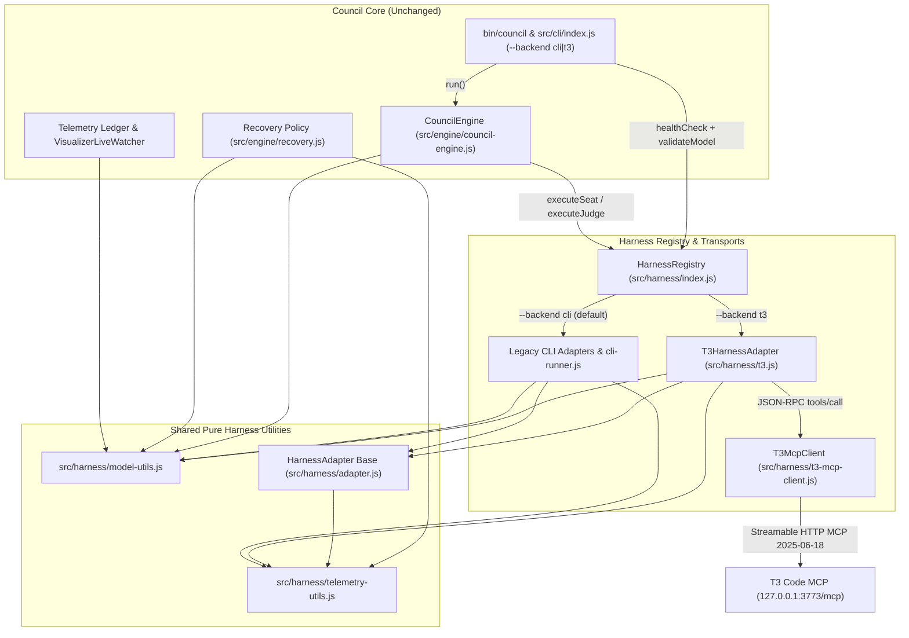

# T3 MCP HarnessAdapter Implementation Plan

> **For agentic workers:** REQUIRED SUB-SKILL: Use superpowers:subagent-driven-development to implement this plan task-by-task. Steps use checkbox (`- [ ]`) syntax for tracking.

**Goal:** Add a zero-dependency Streamable HTTP `T3McpClient` and `T3HarnessAdapter` coexisting behind `--backend t3|cli` (default `'cli'`), decoupled from `src/harness/cli-runner.js` via extracted pure utility modules while preserving 100% of existing `CouncilEngine`, `VisualizerLiveWatcher`, telemetry ledger, and CLI contracts (`1,493 / 1,493` existing tests green).

**Architecture:** Pure model/effort helpers (`src/harness/model-utils.js`) and telemetry/gate/redaction helpers (`src/harness/telemetry-utils.js`) are extracted out of [`src/harness/cli-runner.js`](file:///Users/aaat/projects/the-council/src/harness/cli-runner.js) (which re-exports them for full backward compatibility), breaking the dependency of [`src/harness/adapter.js`](file:///Users/aaat/projects/the-council/src/harness/adapter.js), [`src/engine/recovery.js`](file:///Users/aaat/projects/the-council/src/engine/recovery.js), [`src/engine/council-engine.js`](file:///Users/aaat/projects/the-council/src/engine/council-engine.js), [`src/engine/config.js`](file:///Users/aaat/projects/the-council/src/engine/config.js), and [`src/telemetry/ledger.js`](file:///Users/aaat/projects/the-council/src/telemetry/ledger.js) on direct subprocess spawning. A zero-dependency Streamable HTTP MCP `2025-06-18` client ([`src/harness/t3-mcp-client.js`](file:///Users/aaat/projects/the-council/src/harness/t3-mcp-client.js)) powers [`src/harness/t3.js`](file:///Users/aaat/projects/the-council/src/harness/t3.js) (`T3HarnessAdapter extends HarnessAdapter`), which dispatches one fresh T3 thread per attempt behind [`src/harness/index.js`](file:///Users/aaat/projects/the-council/src/harness/index.js) and [`src/cli/index.js`](file:///Users/aaat/projects/the-council/src/cli/index.js) (`--backend t3|cli`). Full rationale and review history live in [2026-11-25-t3-mcp-harness-design.md](file:///Users/aaat/projects/the-council/docs/superpowers/specs/2026-11-25-t3-mcp-harness-design.md) and [ADR-0005](file:///Users/aaat/projects/the-council/docs/adr/0005-t3-mcp-harness-dispatch.md).

**Architecture Diagram:**



**Tech Stack:** Node.js `>= 22.0.0` ESM (`type: "module"`), zero external runtime dependencies (global `fetch`, `AbortSignal.any`, `AbortSignal.timeout`, `node:async_hooks`, `node:crypto`, `node:http`), built-in `node:test` and `node:assert/strict`.

## Global Constraints

- **Node `>= 22` ESM & zero external dependencies:** Use built-in global `fetch` (never `import('node:fetch')`), `AbortSignal.timeout`, `AbortSignal.any`, `TextDecoder`, and `node:*` standard modules only.
- **Honest T3 Trust Boundary:**
  - Under `--backend t3`, **T3 owns execution sandboxing and permissions**. Tool-free turns (`tools: 'none'`) and turns without an explicit `cwd` launch with `scratch: true`, `interactionMode: 'plan'`, `runtimeMode: 'auto'`. Turns with `tools: 'read-only'` and an explicit `cwd` launch with resolved `projectId`, `workspaceStrategy: { type: 'root' }`, `interactionMode: 'plan'`, `runtimeMode: 'auto'`. Post-turn `t3_thread_read({ view: 'activity' })` `.council/` scanning is best-effort telemetry/guard. Users requiring OS-level `read-only` sandboxing or `.council/` filtered-copy isolation continue using `--backend cli` during coexistence.
  - **Bounded pragmatic cancellation:** Pass an attempt-scoped `clientRequestId` on `t3_thread_launch`. If launch omits `runId`, execute one bounded `t3_thread_read` lookup for `latestRunId` or fail cleanly. On timeout or `AbortSignal`, call run-scoped `t3_thread_interrupt({ threadId, runId, reason, clientRequestId })` (**NEVER pass `stop: true`**) under a fresh `AbortSignal.timeout(1500)` cleanup budget. Archive threads via `t3_thread_organize({ threadId, action: 'archive' })` **ONLY** when `archiveThreads && confirmedTerminal` (leaving unconfirmed threads visible in T3 UI).
  - **`T3_MCP_TOKEN` isolation & redaction:** Never read or scrape external agent credential stores. Reject cleartext non-loopback `http://` URLs whenever credentials/auth headers are present; pass `redirect: 'error'` when auth headers are attached; redact tokens and `Authorization` headers from every error, trace, and diagnostic string; strip `T3_MCP_TOKEN` inside `buildSanitizedCliEnv()` and `listAntigravityModels()` during coexistence.
  - **Keep `CouncilEngine` untouched:** Preflight `healthCheck()` catches missing/expired `T3_MCP_TOKEN` before Round 1; do not alter `CouncilEngine`'s `EXCUSE_SEAT` reducer or Deliberation Round state machine in v1.
- **Coexistence default & zero regressions:** `--backend cli` (`COUNCIL_HARNESS_BACKEND` defaulting to `'cli'`) remains the default; all `1,493` existing tests must remain green after every task.
- **Acyclic ESM graph:** `model-utils.js` -> `telemetry-utils.js` -> `adapter.js` -> `t3-mcp-client.js` -> `t3.js` -> `index.js`. Neither `model-utils.js` nor `telemetry-utils.js` may import `adapter.js` or `cli-runner.js`.
- **Workspace hygiene & glossary alignment:** Leave unstaged `M configs/best-of-families.json` untouched on every commit (use explicit `git add <files>`, never `git add .` or `git add -A`). Follow [`GLOSSARY.md`](file:///Users/aaat/projects/the-council/GLOSSARY.md) vocabulary strictly (`Council`, `Topic Handoff`, `Council Preset`, `Seat`, `Excused Seat`, `Soul`, `Harness`, `Clarification Batch`, `Deliberation Round`, `Proof`, `Candidate`, `Judge`, `Objection`, `Verdict`).

---

### Task 1: Extract Pure Shared Utilities (`src/harness/model-utils.js` & `src/harness/telemetry-utils.js`) + Strip `T3_MCP_TOKEN` from CLI Children

**Files:**
- Create: `src/harness/model-utils.js`
- Create: `src/harness/telemetry-utils.js`
- Modify: `src/harness/cli-runner.js:7-494,1711-1732,3589-3594,3625-3736,3780-3873,4435-4617,5673-5701`
- Modify: `src/harness/adapter.js:6-25`
- Modify: `src/engine/config.js:9`
- Modify: `src/engine/council-engine.js:38-43`
- Modify: `src/engine/recovery.js:7-15`
- Modify: `src/telemetry/ledger.js:14`
- Test: `test/unit/t3-shared-utils.test.js`

**Interfaces:**
- Consumes: Node built-ins (`node:async_hooks`, `node:crypto`) only.
- Produces:
  - `src/harness/model-utils.js`: `CODEX_EFFORT_MAP`, `ALLOWED_EFFORTS`, `parseModelAndEffort(modelString, defaultEffort, fallbackReasoningEffort = 'high')`, `extractCanonicalBaseModel(modelString, defaultEffort = 'high')`, `downshiftEffort(effort, target = 'low')`, `downshiftModel(model, target = 'low')`.
  - `src/harness/telemetry-utils.js`: `VALID_DRAIN_STATUSES`, `LIFECYCLE_ISO_KEYS`, `LIFECYCLE_INT_KEYS`, `MAX_CLI_ERROR_MESSAGE_BYTES`, `MAX_CLI_STDERR_BYTES`, `PROVIDER_HTTP_429_REGEX`, `PROVIDER_HTTP_AUTH_REGEX`, `sliceUtf8Bytes(str, maxBytes = 262144)`, `redactArgv(args, prompt = '')`, `inferPromptFromArgs(executable, args = [], explicitPrompt = '')`, `redactPromptInText(text, prompt = '', options = {})`, `normalizeExitCode(value)`, `normalizeSignalName(value)`, `sanitizeLifecycleMetadata(raw)`, `createAttemptTelemetryGate(meta = {})`, `runWithAttemptTelemetryGate(gate, fn)`, `getActiveAttemptTelemetryGate()`, `markAttemptGateFinalized(gate)`, `markAttemptGateCancelled(gate)`, `detectBasicForbiddenCouncilAccess(toolCalls)`, `registerForbiddenAccessDetector(detector)`, `normalizeProviderTrace(trace, defaults = {})`, `recordProviderCall({ context, onCallRecord, record, attemptGate, allowCancelledFallback = false } = {})`.
  - `src/harness/cli-runner.js`: re-exports all 20+ extracted symbols for 100% backward compatibility; strips `T3_MCP_TOKEN` in `buildSanitizedCliEnv(cwd, env)` (even when `cwd` is empty/undefined) and in `listAntigravityModels(options)`.

- [ ] **Step 1: Write the failing test**

Create `test/unit/t3-shared-utils.test.js`:

```javascript
import { describe, it } from 'node:test';
import assert from 'node:assert/strict';
import fs from 'node:fs';
import path from 'node:path';
import * as modelUtils from '../../src/harness/model-utils.js';
import * as telemetryUtils from '../../src/harness/telemetry-utils.js';
import * as cliRunner from '../../src/harness/cli-runner.js';

const REPO_ROOT = path.resolve(import.meta.dirname, '../..');

describe('Task 1: Shared model-utils, telemetry-utils, and T3_MCP_TOKEN CLI env stripping', () => {
  it('exports exact model/effort helpers from model-utils.js and re-exports identical references from cli-runner.js', () => {
    const expectedKeys = [
      'CODEX_EFFORT_MAP',
      'ALLOWED_EFFORTS',
      'parseModelAndEffort',
      'extractCanonicalBaseModel',
      'downshiftEffort',
      'downshiftModel'
    ];
    for (const key of expectedKeys) {
      assert.ok(key in modelUtils, `model-utils.js missing ${key}`);
      assert.equal(cliRunner[key], modelUtils[key], `cli-runner.js must re-export identical ${key}`);
    }

    assert.deepEqual(modelUtils.parseModelAndEffort('gpt-6.2-sol (xhigh)'), {
      model: 'gpt-6.2-sol',
      effort: 'xhigh',
      codexEffort: 'xhigh'
    });
    assert.equal(modelUtils.extractCanonicalBaseModel('gemini-4-neon-xhigh'), 'gemini-4-neon');
    assert.equal(modelUtils.downshiftEffort('xhigh', 'medium'), 'medium');
    assert.equal(modelUtils.downshiftEffort('low', 'medium'), 'low');
    assert.equal(modelUtils.downshiftModel('gpt-6.2-astra (xhigh)', 'medium'), 'gpt-6.2-astra (medium)');
  });

  it('exports exact telemetry, gate, redaction, and forbidden-access helpers from telemetry-utils.js and re-exports them from cli-runner.js', () => {
    const expectedKeys = [
      'VALID_DRAIN_STATUSES',
      'LIFECYCLE_ISO_KEYS',
      'LIFECYCLE_INT_KEYS',
      'MAX_CLI_ERROR_MESSAGE_BYTES',
      'MAX_CLI_STDERR_BYTES',
      'PROVIDER_HTTP_429_REGEX',
      'PROVIDER_HTTP_AUTH_REGEX',
      'sliceUtf8Bytes',
      'redactPromptInText',
      'normalizeExitCode',
      'normalizeSignalName',
      'sanitizeLifecycleMetadata',
      'createAttemptTelemetryGate',
      'runWithAttemptTelemetryGate',
      'getActiveAttemptTelemetryGate',
      'markAttemptGateFinalized',
      'markAttemptGateCancelled',
      'normalizeProviderTrace',
      'recordProviderCall'
    ];
    for (const key of expectedKeys) {
      assert.ok(key in telemetryUtils, `telemetry-utils.js missing ${key}`);
      assert.equal(cliRunner[key], telemetryUtils[key], `cli-runner.js must re-export identical ${key}`);
    }
    assert.equal(typeof telemetryUtils.detectBasicForbiddenCouncilAccess, 'function');
    assert.equal(typeof telemetryUtils.registerForbiddenAccessDetector, 'function');

    const detected = telemetryUtils.detectBasicForbiddenCouncilAccess([
      { name: 'read_file', arguments: { path: '.council/runs/latest.js' }, output: 'ignored output' }
    ]);
    assert.equal(detected.forbiddenStateAccess, true);
    assert.deepEqual(detected.forbiddenAccessDetails, ['.council/runs/latest.js']);

    const benignOutputOnly = telemetryUtils.detectBasicForbiddenCouncilAccess([
      { name: 'shell', command: 'git status', stdout: '.council/runs/latest.js' }
    ]);
    assert.equal(benignOutputOnly.forbiddenStateAccess, false);

    // Issue #63 parity: cli-runner.js registers shell-aware detectForbiddenCouncilAccess on load
    const benignExclusionTrace = cliRunner.normalizeProviderTrace({
      outcome: 'success',
      toolCalls: [
        { command: 'grep -rn --exclude-dir=.council foo src/' },
        { command: "find . -path '*/.council/*' -prune -o -name '*.js' -print" }
      ]
    });
    assert.equal(benignExclusionTrace.forbiddenStateAccess, false);
    assert.equal(benignExclusionTrace.outcome, 'success');

    const trace = telemetryUtils.normalizeProviderTrace({
      outcome: 'success',
      toolCalls: [{ command: 'cat .council/runs/latest.js' }]
    });
    assert.equal(trace.forbiddenStateAccess, true);
    assert.equal(trace.outcome, 'error');
    assert.deepEqual(trace.forbiddenAccessDetails, ['cat .council/runs/latest.js']);
  });

  it('decouples adapter.js, config.js, council-engine.js, recovery.js, and ledger.js from cli-runner.js', () => {
    const decoupledFiles = [
      'src/harness/model-utils.js',
      'src/harness/telemetry-utils.js',
      'src/harness/adapter.js',
      'src/engine/config.js',
      'src/engine/council-engine.js',
      'src/engine/recovery.js',
      'src/telemetry/ledger.js'
    ];
    for (const rel of decoupledFiles) {
      const src = fs.readFileSync(path.join(REPO_ROOT, rel), 'utf8');
      assert.equal(
        /from\s+['"][^'"]*cli-runner\.js['"]/.test(src),
        false,
        `${rel} must not import cli-runner.js`
      );
    }
    const adapterSrc = fs.readFileSync(path.join(REPO_ROOT, 'src/harness/adapter.js'), 'utf8');
    assert.equal(/\bparseModelAndEffort\b/.test(adapterSrc), false, 'adapter.js drops unused parseModelAndEffort import');
  });

  it('strips T3_MCP_TOKEN in buildSanitizedCliEnv both with and without cwd', () => {
    const prev = process.env.T3_MCP_TOKEN;
    process.env.T3_MCP_TOKEN = 'secret-t3-token-123';
    try {
      const withCwd = cliRunner.buildSanitizedCliEnv('/tmp/work');
      assert.equal('T3_MCP_TOKEN' in withCwd, false);
      assert.equal(withCwd.PWD, '/tmp/work');

      const withoutCwd = cliRunner.buildSanitizedCliEnv(undefined);
      assert.ok(withoutCwd && typeof withoutCwd === 'object');
      assert.equal('T3_MCP_TOKEN' in withoutCwd, false);

      const explicitEnv = cliRunner.buildSanitizedCliEnv('', {
        PATH: '/usr/bin',
        T3_MCP_TOKEN: 'explicit-secret'
      });
      assert.equal('T3_MCP_TOKEN' in explicitEnv, false);
      assert.equal(explicitEnv.PATH, '/usr/bin');
    } finally {
      if (prev === undefined) delete process.env.T3_MCP_TOKEN;
      else process.env.T3_MCP_TOKEN = prev;
    }
  });

  it('strips T3_MCP_TOKEN from child env in listAntigravityModels for both exec and runner paths', async () => {
    const prev = process.env.T3_MCP_TOKEN;
    process.env.T3_MCP_TOKEN = 'secret-t3-token-agy';
    try {
      let seenExecOpts = null;
      const execRes = await cliRunner.listAntigravityModels({
        exec: async (_bin, _args, opts) => {
          seenExecOpts = opts;
          return { exitCode: 0, stdout: 'gemini-4-neon-high  Gemini 4 Neon\n', stderr: '' };
        }
      });
      assert.equal(execRes.ok, true);
      assert.ok(seenExecOpts?.env && typeof seenExecOpts.env === 'object');
      assert.equal('T3_MCP_TOKEN' in seenExecOpts.env, false);

      let seenRunnerOpts = null;
      const runnerRes = await cliRunner.listAntigravityModels({
        runner: async (opts) => {
          seenRunnerOpts = opts;
          return { exitCode: 0, stdout: 'gemini-4-neon-high  Gemini 4 Neon\n', stderr: '' };
        }
      });
      assert.equal(runnerRes.ok, true);
      assert.ok(seenRunnerOpts?.env && typeof seenRunnerOpts.env === 'object');
      assert.equal('T3_MCP_TOKEN' in seenRunnerOpts.env, false);
    } finally {
      if (prev === undefined) delete process.env.T3_MCP_TOKEN;
      else process.env.T3_MCP_TOKEN = prev;
    }
  });
});
```

- [ ] **Step 2: Run test to verify it fails**

Run: `node --test test/unit/t3-shared-utils.test.js`
Expected: FAIL with `ERR_MODULE_NOT_FOUND` for `../../src/harness/model-utils.js`.

- [ ] **Step 3: Write minimal implementation**

1. Create `src/harness/model-utils.js`:

```javascript
/**
 * @fileoverview Pure Model & Reasoning Effort Parsing/Downshifting Utilities.
 * Zero external dependencies. Acyclic leaf module shared by Harnesses, Engine, Recovery, and Ledger.
 * Node >= 22 ESM.
 */

export const CODEX_EFFORT_MAP = Object.freeze({
  max: 'max',
  xhigh: 'xhigh',
  high: 'high',
  medium: 'medium',
  low: 'low'
});

export const ALLOWED_EFFORTS = Object.freeze(['low', 'medium', 'high', 'xhigh', 'max']);

const RECOGNIZED_EFFORT_SUFFIXES = Object.freeze(['-max', '-xhigh', '-high', '-medium', '-low']);

const EFFORT_RANK = Object.freeze({
  low: 1,
  medium: 2,
  high: 3,
  xhigh: 4,
  max: 5
});

/**
 * Parses model name and reasoning effort level.
 * Handles parenthesis format "gpt-6-astra (max)" and hyphenated suffixes "gemini-4-argon-high".
 * Preserves 'max' for Codex reasoning effort.
 * Throws a configuration error on unsupported efforts naming allowed values.
 *
 * @param {string} modelString
 * @param {'high'|'medium'|'low'|'max'|'xhigh'|string} [defaultEffort]
 * @param {'high'|'medium'|'low'|'max'|'xhigh'|string} [fallbackReasoningEffort='high']
 * @returns {{ model: string, effort: string, codexEffort: string }}
 */
export function parseModelAndEffort(modelString, defaultEffort, fallbackReasoningEffort = 'high') {
  if (typeof modelString !== 'string' || !modelString.trim()) {
    throw new Error('modelString must be a non-empty string');
  }

  const resolvedDefault = defaultEffort ?? fallbackReasoningEffort ?? 'high';
  const trimmed = modelString.trim();

  // 1. Parenthesized effort format: e.g. "gpt-6-astra (max)"
  const parenMatch = trimmed.match(/^([^(]+)\s*\(([^)]+)\)$/);
  if (parenMatch) {
    const model = parenMatch[1].trim();
    const rawEffort = parenMatch[2].trim();
    if (!rawEffort) {
      const defaultEff = (resolvedDefault || 'high').toLowerCase();
      const codexEffort = CODEX_EFFORT_MAP[defaultEff] || 'high';
      return { model, effort: '', codexEffort };
    }
    const effort = rawEffort.toLowerCase();
    if (!CODEX_EFFORT_MAP[effort]) {
      throw new Error(
        `Configuration error: Unsupported reasoning effort "${rawEffort}". Allowed: ${ALLOWED_EFFORTS.join(', ')}.`
      );
    }
    return { model, effort, codexEffort: CODEX_EFFORT_MAP[effort] };
  }

  // 2. Suffix effort format: e.g. "gemini-4-argon-high", "grok-4.7-xhigh", "model-max"
  for (const suffix of RECOGNIZED_EFFORT_SUFFIXES) {
    if (trimmed.toLowerCase().endsWith(suffix)) {
      const effort = suffix.slice(1);
      const codexEffort = CODEX_EFFORT_MAP[effort] || 'high';
      return { model: trimmed, effort, codexEffort };
    }
  }

  // 3. Fallback to default effort
  const defaultEff = (resolvedDefault || 'high').toLowerCase();
  if (!CODEX_EFFORT_MAP[defaultEff]) {
    throw new Error(
      `Configuration error: Unsupported reasoning effort "${resolvedDefault}". Allowed: ${ALLOWED_EFFORTS.join(', ')}.`
    );
  }
  const codexEffort = CODEX_EFFORT_MAP[defaultEff];
  return { model: trimmed, effort: defaultEff, codexEffort };
}

/**
 * Extracts the canonical lowercase base model name after validating effort via parseModelAndEffort.
 * Enforces the no-double-effort (!hasParens) and single-suffix (break) rules.
 *
 * @param {string} modelString
 * @param {'high'|'medium'|'low'|'max'|'xhigh'|string} [defaultEffort='high']
 * @returns {string}
 */
export function extractCanonicalBaseModel(modelString, defaultEffort = 'high') {
  const parsed = parseModelAndEffort(modelString, defaultEffort);
  const hasParens = /\([^)]*\)\s*$/.test(String(modelString || '').trim());
  let baseModel = parsed.model.trim().toLowerCase();
  if (!hasParens) {
    for (const suffix of RECOGNIZED_EFFORT_SUFFIXES) {
      if (baseModel.endsWith(suffix)) {
        baseModel = baseModel.slice(0, -suffix.length);
        break;
      }
    }
  }
  return baseModel;
}

/**
 * Downshifts an effort level to a target level if current effort exceeds target.
 * Never upshifts an effort that is already at or below target.
 *
 * @param {string} effort
 * @param {string} [target='low']
 * @returns {string}
 */
export function downshiftEffort(effort, target = 'low') {
  const cur = String(effort || '').toLowerCase().trim();
  const tgt = String(target || 'low').toLowerCase().trim();
  if (EFFORT_RANK[tgt] === undefined) {
    return cur || 'low';
  }
  if (EFFORT_RANK[cur] === undefined) {
    return tgt;
  }
  return EFFORT_RANK[cur] > EFFORT_RANK[tgt] ? tgt : cur;
}

/**
 * Downshifts model reasoning effort for voting or lightweight tasks.
 * Handles parenthesized models (e.g. "gpt-6-astra (max)" -> "gpt-6-astra (low)")
 * and hyphenated suffix models (e.g. "grok-4.7-xhigh" -> "grok-4.7-low").
 * Preserves models without recognized effort tiers (e.g. "composer-2.5").
 *
 * @param {string} model
 * @param {string} [target='low']
 * @returns {string}
 */
export function downshiftModel(model, target = 'low') {
  if (typeof model !== 'string' || !model.trim()) {
    return model;
  }
  const trimmed = model.trim();
  const parenMatch = trimmed.match(/^([^(]+)\s*\(([^)]+)\)$/);
  if (parenMatch) {
    const baseModel = parenMatch[1].trim();
    const rawEffort = parenMatch[2].trim();
    const newEffort = downshiftEffort(rawEffort, target);
    return `${baseModel} (${newEffort})`;
  }

  for (const suffix of RECOGNIZED_EFFORT_SUFFIXES) {
    if (trimmed.toLowerCase().endsWith(suffix)) {
      const rawEffort = suffix.slice(1);
      const newEffort = downshiftEffort(rawEffort, target);
      return `${trimmed.slice(0, -suffix.length)}-${newEffort}`;
    }
  }

  return trimmed;
}
```

2. Create `src/harness/telemetry-utils.js`:

```javascript
/**
 * @fileoverview Shared Harness Telemetry, Attempt Gate, Redaction, and Diagnostic Helpers.
 * Zero external dependencies. Acyclic module depending only on ./model-utils.js.
 * Node >= 22 ESM.
 */

import { AsyncLocalStorage } from 'node:async_hooks';
import { createHash } from 'node:crypto';
import { parseModelAndEffort, extractCanonicalBaseModel } from './model-utils.js';

const _validDrainStatusesSet = new Set(['fulfilled', 'settled', 'drain_expired']);
const _throwDrainStatusesReadOnly = () => {
  throw new TypeError('VALID_DRAIN_STATUSES is read-only');
};

export const VALID_DRAIN_STATUSES = Object.freeze({
  get size() {
    return _validDrainStatusesSet.size;
  },
  has(value) {
    return _validDrainStatusesSet.has(value);
  },
  values() {
    return _validDrainStatusesSet.values();
  },
  [Symbol.iterator]() {
    return _validDrainStatusesSet[Symbol.iterator]();
  },
  add: _throwDrainStatusesReadOnly,
  delete: _throwDrainStatusesReadOnly,
  clear: _throwDrainStatusesReadOnly
});

export const LIFECYCLE_ISO_KEYS = Object.freeze([
  'spawnedAt',
  'firstStdoutAt',
  'lastStdoutAt',
  'firstStderrAt',
  'lastStderrAt',
  'sigtermSentAt',
  'sigkillSentAt',
  'settledAt'
]);

export const LIFECYCLE_INT_KEYS = Object.freeze([
  'stdoutBytes',
  'stdoutChunks',
  'stderrBytes',
  'stderrChunks'
]);

export const MAX_CLI_ERROR_MESSAGE_BYTES = 2048;
export const MAX_CLI_STDERR_BYTES = 4096;

const MAX_TRACE_SCAN_BYTES = 262_144;

export const PROVIDER_HTTP_429_REGEX =
  /(?:\bhttp(?:\/\d(?:\.\d)?)?\s*429\b|\b(?:status(?:\s*code)?|error(?:\s*code)?|response(?:\s*code)?)\s*[:=]?\s*429\b|"status"\s*:\s*429\b|"code"\s*:\s*429\b|\b429\s+(?:too\s+many\s+requests|resource[\s_-]*exhausted|rate[\s_-]*limit))/i;

export const PROVIDER_HTTP_AUTH_REGEX =
  /(?:\bhttp(?:\/\d(?:\.\d)?)?\s*(?:401|403)\b|\b(?:status(?:\s*code)?|error(?:\s*code)?|response(?:\s*code)?)\s*[:=]?\s*(?:401|403)\b|"status"\s*:\s*(?:401|403)\b|"code"\s*:\s*(?:401|403)\b|\b(?:401|403)\s+(?:unauthorized|forbidden|unauthenticated|permission[\s_-]*denied))/i;

const ISO_8601_TIMESTAMP_REGEX =
  /^\d{4}-(?:0[1-9]|1[0-2])-(?:0[1-9]|[12]\d|3[01])T(?:[01]\d|2[0-3]):[0-5]\d:[0-5]\d(?:\.\d{1,9})?(?:Z|[+-](?:[01]\d|2[0-3]):[0-5]\d)$/;

const NON_PROMPT_VALUE_FLAGS = new Set([
  '-e',
  '--eval',
  '-m',
  '--model',
  '-c',
  '--mode',
  '--sandbox',
  '--output-format',
  '--effort',
  '--disable'
]);

const SHORT_CLI_FLAG_REGEX = /^-+[a-zA-Z0-9][-a-zA-Z0-9_]*$/;

const EXCLUDED_TRACE_OUTPUT_KEYS = new Set([
  'aggregated_output',
  'output',
  'result',
  'stdout',
  'stderr',
  'content',
  'text',
  'response'
]);

const BASIC_FORBIDDEN_COUNCIL_REGEX =
  /(?:^|[\\/\s"'`(=,\[{:;])\.council(?:$|[\\/\s"'`),.:;\]}?!])|(?:^|[\\/\s"'`(=,\[{:;])latest\.js(?=$|[:\s"'`),.\]}?!])|(?:^|[\\/\s"'`(=,\[{:;])[a-z0-9._-]+\.(?:meta\.json|events\.jsonl)(?=$|[:\s"'`),.\]}?!])|(?:^|[\\/\s"'`(=,\[{:;])telemetry-summary(?:\.[a-z0-9]+)?(?=$|[:\s"'`),.\]}?!])/i;

const NO_EFFORT_MODELS = new Set(['composer-2.5', 'gemini-pro-orchestrator-neon']);

export function sliceUtf8Bytes(str, maxBytes = MAX_TRACE_SCAN_BYTES) {
  if (typeof str !== 'string' || !str) return '';
  if (typeof maxBytes !== 'number' || !Number.isFinite(maxBytes) || maxBytes <= 0) return '';
  const cap = Math.floor(maxBytes);
  if (cap <= 0) return '';
  let pre = str.length > cap ? str.slice(0, cap) : str;
  if (str.length > cap && pre.length > 0) {
    const lastCode = pre.charCodeAt(pre.length - 1);
    if (lastCode >= 0xd800 && lastCode <= 0xdbff) {
      pre = pre.slice(0, -1);
    }
  }
  const buf = Buffer.from(pre, 'utf8');
  if (buf.length <= cap) {
    return pre;
  }
  let end = cap;
  while (end > 0 && (buf[end] & 0xc0) === 0x80) {
    end -= 1;
  }
  return buf.subarray(0, end).toString('utf8');
}

export function redactArgv(args, prompt = '') {
  if (!Array.isArray(args)) {
    return [];
  }
  const promptStr = typeof prompt === 'string' ? prompt : String(prompt || '');
  const hash = createHash('sha256').update(promptStr).digest('hex').slice(0, 12);
  const length = promptStr.length;
  const summary = `[REDACTED prompt: length=${length}, sha256=${hash}]`;

  return args.map((arg) => {
    if (arg === prompt) {
      return summary;
    }
    if (typeof arg === 'string' && prompt && arg === `--print=${prompt}`) {
      return `--print=${summary}`;
    }
    return arg;
  });
}

export function inferPromptFromArgs(executable, args = [], explicitPrompt = '') {
  if (typeof explicitPrompt === 'string' && explicitPrompt.length > 0) {
    return explicitPrompt;
  }
  if (!Array.isArray(args) || args.length === 0) {
    return '';
  }
  for (const arg of args) {
    if (typeof arg === 'string' && arg.startsWith('--print=') && arg.length > '--print='.length) {
      return arg.slice('--print='.length);
    }
  }
  if (args.length >= 2) {
    const lastArg = args[args.length - 1];
    const prevArg = String(args[args.length - 2] || '');
    if (
      typeof lastArg === 'string' &&
      lastArg.length > 0 &&
      !SHORT_CLI_FLAG_REGEX.test(lastArg) &&
      !NON_PROMPT_VALUE_FLAGS.has(prevArg)
    ) {
      return lastArg;
    }
  } else if (args.length === 1) {
    const onlyArg = args[0];
    if (typeof onlyArg === 'string' && onlyArg.length >= 8 && !SHORT_CLI_FLAG_REGEX.test(onlyArg)) {
      return onlyArg;
    }
  }
  return '';
}

function isAsciiAlnumCode(code) {
  return (
    (code >= 48 && code <= 57) ||
    (code >= 65 && code <= 90) ||
    (code >= 97 && code <= 122)
  );
}

function matchesTokenBoundary(text, idx, needle) {
  if (!needle) return false;
  if (isAsciiAlnumCode(needle.charCodeAt(0)) && idx > 0 && isAsciiAlnumCode(text.charCodeAt(idx - 1))) {
    return false;
  }
  const end = idx + needle.length;
  if (
    isAsciiAlnumCode(needle.charCodeAt(needle.length - 1)) &&
    end < text.length &&
    isAsciiAlnumCode(text.charCodeAt(end))
  ) {
    return false;
  }
  return true;
}

function findNextPairMatch(text, pair, fromPos) {
  let pos = fromPos;
  while (pos < text.length) {
    const idx = text.indexOf(pair.needle, pos);
    if (idx === -1) return -1;
    if (!pair.boundaryOnly || matchesTokenBoundary(text, idx, pair.needle)) {
      return idx;
    }
    pos = idx + 1;
  }
  return -1;
}

function buildPromptRedactionPairs(text, prompt, options = {}) {
  const args = Array.isArray(options?.args) ? options.args : [];
  const executable = typeof options?.executable === 'string' ? options.executable : '';
  const explicitPrompt = typeof prompt === 'string' ? prompt : '';
  const detectedPrompt = explicitPrompt || inferPromptFromArgs(executable, args, '');
  if (!detectedPrompt) {
    return [];
  }
  const minPromptLength =
    typeof options?.minPromptLength === 'number' && Number.isFinite(options.minPromptLength)
      ? options.minPromptLength
      : 1;
  const redactBareUnbounded = detectedPrompt.length >= minPromptLength || text === detectedPrompt;
  const redactBareBounded = !redactBareUnbounded && Boolean(explicitPrompt);
  const redactedSummary = redactArgv([detectedPrompt], detectedPrompt)[0] || '[PROMPT REDACTED]';
  const pairs = [];
  const addPair = (needle, replacement, boundaryOnly = false) => {
    if (needle && replacement !== undefined && needle !== replacement) {
      pairs.push({ needle, replacement, boundaryOnly });
    }
  };
  if (!redactBareUnbounded && args.length > 0) {
    const redactedArgs = redactArgv(args, detectedPrompt);
    const rawCmd = [executable, ...args].filter(Boolean).join(' ');
    const redactedCmd = [executable, ...redactedArgs].filter(Boolean).join(' ');
    if (rawCmd) {
      addPair(rawCmd, redactedCmd, false);
    }
    if (args.length >= 2) {
      addPair(args.join(' '), redactedArgs.join(' '), false);
    }
  }
  addPair(`--print=${detectedPrompt}`, `--print=${redactedSummary}`, false);
  if (redactBareUnbounded) {
    addPair(detectedPrompt, redactedSummary, false);
  } else if (redactBareBounded) {
    addPair(detectedPrompt, redactedSummary, true);
  }
  pairs.sort((a, b) => b.needle.length - a.needle.length);
  return pairs;
}

function appendBoundedTrailingSlice(rebuilt, rebuiltBytes, text, pos, maxBytesCap) {
  const remainingBytes = Math.max(0, maxBytesCap - rebuiltBytes);
  if (remainingBytes <= 0) {
    return rebuilt;
  }
  const tail = pos === 0 ? text.slice(0, remainingBytes + 4) : text.slice(pos, pos + remainingBytes + 4);
  return rebuilt + tail;
}

export function redactPromptInText(text, prompt = '', options = {}) {
  if (typeof text !== 'string' || !text) {
    return '';
  }
  const hasMaxBytes =
    typeof options?.maxBytes === 'number' && Number.isFinite(options.maxBytes) && options.maxBytes >= 0;
  if (typeof options?.maxBytes === 'number' && (!Number.isFinite(options.maxBytes) || options.maxBytes <= 0)) {
    return '';
  }
  const maxBytesCap = hasMaxBytes ? Math.floor(options.maxBytes) : Infinity;
  const pairs = buildPromptRedactionPairs(text, prompt, options);
  if (pairs.length === 0) {
    return hasMaxBytes ? sliceUtf8Bytes(text, options.maxBytes) : text;
  }
  const nextIndices = pairs.map((pair) => findNextPairMatch(text, pair, 0));
  let pos = 0;
  let rebuilt = '';
  let rebuiltBytes = 0;
  while (pos < text.length) {
    let bestIdx = -1;
    let bestPair = null;
    for (let i = 0; i < pairs.length; i += 1) {
      let idx = nextIndices[i];
      if (idx === -1) continue;
      if (idx < pos) {
        idx = findNextPairMatch(text, pairs[i], pos);
        nextIndices[i] = idx;
        if (idx === -1) continue;
      }
      if (
        bestIdx === -1 ||
        idx < bestIdx ||
        (idx === bestIdx && pairs[i].needle.length > bestPair.needle.length)
      ) {
        bestIdx = idx;
        bestPair = pairs[i];
      }
    }
    if (bestIdx === -1) {
      rebuilt = hasMaxBytes
        ? appendBoundedTrailingSlice(rebuilt, rebuiltBytes, text, pos, maxBytesCap)
        : (pos === 0 ? text : rebuilt + text.slice(pos));
      break;
    }
    const prefix = text.slice(pos, bestIdx);
    if (hasMaxBytes) {
      const remainingBytes = Math.max(0, maxBytesCap - rebuiltBytes);
      if (prefix.length > remainingBytes + 4) {
        rebuilt += prefix.slice(0, remainingBytes + 4);
        break;
      }
    }
    const piece = prefix + bestPair.replacement;
    rebuilt += piece;
    pos = bestIdx + bestPair.needle.length;
    if (hasMaxBytes) {
      rebuiltBytes += Buffer.byteLength(piece, 'utf8');
      if (rebuiltBytes >= maxBytesCap) {
        break;
      }
    }
  }
  return hasMaxBytes ? sliceUtf8Bytes(rebuilt, options.maxBytes) : rebuilt;
}

export function normalizeExitCode(value) {
  return typeof value === 'number' && Number.isFinite(value) ? (value === 0 ? 0 : value) : null;
}

export function normalizeSignalName(value) {
  if (typeof value !== 'string') return null;
  const normalized = value.trim().toUpperCase();
  return /^SIG[A-Z0-9]+$/.test(normalized) ? normalized : null;
}

export function sanitizeLifecycleMetadata(raw) {
  if (!raw || typeof raw !== 'object' || Array.isArray(raw)) {
    return null;
  }
  const out = {};
  for (const key of LIFECYCLE_ISO_KEYS) {
    const val = raw[key];
    if (typeof val === 'string') {
      const trimmed = val.trim();
      if (ISO_8601_TIMESTAMP_REGEX.test(trimmed) && Number.isFinite(Date.parse(trimmed))) {
        out[key] = trimmed;
      }
    }
  }
  for (const key of LIFECYCLE_INT_KEYS) {
    const val = raw[key];
    if (typeof val === 'number' && Number.isInteger(val) && val >= 0) {
      out[key] = val === 0 ? 0 : val;
    }
  }
  if (typeof raw.groupDrainExhausted === 'boolean') {
    out.groupDrainExhausted = raw.groupDrainExhausted;
  }
  if (Array.isArray(raw.attemptedSignals)) {
    const seen = new Set();
    const signals = [];
    for (const item of raw.attemptedSignals) {
      const sig = normalizeSignalName(item);
      if (sig && !seen.has(sig)) {
        seen.add(sig);
        signals.push(sig);
        if (signals.length >= 8) break;
      }
    }
    if (signals.length > 0) {
      out.attemptedSignals = Object.freeze(signals);
    }
  }
  return Object.keys(out).length > 0 ? Object.freeze(out) : null;
}

const attemptTelemetryGateStorage = new AsyncLocalStorage();

export function createAttemptTelemetryGate(meta = {}) {
  const safeMeta = meta && typeof meta === 'object' && !Array.isArray(meta) ? meta : {};
  return {
    ...safeMeta,
    recorded: Boolean(safeMeta.recorded),
    finalized: Boolean(safeMeta.finalized),
    cancelled: Boolean(safeMeta.cancelled),
    managedByExecuteWithTimeout: Boolean(safeMeta.managedByExecuteWithTimeout)
  };
}

export function runWithAttemptTelemetryGate(gate, fn) {
  if (typeof fn !== 'function') {
    throw new TypeError('runWithAttemptTelemetryGate requires a function');
  }
  return attemptTelemetryGateStorage.run(gate && typeof gate === 'object' ? gate : null, fn);
}

export function getActiveAttemptTelemetryGate() {
  return attemptTelemetryGateStorage.getStore() || null;
}

export function markAttemptGateFinalized(gate) {
  if (gate && typeof gate === 'object') {
    gate.finalized = true;
    return gate;
  }
  return null;
}

export function markAttemptGateCancelled(gate) {
  if (gate && typeof gate === 'object') {
    gate.cancelled = true;
    return gate;
  }
  return null;
}

/**
 * Lightweight, shell-parser-free `.council/` artifact scanner for tool call inputs.
 * Ignores tool output keys (stdout, stderr, output, result, content, text, response).
 *
 * @param {Array<Object>|Object|string} toolCalls
 * @returns {{ forbiddenStateAccess: boolean, forbiddenAccessDetails: string[] }}
 */
export function detectBasicForbiddenCouncilAccess(toolCalls) {
  if (typeof toolCalls === 'string') {
    const bounded = sliceUtf8Bytes(toolCalls, MAX_TRACE_SCAN_BYTES).trim();
    const matched = Boolean(bounded) && BASIC_FORBIDDEN_COUNCIL_REGEX.test(bounded);
    return {
      forbiddenStateAccess: matched,
      forbiddenAccessDetails: matched ? [bounded] : []
    };
  }
  const list = Array.isArray(toolCalls)
    ? toolCalls
    : toolCalls && typeof toolCalls === 'object'
      ? [toolCalls]
      : [];
  const details = new Set();
  const visited = new Set();

  const walk = (val, depth) => {
    if (depth > 20 || val === null || val === undefined) return;
    if (typeof val === 'string') {
      const bounded = sliceUtf8Bytes(val, MAX_TRACE_SCAN_BYTES).trim();
      if (!bounded) return;
      if ((bounded.startsWith('{') && bounded.endsWith('}')) || (bounded.startsWith('[') && bounded.endsWith(']'))) {
        try {
          walk(JSON.parse(bounded), depth + 1);
          return;
        } catch {
          // Inspect as raw string when not valid JSON
        }
      }
      if (BASIC_FORBIDDEN_COUNCIL_REGEX.test(bounded)) {
        details.add(bounded);
      }
      return;
    }
    if (typeof val !== 'object' || visited.has(val)) return;
    visited.add(val);
    if (Array.isArray(val)) {
      for (const item of val) walk(item, depth + 1);
      return;
    }
    for (const [k, v] of Object.entries(val)) {
      if (EXCLUDED_TRACE_OUTPUT_KEYS.has(k)) continue;
      walk(v, depth + 1);
    }
  };

  for (const item of list) {
    walk(item, 0);
  }
  const listDetails = [...details];
  return {
    forbiddenStateAccess: listDetails.length > 0,
    forbiddenAccessDetails: listDetails
  };
}

let defaultForbiddenAccessDetector = detectBasicForbiddenCouncilAccess;

export function registerForbiddenAccessDetector(detector) {
  defaultForbiddenAccessDetector =
    typeof detector === 'function' ? detector : detectBasicForbiddenCouncilAccess;
}

export function normalizeProviderTrace(trace, defaults = {}) {
  const validCoverages = new Set(['full', 'partial', 'unavailable']);
  const defaultCoverage = defaults.provider === 'antigravity' ? 'unavailable' : 'partial';
  const traceCoverage = validCoverages.has(trace?.traceCoverage)
    ? trace.traceCoverage
    : defaultCoverage;
  const toolCalls = Array.isArray(trace?.toolCalls) ? trace.toolCalls : [];
  const skillsRead = Array.isArray(trace?.skillsRead) ? trace.skillsRead : [];
  const detector =
    typeof defaults.detectForbiddenAccess === 'function'
      ? defaults.detectForbiddenAccess
      : defaultForbiddenAccessDetector;
  const detectedForbidden =
    toolCalls.length > 0
      ? detector(toolCalls)
      : { forbiddenStateAccess: false, forbiddenAccessDetails: [] };
  const mergedDetails = [
    ...new Set([
      ...(Array.isArray(trace?.forbiddenAccessDetails) ? trace.forbiddenAccessDetails : []),
      ...detectedForbidden.forbiddenAccessDetails
    ])
  ];
  const forbiddenStateAccess =
    Boolean(trace?.forbiddenStateAccess) ||
    detectedForbidden.forbiddenStateAccess ||
    mergedDetails.length > 0;
  const durationMs =
    typeof trace?.durationMs === 'number'
      ? trace.durationMs
      : (typeof defaults.durationMs === 'number' ? defaults.durationMs : 0);
  const outcome =
    forbiddenStateAccess
      ? 'error'
      : trace?.outcome === 'error' || trace?.outcome === 'success'
        ? trace.outcome
        : (defaults.exitCode === 0 || defaults.exitCode === undefined ? 'success' : 'error');

  const promptHint = typeof defaults.prompt === 'string' ? defaults.prompt : '';
  const redactOpts = {
    executable: defaults.executable,
    args: defaults.args,
    minPromptLength: 8
  };
  const boundedStderr =
    typeof trace?.stderr === 'string' && trace.stderr.length > 0
      ? redactPromptInText(trace.stderr, promptHint, { ...redactOpts, maxBytes: MAX_CLI_STDERR_BYTES })
      : '';
  const boundedEnvelopeError =
    typeof trace?.envelopeError === 'string' && trace.envelopeError.length > 0
      ? redactPromptInText(trace.envelopeError, promptHint, { ...redactOpts, maxBytes: 1024 })
      : '';
  const lifecycle = sanitizeLifecycleMetadata(trace?.lifecycle ?? defaults.lifecycle);

  return {
    traceCoverage,
    toolCalls,
    skillsRead,
    forbiddenStateAccess,
    forbiddenAccessDetails: mergedDetails,
    durationMs,
    outcome,
    ...(boundedStderr ? { stderr: boundedStderr } : {}),
    ...(Array.isArray(trace?.deniedActions)
      ? { deniedActions: trace.deniedActions }
      : {}),
    ...(boundedEnvelopeError ? { envelopeError: boundedEnvelopeError } : {}),
    ...(typeof trace?.finishedReason === 'string' && trace.finishedReason.length > 0
      ? { finishedReason: trace.finishedReason }
      : {}),
    ...(lifecycle ? { lifecycle } : {})
  };
}

function inferEffortForTelemetry(modelString, defaultEffort) {
  if (typeof modelString !== 'string' || !modelString.trim()) {
    return undefined;
  }
  const trimmed = modelString.trim();
  const fallback =
    typeof defaultEffort === 'string' && defaultEffort.trim() ? defaultEffort.trim().toLowerCase() : 'high';
  try {
    const baseModel = extractCanonicalBaseModel(trimmed, fallback);
    if (NO_EFFORT_MODELS.has(baseModel) || NO_EFFORT_MODELS.has(trimmed.toLowerCase())) {
      return null;
    }
    return parseModelAndEffort(trimmed, fallback).effort;
  } catch {
    return typeof defaultEffort === 'string' && defaultEffort.trim()
      ? defaultEffort.trim().toLowerCase()
      : undefined;
  }
}

function buildProviderCallRecord({ context, record }) {
  const pickDefined = (...values) => {
    for (const value of values) {
      if (value !== undefined) return value;
    }
    return undefined;
  };
  const retryDiagnostics =
    record.retryDiagnostics !== undefined ? record.retryDiagnostics : context?.retryDiagnostics;
  const phase = record.phase ?? context?.phase;
  const round = record.round ?? context?.round;
  const hasRetryDiag = Boolean(retryDiagnostics && typeof retryDiagnostics === 'object');
  const rawEffectiveModel = record.model || context?.model;
  const attempt =
    typeof record.attempt === 'number'
      ? record.attempt
      : typeof retryDiagnostics?.attempt === 'number'
        ? retryDiagnostics.attempt
        : typeof context?.attempt === 'number'
          ? context.attempt
          : !hasRetryDiag
            ? 0
            : undefined;
  const requestedModel = pickDefined(
    record.requestedModel,
    retryDiagnostics?.requestedModel,
    context?.requestedModel,
    context?.seat?.model,
    rawEffectiveModel
  );
  const requestedEffort = pickDefined(
    record.requestedEffort,
    retryDiagnostics?.requestedEffort,
    context?.requestedEffort,
    inferEffortForTelemetry(requestedModel || rawEffectiveModel, context?.reasoningEffort)
  );
  const effectiveEffort = pickDefined(
    record.effectiveEffort,
    retryDiagnostics?.effectiveEffort,
    inferEffortForTelemetry(rawEffectiveModel, record.reasoningEffort ?? context?.reasoningEffort)
  );
  const capabilityProvenance = pickDefined(
    record.capabilityProvenance,
    retryDiagnostics?.capabilityProvenance,
    context?.capabilityProvenance,
    null
  );
  const fallbackApplied =
    typeof record.fallbackApplied === 'boolean'
      ? record.fallbackApplied
      : typeof retryDiagnostics?.fallbackApplied === 'boolean'
        ? retryDiagnostics.fallbackApplied
        : false;
  const fallbackReason = pickDefined(record.fallbackReason, retryDiagnostics?.fallbackReason, null);
  const drainStatus = VALID_DRAIN_STATUSES.has(record.drainStatus) ? record.drainStatus : undefined;
  const drainDurationMs =
    typeof record.drainDurationMs === 'number' &&
    Number.isFinite(record.drainDurationMs) &&
    record.drainDurationMs >= 0
      ? record.drainDurationMs
      : undefined;
  const exitCode = drainStatus === 'drain_expired' ? null : normalizeExitCode(record.exitCode);
  const signal = drainStatus === 'drain_expired' ? null : normalizeSignalName(record.signal);
  const promptHint =
    typeof record.prompt === 'string' && record.prompt
      ? record.prompt
      : (typeof context?.prompt === 'string' ? context.prompt : '');
  const normalizedTrace = normalizeProviderTrace(record.trace, {
    durationMs: record.durationMs,
    exitCode,
    provider: record.provider,
    prompt: promptHint,
    lifecycle: record.trace?.lifecycle ?? record.lifecycle
  });

  const {
    drainStatus: _ds,
    drainDurationMs: _dd,
    exitCode: _ec,
    signal: _sig,
    lifecycle: _lc,
    prompt: _pr,
    ...restRecord
  } = record;

  return {
    ...restRecord,
    ...(record.model || context?.model ? { model: record.model || context?.model } : {}),
    ...(typeof phase === 'string' && phase ? { phase } : {}),
    ...(typeof round === 'number' ? { round } : {}),
    ...(typeof attempt === 'number' ? { attempt } : {}),
    ...(requestedModel !== undefined ? { requestedModel } : {}),
    ...(requestedEffort !== undefined ? { requestedEffort } : {}),
    ...(effectiveEffort !== undefined ? { effectiveEffort } : {}),
    ...(capabilityProvenance !== undefined ? { capabilityProvenance } : {}),
    ...(typeof fallbackApplied === 'boolean' ? { fallbackApplied } : {}),
    ...(fallbackReason !== undefined ? { fallbackReason } : {}),
    exitCode,
    signal,
    ...(drainStatus ? { drainStatus } : {}),
    ...(drainDurationMs !== undefined ? { drainDurationMs } : {}),
    tools:
      record.tools === 'none' || context?.tools === 'none'
        ? 'none'
        : (record.tools || context?.tools || 'read-only'),
    trace: normalizedTrace
  };
}

export function recordProviderCall({
  context,
  onCallRecord,
  record,
  attemptGate,
  allowCancelledFallback = false
} = {}) {
  const gate = attemptGate || getActiveAttemptTelemetryGate();
  if (gate && (gate.recorded || gate.finalized || (gate.cancelled && !allowCancelledFallback))) {
    return false;
  }
  if (!record || typeof record !== 'object') {
    return false;
  }
  let enrichedRecord;
  try {
    enrichedRecord = buildProviderCallRecord({ context, record });
  } catch {
    return false;
  }
  if (gate) {
    gate.recorded = true;
  }
  try {
    if (typeof onCallRecord === 'function') {
      onCallRecord(enrichedRecord);
    }
  } catch {
    // Isolate direct observer callback failure
  }
  try {
    if (typeof context?.onCallRecord === 'function' && context.onCallRecord !== onCallRecord) {
      context.onCallRecord(enrichedRecord);
    }
  } catch {
    // Isolate context observer callback failure
  }
  try {
    if (context?.telemetry && typeof context.telemetry.emitProviderCall === 'function') {
      context.telemetry.emitProviderCall(enrichedRecord);
    }
  } catch {
    // Isolate telemetry emitter failure
  }
  return true;
}
```

3. Update `src/harness/cli-runner.js` to import & re-export the extracted modules, delete the now-duplicated definitions (`L17-295`, `L299-334`, `L359-399`, `L412-493`, `L1711-1732`, `L3589-3593`, `L3625-3735`, `L3780-3847`, `L4435-4616`), and strip `T3_MCP_TOKEN` in `buildSanitizedCliEnv` and `listAntigravityModels`:

```diff
--- a/src/harness/cli-runner.js
+++ b/src/harness/cli-runner.js
@@ -4,10 +4,72 @@
  * Node >= 22 ESM.
  */
 
-import { AsyncLocalStorage } from 'node:async_hooks';
 import { isUtf8 } from 'node:buffer';
 import { spawn } from 'node:child_process';
-import { createHash } from 'node:crypto';
 import fs from 'node:fs';
 import os from 'node:os';
 import path from 'node:path';
+import {
+  CODEX_EFFORT_MAP,
+  ALLOWED_EFFORTS,
+  parseModelAndEffort,
+  extractCanonicalBaseModel,
+  downshiftEffort,
+  downshiftModel
+} from './model-utils.js';
+import {
+  VALID_DRAIN_STATUSES,
+  LIFECYCLE_ISO_KEYS,
+  LIFECYCLE_INT_KEYS,
+  MAX_CLI_ERROR_MESSAGE_BYTES,
+  MAX_CLI_STDERR_BYTES,
+  PROVIDER_HTTP_429_REGEX,
+  PROVIDER_HTTP_AUTH_REGEX,
+  sliceUtf8Bytes,
+  redactArgv,
+  inferPromptFromArgs,
+  redactPromptInText,
+  normalizeExitCode,
+  normalizeSignalName,
+  sanitizeLifecycleMetadata,
+  createAttemptTelemetryGate,
+  runWithAttemptTelemetryGate,
+  getActiveAttemptTelemetryGate,
+  markAttemptGateFinalized,
+  markAttemptGateCancelled,
+  registerForbiddenAccessDetector,
+  normalizeProviderTrace,
+  recordProviderCall
+} from './telemetry-utils.js';
+
+export {
+  CODEX_EFFORT_MAP,
+  ALLOWED_EFFORTS,
+  parseModelAndEffort,
+  extractCanonicalBaseModel,
+  downshiftEffort,
+  downshiftModel,
+  VALID_DRAIN_STATUSES,
+  LIFECYCLE_ISO_KEYS,
+  LIFECYCLE_INT_KEYS,
+  MAX_CLI_ERROR_MESSAGE_BYTES,
+  MAX_CLI_STDERR_BYTES,
+  PROVIDER_HTTP_429_REGEX,
+  PROVIDER_HTTP_AUTH_REGEX,
+  sliceUtf8Bytes,
+  redactArgv,
+  inferPromptFromArgs,
+  redactPromptInText,
+  normalizeExitCode,
+  normalizeSignalName,
+  sanitizeLifecycleMetadata,
+  createAttemptTelemetryGate,
+  runWithAttemptTelemetryGate,
+  getActiveAttemptTelemetryGate,
+  markAttemptGateFinalized,
+  markAttemptGateCancelled,
+  normalizeProviderTrace,
+  recordProviderCall
+};
+
+registerForbiddenAccessDetector(detectForbiddenCouncilAccess);
```

Update `buildSanitizedCliEnv` (`src/harness/cli-runner.js:3858-3872`) and `listAntigravityModels` (`src/harness/cli-runner.js:5673-5682`):

```diff
--- a/src/harness/cli-runner.js
+++ b/src/harness/cli-runner.js
@@ -3858,15 +3858,20 @@
 export function buildSanitizedCliEnv(cwd, env) {
   const normalizedCwd = typeof cwd === 'string' ? cwd.trim() : '';
-  if (!normalizedCwd) {
+  const baseEnv = env || process.env;
+  const hasT3Token = Boolean(baseEnv && Object.prototype.hasOwnProperty.call(baseEnv, 'T3_MCP_TOKEN'));
+  if (!normalizedCwd && !hasT3Token) {
     return env;
   }
-  const baseEnv = env || process.env;
-  const nextEnv = { ...baseEnv, PWD: normalizedCwd };
-  if (!env || env.OLDPWD === undefined || !Object.prototype.hasOwnProperty.call(env, 'OLDPWD')) {
-    delete nextEnv.OLDPWD;
-  }
-  if (!env || env.INIT_CWD === undefined || !Object.prototype.hasOwnProperty.call(env, 'INIT_CWD')) {
-    delete nextEnv.INIT_CWD;
+  const nextEnv = { ...baseEnv };
+  delete nextEnv.T3_MCP_TOKEN;
+  if (normalizedCwd) {
+    nextEnv.PWD = normalizedCwd;
+    if (!env || env.OLDPWD === undefined || !Object.prototype.hasOwnProperty.call(env, 'OLDPWD')) {
+      delete nextEnv.OLDPWD;
+    }
+    if (!env || env.INIT_CWD === undefined || !Object.prototype.hasOwnProperty.call(env, 'INIT_CWD')) {
+      delete nextEnv.INIT_CWD;
+    }
   }
   return nextEnv;
 }
```

```diff
--- a/src/harness/cli-runner.js
+++ b/src/harness/cli-runner.js
@@ -5673,10 +5673,11 @@
 export async function listAntigravityModels(options = {}) {
   const exec = options.exec || options.runner || execCli;
   const runner = typeof options.runner === 'function' ? options.runner : null;
   const timeoutMs = options.timeoutMs ?? 15000;
+  const sanitizedEnv = buildSanitizedCliEnv(undefined, options.env);
   let res;
   try {
     res = runner
-      ? await runner({ command: 'agy', args: ['models'], timeoutMs })
-      : await exec('agy', ['models'], { timeoutMs, signal: options.signal });
+      ? await runner({ command: 'agy', args: ['models'], timeoutMs, ...(sanitizedEnv ? { env: sanitizedEnv } : {}) })
+      : await exec('agy', ['models'], { timeoutMs, signal: options.signal, ...(sanitizedEnv ? { env: sanitizedEnv } : {}) });
   } catch (err) {
```

4. Update imports across the 5 non-legacy `src/` modules:

```diff
--- a/src/harness/adapter.js
+++ b/src/harness/adapter.js
@@ -6,20 +6,19 @@
 import {
   VALID_DRAIN_STATUSES,
   MAX_CLI_ERROR_MESSAGE_BYTES,
   MAX_CLI_STDERR_BYTES,
-  parseModelAndEffort,
   recordProviderCall,
   normalizeProviderTrace,
   normalizeExitCode,
   normalizeSignalName,
   sliceUtf8Bytes,
   redactPromptInText,
   sanitizeLifecycleMetadata,
   createAttemptTelemetryGate,
   runWithAttemptTelemetryGate,
   getActiveAttemptTelemetryGate,
   markAttemptGateCancelled,
   markAttemptGateFinalized,
   PROVIDER_HTTP_429_REGEX,
   PROVIDER_HTTP_AUTH_REGEX
-} from './cli-runner.js';
+} from './telemetry-utils.js';
```

```diff
--- a/src/engine/config.js
+++ b/src/engine/config.js
@@ -6,5 +6,5 @@
 import fs from 'node:fs';
 import path from 'node:path';
 import { DEFAULT_CONFIG, VALID_TOOL_POLICIES } from '../types.js';
-import { ALLOWED_EFFORTS } from '../harness/cli-runner.js';
+import { ALLOWED_EFFORTS } from '../harness/model-utils.js';
 import { VALID_SELF_CONTAINED_PHASES } from './recovery.js';
```

```diff
--- a/src/engine/council-engine.js
+++ b/src/engine/council-engine.js
@@ -38,6 +38,6 @@
 import {
   downshiftEffort,
   downshiftModel,
   extractCanonicalBaseModel,
   parseModelAndEffort
-} from '../harness/cli-runner.js';
+} from '../harness/model-utils.js';
```

```diff
--- a/src/engine/recovery.js
+++ b/src/engine/recovery.js
@@ -6,10 +6,12 @@
 
 import {
   ALLOWED_EFFORTS,
+  extractCanonicalBaseModel,
+  downshiftEffort,
+  downshiftModel
+} from '../harness/model-utils.js';
+import {
   VALID_DRAIN_STATUSES,
   normalizeExitCode,
-  normalizeSignalName,
-  extractCanonicalBaseModel,
-  downshiftEffort,
-  downshiftModel
-} from '../harness/cli-runner.js';
+  normalizeSignalName
+} from '../harness/telemetry-utils.js';
```

```diff
--- a/src/telemetry/ledger.js
+++ b/src/telemetry/ledger.js
@@ -11,4 +11,4 @@
 import fs from 'node:fs';
 import os from 'node:os';
 import path from 'node:path';
-import { parseModelAndEffort, extractCanonicalBaseModel } from '../harness/cli-runner.js';
+import { parseModelAndEffort, extractCanonicalBaseModel } from '../harness/model-utils.js';
```

- [ ] **Step 4: Run test to verify it passes**

Run: `node --test test/unit/t3-shared-utils.test.js && npm test`
Expected: PASS (`t3-shared-utils.test.js` passes all 5 tests; full `npm test` passes `>= 1,498` tests with 0 failures).

- [ ] **Step 5: Commit**

```bash
git add src/harness/model-utils.js src/harness/telemetry-utils.js src/harness/cli-runner.js src/harness/adapter.js src/engine/config.js src/engine/council-engine.js src/engine/recovery.js src/telemetry/ledger.js test/unit/t3-shared-utils.test.js
git commit -m "refactor(harness): extract shared model and telemetry utils and strip T3_MCP_TOKEN from CLI env"
```

---

### Task 2: Zero-Dependency Streamable HTTP MCP Client (`src/harness/t3-mcp-client.js`)

**Files:**
- Create: `src/harness/t3-mcp-client.js`
- Test: `test/unit/t3-mcp-client.test.js`

**Interfaces:**
- Consumes:
  - `src/harness/adapter.js`: `AuthenticationError`, `AbortError`, `QuotaExhaustionError`, `TimeoutError`, `HarnessExecutionError`, `PROVIDER_HTTP_429_REGEX`, `PROVIDER_HTTP_AUTH_REGEX`.
  - `src/harness/telemetry-utils.js`: `sliceUtf8Bytes`, `MAX_CLI_ERROR_MESSAGE_BYTES`.
- Produces:
  - `DEFAULT_T3_MCP_URL = 'http://127.0.0.1:3773/mcp'`
  - `MCP_PROTOCOL_VERSION = '2025-06-18'`
  - `isLoopbackHostname(hostname: string): boolean`
  - `redactSecrets(text: string, secrets?: string[]): string`
  - `class T3McpClient`:
    - `constructor({ url?, token?, headers?, clientInfo?, protocolVersion?, fetchImpl?, callTool?, maxResponseBytes?, requestTimeoutMs? })`
    - `async initialize({ signal? }): Promise<{ protocolVersion: string, sessionId: string | null, serverInfo?: Object }>`
    - `async callTool(name: string, args?: Object, { signal? }): Promise<any>`
    - `async healthCheck({ signal? }): Promise<{ ok: boolean, latencyMs: number, capabilities?: Object, error?: string, errorClass?: string, code?: string }>`
    - `async close(): Promise<void>`

- [ ] **Step 1: Write the failing test**

Create `test/unit/t3-mcp-client.test.js`:

```javascript
import { describe, it, afterEach } from 'node:test';
import assert from 'node:assert/strict';
import http from 'node:http';
import {
  DEFAULT_T3_MCP_URL,
  MCP_PROTOCOL_VERSION,
  T3McpClient
} from '../../src/harness/t3-mcp-client.js';
import {
  AuthenticationError,
  AbortError,
  QuotaExhaustionError,
  HarnessExecutionError
} from '../../src/harness/adapter.js';

function startMockServer(handler) {
  return new Promise((resolve, reject) => {
    const server = http.createServer(async (req, res) => {
      const chunks = [];
      for await (const chunk of req) chunks.push(chunk);
      const rawBody = Buffer.concat(chunks).toString('utf8');
      let json = null;
      if (rawBody) {
        try {
          json = JSON.parse(rawBody);
        } catch {
          json = null;
        }
      }
      await handler(req, res, json, rawBody);
    });
    server.on('error', reject);
    server.listen(0, '127.0.0.1', () => {
      const { port } = server.address();
      resolve({ server, url: `http://127.0.0.1:${port}/mcp` });
    });
  });
}

describe('Task 2: Zero-dependency Streamable HTTP T3McpClient', () => {
  const servers = [];
  afterEach(async () => {
    while (servers.length > 0) {
      const s = servers.pop();
      await new Promise((r) => s.close(r));
    }
  });

  it('serializes concurrent initialize calls, sends Accept + Mcp-Session-Id on notifications/initialized, and handles 202 empty body', async () => {
    let initCount = 0;
    let notifyCount = 0;
    let notifySessionHeader = null;
    let notifyAcceptHeader = null;

    const { server, url } = await startMockServer((req, res, body) => {
      assert.match(req.headers.accept || '', /application\/json/);
      assert.match(req.headers.accept || '', /text\/event-stream/);
      if (body?.method === 'initialize') {
        initCount += 1;
        res.writeHead(200, {
          'Content-Type': 'application/json',
          'Mcp-Session-Id': 'sess-001'
        });
        res.end(
          JSON.stringify({
            jsonrpc: '2.0',
            id: body.id,
            result: {
              protocolVersion: MCP_PROTOCOL_VERSION,
              capabilities: {},
              serverInfo: { name: 'mock-t3', version: '0.1.12' }
            }
          })
        );
        return;
      }
      if (body?.method === 'notifications/initialized') {
        notifyCount += 1;
        notifySessionHeader = req.headers['mcp-session-id'];
        notifyAcceptHeader = req.headers.accept;
        res.writeHead(202);
        res.end();
        return;
      }
      if (body?.method === 'tools/call') {
        assert.equal(req.headers['mcp-session-id'], 'sess-001');
        assert.equal(req.headers['mcp-protocol-version'], MCP_PROTOCOL_VERSION);
        res.writeHead(200, { 'Content-Type': 'application/json' });
        res.end(
          JSON.stringify({
            jsonrpc: '2.0',
            id: body.id,
            result: {
              content: [{ type: 'text', text: JSON.stringify({ echoed: body.params.arguments.value }) }]
            }
          })
        );
      }
    });
    servers.push(server);

    const client = new T3McpClient({ url, token: 'tok-abc' });
    const [r1, r2, r3] = await Promise.all([
      client.callTool('echo_tool', { value: 1 }),
      client.callTool('echo_tool', { value: 2 }),
      client.callTool('echo_tool', { value: 3 })
    ]);
    assert.equal(initCount, 1);
    assert.equal(notifyCount, 1);
    assert.equal(notifySessionHeader, 'sess-001');
    assert.equal(notifyAcceptHeader, 'application/json, text/event-stream');
    assert.deepEqual([r1.echoed, r2.echoed, r3.echoed], [1, 2, 3]);
    assert.equal(DEFAULT_T3_MCP_URL, 'http://127.0.0.1:3773/mcp');
  });

  it('parses chunk-split multi-byte UTF-8 text/event-stream SSE with CRLF, comments, multiline data, and id correlation', async () => {
    const { server, url } = await startMockServer((req, res, body) => {
      if (body?.method === 'initialize') {
        res.writeHead(200, { 'Content-Type': 'application/json', 'Mcp-Session-Id': 'sess-sse' });
        res.end(JSON.stringify({ jsonrpc: '2.0', id: body.id, result: { protocolVersion: MCP_PROTOCOL_VERSION } }));
        return;
      }
      if (body?.method === 'notifications/initialized') {
        res.writeHead(202);
        res.end();
        return;
      }
      res.writeHead(200, { 'Content-Type': 'text/event-stream; charset=utf-8' });
      const payload = JSON.stringify({
        jsonrpc: '2.0',
        id: body.id,
        result: { content: [{ type: 'text', text: JSON.stringify({ text: 'café 🚀 consensus' }) }] }
      });
      const notification = JSON.stringify({ jsonrpc: '2.0', method: 'notifications/progress', params: { pct: 50 } });
      const splitJsonAt = payload.indexOf('"result"');
      const sseBuf = Buffer.from(
        `: keepalive comment\r\ndata: ${notification}\r\n\r\ndata: ${payload.slice(0, splitJsonAt)}\r\ndata: ${payload.slice(splitJsonAt)}\r\n\r\n`,
        'utf8'
      );
      // Split deliberately across multi-byte UTF-8 sequence
      const splitAt = sseBuf.indexOf(Buffer.from('🚀', 'utf8')) + 2;
      res.write(sseBuf.subarray(0, splitAt));
      setTimeout(() => {
        res.end(sseBuf.subarray(splitAt));
      }, 10);
    });
    servers.push(server);

    const client = new T3McpClient({ url });
    const res = await client.callTool('sse_tool', {});
    assert.equal(res.text, 'café 🚀 consensus');
  });

  it('maps HTTP 401 invalid_mcp_credential to non-retryable AuthenticationError and redacts token everywhere', async () => {
    const secret = 't3_live_super_secret_token_999';
    const { server, url } = await startMockServer((req, res) => {
      res.writeHead(401, { 'Content-Type': 'application/json' });
      res.end(
        JSON.stringify({
          error: 'invalid_mcp_credential',
          message: `Credential ${secret} rejected with Authorization: Bearer ${secret}`
        })
      );
    });
    servers.push(server);

    const client = new T3McpClient({ url, token: secret });
    await assert.rejects(
      () => client.callTool('orchestrator_capabilities', {}),
      (err) => {
        assert.ok(err instanceof AuthenticationError);
        assert.equal(err.isRetryable, false);
        assert.equal(err.code, 'INVALID_MCP_CREDENTIAL');
        assert.equal(err.message.includes(secret), false);
        assert.equal((err.envelopeError || '').includes(secret), false);
        return true;
      }
    );

    const health = await client.healthCheck();
    assert.equal(health.ok, false);
    assert.equal(health.errorClass, 'AuthenticationError');
    assert.equal((health.error || '').includes(secret), false);
  });

  it('re-initializes once on HTTP 404 stale session and retries tools/call cleanly', async () => {
    let initNum = 0;
    let callNum = 0;
    const { server, url } = await startMockServer((req, res, body) => {
      if (body?.method === 'initialize') {
        initNum += 1;
        res.writeHead(200, { 'Content-Type': 'application/json', 'Mcp-Session-Id': `sess-${initNum}` });
        res.end(JSON.stringify({ jsonrpc: '2.0', id: body.id, result: { protocolVersion: MCP_PROTOCOL_VERSION } }));
        return;
      }
      if (body?.method === 'notifications/initialized') {
        res.writeHead(202);
        res.end();
        return;
      }
      callNum += 1;
      if (req.headers['mcp-session-id'] === 'sess-1') {
        res.writeHead(404, { 'Content-Type': 'application/json' });
        res.end(JSON.stringify({ error: 'session_not_found' }));
        return;
      }
      res.writeHead(200, { 'Content-Type': 'application/json' });
      res.end(
        JSON.stringify({
          jsonrpc: '2.0',
          id: body.id,
          result: { structuredContent: { ok: true, session: req.headers['mcp-session-id'] } }
        })
      );
    });
    servers.push(server);

    const client = new T3McpClient({ url });
    const result = await client.callTool('t3_project_list', {});
    assert.equal(initNum, 2);
    assert.equal(callNum, 2);
    assert.deepEqual(result, { ok: true, session: 'sess-2' });
  });

  it('distinguishes JSON-RPC errors and MCP result.isError === true (including 429 quota classification)', async () => {
    const { server, url } = await startMockServer((req, res, body) => {
      if (body?.method === 'initialize') {
        res.writeHead(200, { 'Content-Type': 'application/json', 'Mcp-Session-Id': 'sess-err' });
        res.end(JSON.stringify({ jsonrpc: '2.0', id: body.id, result: { protocolVersion: MCP_PROTOCOL_VERSION } }));
        return;
      }
      if (body?.method === 'notifications/initialized') {
        res.writeHead(202);
        res.end();
        return;
      }
      if (body?.params?.name === 'rpc_err') {
        res.writeHead(200, { 'Content-Type': 'application/json' });
        res.end(JSON.stringify({ jsonrpc: '2.0', id: body.id, error: { code: -32602, message: 'Invalid params' } }));
        return;
      }
      res.writeHead(200, { 'Content-Type': 'application/json' });
      res.end(
        JSON.stringify({
          jsonrpc: '2.0',
          id: body.id,
          result: { isError: true, content: [{ type: 'text', text: 'HTTP 429 Too Many Requests: quota exceeded' }] }
        })
      );
    });
    servers.push(server);

    const client = new T3McpClient({ url });
    await assert.rejects(
      () => client.callTool('rpc_err', {}),
      (err) => err instanceof HarnessExecutionError && err.code === 'MCP_JSONRPC_ERROR'
    );
    await assert.rejects(
      () => client.callTool('tool_err', {}),
      (err) => err instanceof QuotaExhaustionError && err.isQuotaFault === true
    );
  });

  it('rejects cleartext non-loopback HTTP URLs with tokens, blocks auth redirects, and propagates AbortSignal', async () => {
    const badClient = new T3McpClient({ url: 'http://remote.example.com:3773/mcp', token: 'tok-secret' });
    await assert.rejects(
      () => badClient.initialize(),
      (err) => err instanceof HarnessExecutionError && err.code === 'INSECURE_T3_MCP_URL' && err.isRetryable === false
    );

    const { server, url } = await startMockServer((req, res, body) => {
      if (req.url === '/redirect') {
        res.writeHead(302, { Location: 'http://127.0.0.1:9999/steal' });
        res.end();
        return;
      }
      if (body?.method === 'initialize') {
        res.writeHead(200, { 'Content-Type': 'application/json', 'Mcp-Session-Id': 'sess-ab' });
        res.end(JSON.stringify({ jsonrpc: '2.0', id: body.id, result: { protocolVersion: MCP_PROTOCOL_VERSION } }));
        return;
      }
      if (body?.method === 'notifications/initialized') {
        res.writeHead(202);
        res.end();
        return;
      }
      // Stall so AbortController cancels
      const stallTimer = setTimeout(() => {
        if (!res.writableEnded && !res.destroyed) {
          res.writeHead(200, { 'Content-Type': 'application/json' });
          res.end('{}');
        }
      }, 5000);
      stallTimer.unref();
      req.on('close', () => clearTimeout(stallTimer));
    });
    servers.push(server);

    const redirClient = new T3McpClient({ url: url.replace('/mcp', '/redirect'), token: 'tok-secret' });
    await assert.rejects(() => redirClient.initialize());

    const abortClient = new T3McpClient({ url });
    const ac = new AbortController();
    setTimeout(() => ac.abort(new Error('caller cancelled')), 30);
    await assert.rejects(
      () => abortClient.callTool('slow_tool', {}, { signal: ac.signal }),
      (err) => err instanceof AbortError && err.isRetryable === false
    );
  });
});
```

- [ ] **Step 2: Run test to verify it fails**

Run: `node --test test/unit/t3-mcp-client.test.js`
Expected: FAIL with `ERR_MODULE_NOT_FOUND` for `../../src/harness/t3-mcp-client.js`.

- [ ] **Step 3: Write minimal implementation**

Create `src/harness/t3-mcp-client.js`:

```javascript
/**
 * @fileoverview Zero-Dependency Streamable HTTP MCP (2025-06-18) Client for T3 Code.
 * Uses Node >= 22 built-in global fetch(). Zero npm dependencies.
 */

import {
  AuthenticationError,
  AbortError,
  QuotaExhaustionError,
  TimeoutError,
  HarnessExecutionError,
  PROVIDER_HTTP_429_REGEX,
  PROVIDER_HTTP_AUTH_REGEX
} from './adapter.js';
import { sliceUtf8Bytes, MAX_CLI_ERROR_MESSAGE_BYTES } from './telemetry-utils.js';

export const DEFAULT_T3_MCP_URL = 'http://127.0.0.1:3773/mcp';
export const MCP_PROTOCOL_VERSION = '2025-06-18';
const MCP_ACCEPT_HEADER = 'application/json, text/event-stream';
const DEFAULT_MAX_RESPONSE_BYTES = 2 * 1024 * 1024;
const DEFAULT_REQUEST_TIMEOUT_MS = 60_000;

/**
 * Returns true if hostname resolves strictly to local loopback.
 * @param {string} hostname
 * @returns {boolean}
 */
export function isLoopbackHostname(hostname) {
  const norm = String(hostname || '').trim().toLowerCase();
  return norm === '127.0.0.1' || norm === 'localhost' || norm === '::1' || norm === '[::1]';
}

/**
 * Redacts explicit tokens and Authorization/Bearer patterns from error/diagnostic strings.
 * @param {string} text
 * @param {string[]} [secrets=[]]
 * @returns {string}
 */
export function redactSecrets(text, secrets = []) {
  if (typeof text !== 'string' || !text) return '';
  let out = text.replace(/\b(Bearer\s+)[^\s"',;]+/gi, '$1[REDACTED]');
  out = out.replace(/(authorization\s*[:=]\s*)[^\r\n"',;]+/gi, '$1[REDACTED]');
  for (const secret of secrets) {
    if (typeof secret === 'string' && secret.length > 0) {
      out = out.split(secret).join('[REDACTED]');
    }
  }
  return sliceUtf8Bytes(out, MAX_CLI_ERROR_MESSAGE_BYTES);
}

function isAbortLike(err) {
  return Boolean(
    err &&
      typeof err === 'object' &&
      (err.name === 'AbortError' || err.code === 'ABORT_ERR' || err instanceof AbortError)
  );
}

async function readBoundedText(response, maxBytes) {
  if (!response.body || typeof response.body.getReader !== 'function') {
    const text = await response.text();
    if (Buffer.byteLength(text, 'utf8') > maxBytes) {
      throw new HarnessExecutionError(`T3 MCP response exceeded ${maxBytes} byte cap`, {
        harness: 't3',
        code: 'T3_RESPONSE_TOO_LARGE',
        isRetryable: false,
        exitCode: null,
        signal: null
      });
    }
    return text;
  }
  const reader = response.body.getReader();
  const decoder = new TextDecoder('utf-8');
  let totalBytes = 0;
  let out = '';
  try {
    while (true) {
      const { value, done } = await reader.read();
      if (done) break;
      totalBytes += value.byteLength;
      if (totalBytes > maxBytes) {
        await reader.cancel().catch(() => {});
        throw new HarnessExecutionError(`T3 MCP response exceeded ${maxBytes} byte cap`, {
          harness: 't3',
          code: 'T3_RESPONSE_TOO_LARGE',
          isRetryable: false,
          exitCode: null,
          signal: null
        });
      }
      out += decoder.decode(value, { stream: true });
    }
    out += decoder.decode();
    return out;
  } finally {
    reader.releaseLock?.();
  }
}

async function parseSseJsonRpcStream(response, expectedId, maxBytes) {
  const reader = response.body?.getReader?.();
  if (!reader) {
    throw new HarnessExecutionError('T3 MCP SSE response has no readable body', {
      harness: 't3',
      code: 'T3_SSE_EMPTY',
      exitCode: null,
      signal: null
    });
  }
  const decoder = new TextDecoder('utf-8');
  let totalBytes = 0;
  let buffer = '';
  let dataLines = [];

  const flushEvent = () => {
    if (dataLines.length === 0) return null;
    const raw = dataLines.join('\n').trim();
    dataLines = [];
    if (!raw || raw === '[DONE]') return null;
    let parsed;
    try {
      parsed = JSON.parse(raw);
    } catch {
      return null;
    }
    if (parsed && typeof parsed === 'object' && Object.prototype.hasOwnProperty.call(parsed, 'id') && parsed.id === expectedId) {
      return parsed;
    }
    return null;
  };

  try {
    while (true) {
      const { value, done } = await reader.read();
      if (done) break;
      totalBytes += value.byteLength;
      if (totalBytes > maxBytes) {
        await reader.cancel().catch(() => {});
        throw new HarnessExecutionError(`T3 MCP SSE stream exceeded ${maxBytes} byte cap`, {
          harness: 't3',
          code: 'T3_RESPONSE_TOO_LARGE',
          isRetryable: false,
          exitCode: null,
          signal: null
        });
      }
      buffer += decoder.decode(value, { stream: true });
      let newlineIdx;
      while ((newlineIdx = buffer.indexOf('\n')) !== -1) {
        let line = buffer.slice(0, newlineIdx);
        buffer = buffer.slice(newlineIdx + 1);
        if (line.endsWith('\r')) line = line.slice(0, -1);
        if (line === '') {
          const match = flushEvent();
          if (match) {
            await reader.cancel().catch(() => {});
            return match;
          }
          continue;
        }
        if (line.startsWith(':')) continue;
        if (line.startsWith('data:')) {
          const val = line.slice(5);
          dataLines.push(val.startsWith(' ') ? val.slice(1) : val);
        }
      }
    }
    buffer += decoder.decode();
    if (buffer.length > 0) {
      const tail = buffer.endsWith('\r') ? buffer.slice(0, -1) : buffer;
      if (tail.startsWith('data:')) {
        const val = tail.slice(5);
        dataLines.push(val.startsWith(' ') ? val.slice(1) : val);
      }
    }
    const finalMatch = flushEvent();
    if (finalMatch) return finalMatch;
    throw new HarnessExecutionError(`T3 MCP SSE stream ended without JSON-RPC response for id ${expectedId}`, {
      harness: 't3',
      code: 'T3_SSE_MISSING_RESPONSE',
      exitCode: null,
      signal: null
    });
  } finally {
    reader.releaseLock?.();
  }
}

function extractToolPayload(result) {
  if (!result || typeof result !== 'object') return result;
  if (result.structuredContent !== undefined) {
    return result.structuredContent;
  }
  if (Array.isArray(result.content)) {
    const textChunks = result.content
      .filter((item) => item && item.type === 'text' && typeof item.text === 'string')
      .map((item) => item.text);
    const joined = textChunks.join('\n').trim();
    if (!joined) return {};
    try {
      return JSON.parse(joined);
    } catch {
      return { text: joined, content: result.content };
    }
  }
  return result;
}

function extractToolErrorText(result) {
  if (!result || typeof result !== 'object') return 'T3 MCP tool returned an error';
  if (Array.isArray(result.content)) {
    const text = result.content
      .filter((item) => item && item.type === 'text' && typeof item.text === 'string')
      .map((item) => item.text.trim())
      .filter(Boolean)
      .join(' ');
    if (text) return text;
  }
  if (typeof result.message === 'string' && result.message.trim()) return result.message.trim();
  return 'T3 MCP tool returned isError: true';
}

export class T3McpClient {
  constructor(options = {}) {
    this.url = String(options.url || process.env.T3_MCP_URL || DEFAULT_T3_MCP_URL).trim();
    this._token = options.token !== undefined ? String(options.token || '').trim() : String(process.env.T3_MCP_TOKEN || '').trim();
    this._headersProvider = options.headers || null;
    this._clientInfo = options.clientInfo || { name: 'the-council', version: '0.1.0' };
    this.protocolVersion = options.protocolVersion || MCP_PROTOCOL_VERSION;
    this.negotiatedProtocolVersion = null;
    this._fetch = options.fetchImpl || globalThis.fetch;
    this._injectedCallTool = typeof options.callTool === 'function' ? options.callTool : null;
    this._maxResponseBytes = options.maxResponseBytes || DEFAULT_MAX_RESPONSE_BYTES;
    this._requestTimeoutMs = options.requestTimeoutMs || DEFAULT_REQUEST_TIMEOUT_MS;
    this.sessionId = null;
    this._initialized = false;
    this._initInfo = null;
    this._initPromise = null;
    this._nextId = 1;
  }

  _collectSecrets(extraHeaders = {}) {
    const secrets = [];
    if (this._token) secrets.push(this._token);
    for (const [k, v] of Object.entries(extraHeaders || {})) {
      if (k.toLowerCase() === 'authorization' && typeof v === 'string' && v.trim()) {
        secrets.push(v.trim());
        const bearerMatch = /^Bearer\s+(.+)$/i.exec(v.trim());
        if (bearerMatch?.[1]) secrets.push(bearerMatch[1].trim());
      }
    }
    return secrets;
  }

  async _resolveAuthHeaders() {
    const custom =
      typeof this._headersProvider === 'function'
        ? await this._headersProvider()
        : (this._headersProvider && typeof this._headersProvider === 'object' ? { ...this._headersProvider } : {});
    const headers = {};
    let hasAuth = false;
    for (const [k, v] of Object.entries(custom || {})) {
      if (v === undefined || v === null) continue;
      headers[k] = String(v);
      if (k.toLowerCase() === 'authorization') hasAuth = true;
    }
    if (!hasAuth && this._token) {
      headers.Authorization = `Bearer ${this._token}`;
      hasAuth = true;
    }
    return { headers, hasAuth };
  }

  _assertSafeUrl(hasAuth) {
    let parsed;
    try {
      parsed = new URL(this.url);
    } catch {
      throw new HarnessExecutionError(`Invalid T3 MCP URL "${this.url}"`, {
        harness: 't3',
        code: 'INVALID_T3_MCP_URL',
        isRetryable: false,
        exitCode: null,
        signal: null
      });
    }
    if (parsed.protocol !== 'http:' && parsed.protocol !== 'https:') {
      throw new HarnessExecutionError(`Unsupported T3 MCP URL scheme "${parsed.protocol}"`, {
        harness: 't3',
        code: 'INVALID_T3_MCP_URL',
        isRetryable: false,
        exitCode: null,
        signal: null
      });
    }
    if (parsed.protocol === 'http:' && !isLoopbackHostname(parsed.hostname) && hasAuth) {
      throw new HarnessExecutionError(
        `Refusing to send T3 MCP credentials over cleartext non-loopback URL "${parsed.origin}"`,
        {
          harness: 't3',
          code: 'INSECURE_T3_MCP_URL',
          isRetryable: false,
          exitCode: null,
          signal: null
        }
      );
    }
  }

  _classifyProtocolError(message, { code, status, secrets = [], isToolError = false } = {}) {
    const clean = redactSecrets(String(message || 'T3 MCP error'), secrets);
    if (
      status === 401 ||
      status === 403 ||
      code === 'INVALID_MCP_CREDENTIAL' ||
      PROVIDER_HTTP_AUTH_REGEX.test(clean) ||
      /\binvalid_mcp_credential|unauthorized|unauthenticated|permission_denied\b/i.test(clean)
    ) {
      return new AuthenticationError(clean, {
        harness: 't3',
        code: code || 'INVALID_MCP_CREDENTIAL',
        envelopeError: clean,
        exitCode: null,
        signal: null
      });
    }
    if (
      status === 429 ||
      PROVIDER_HTTP_429_REGEX.test(clean) ||
      /\bquota\b|rate[\s_-]*limit|resource_exhausted|overloaded_error/i.test(clean)
    ) {
      return new QuotaExhaustionError(clean, {
        harness: 't3',
        code: code || (isToolError ? 'MCP_TOOL_QUOTA' : 'MCP_HTTP_429'),
        envelopeError: clean,
        exitCode: null,
        signal: null
      });
    }
    return new HarnessExecutionError(clean, {
      harness: 't3',
      code: code || (isToolError ? 'MCP_TOOL_ERROR' : 'MCP_TRANSPORT_ERROR'),
      envelopeError: clean,
      isRetryable: status === 502 || status === 503 || status === 504,
      exitCode: null,
      signal: null
    });
  }

  async _postJsonRpc(payload, { signal, includeSession = true, isNotification = false } = {}) {
    const { headers: authHeaders, hasAuth } = await this._resolveAuthHeaders();
    this._assertSafeUrl(hasAuth);
    const secrets = this._collectSecrets(authHeaders);

    const reqHeaders = {
      'Content-Type': 'application/json',
      Accept: MCP_ACCEPT_HEADER,
      ...authHeaders
    };
    if (includeSession && this.sessionId) {
      reqHeaders['Mcp-Session-Id'] = this.sessionId;
    }
    if (this.negotiatedProtocolVersion || includeSession) {
      reqHeaders['MCP-Protocol-Version'] = this.negotiatedProtocolVersion || this.protocolVersion;
    }

    const timeoutSig = AbortSignal.timeout(this._requestTimeoutMs);
    const fetchSignal = signal ? AbortSignal.any([signal, timeoutSig]) : timeoutSig;

    let res;
    try {
      res = await this._fetch(this.url, {
        method: 'POST',
        headers: reqHeaders,
        body: JSON.stringify(payload),
        signal: fetchSignal,
        ...(hasAuth ? { redirect: 'error' } : {})
      });
    } catch (err) {
      if (signal?.aborted) {
        throw new AbortError('T3 MCP HTTP request aborted', {
          harness: 't3',
          exitCode: null,
          signal: null
        });
      }
      if (timeoutSig.aborted || err?.name === 'TimeoutError') {
        throw new TimeoutError(`T3 MCP HTTP request timed out after ${this._requestTimeoutMs}ms`, {
          harness: 't3',
          timeoutMs: this._requestTimeoutMs,
          exitCode: null,
          signal: null
        });
      }
      if (isAbortLike(err)) {
        throw new AbortError(redactSecrets(err.message || 'T3 MCP request aborted', secrets), {
          harness: 't3',
          exitCode: null,
          signal: null
        });
      }
      throw new HarnessExecutionError(
        redactSecrets(`T3 MCP request failed: ${err?.message || String(err)}`, secrets),
        { harness: 't3', code: 'MCP_NETWORK_ERROR', isRetryable: false, exitCode: null, signal: null }
      );
    }

    const returnedSessionId = res.headers?.get?.('mcp-session-id');
    if (res.status === 401 || res.status === 403) {
      const errText = await readBoundedText(res, Math.min(this._maxResponseBytes, 16_384)).catch(() => '');
      let parsedErr = null;
      try {
        parsedErr = errText ? JSON.parse(errText) : null;
      } catch {
        parsedErr = null;
      }
      const code = parsedErr?.error === 'invalid_mcp_credential' ? 'INVALID_MCP_CREDENTIAL' : `HTTP_${res.status}`;
      const detail = parsedErr?.message || errText || `HTTP ${res.status} authentication failed`;
      throw this._classifyProtocolError(`HTTP ${res.status} (${code}): ${detail}`, {
        code,
        status: res.status,
        secrets
      });
    }

    if (res.status === 404) {
      const errText = await readBoundedText(res, Math.min(this._maxResponseBytes, 8192)).catch(() => '');
      const err = new HarnessExecutionError(
        redactSecrets(`T3 MCP HTTP 404 session not found: ${errText}`.trim(), secrets),
        { harness: 't3', code: 'MCP_SESSION_NOT_FOUND', exitCode: null, signal: null }
      );
      err.httpStatus = 404;
      throw err;
    }

    if (isNotification && (res.status === 202 || res.status === 204 || res.status === 200)) {
      await res.body?.cancel?.().catch(() => {});
      return { sessionId: returnedSessionId, message: null };
    }

    if (!res.ok) {
      const errText = await readBoundedText(res, Math.min(this._maxResponseBytes, 16_384)).catch(() => '');
      throw this._classifyProtocolError(`T3 MCP HTTP ${res.status}: ${errText || res.statusText}`, {
        code: `HTTP_${res.status}`,
        status: res.status,
        secrets
      });
    }

    const contentType = String(res.headers?.get?.('content-type') || '').toLowerCase();
    let message;
    if (contentType.includes('text/event-stream')) {
      message = await parseSseJsonRpcStream(res, payload.id, this._maxResponseBytes);
    } else {
      const rawText = await readBoundedText(res, this._maxResponseBytes);
      if (!rawText.trim()) {
        message = null;
      } else {
        try {
          message = JSON.parse(rawText);
        } catch (parseErr) {
          throw new HarnessExecutionError(
            redactSecrets(`Invalid JSON from T3 MCP server: ${parseErr.message}`, secrets),
            { harness: 't3', code: 'MCP_INVALID_JSON', exitCode: null, signal: null }
          );
        }
      }
    }

    if (message?.error) {
      const rpcMsg = message.error.message || JSON.stringify(message.error);
      throw this._classifyProtocolError(`T3 MCP JSON-RPC error (${message.error.code ?? 'unknown'}): ${rpcMsg}`, {
        code: 'MCP_JSONRPC_ERROR',
        secrets
      });
    }

    return { sessionId: returnedSessionId, message };
  }

  async initialize({ signal } = {}) {
    if (this._injectedCallTool) {
      this._initialized = true;
      return { protocolVersion: this.protocolVersion, sessionId: null, injected: true };
    }
    if (this._initialized) {
      return this._initInfo;
    }
    if (signal?.aborted) {
      throw new AbortError('T3 MCP initialize aborted', { harness: 't3', exitCode: null, signal: null });
    }
    if (!this._initPromise) {
      this._initPromise = (async () => {
        const id = this._nextId++;
        const { sessionId, message } = await this._postJsonRpc(
          {
            jsonrpc: '2.0',
            id,
            method: 'initialize',
            params: {
              protocolVersion: this.protocolVersion,
              capabilities: {},
              clientInfo: this._clientInfo
            }
          },
          { includeSession: false }
        );
        this.sessionId = sessionId || null;
        this.negotiatedProtocolVersion = message?.result?.protocolVersion || this.protocolVersion;

        await this._postJsonRpc(
          {
            jsonrpc: '2.0',
            method: 'notifications/initialized'
          },
          { includeSession: true, isNotification: true }
        );

        this._initInfo = {
          protocolVersion: this.negotiatedProtocolVersion,
          sessionId: this.sessionId,
          serverInfo: message?.result?.serverInfo || null
        };
        this._initialized = true;
        return this._initInfo;
      })().finally(() => {
        this._initPromise = null;
      });
    }

    if (!signal) {
      return this._initPromise;
    }
    return new Promise((resolve, reject) => {
      const onAbort = () => reject(new AbortError('T3 MCP initialize aborted', { harness: 't3', exitCode: null, signal: null }));
      signal.addEventListener('abort', onAbort, { once: true });
      this._initPromise.then(
        (val) => {
          signal.removeEventListener('abort', onAbort);
          resolve(val);
        },
        (err) => {
          signal.removeEventListener('abort', onAbort);
          reject(err);
        }
      );
    });
  }

  async callTool(name, args = {}, { signal } = {}) {
    if (signal?.aborted) {
      throw new AbortError(`T3 MCP tool "${name}" aborted`, { harness: 't3', exitCode: null, signal: null });
    }
    if (this._injectedCallTool) {
      const raw = await this._injectedCallTool(name, args, { signal });
      if (raw && typeof raw === 'object' && raw.isError === true) {
        throw this._classifyProtocolError(extractToolErrorText(raw), {
          code: 'MCP_TOOL_ERROR',
          isToolError: true
        });
      }
      return raw && typeof raw === 'object' && (Array.isArray(raw.content) || raw.structuredContent !== undefined)
        ? extractToolPayload(raw)
        : raw;
    }

    await this.initialize({ signal });
    const attemptedSessionId = this.sessionId;

    const invokeOnce = async () => {
      const id = this._nextId++;
      const { message } = await this._postJsonRpc(
        {
          jsonrpc: '2.0',
          id,
          method: 'tools/call',
          params: { name, arguments: args }
        },
        { signal, includeSession: true }
      );
      const result = message?.result;
      if (result?.isError === true) {
        const { headers: authHeaders } = await this._resolveAuthHeaders();
        throw this._classifyProtocolError(extractToolErrorText(result), {
          code: 'MCP_TOOL_ERROR',
          secrets: this._collectSecrets(authHeaders),
          isToolError: true
        });
      }
      return extractToolPayload(result);
    };

    try {
      return await invokeOnce();
    } catch (err) {
      if (err?.httpStatus === 404 || err?.code === 'MCP_SESSION_NOT_FOUND') {
        if (this.sessionId === attemptedSessionId) {
          this.sessionId = null;
          this._initialized = false;
          this._initInfo = null;
        }
        await this.initialize({ signal });
        return await invokeOnce();
      }
      throw err;
    }
  }

  async healthCheck({ signal } = {}) {
    const t0 = Date.now();
    try {
      await this.initialize({ signal });
      const capabilities = await this.callTool('orchestrator_capabilities', {}, { signal });
      return {
        ok: true,
        latencyMs: Math.max(0, Date.now() - t0),
        capabilities
      };
    } catch (err) {
      const secrets = this._token ? [this._token] : [];
      return {
        ok: false,
        latencyMs: Math.max(0, Date.now() - t0),
        error: redactSecrets(err?.message || String(err), secrets),
        errorClass: err?.name || 'HarnessExecutionError',
        ...(err?.code ? { code: err.code } : {})
      };
    }
  }

  async close() {
    this.sessionId = null;
    this.negotiatedProtocolVersion = null;
    this._initialized = false;
    this._initInfo = null;
    this._initPromise = null;
  }
}
```

- [ ] **Step 4: Run test to verify it passes**

Run: `node --test test/unit/t3-mcp-client.test.js`
Expected: PASS (all 6 tests pass).

- [ ] **Step 5: Commit**

```bash
git add src/harness/t3-mcp-client.js test/unit/t3-mcp-client.test.js
git commit -m "feat(harness): add zero-dependency Streamable HTTP T3McpClient"
```

---

### Task 3: `T3HarnessAdapter` (`src/harness/t3.js`) + Direct Harness Contract Tests

**Files:**
- Create: `src/harness/t3.js`
- Test: `test/unit/t3-harness-adapter.test.js`

**Interfaces:**
- Consumes:
  - `src/harness/adapter.js`: `HarnessAdapter`, `QuotaExhaustionError`, `HarnessExecutionError`, `AuthenticationError`, `HeadlessToolDeniedError`, `AbortError`, `PROVIDER_HTTP_429_REGEX`, `resolveAttemptExecutionWorkspace`, `captureAttemptInvocationMeta`, `registerAttemptPrompt`, `isReservedClassificationError`.
  - `src/harness/model-utils.js`: `parseModelAndEffort`, `extractCanonicalBaseModel`.
  - `src/harness/telemetry-utils.js`: `getActiveAttemptTelemetryGate`, `detectBasicForbiddenCouncilAccess`.
  - `src/harness/t3-mcp-client.js`: `T3McpClient`.
  - `src/seats/soul.js`: `formatClarificationPrompt`, `formatDeliberationPrompt`, `formatVotingPrompt`, `formatJudgePrompt`, `resolvePriorAdmittedProofs`.
- Produces:
  - `MAX_T3_PROMPT_CHARS = 120000`
  - `STATIC_T3_CAPABILITIES`
  - `class T3HarnessAdapter extends HarnessAdapter`:
    - `constructor(config = {})` (`this.name = provider`, keeping logical `'codex' | 'antigravity' | 'cursor'`)
    - `validateModel(model): void` (synchronous; uses cached T3 capabilities if populated, else `STATIC_T3_CAPABILITIES`)
    - `translateModelSelection(model, context = {}): { provider: string, model: string, options?: Record<string, string> }`
    - `setCapabilities(rawCapabilities): Object | null`
    - `setProjects(projects): Array<Object> | null`
    - `getVerifiedCapabilities(): { source: string, models: Record<string, { efforts: string[] | null }>, selectors: string[] } | null`
    - `async resolveProjectId(cwd, { signal? }): Promise<string>`
    - `async healthCheck({ signal? }): Promise<{ ok: boolean, latencyMs?: number, provider?: string, capabilities?: Object, projects?: Array<Object>, error?: string, errorClass?: string, code?: string }>`
    - `async shutdown(): Promise<void>`
    - `async executeSeat(params): Promise<Object>`
    - `async executeJudge(params): Promise<Object>`

- [ ] **Step 1: Write the failing test**

Create `test/unit/t3-harness-adapter.test.js`:

```javascript
import { describe, it } from 'node:test';
import assert from 'node:assert/strict';
import { T3HarnessAdapter, MAX_T3_PROMPT_CHARS } from '../../src/harness/t3.js';
import { T3McpClient } from '../../src/harness/t3-mcp-client.js';
import {
  TimeoutError,
  AbortError,
  HeadlessToolDeniedError,
  HarnessExecutionError
} from '../../src/harness/adapter.js';
import { createTelemetryEmitter } from '../../src/telemetry/emitter.js';

const MOCK_CAPABILITIES = {
  providers: [
    {
      provider: 'codex',
      canRunChildTask: true,
      models: [
        { model: 'gpt-6.2-sol', optionKey: 'reasoningEffort', efforts: ['low', 'medium', 'high', 'xhigh'] },
        { model: 'gpt-6.2-astra', optionKey: 'reasoningEffort', efforts: ['low', 'medium', 'high', 'xhigh'] },
        { model: 'gpt-6-astra', optionKey: 'reasoningEffort', efforts: ['low', 'medium', 'high', 'xhigh', 'max'] }
      ]
    },
    {
      provider: 'antigravity',
      canRunChildTask: true,
      models: [
        { model: 'gemini-4-neon', optionKey: 'thought_level', efforts: ['low', 'medium', 'high', 'xhigh'] },
        { model: 'gemini-pro-orchestrator-neon', optionKey: null, efforts: null },
        { model: 'claude-opus-5-5', optionKey: 'thought_level', efforts: ['low', 'medium', 'high'] }
      ]
    },
    {
      provider: 'cursor',
      canRunChildTask: true,
      models: [
        { model: 'grok-4.7', optionKey: 'reasoning_effort', efforts: ['low', 'medium', 'high', 'xhigh'] },
        { model: 'grok-4.6', optionKey: 'effort', efforts: ['low', 'medium', 'high'] },
        { model: 'composer-2.5', optionKey: null, efforts: null }
      ]
    }
  ]
};

describe('Task 3: T3HarnessAdapter direct contract tests', () => {
  it('translates modelSelection per provider capability option key and omits effort for composer-2.5 and gemini-pro-orchestrator-neon', () => {
    const codex = new T3HarnessAdapter({ provider: 'codex', capabilities: MOCK_CAPABILITIES });
    assert.deepEqual(codex.translateModelSelection('gpt-6.2-sol (xhigh)'), {
      provider: 'codex',
      model: 'gpt-6.2-sol',
      options: { reasoningEffort: 'xhigh' }
    });

    const agy = new T3HarnessAdapter({ provider: 'antigravity', capabilities: MOCK_CAPABILITIES });
    assert.deepEqual(agy.translateModelSelection('gemini-4-neon-xhigh'), {
      provider: 'antigravity',
      model: 'gemini-4-neon',
      options: { thought_level: 'xhigh' }
    });
    assert.deepEqual(agy.translateModelSelection('gemini-pro-orchestrator-neon'), {
      provider: 'antigravity',
      model: 'gemini-pro-orchestrator-neon'
    });

    const cursor = new T3HarnessAdapter({ provider: 'cursor', capabilities: MOCK_CAPABILITIES });
    assert.deepEqual(cursor.translateModelSelection('grok-4.7-xhigh'), {
      provider: 'cursor',
      model: 'grok-4.7',
      options: { reasoning_effort: 'xhigh' }
    });
    assert.deepEqual(cursor.translateModelSelection('grok-4.6-high'), {
      provider: 'cursor',
      model: 'grok-4.6',
      options: { effort: 'high' }
    });
    assert.deepEqual(cursor.translateModelSelection('composer-2.5'), {
      provider: 'cursor',
      model: 'composer-2.5'
    });
    assert.throws(() => cursor.validateModel('composer-2.5 (high)'), /not permitted/i);
  });

  it('handles direct QUESTION: and CLEAR: clarification turns, Proof/Vote/Judge turns, in-place _invocationMeta mutation, and confirmed-terminal archiving', async () => {
    const calls = [];
    const runsByThread = new Map();
    let responseText = 'QUESTION: What is the target Node.js version?';
    const mcpClient = new T3McpClient({
      callTool: async (name, args) => {
        calls.push({ name, args });
        if (name === 'orchestrator_capabilities') return MOCK_CAPABILITIES;
        if (name === 't3_project_list') return { projects: [{ id: 'proj-1', workspaceRoot: '/tmp/council-repo' }] };
        if (name === 't3_thread_launch') {
          const threadId = `th-${calls.length}`;
          const runId = `run-${calls.length}`;
          runsByThread.set(threadId, runId);
          return { threadId, runId };
        }
        if (name === 't3_thread_wait') return { threadId: args.threadId, runId: args.runId, timedOut: false, status: 'completed', thread: { pendingRequestCount: 0 } };
        if (name === 't3_thread_read' && args.view === 'messages') {
          return {
            items: [{ id: 'msg-1', role: 'assistant', runId: runsByThread.get(args.threadId), text: responseText, textTruncated: false }],
            hasMore: false,
            nextPosition: 1
          };
        }
        if (name === 't3_thread_read' && args.view === 'activity') {
          return { items: [], hasMore: false };
        }
        if (name === 't3_thread_organize') return { ok: true };
        return {};
      }
    });

    const telemetry = createTelemetryEmitter();
    const adapter = new T3HarnessAdapter({ provider: 'codex', mcpClient, capabilities: MOCK_CAPABILITIES });

    // 1. Clarification QUESTION:
    const qRes = await adapter.executeSeatClarification({
      seat: { id: 's1', harness: 'codex', model: 'gpt-6.2-sol (xhigh)', tools: 'none' },
      soul: 'Architect',
      round: 1,
      state: { topic: 'API versioning' },
      telemetry
    });
    assert.equal(qRes.needsClarification, true);
    assert.equal(qRes.status, 'question');
    assert.equal(qRes.question, 'What is the target Node.js version?');
    const qLaunch = calls.find((c) => c.name === 't3_thread_launch').args;
    assert.equal(qLaunch.scratch, true);
    assert.equal(qLaunch.projectId, undefined);
    assert.equal(qLaunch.interactionMode, 'plan');
    assert.equal(qLaunch.runtimeMode, 'auto');
    assert.equal(qLaunch.outputSchema, undefined);
    assert.ok(qLaunch.title && qLaunch.title.length > 0);
    assert.ok(qLaunch.clientRequestId);
    assert.ok(calls.some((c) => c.name === 't3_thread_organize' && c.args.action === 'archive'));

    // 2. Clarification CLEAR:
    responseText = 'CLEAR: Topic handoff has all needed context.';
    const cRes = await adapter.executeSeatClarification({
      seat: { id: 's1', harness: 'codex', model: 'gpt-6.2-sol (xhigh)', tools: 'none' },
      soul: 'Architect',
      round: 1,
      state: { topic: 'API versioning' },
      telemetry
    });
    assert.equal(cRes.needsClarification, false);
    assert.equal(cRes.status, 'clear');

    // 3. Deliberation Proof with explicit cwd + in-place _invocationMeta mutation
    responseText = JSON.stringify({
      scope: 'Node >= 22 runtime',
      kind: 'check',
      source: 'package.json:10-12',
      statement: 'Engine constraint requires Node >= 22.0.0.'
    });
    const callerContext = { _invocationMeta: {} };
    const metaRef = callerContext._invocationMeta;
    const proof = await adapter.executeSeatProof({
      seat: { id: 's1', harness: 'codex', model: 'gpt-6.2-sol (xhigh)', tools: 'read-only', cwd: '/tmp/council-repo' },
      soul: 'Architect',
      round: 1,
      state: { topic: 'Runtime check' },
      context: callerContext,
      telemetry
    });
    assert.equal(proof.kind, 'check');
    assert.equal(callerContext._invocationMeta, metaRef, '_invocationMeta must be mutated in place');
    assert.equal(callerContext._invocationMeta.effectiveCwd, '/tmp/council-repo');
    const proofLaunch = calls.filter((c) => c.name === 't3_thread_launch').at(-1).args;
    assert.equal(proofLaunch.projectId, 'proj-1');
    assert.deepEqual(proofLaunch.workspaceStrategy, { type: 'root' });

    // 4. Vote (tools: 'none' -> scratch: true) and Judge synthesis
    responseText = JSON.stringify({ vote: 'accept' });
    const vote = await adapter.executeSeatVote({
      seat: { id: 's1', harness: 'codex', model: 'gpt-6.2-sol (low)', tools: 'none' },
      soul: 'Architect',
      round: 1,
      state: { topic: 'Runtime check', candidate: { summary: 'Use Node 22', clauses: [] }, proofs: [] },
      telemetry
    });
    assert.equal(vote.vote, 'accept');

    responseText = JSON.stringify({
      summary: 'Use Node 22 ESM.',
      proofDecisions: { P1: { status: 'admitted', note: 'Verified' } },
      clauses: [{ context: 'Runtime', conclusion: 'Use Node 22', citedProofIds: ['P1'] }]
    });
    const judge = await adapter.executeJudge({
      judge: { id: 'judge-astra', harness: 'codex', model: 'gpt-6.2-astra (xhigh)', tools: 'none' },
      round: 1,
      proofs: [{ id: 'P1', seatId: 's1', scope: 'Runtime', kind: 'check', source: 'package.json', statement: 'Node 22' }],
      state: { topic: 'Runtime check' },
      telemetry
    });
    assert.equal(judge.clauses.length, 1);

    const providerCalls = telemetry.getProviderCalls();
    assert.equal(providerCalls.length, 5);
    assert.equal(providerCalls[0].provider, 'codex');
    assert.equal(providerCalls[0].transport, 't3-mcp');
    assert.equal(providerCalls[0].exitCode, null);
    assert.equal(providerCalls[0].signal, null);
  });

  it('paginates forward on hasMore === true and reassembles >20KB itemId/textOffset chunks, failing closed on truncation', async () => {
    const bigStatement = 'X'.repeat(21_500);
    const fullJson = JSON.stringify({
      scope: 'Large proof',
      kind: 'check',
      source: 'src/harness/t3.js',
      statement: bigStatement
    });
    const part1 = fullJson.slice(0, 20_000);
    const part2 = fullJson.slice(20_000);

    const mcpClient = new T3McpClient({
      callTool: async (name, args) => {
        if (name === 't3_thread_launch') return { threadId: 'th-page', runId: 'run-page' };
        if (name === 't3_thread_wait') return { threadId: 'th-page', runId: 'run-page', timedOut: false, status: 'completed', thread: { pendingRequestCount: 0 } };
        if (name === 't3_thread_read' && args.view === 'messages' && args.itemId === 'msg-big') {
          return {
            items: [{ id: 'msg-big', role: 'assistant', runId: 'run-page', text: part2, textTruncated: false }],
            hasMore: false
          };
        }
        if (name === 't3_thread_read' && args.view === 'messages' && args.afterPosition === -1) {
          return {
            items: [{ id: 'msg-user', role: 'user', runId: 'run-page', text: 'prompt', textTruncated: false }],
            hasMore: true,
            nextPosition: 1
          };
        }
        if (name === 't3_thread_read' && args.view === 'messages' && args.afterPosition === 1) {
          return {
            items: [{ id: 'msg-big', role: 'assistant', runId: 'run-page', text: part1, textTruncated: true, nextTextOffset: 20_000 }],
            hasMore: false,
            nextPosition: 2 // Non-null nextPosition on last page must still stop because hasMore === false!
          };
        }
        if (name === 't3_thread_read' && args.view === 'activity') return { items: [], hasMore: false };
        if (name === 't3_thread_organize') return { ok: true };
        return {};
      }
    });

    const adapter = new T3HarnessAdapter({ provider: 'codex', mcpClient, capabilities: MOCK_CAPABILITIES });
    const proof = await adapter.executeSeatProof({
      seat: { id: 's1', harness: 'codex', model: 'gpt-6.2-sol (xhigh)', tools: 'none' },
      soul: 'Architect',
      round: 1,
      state: { topic: 'Pagination test' }
    });
    assert.equal(proof.statement.length, 21_500);
  });

  it('rejects failed run even when assistant_message contains schema-valid JSON, rejects >120k prompts pre-launch, and maps pendingRequestCount > 0 to HeadlessToolDeniedError', async () => {
    let launchCalls = 0;
    const interruptCalls = [];
    let mode = 'failed_run';
    const mcpClient = new T3McpClient({
      callTool: async (name, args) => {
        if (name === 't3_thread_launch') {
          launchCalls += 1;
          return { threadId: `th-${launchCalls}`, runId: `run-${launchCalls}` };
        }
        if (name === 't3_thread_wait') {
          if (mode === 'failed_run') {
            return { threadId: args.threadId, runId: args.runId, timedOut: false, status: 'failed', error: 'Upstream provider failed', thread: { pendingRequestCount: 0 } };
          }
          return { threadId: args.threadId, runId: args.runId, timedOut: true, status: 'running', thread: { pendingRequestCount: 1 } };
        }
        if (name === 't3_thread_read' && args.view === 'messages') {
          return { items: [{ id: 'm1', role: 'assistant', runId: args.runId, text: '{"vote":"accept"}', textTruncated: false }], hasMore: false };
        }
        if (name === 't3_thread_interrupt') {
          interruptCalls.push(args);
          return { ok: true };
        }
        return {};
      }
    });

    const adapter = new T3HarnessAdapter({ provider: 'codex', mcpClient, capabilities: MOCK_CAPABILITIES });

    // 1. Failed run with schema-valid JSON must reject
    await assert.rejects(
      () =>
        adapter.executeSeatVote({
          seat: { id: 's1', harness: 'codex', model: 'gpt-6.2-sol (low)', tools: 'none' },
          soul: 'Architect',
          round: 1,
          state: { topic: 'Fail check', candidate: { summary: 'S', clauses: [] }, proofs: [] }
        }),
      (err) => err instanceof HarnessExecutionError
    );

    // 2. >120,000 char prompt rejected pre-launch (zero new launches)
    const launchesBefore = launchCalls;
    await assert.rejects(
      () =>
        adapter.executeSeatProof({
          seat: { id: 's1', harness: 'codex', model: 'gpt-6.2-sol (xhigh)', tools: 'none' },
          soul: 'A'.repeat(MAX_T3_PROMPT_CHARS + 500),
          round: 1,
          state: { topic: 'Oversized prompt' }
        }),
      (err) => err instanceof HarnessExecutionError && err.code === 'T3_PROMPT_TOO_LARGE' && err.isRetryable === false
    );
    assert.equal(launchCalls, launchesBefore);

    // 3. pendingRequestCount > 0 -> interrupt without stop: true + HeadlessToolDeniedError
    mode = 'pending_request';
    await assert.rejects(
      () =>
        adapter.executeSeatProof({
          seat: { id: 's1', harness: 'codex', model: 'gpt-6.2-sol (xhigh)', tools: 'none' },
          soul: 'Architect',
          round: 1,
          state: { topic: 'Pending request stall' }
        }),
      (err) => err instanceof HeadlessToolDeniedError && err.code === 'HEADLESS_TOOL_DENIED'
    );
    assert.equal(interruptCalls.length, 1);
    assert.equal('stop' in interruptCalls[0], false, 't3_thread_interrupt must NEVER pass stop: true');

    // 4. Live capabilities without this provider must NOT silently fall back to static catalog
    adapter.setCapabilities({ antigravity: { canRunChildTask: true, models: [] } });
    assert.equal(adapter.isProviderAvailable(), false);
    assert.throws(() => adapter.validateModel('gpt-6.2-sol (xhigh)'), HarnessExecutionError);
  });

  it('sends run-scoped t3_thread_interrupt (no stop: true) on timeout/abort, skips archive when unconfirmed, and emits exactly 1 receipt via attempt gate', async () => {
    const interruptCalls = [];
    const organizeCalls = [];
    const mcpClient = new T3McpClient({
      callTool: async (name, args, { signal } = {}) => {
        if (name === 't3_thread_launch') return { threadId: 'th-slow', runId: 'run-slow' };
        if (name === 't3_thread_wait') {
          return await new Promise((resolve, reject) => {
            const t = setTimeout(() => resolve({ threadId: 'th-slow', runId: 'run-slow', timedOut: true, status: 'running' }), 2000);
            signal?.addEventListener('abort', () => {
              clearTimeout(t);
              reject(new AbortError('wait aborted'));
            }, { once: true });
          });
        }
        if (name === 't3_thread_interrupt') {
          assert.equal(signal?.aborted, false, 'interrupt must use fresh timeout signal, not aborted turn signal');
          interruptCalls.push(args);
          return { ok: true };
        }
        if (name === 't3_thread_organize') {
          organizeCalls.push(args);
          return { ok: true };
        }
        return {};
      }
    });

    const records = [];
    const telemetry = createTelemetryEmitter();
    const adapter = new T3HarnessAdapter({ provider: 'codex', mcpClient, capabilities: MOCK_CAPABILITIES, interruptTimeoutMs: 1500 });

    await assert.rejects(
      () =>
        adapter.executeSeatProof({
          seat: { id: 's1', harness: 'codex', model: 'gpt-6.2-sol (xhigh)', tools: 'none' },
          soul: 'Architect',
          round: 1,
          timeoutMs: 40,
          state: { topic: 'Timeout test' },
          telemetry,
          onCallRecord: (rec) => records.push(rec)
        }),
      (err) => err instanceof TimeoutError && err._latchedTimeout === true
    );

    assert.equal(interruptCalls.length, 1);
    assert.equal(interruptCalls[0].threadId, 'th-slow');
    assert.equal(interruptCalls[0].runId, 'run-slow');
    assert.equal('stop' in interruptCalls[0], false);
    assert.equal(organizeCalls.length, 0, 'Must NOT archive unconfirmed thread');
    assert.equal(records.length, 1, 'Exactly one onCallRecord receipt must be emitted');
    assert.equal(telemetry.getProviderCalls().length, 1, 'Exactly one provider_call telemetry event must be emitted');
    assert.equal(records[0].provider, 'codex');
  });
});
```

- [ ] **Step 2: Run test to verify it fails**

Run: `node --test test/unit/t3-harness-adapter.test.js`
Expected: FAIL with `ERR_MODULE_NOT_FOUND` for `../../src/harness/t3.js`.

- [ ] **Step 3: Write minimal implementation**

Create `src/harness/t3.js`:

```javascript
/**
 * @fileoverview T3 MCP Harness Adapter for The Council (ADR-0005).
 * Dispatches one fresh T3 thread per Seat or Judge attempt via Streamable HTTP MCP.
 * Node >= 22 ESM. Zero external dependencies.
 */

import { randomUUID } from 'node:crypto';
import fs from 'node:fs';
import path from 'node:path';
import {
  HarnessAdapter,
  QuotaExhaustionError,
  HarnessExecutionError,
  HeadlessToolDeniedError,
  PROVIDER_HTTP_429_REGEX,
  resolveAttemptExecutionWorkspace,
  captureAttemptInvocationMeta,
  registerAttemptPrompt,
  isReservedClassificationError
} from './adapter.js';
import { parseModelAndEffort, extractCanonicalBaseModel } from './model-utils.js';
import {
  getActiveAttemptTelemetryGate,
  detectBasicForbiddenCouncilAccess
} from './telemetry-utils.js';
import { T3McpClient } from './t3-mcp-client.js';
import {
  formatClarificationPrompt,
  formatDeliberationPrompt,
  formatVotingPrompt,
  formatJudgePrompt as formatJudgeSoulPrompt,
  resolvePriorAdmittedProofs
} from '../seats/soul.js';

export const MAX_T3_PROMPT_CHARS = 120_000;
const DEFAULT_WAIT_SLICE_MS = 45_000;
const DEFAULT_INTERRUPT_TIMEOUT_MS = 1_500;
const DEFAULT_READ_MAX_CHARS_PER_ITEM = 20_000;
const DEFAULT_MAX_READ_PAGES = 20;
const DEFAULT_MAX_RESPONSE_BYTES = 256 * 1024;

const TERMINAL_FAILED_STATUSES = new Set([
  'failed',
  'error',
  'errored',
  'cancelled',
  'canceled',
  'interrupted',
  'stopped',
  'aborted'
]);

/**
 * Static T3 capability fallback table used for synchronous pre-healthCheck validateModel()
 * and option-key translation across codex, antigravity, and cursor.
 */
export const STATIC_T3_CAPABILITIES = Object.freeze({
  codex: Object.freeze({
    'gpt-6.2-sol': Object.freeze({ optionKey: 'reasoningEffort', efforts: Object.freeze(['low', 'medium', 'high', 'xhigh', 'max']) }),
    'gpt-6.2-astra': Object.freeze({ optionKey: 'reasoningEffort', efforts: Object.freeze(['low', 'medium', 'high', 'xhigh', 'max']) }),
    'gpt-6.1-terra': Object.freeze({ optionKey: 'reasoningEffort', efforts: Object.freeze(['low', 'medium', 'high', 'xhigh', 'max']) }),
    'gpt-6.1-sol': Object.freeze({ optionKey: 'reasoningEffort', efforts: Object.freeze(['low', 'medium', 'high', 'xhigh', 'max']) }),
    'gpt-6-astra': Object.freeze({ optionKey: 'reasoningEffort', efforts: Object.freeze(['low', 'medium', 'high', 'xhigh', 'max']) }),
    'gpt-6-luna': Object.freeze({ optionKey: 'reasoningEffort', efforts: Object.freeze(['low', 'medium', 'high', 'xhigh', 'max']) })
  }),
  antigravity: Object.freeze({
    'gemini-4-neon': Object.freeze({ optionKey: 'thought_level', efforts: Object.freeze(['low', 'medium', 'high', 'xhigh']) }),
    'gemini-4-hydrogen': Object.freeze({ optionKey: 'thought_level', efforts: Object.freeze(['low', 'medium', 'high', 'xhigh']) }),
    'gemini-pro-orchestrator-neon': Object.freeze({ optionKey: null, efforts: null }),
    'claude-opus-5-5': Object.freeze({ optionKey: 'thought_level', efforts: Object.freeze(['low', 'medium', 'high']) }),
    'claude-sonnet-5-5': Object.freeze({ optionKey: 'thought_level', efforts: Object.freeze(['low', 'medium', 'high']) }),
    'gemini-4-argon': Object.freeze({ optionKey: 'thought_level', efforts: Object.freeze(['low', 'medium', 'high']) }),
    'gemini-4-carbon': Object.freeze({ optionKey: 'thought_level', efforts: Object.freeze(['low', 'medium', 'high']) })
  }),
  cursor: Object.freeze({
    'grok-4.7': Object.freeze({ optionKey: 'reasoning_effort', efforts: Object.freeze(['low', 'medium', 'high', 'xhigh']) }),
    'grok-4.6': Object.freeze({ optionKey: 'effort', efforts: Object.freeze(['low', 'medium', 'high']) }),
    'composer-2.5': Object.freeze({ optionKey: null, efforts: null }),
    'gemini-4-neon': Object.freeze({ optionKey: 'reasoning_effort', efforts: Object.freeze(['low', 'medium', 'high', 'xhigh']) }),
    'gemini-4-hydrogen': Object.freeze({ optionKey: 'reasoning_effort', efforts: Object.freeze(['low', 'medium', 'high', 'xhigh']) }),
    'muse-wonder-1.0': Object.freeze({ optionKey: null, efforts: null })
  })
});

function defaultOptionKeyForProvider(provider, baseModel) {
  if (baseModel === 'composer-2.5' || baseModel === 'gemini-pro-orchestrator-neon' || baseModel === 'muse-wonder-1.0') {
    return null;
  }
  if (provider === 'codex') return 'reasoningEffort';
  if (provider === 'antigravity') return 'thought_level';
  if (provider === 'cursor') return baseModel === 'grok-4.6' ? 'effort' : 'reasoning_effort';
  return 'reasoningEffort';
}

function normalizePathSafe(rawPath) {
  if (typeof rawPath !== 'string' || !rawPath.trim()) return '';
  const resolved = path.resolve(rawPath.trim());
  try {
    return fs.realpathSync(resolved);
  } catch {
    return resolved;
  }
}

function normalizeModelDescriptor(provider, entry) {
  if (typeof entry === 'string') {
    const id = entry.trim().toLowerCase();
    const staticEntry = STATIC_T3_CAPABILITIES[provider]?.[id];
    return id
      ? [
          id,
          {
            optionKey: staticEntry ? staticEntry.optionKey : defaultOptionKeyForProvider(provider, id),
            efforts: staticEntry ? (staticEntry.efforts ? [...staticEntry.efforts] : null) : null
          }
        ]
      : null;
  }
  if (!entry || typeof entry !== 'object') return null;
  const id = String(entry.model || entry.id || entry.slug || '').trim().toLowerCase();
  if (!id) return null;

  let optionKey =
    entry.optionKey !== undefined
      ? entry.optionKey
      : (entry.effortOptionKey !== undefined ? entry.effortOptionKey : undefined);
  let efforts = Array.isArray(entry.efforts)
    ? entry.efforts.map((e) => String(e).trim().toLowerCase())
    : (entry.efforts === null ? null : undefined);

  if (entry.options && typeof entry.options === 'object' && !Array.isArray(entry.options)) {
    const knownKeys = ['reasoningEffort', 'thought_level', 'reasoning_effort', 'effort'];
    for (const k of knownKeys) {
      if (Object.prototype.hasOwnProperty.call(entry.options, k)) {
        optionKey = k;
        const optDef = entry.options[k];
        if (Array.isArray(optDef)) {
          efforts = optDef.map((e) => String(e).trim().toLowerCase());
        } else if (Array.isArray(optDef?.values)) {
          efforts = optDef.values.map((e) => String(e).trim().toLowerCase());
        } else if (Array.isArray(optDef?.enum)) {
          efforts = optDef.enum.map((e) => String(e).trim().toLowerCase());
        }
        break;
      }
    }
  }

  const staticEntry = STATIC_T3_CAPABILITIES[provider]?.[id];
  if (optionKey === undefined) {
    optionKey = staticEntry ? staticEntry.optionKey : defaultOptionKeyForProvider(provider, id);
  }
  if (efforts === undefined) {
    efforts = optionKey === null ? null : (staticEntry?.efforts ? [...staticEntry.efforts] : ['low', 'medium', 'high', 'xhigh']);
  }
  return [id, { optionKey, efforts }];
}

function normalizeCapabilitiesPayload(raw) {
  if (!raw || typeof raw !== 'object') return null;
  const byProvider = {};
  const list = Array.isArray(raw.providers)
    ? raw.providers
    : (Array.isArray(raw) ? raw : null);

  if (list) {
    for (const item of list) {
      if (!item || typeof item !== 'object') continue;
      const prov = String(item.provider || item.id || item.name || '').trim().toLowerCase();
      if (!prov) continue;
      const models = {};
      for (const m of Array.isArray(item.models) ? item.models : []) {
        const norm = normalizeModelDescriptor(prov, m);
        if (norm) models[norm[0]] = norm[1];
      }
      byProvider[prov] = {
        canRunChildTask: item.canRunChildTask !== false,
        models
      };
    }
    return byProvider;
  }

  for (const [k, v] of Object.entries(raw)) {
    const prov = k.trim().toLowerCase();
    if (!v || typeof v !== 'object') continue;
    const models = {};
    if (Array.isArray(v.models)) {
      for (const m of v.models) {
        const norm = normalizeModelDescriptor(prov, m);
        if (norm) models[norm[0]] = norm[1];
      }
    } else if (v.models && typeof v.models === 'object') {
      for (const [mid, mval] of Object.entries(v.models)) {
        const norm = normalizeModelDescriptor(prov, { model: mid, ...(typeof mval === 'object' ? mval : {}) });
        if (norm) models[norm[0]] = norm[1];
      }
    }
    byProvider[prov] = { canRunChildTask: v.canRunChildTask !== false, models };
  }
  return Object.keys(byProvider).length > 0 ? byProvider : null;
}

function hasInlineEffortSyntax(modelString) {
  const trimmed = String(modelString || '').trim();
  return /\([^)]*\)\s*$/.test(trimmed) || /-(?:low|medium|high|xhigh|max)$/i.test(trimmed);
}

function extractActivityToolCalls(items) {
  const toolCalls = [];
  for (const item of Array.isArray(items) ? items : []) {
    if (!item || typeof item !== 'object') continue;
    const kind = String(item.kind || item.type || '').toLowerCase();
    if (
      kind.includes('tool') ||
      kind.includes('command') ||
      kind.includes('exec') ||
      item.toolName ||
      item.tool ||
      item.command
    ) {
      toolCalls.push(item);
    }
  }
  return toolCalls;
}

export class T3HarnessAdapter extends HarnessAdapter {
  constructor(config = {}) {
    const provider = String(config.provider || config.name || 'codex').trim().toLowerCase();
    super({ ...config, name: provider });
    this.provider = provider;
    this.mcpClient =
      config.mcpClient ||
      new T3McpClient({
        url: config.url,
        token: config.token,
        headers: config.headers,
        fetchImpl: config.fetchImpl,
        callTool: config.callTool
      });
    this._ownsMcpClient = !config.mcpClient;
    this.projectId = config.projectId || null;
    this.environmentId = config.environmentId || undefined;
    this.archiveThreads = config.archiveThreads !== undefined ? Boolean(config.archiveThreads) : true;
    this.waitSliceMs = config.waitSliceMs || DEFAULT_WAIT_SLICE_MS;
    this.interruptTimeoutMs = config.interruptTimeoutMs ?? DEFAULT_INTERRUPT_TIMEOUT_MS;
    this.maxReadPages = config.maxReadPages || DEFAULT_MAX_READ_PAGES;
    this.maxResponseBytes = config.maxResponseBytes || DEFAULT_MAX_RESPONSE_BYTES;
    this._capabilitiesByProvider = config.capabilities ? normalizeCapabilitiesPayload(config.capabilities) : null;
    this._projectsCache = Array.isArray(config.projects) ? config.projects : null;
  }

  setCapabilities(rawCapabilities) {
    this._capabilitiesByProvider = normalizeCapabilitiesPayload(rawCapabilities);
    return this._capabilitiesByProvider;
  }

  setProjects(projects) {
    this._projectsCache = Array.isArray(projects) ? projects : null;
    return this._projectsCache;
  }

  isProviderAvailable() {
    if (this._capabilitiesByProvider === null) return true;
    const provCap = this._capabilitiesByProvider[this.provider];
    return Boolean(provCap && provCap.canRunChildTask !== false);
  }

  getVerifiedCapabilities() {
    const providerCap = this._capabilitiesByProvider?.[this.provider];
    if (!providerCap || providerCap.canRunChildTask === false || !providerCap.models) return null;
    const models = {};
    const selectors = [];
    for (const [modelId, desc] of Object.entries(providerCap.models)) {
      models[modelId] = { efforts: Array.isArray(desc.efforts) ? [...desc.efforts] : null };
      if (Array.isArray(desc.efforts)) {
        for (const eff of desc.efforts) {
          selectors.push(this.provider === 'codex' ? `${modelId} (${eff})` : `${modelId}-${eff}`);
        }
      } else {
        selectors.push(modelId);
      }
    }
    return { source: 'live_cli_catalog', models, selectors };
  }

  _getModelDescriptor(baseModel) {
    if (this._capabilitiesByProvider !== null) {
      const provCap = this._capabilitiesByProvider[this.provider];
      if (!provCap || provCap.canRunChildTask === false || !provCap.models) {
        return null;
      }
      return provCap.models[baseModel] || null;
    }
    return STATIC_T3_CAPABILITIES[this.provider]?.[baseModel] || null;
  }

  validateModel(model) {
    let parsed;
    let baseModel;
    try {
      parsed = parseModelAndEffort(model, 'high');
      baseModel = extractCanonicalBaseModel(model, 'high');
    } catch (err) {
      throw new HarnessExecutionError(err.message, { harness: this.name, model, cause: err, exitCode: null, signal: null });
    }

    if (this.provider === 'antigravity' && /^claude-(sonnet|opus)-5-5-\d{8}$/.test(baseModel)) {
      baseModel = baseModel.slice(0, -9);
    }

    const descriptor = this._getModelDescriptor(baseModel);
    if (!descriptor) {
      const allowedModels =
        this._capabilitiesByProvider !== null
          ? (this._capabilitiesByProvider[this.provider]?.canRunChildTask !== false
              ? this._capabilitiesByProvider[this.provider]?.models || {}
              : {})
          : (STATIC_T3_CAPABILITIES[this.provider] || {});
      const allowedList = Object.keys(allowedModels).join(', ');
      throw new HarnessExecutionError(
        `Model "${model}" is not permitted under ${this.provider} T3 route. Allowed: ${allowedList || 'none'}.`,
        { harness: this.name, model, exitCode: null, signal: null }
      );
    }

    const inlineEffort = hasInlineEffortSyntax(model);
    if (descriptor.optionKey === null || descriptor.efforts === null) {
      if (inlineEffort) {
        throw new HarnessExecutionError(
          `Model "${model}" is not permitted under ${this.provider} route: "${baseModel}" does not accept reasoning effort tiers.`,
          { harness: this.name, model, exitCode: null, signal: null }
        );
      }
      return;
    }

    if (Array.isArray(descriptor.efforts) && inlineEffort && parsed.effort && !descriptor.efforts.includes(parsed.effort)) {
      throw new HarnessExecutionError(
        `Model "${model}" is not permitted under ${this.provider} route: effort "${parsed.effort}" not in [${descriptor.efforts.join(', ')}].`,
        { harness: this.name, model, exitCode: null, signal: null }
      );
    }
  }

  translateModelSelection(model, context = {}) {
    this.validateModel(model);
    const defaultEffort = context?.reasoningEffort || 'high';
    const parsed = parseModelAndEffort(model, defaultEffort);
    let baseModel = extractCanonicalBaseModel(model, defaultEffort);
    if (this.provider === 'antigravity' && /^claude-(sonnet|opus)-5-5-\d{8}$/.test(baseModel)) {
      baseModel = baseModel.slice(0, -9);
    }
    const descriptor = this._getModelDescriptor(baseModel);
    if (!descriptor || descriptor.optionKey === null || descriptor.efforts === null) {
      return { provider: this.provider, model: baseModel };
    }
    const inlineEffort = hasInlineEffortSyntax(model);
    const desiredEffort = inlineEffort ? parsed.effort : (context?.reasoningEffort || parsed.effort || 'high');
    const normEffort = String(desiredEffort || '').trim().toLowerCase();
    if (Array.isArray(descriptor.efforts) && normEffort && !descriptor.efforts.includes(normEffort)) {
      throw new HarnessExecutionError(
        `Reasoning effort "${normEffort}" is not supported for "${baseModel}" on ${this.provider} (allowed: ${descriptor.efforts.join(', ')}).`,
        { harness: this.name, model, exitCode: null, signal: null }
      );
    }
    return {
      provider: this.provider,
      model: baseModel,
      ...(normEffort ? { options: { [descriptor.optionKey]: normEffort } } : {})
    };
  }

  async _loadProjects({ signal } = {}) {
    const projects = [];
    let cursor = 0;
    for (let page = 0; page < 10; page += 1) {
      const res = await this.mcpClient.callTool(
        't3_project_list',
        { limit: 100, ...(cursor > 0 ? { cursor } : {}), ...(this.environmentId ? { environmentId: this.environmentId } : {}) },
        { signal }
      );
      const batch = Array.isArray(res?.projects) ? res.projects : (Array.isArray(res?.items) ? res.items : (Array.isArray(res) ? res : []));
      projects.push(...batch);
      if (!res?.hasMore && (res?.nextCursor === undefined || res?.nextCursor === null || batch.length < 100)) {
        break;
      }
      cursor = typeof res.nextCursor === 'number' ? res.nextCursor : cursor + batch.length;
    }
    this._projectsCache = projects;
    return projects;
  }

  async resolveProjectId(cwd, { signal } = {}) {
    if (this.projectId) return this.projectId;
    const normTarget = normalizePathSafe(cwd);
    if (!normTarget) {
      throw new HarnessExecutionError('Cannot resolve T3 projectId without a valid cwd', {
        harness: this.name,
        code: 'T3_PROJECT_NOT_FOUND',
        isRetryable: false,
        exitCode: null,
        signal: null
      });
    }
    const projects = this._projectsCache || (await this._loadProjects({ signal }));
    for (const proj of projects) {
      const root = proj?.workspaceRoot || proj?.path || proj?.rootPath || proj?.cwd;
      if (root && normalizePathSafe(root) === normTarget) {
        return proj.id || proj.projectId;
      }
    }
    throw new HarnessExecutionError(
      `No registered T3 project matches cwd "${cwd}". Register the project in T3 or run with --tools none.`,
      { harness: this.name, code: 'T3_PROJECT_NOT_FOUND', isRetryable: false, exitCode: null, signal: null }
    );
  }

  async healthCheck({ signal } = {}) {
    const check = await this.mcpClient.healthCheck({ signal });
    if (!check.ok) {
      return check;
    }
    const caps = this.setCapabilities(check.capabilities);
    const provCap = caps?.[this.provider];
    if (caps && (!provCap || provCap.canRunChildTask === false)) {
      return {
        ok: false,
        latencyMs: check.latencyMs,
        error: `T3 provider "${this.provider}" is unavailable or cannot run child tasks`,
        errorClass: 'HarnessExecutionError',
        code: 'T3_PROVIDER_UNAVAILABLE'
      };
    }
    let projects = this._projectsCache;
    try {
      projects = await this._loadProjects({ signal });
    } catch {
      projects = this._projectsCache || [];
    }
    this.initialized = true;
    return {
      ok: true,
      latencyMs: check.latencyMs,
      provider: this.provider,
      capabilities: check.capabilities,
      projects
    };
  }

  async shutdown() {
    this.initialized = false;
    if (this._ownsMcpClient && typeof this.mcpClient?.close === 'function') {
      await this.mcpClient.close();
    }
  }

  classifyError(error, context = {}) {
    if (isReservedClassificationError(error)) {
      return super.classifyError(error, context);
    }
    const baseOptions = this._buildClassifiedErrorOptions(error, context);
    const raw = [error?.message, baseOptions.stderr, baseOptions.envelopeError].filter(Boolean).join(' ');
    if (
      PROVIDER_HTTP_429_REGEX.test(raw) ||
      /insufficient_quota|rate_limit|resource_exhausted|overloaded_error|weekly\s+included\s+pool\s+exhausted|quota\s+exceeded/i.test(raw)
    ) {
      return new QuotaExhaustionError(error?.message || `Quota exhausted on T3 ${this.provider} harness`, baseOptions);
    }
    return super.classifyError(error, context);
  }

  formatSeatPrompt({ seat, soul, round, phase, state, tools, cwd, rebuttalMode, mode, context: callerContext }) {
    const isClarification = phase === 'CLARIFICATION' || phase === 'clarifying';
    const isVoting = phase === 'VOTING' || phase === 'confirming';
    const isRebuttal =
      !isVoting &&
      !isClarification &&
      Boolean(
        rebuttalMode ||
          mode === 'rebuttal' ||
          callerContext?.rebuttalMode ||
          callerContext?.mode === 'rebuttal' ||
          seat?.rebuttalMode ||
          seat?.mode === 'rebuttal'
      );
    const { effectiveTools, effectiveCwd } = resolveAttemptExecutionWorkspace({
      role: 'seat',
      phase,
      participant: seat,
      state,
      tools,
      cwd,
      callerContext,
      adapter: this
    });
    const effectiveSeat = seat
      ? { ...seat, tools: effectiveTools, ...(effectiveTools === 'none' ? { cwd: undefined } : {}) }
      : seat;
    if (isClarification) {
      return formatClarificationPrompt({
        soul,
        seat: effectiveSeat,
        topic: state?.topic || '',
        batch: round || state?.clarificationBatch || 1,
        maxBatches: state?.maxClarificationBatches || 1
      });
    }
    if (isVoting) {
      const admittedProofs = (state?.proofs || []).filter(
        (p) => p && (p.status === 'admitted' || p.status === 'partially_admitted')
      );
      const myOpenObjections = seat?.id
        ? (state?.objections || []).filter((o) => o && o.seatId === seat.id && o.status === 'open')
        : [];
      return formatVotingPrompt({
        soul,
        seat: effectiveSeat,
        topic: state?.topic || '',
        candidate: state?.candidate,
        admittedProofs,
        myOpenObjections,
        state,
        tools: effectiveTools,
        cwd: effectiveCwd
      });
    }
    const openObjections = (state?.objections || []).filter((o) => o && o.status === 'open');
    const resolvedRound = round || state?.round || 1;
    const priorAdmittedProofs = resolvedRound > 1 ? resolvePriorAdmittedProofs([], state, resolvedRound) : [];
    return formatDeliberationPrompt({
      soul,
      seat: effectiveSeat,
      topic: state?.topic,
      round,
      maxRounds: state?.maxRounds,
      clarifications: state?.clarifications,
      previousCandidate: state?.candidate,
      openObjections,
      priorAdmittedProofs,
      state,
      tools: effectiveTools,
      cwd: effectiveCwd,
      ...(isRebuttal ? { rebuttalMode: true, mode: 'rebuttal' } : {})
    });
  }

  formatJudgePrompt({ judge, round, phase, proofs, state, tools, cwd, context: callerContext }) {
    const { effectiveTools, effectiveCwd } = resolveAttemptExecutionWorkspace({
      role: 'judge',
      phase,
      participant: judge,
      state,
      tools,
      cwd,
      callerContext,
      adapter: this
    });
    const effectiveJudge = judge
      ? { ...judge, tools: effectiveTools, ...(effectiveTools === 'none' ? { cwd: undefined } : {}) }
      : judge;
    return formatJudgeSoulPrompt({
      judge: effectiveJudge,
      topic: state?.topic,
      round,
      maxRounds: state?.maxRounds,
      proofs,
      state,
      tools: effectiveTools,
      cwd: effectiveCwd
    });
  }

  async _interruptRun(threadId, runId, reason) {
    if (!threadId) return;
    try {
      await this.mcpClient.callTool(
        't3_thread_interrupt',
        {
          threadId,
          ...(runId ? { runId } : {}),
          reason: String(reason || 'Council turn interrupted').slice(0, 2000),
          clientRequestId: randomUUID(),
          ...(this.environmentId ? { environmentId: this.environmentId } : {})
        },
        { signal: AbortSignal.timeout(this.interruptTimeoutMs) }
      );
    } catch {
      // Best-effort bounded cancellation; never mask primary TimeoutError/AbortError
    }
  }

  async _archiveConfirmedThread(threadId) {
    if (!this.archiveThreads || !threadId) return;
    try {
      await this.mcpClient.callTool(
        't3_thread_organize',
        {
          threadId,
          action: 'archive',
          ...(this.environmentId ? { environmentId: this.environmentId } : {})
        },
        { signal: AbortSignal.timeout(this.interruptTimeoutMs) }
      );
    } catch {
      // Best-effort archive cleanup
    }
  }

  async _readRunAssistantText(threadId, runId, { signal }) {
    const messages = [];
    let afterPosition = -1;
    let pages = 0;

    while (true) {
      pages += 1;
      if (pages > this.maxReadPages) {
        throw new HarnessExecutionError(
          `T3 t3_thread_read exceeded maxReadPages (${this.maxReadPages}) before hasMore became false`,
          { harness: this.name, code: 'T3_READ_TRUNCATED', exitCode: null, signal: null }
        );
      }
      const page = await this.mcpClient.callTool(
        't3_thread_read',
        {
          threadId,
          view: 'messages',
          afterPosition,
          limit: 100,
          maxCharsPerItem: DEFAULT_READ_MAX_CHARS_PER_ITEM,
          ...(this.environmentId ? { environmentId: this.environmentId } : {})
        },
        { signal }
      );
      const batch = Array.isArray(page?.items) ? page.items : (Array.isArray(page?.messages) ? page.messages : []);
      messages.push(...batch);
      if (page?.hasMore !== true) {
        break;
      }
      if (typeof page.nextPosition !== 'number' || page.nextPosition <= afterPosition) {
        throw new HarnessExecutionError(
          'T3 t3_thread_read reported hasMore: true without advancing nextPosition',
          { harness: this.name, code: 'T3_READ_TRUNCATED', exitCode: null, signal: null }
        );
      }
      afterPosition = page.nextPosition;
    }

    const assistantMessages = messages.filter((item) => {
      if (!item || typeof item !== 'object') return false;
      const role = String(item.role || item.kind || item.type || '').toLowerCase();
      const isAssistant = role === 'assistant' || role === 'assistant_message';
      if (!isAssistant) return false;
      if (runId && item.runId && item.runId !== runId) return false;
      return true;
    });

    if (assistantMessages.length === 0) {
      throw new HarnessExecutionError(`T3 thread "${threadId}" completed without an assistant_message for run "${runId}"`, {
        harness: this.name,
        code: 'T3_EMPTY_RESPONSE',
        exitCode: null,
        signal: null
      });
    }

    const target = assistantMessages[assistantMessages.length - 1];
    let text = typeof target.text === 'string' ? target.text : (typeof target.content === 'string' ? target.content : '');
    let totalBytes = Buffer.byteLength(text, 'utf8');
    let truncated = target.textTruncated === true;
    let nextOffset = target.nextTextOffset;
    const itemId = target.id || target.itemId;
    let chunkPages = 0;

    while (truncated) {
      chunkPages += 1;
      if (!itemId || typeof nextOffset !== 'number' || chunkPages > this.maxReadPages) {
        throw new HarnessExecutionError('T3 assistant_message text remained truncated beyond pagination budget', {
          harness: this.name,
          code: 'T3_READ_TRUNCATED',
          exitCode: null,
          signal: null
        });
      }
      const cont = await this.mcpClient.callTool(
        't3_thread_read',
        {
          threadId,
          view: 'messages',
          itemId,
          textOffset: nextOffset,
          maxCharsPerItem: DEFAULT_READ_MAX_CHARS_PER_ITEM,
          ...(this.environmentId ? { environmentId: this.environmentId } : {})
        },
        { signal }
      );
      const contItems = Array.isArray(cont?.items) ? cont.items : (Array.isArray(cont?.messages) ? cont.messages : [cont]);
      const contItem = contItems.find((i) => i && (i.id === itemId || i.itemId === itemId)) || contItems[0];
      const chunkText = typeof contItem?.text === 'string' ? contItem.text : '';
      totalBytes += Buffer.byteLength(chunkText, 'utf8');
      if (totalBytes > this.maxResponseBytes) {
        throw new HarnessExecutionError(`T3 assistant_message exceeded maxResponseBytes (${this.maxResponseBytes})`, {
          harness: this.name,
          code: 'T3_READ_TRUNCATED',
          exitCode: null,
          signal: null
        });
      }
      text += chunkText;
      truncated = contItem?.textTruncated === true;
      nextOffset = contItem?.nextTextOffset;
    }

    if (totalBytes > this.maxResponseBytes) {
      throw new HarnessExecutionError(`T3 assistant_message exceeded maxResponseBytes (${this.maxResponseBytes})`, {
        harness: this.name,
        code: 'T3_READ_TRUNCATED',
        exitCode: null,
        signal: null
      });
    }
    return text;
  }

  async _readActivityTrace(threadId, durationMs, { signal }) {
    try {
      const act = await this.mcpClient.callTool(
        't3_thread_read',
        {
          threadId,
          view: 'activity',
          afterPosition: -1,
          limit: 100,
          ...(this.environmentId ? { environmentId: this.environmentId } : {})
        },
        { signal }
      );
      const items = Array.isArray(act?.items) ? act.items : [];
      const toolCalls = extractActivityToolCalls(items);
      const forbidden = detectBasicForbiddenCouncilAccess(toolCalls);
      return {
        traceCoverage: act?.hasMore === true ? 'partial' : 'full',
        toolCalls,
        skillsRead: [],
        forbiddenStateAccess: forbidden.forbiddenStateAccess,
        forbiddenAccessDetails: forbidden.forbiddenAccessDetails,
        durationMs,
        outcome: forbidden.forbiddenStateAccess ? 'error' : 'success'
      };
    } catch {
      return {
        traceCoverage: 'unavailable',
        toolCalls: [],
        skillsRead: [],
        forbiddenStateAccess: false,
        forbiddenAccessDetails: [],
        durationMs,
        outcome: 'success'
      };
    }
  }

  async _executeTurn({ role, participant, prompt, schemaType, signal, timeoutMs, context, onCallRecord, effectiveTools, effectiveCwd }) {
    if (prompt.length > MAX_T3_PROMPT_CHARS) {
      throw new HarnessExecutionError(
        `Formatted prompt (${prompt.length} chars) exceeds T3 launch limit of ${MAX_T3_PROMPT_CHARS} chars`,
        {
          harness: this.name,
          seatId: context.seatId,
          model: participant.model,
          code: 'T3_PROMPT_TOO_LARGE',
          isRetryable: false,
          exitCode: null,
          signal: null
        }
      );
    }

    const startedAt = Date.now();
    const effectiveDeadlineMs = this.resolveTimeoutMs(participant.model, timeoutMs);
    const clientRequestId = randomUUID();
    const modelSelection = this.translateModelSelection(participant.model, context);

    const workspaceParams =
      effectiveTools === 'none' || !effectiveCwd
        ? { scratch: true }
        : {
            projectId: await this.resolveProjectId(effectiveCwd, { signal }),
            workspaceStrategy: { type: 'root' }
          };

    const rawTitle = `Council ${context.phase || role} R${context.round ?? 1}: ${context.seatId || role}`;
    const title = rawTitle.trim().slice(0, 120) || 'Council Turn';

    let threadId = null;
    let runId = null;
    let confirmedTerminal = false;
    let interrupted = false;

    try {
      const launchRes = await this.mcpClient.callTool(
        't3_thread_launch',
        {
          title,
          ...workspaceParams,
          interactionMode: 'plan',
          runtimeMode: 'auto',
          modelSelection,
          message: prompt,
          clientRequestId,
          ...(this.environmentId ? { environmentId: this.environmentId } : {})
        },
        { signal }
      );

      threadId = launchRes?.threadId || launchRes?.thread?.id || null;
      runId = launchRes?.runId || launchRes?.latestRunId || launchRes?.run?.id || null;

      if (!threadId) {
        throw new HarnessExecutionError('T3 t3_thread_launch did not return a threadId', {
          harness: this.name,
          seatId: context.seatId,
          model: participant.model,
          code: 'T3_LAUNCH_MISSING_THREAD',
          exitCode: null,
          signal: null
        });
      }

      if (!runId) {
        const probe = await this.mcpClient.callTool(
          't3_thread_read',
          { threadId, view: 'messages', limit: 1, ...(this.environmentId ? { environmentId: this.environmentId } : {}) },
          { signal }
        );
        runId = probe?.latestRunId || probe?.latestRun?.id || probe?.runs?.[0]?.id || null;
        if (!runId) {
          interrupted = true;
          await this._interruptRun(threadId, null, 'Launch omitted runId');
          throw new HarnessExecutionError(`T3 t3_thread_launch for thread "${threadId}" omitted runId`, {
            harness: this.name,
            seatId: context.seatId,
            model: participant.model,
            code: 'T3_LAUNCH_MISSING_RUN',
            exitCode: null,
            signal: null
          });
        }
      }

      // Bounded wait loop
      while (!signal?.aborted) {
        const elapsed = Date.now() - startedAt;
        const remaining = Math.max(100, effectiveDeadlineMs - elapsed);
        const sliceMs = Math.min(this.waitSliceMs, remaining);

        const waitRes = await this.mcpClient.callTool(
          't3_thread_wait',
          {
            threadId,
            runId,
            timeoutMs: sliceMs,
            ...(this.environmentId ? { environmentId: this.environmentId } : {})
          },
          { signal }
        );

        const pendingCount = waitRes?.thread?.pendingRequestCount ?? waitRes?.pendingRequestCount ?? 0;
        const status = String(waitRes?.status || waitRes?.run?.status || '').toLowerCase();

        if (pendingCount > 0 || status === 'waiting_for_input' || status === 'pending_approval') {
          interrupted = true;
          await this._interruptRun(threadId, runId, 'Headless T3 thread stalled on pending request');
          const durationMs = Math.max(0, Date.now() - startedAt);
          const deniedActions = [{ reason: 'pending_request', count: pendingCount || 1 }];
          const envelopeError = `pendingRequestCount=${pendingCount || 1}`;
          throw new HeadlessToolDeniedError(
            `Headless T3 thread "${threadId}" stalled on ${pendingCount || 1} pending request(s)`,
            {
              harness: this.name,
              seatId: context.seatId,
              model: participant.model,
              code: 'HEADLESS_TOOL_DENIED',
              finishedReason: 'pending_request',
              deniedActions,
              envelopeError,
              trace: {
                traceCoverage: 'unavailable',
                toolCalls: [],
                skillsRead: [],
                forbiddenStateAccess: false,
                forbiddenAccessDetails: [],
                durationMs,
                outcome: 'error',
                deniedActions,
                finishedReason: 'pending_request',
                envelopeError
              },
              exitCode: null,
              signal: null
            }
          );
        }

        if (waitRes?.timedOut === true) {
          continue;
        }

        const returnedRunId = waitRes?.runId || waitRes?.run?.id;
        if (returnedRunId && returnedRunId !== runId) {
          throw new HarnessExecutionError(
            `T3 t3_thread_wait returned mismatched runId "${returnedRunId}" (expected "${runId}")`,
            { harness: this.name, seatId: context.seatId, model: participant.model, code: 'T3_RUN_MISMATCH', exitCode: null, signal: null }
          );
        }

        if (waitRes?.timedOut === false && status === 'completed') {
          confirmedTerminal = true;
          break;
        }

        confirmedTerminal = TERMINAL_FAILED_STATUSES.has(status);
        const durationMs = Math.max(0, Date.now() - startedAt);
        const failStatus = status || 'unknown';
        const failMsg =
          waitRes?.error ||
          waitRes?.message ||
          waitRes?.run?.error ||
          `T3 run ended with status "${failStatus}"`;
        throw new HarnessExecutionError(String(failMsg), {
          harness: this.name,
          seatId: context.seatId,
          model: participant.model,
          code: `T3_RUN_${failStatus.toUpperCase()}`,
          envelopeError: String(failMsg),
          trace: {
            traceCoverage: 'unavailable',
            toolCalls: [],
            skillsRead: [],
            forbiddenStateAccess: false,
            forbiddenAccessDetails: [],
            durationMs,
            outcome: 'error',
            envelopeError: String(failMsg)
          },
          exitCode: null,
          signal: null
        });
      }

      if (!confirmedTerminal) {
        throw new HarnessExecutionError('T3 wait loop exited before run completed', {
          harness: this.name,
          seatId: context.seatId,
          model: participant.model,
          exitCode: null,
          signal: null
        });
      }

      const rawText = await this._readRunAssistantText(threadId, runId, { signal });
      const durationMs = Math.max(0, Date.now() - startedAt);
      const trace = await this._readActivityTrace(threadId, durationMs, { signal });

      const activeGate = getActiveAttemptTelemetryGate();
      if (!(activeGate?.cancelled || activeGate?.finalized || activeGate?.recorded)) {
        this.recordProviderCall({
          context,
          onCallRecord,
          attemptGate: activeGate,
          record: {
            participantId: context.seatId || context.participantId || role,
            provider: this.name,
            transport: 't3-mcp',
            threadId,
            runId,
            model: participant.model,
            prompt,
            tools: effectiveTools,
            exitCode: null,
            signal: null,
            durationMs,
            trace
          }
        });
      }

      return this.parseStructuredOutput({ text: rawText, trace }, schemaType);
    } catch (err) {
      if (threadId && !confirmedTerminal && !interrupted) {
        interrupted = true;
        await this._interruptRun(threadId, runId, signal?.aborted ? 'Council timeout or abort' : (err?.message || 'Turn failed'));
      }
      throw err;
    } finally {
      if (this.archiveThreads && confirmedTerminal && threadId) {
        await this._archiveConfirmedThread(threadId);
      }
    }
  }

  async executeSeat({
    seat,
    soul,
    round,
    phase,
    state,
    timeoutMs,
    tools,
    telemetry,
    onCallRecord,
    cwd,
    rebuttalMode,
    mode,
    reasoningEffort,
    signal: callerSignal,
    abortDrainMs,
    context: callerContext
  }) {
    this.validateModel(seat.model);
    const isClarification = phase === 'CLARIFICATION' || phase === 'clarifying';
    const isVoting = phase === 'VOTING' || phase === 'confirming';
    const isRebuttal =
      !isVoting &&
      !isClarification &&
      Boolean(
        rebuttalMode ||
          mode === 'rebuttal' ||
          callerContext?.rebuttalMode ||
          callerContext?.mode === 'rebuttal' ||
          seat?.rebuttalMode ||
          seat?.mode === 'rebuttal'
      );
    const baseModel = extractCanonicalBaseModel(seat.model, 'high');
    const descriptor = this._getModelDescriptor(baseModel);
    const effectiveReasoningEffort =
      descriptor?.optionKey === null
        ? undefined
        : (reasoningEffort ?? callerContext?.reasoningEffort ?? seat?.reasoningEffort);
    const { effectiveTools, effectiveCwd, invocationMeta, retryDiagnostics } =
      captureAttemptInvocationMeta({
        role: 'seat',
        phase,
        participant: seat,
        state,
        tools,
        cwd,
        callerContext,
        adapter: this
      });
    const effectiveSeat = {
      ...seat,
      tools: effectiveTools,
      ...(effectiveTools === 'none' ? { cwd: undefined } : {})
    };
    const externalSignal = callerSignal ?? callerContext?.signal;
    const effectiveAbortDrainMs = abortDrainMs ?? callerContext?.abortDrainMs;
    const context = {
      seatId: seat.id,
      model: seat.model,
      tools: effectiveTools,
      ...(phase !== undefined ? { phase } : {}),
      ...(round !== undefined ? { round } : {}),
      _invocationMeta: invocationMeta,
      retryDiagnostics,
      ...(effectiveReasoningEffort ? { reasoningEffort: effectiveReasoningEffort } : {}),
      ...(isRebuttal ? { rebuttalMode: true, mode: 'rebuttal' } : {}),
      ...(telemetry ? { telemetry } : {}),
      ...(onCallRecord ? { onCallRecord } : {}),
      ...(effectiveCwd ? { cwd: effectiveCwd } : {}),
      ...(externalSignal ? { signal: externalSignal } : {}),
      ...(effectiveAbortDrainMs !== undefined ? { abortDrainMs: effectiveAbortDrainMs } : {})
    };

    return this.executeWithTimeout(
      async (signal) => {
        try {
          const prompt = this.formatSeatPrompt({
            seat: effectiveSeat,
            soul,
            round,
            phase,
            state,
            tools: effectiveTools,
            cwd: effectiveCwd,
            rebuttalMode: isRebuttal,
            mode: isRebuttal ? 'rebuttal' : mode,
            context
          });
          const effectivePrompt = this._withRetryFeedback(prompt, callerContext?.retryFeedback);
          registerAttemptPrompt(context, effectivePrompt);
          const schemaType = isClarification ? 'clarification' : (isVoting ? 'vote' : 'proof');
          return await this._executeTurn({
            role: 'seat',
            participant: effectiveSeat,
            prompt: effectivePrompt,
            schemaType,
            signal,
            timeoutMs,
            context,
            onCallRecord,
            effectiveTools,
            effectiveCwd
          });
        } catch (err) {
          this._handleAttemptError(err, {
            provider: this.name,
            context,
            onCallRecord,
            tools: effectiveTools
          });
        }
      },
      timeoutMs,
      context
    );
  }

  async executeJudge({
    judge,
    round,
    phase,
    proofs,
    state,
    timeoutMs,
    tools,
    telemetry,
    onCallRecord,
    cwd,
    reasoningEffort,
    signal: callerSignal,
    abortDrainMs,
    context: callerContext
  }) {
    this.validateModel(judge.model);
    const baseModel = extractCanonicalBaseModel(judge.model, 'high');
    const descriptor = this._getModelDescriptor(baseModel);
    const effectiveReasoningEffort =
      descriptor?.optionKey === null
        ? undefined
        : (reasoningEffort ?? callerContext?.reasoningEffort ?? judge?.reasoningEffort);
    const { effectiveTools, effectiveCwd, invocationMeta, retryDiagnostics } =
      captureAttemptInvocationMeta({
        role: 'judge',
        phase,
        participant: judge,
        state,
        tools,
        cwd,
        callerContext,
        adapter: this
      });
    const effectiveJudge = {
      ...judge,
      tools: effectiveTools,
      ...(effectiveTools === 'none' ? { cwd: undefined } : {})
    };
    const externalSignal = callerSignal ?? callerContext?.signal;
    const effectiveAbortDrainMs = abortDrainMs ?? callerContext?.abortDrainMs;
    const context = {
      seatId: judge.id,
      model: judge.model,
      tools: effectiveTools,
      ...(phase !== undefined ? { phase } : {}),
      ...(round !== undefined ? { round } : {}),
      _invocationMeta: invocationMeta,
      retryDiagnostics,
      ...(effectiveReasoningEffort ? { reasoningEffort: effectiveReasoningEffort } : {}),
      ...(telemetry ? { telemetry } : {}),
      ...(onCallRecord ? { onCallRecord } : {}),
      ...(effectiveCwd ? { cwd: effectiveCwd } : {}),
      ...(externalSignal ? { signal: externalSignal } : {}),
      ...(effectiveAbortDrainMs !== undefined ? { abortDrainMs: effectiveAbortDrainMs } : {})
    };

    return this.executeWithTimeout(
      async (signal) => {
        try {
          const prompt = this.formatJudgePrompt({
            judge: effectiveJudge,
            round,
            phase,
            proofs,
            state,
            tools: effectiveTools,
            cwd: effectiveCwd,
            context
          });
          const effectivePrompt = this._withRetryFeedback(prompt, callerContext?.retryFeedback);
          registerAttemptPrompt(context, effectivePrompt);
          return await this._executeTurn({
            role: 'judge',
            participant: effectiveJudge,
            prompt: effectivePrompt,
            schemaType: 'judge_synthesis',
            signal,
            timeoutMs,
            context,
            onCallRecord,
            effectiveTools,
            effectiveCwd
          });
        } catch (err) {
          this._handleAttemptError(err, {
            provider: this.name,
            context,
            onCallRecord,
            tools: effectiveTools
          });
        }
      },
      timeoutMs,
      context
    );
  }
}
```

- [ ] **Step 4: Run test to verify it passes**

Run: `node --test test/unit/t3-harness-adapter.test.js`
Expected: PASS (all 5 tests pass).

- [ ] **Step 5: Commit**

```bash
git add src/harness/t3.js test/unit/t3-harness-adapter.test.js
git commit -m "feat(harness): add T3HarnessAdapter with fresh per-attempt threads and run-scoped cancellation"
```

---

### Task 4: `--backend t3|cli` Coexistence Wiring, CLI Preflight, `recovery.js` Catalog, `GLOSSARY.md`, and E2E + Live Smoke Tests

**Files:**
- Modify: `src/harness/index.js:1-121`
- Modify: `src/cli/index.js:105-133,193-244,544-665`
- Modify: `src/engine/recovery.js:5859-5874,9263-9297`
- Modify: `GLOSSARY.md:31-33`
- Create: `test/unit/t3-council-e2e.test.js`
- Create: `test/unit/t3-live-smoke.test.js`

**Interfaces:**
- Consumes:
  - `src/harness/t3-mcp-client.js`: `T3McpClient`.
  - `src/harness/t3.js`: `T3HarnessAdapter`.
  - `src/engine/recovery.js`: `validateRetryFallbackCapability({ config, catalogByHarness, verifiedCapabilitiesByHarness })`.
- Produces:
  - `src/harness/index.js` (and re-exported by `src/index.js:17`): `T3McpClient`, `T3HarnessAdapter`, `VALID_HARNESS_BACKENDS`, `resolveHarnessBackend(explicitBackend, env = process.env)`, `createHarnessAdapter(harnessType, { backend?, ... })`, `HarnessRegistry` sharing one `T3McpClient` across `'codex' | 'antigravity' | 'cursor'` when `backend === 't3'`.
  - `src/cli/index.js`: `--backend <cli|t3>` CLI option & `COUNCIL_HARNESS_BACKEND` env var (default `'cli'`); deduplicated T3 `healthCheck()` + capability/project preflight before `validateModel` and `engine.run()` (never calling `listAntigravityModels` under `--backend t3`).
  - `src/engine/recovery.js`: T3 v5 models (`gpt-6.2-sol`, `gpt-6.2-astra`, `gemini-4-neon`, `gemini-4-hydrogen`, `gemini-pro-orchestrator-neon: null`) in `STATIC_CAPABILITY_CATALOG` + null-effort support for `gemini-pro-orchestrator-neon`.
  - `GLOSSARY.md`: updated `Harness` definition retiring Orca.

- [ ] **Step 1: Write the failing tests**

Create `test/unit/t3-council-e2e.test.js`:

```javascript
import { describe, it, afterEach } from 'node:test';
import assert from 'node:assert/strict';
import http from 'node:http';
import fs from 'node:fs';
import os from 'node:os';
import path from 'node:path';
import { CouncilEngine } from '../../src/engine/council-engine.js';
import { HarnessRegistry, T3HarnessAdapter, T3McpClient, resolveHarnessBackend } from '../../src/harness/index.js';
import { VisualizerLiveWatcher } from '../../src/visualizer/live-watcher.js';
import { runCli } from '../../src/cli/index.js';
import { MCP_PROTOCOL_VERSION } from '../../src/harness/t3-mcp-client.js';

function startT3E2eServer({ authToken = 'test-t3-token', projectRoot, onToolCall }) {
  return new Promise((resolve, reject) => {
    const server = http.createServer(async (req, res) => {
      const chunks = [];
      for await (const c of req) chunks.push(c);
      const body = chunks.length ? JSON.parse(Buffer.concat(chunks).toString('utf8')) : null;
      if (authToken && req.headers.authorization !== `Bearer ${authToken}`) {
        res.writeHead(401, { 'Content-Type': 'application/json' });
        res.end(JSON.stringify({ error: 'invalid_mcp_credential', message: 'A valid T3 Code MCP credential is required.' }));
        return;
      }
      if (body?.method === 'initialize') {
        res.writeHead(200, { 'Content-Type': 'application/json', 'Mcp-Session-Id': 'e2e-sess-1' });
        res.end(JSON.stringify({ jsonrpc: '2.0', id: body.id, result: { protocolVersion: MCP_PROTOCOL_VERSION } }));
        return;
      }
      if (body?.method === 'notifications/initialized') {
        res.writeHead(202);
        res.end();
        return;
      }
      if (body?.method === 'tools/call') {
        const { name, arguments: args } = body.params;
        const payload = await onToolCall(name, args, { projectRoot });
        if (res.writableEnded || res.destroyed) return;
        res.writeHead(200, { 'Content-Type': 'application/json' });
        res.end(JSON.stringify({ jsonrpc: '2.0', id: body.id, result: { structuredContent: payload } }));
      }
    });
    server.on('error', reject);
    server.listen(0, '127.0.0.1', () => {
      const { port } = server.address();
      resolve({ server, url: `http://127.0.0.1:${port}/mcp` });
    });
  });
}

const E2E_CAPABILITIES = {
  providers: [
    {
      provider: 'codex',
      canRunChildTask: true,
      models: [
        { model: 'gpt-6.2-sol', optionKey: 'reasoningEffort', efforts: ['low', 'medium', 'high', 'xhigh'] },
        { model: 'gpt-6.2-astra', optionKey: 'reasoningEffort', efforts: ['low', 'medium', 'high', 'xhigh'] }
      ]
    },
    {
      provider: 'antigravity',
      canRunChildTask: true,
      models: [
        { model: 'gemini-4-neon', optionKey: 'thought_level', efforts: ['low', 'medium', 'high', 'xhigh'] },
        { model: 'gemini-pro-orchestrator-neon', optionKey: null, efforts: null }
      ]
    },
    {
      provider: 'cursor',
      canRunChildTask: true,
      models: [{ model: 'grok-4.7', optionKey: 'reasoning_effort', efforts: ['low', 'medium', 'high', 'xhigh'] }]
    }
  ]
};

describe('Task 4: T3 MCP coexistence wiring, CLI preflight, recovery catalog & CouncilEngine E2E', () => {
  const servers = [];
  afterEach(async () => {
    while (servers.length > 0) {
      const s = servers.pop();
      await new Promise((r) => s.close(r));
    }
  });

  it('runs full CouncilEngine lifecycle over HTTP T3 MCP with shared client, VisualizerLiveWatcher receipts, and voting scratch isolation', async () => {
    const tmpDir = fs.mkdtempSync(path.join(os.tmpdir(), 'council-t3-e2e-'));
    const repoDir = path.join(tmpDir, 'repo');
    const runsDir = path.join(tmpDir, 'runs');
    fs.mkdirSync(repoDir, { recursive: true });

    const launches = [];
    const threadOutputs = new Map();
    let seq = 0;

    const { server, url } = await startT3E2eServer({
      projectRoot: repoDir,
      onToolCall: async (name, args) => {
        if (name === 'orchestrator_capabilities') return E2E_CAPABILITIES;
        if (name === 't3_project_list') return { projects: [{ id: 'proj-e2e', workspaceRoot: repoDir }] };
        if (name === 't3_thread_launch') {
          seq += 1;
          const tid = `th-${seq}`;
          const rid = `run-${seq}`;
          launches.push({ tid, rid, args });
          const title = args.title || '';
          if (title.includes('JUDGE_AUDIT_SYNTHESIS')) {
            threadOutputs.set(tid, JSON.stringify({
              summary: 'Adopt T3 MCP transport behind --backend t3.',
              proofDecisions: {
                P1: { status: 'admitted', note: 'Grounded' },
                P2: { status: 'admitted', note: 'Grounded' }
              },
              clauses: [{ context: 'Transport', conclusion: 'Use T3 MCP', citedProofIds: ['P1', 'P2'] }]
            }));
          } else if (title.includes('VOTING')) {
            threadOutputs.set(tid, JSON.stringify({ vote: 'accept' }));
          } else {
            threadOutputs.set(tid, JSON.stringify({
              scope: `Scope for ${title}`,
              kind: 'check',
              source: 'src/harness/t3.js',
              statement: `Verified check from ${title}`
            }));
          }
          return { threadId: tid, runId: rid };
        }
        if (name === 't3_thread_wait') {
          return { threadId: args.threadId, runId: args.runId, timedOut: false, status: 'completed', thread: { pendingRequestCount: 0 } };
        }
        if (name === 't3_thread_read' && args.view === 'messages') {
          return {
            items: [{ id: `m-${args.threadId}`, role: 'assistant', runId: `run-${args.threadId.slice(3)}`, text: threadOutputs.get(args.threadId), textTruncated: false }],
            hasMore: false
          };
        }
        if (name === 't3_thread_read' && args.view === 'activity') return { items: [], hasMore: false };
        if (name === 't3_thread_organize') return { ok: true };
        return {};
      }
    });
    servers.push(server);

    const registry = new HarnessRegistry({ backend: 't3', url, token: 'test-t3-token', cwd: repoDir });
    const codexAdapter = registry.get('codex');
    const agyAdapter = registry.get('antigravity');
    assert.ok(codexAdapter instanceof T3HarnessAdapter);
    assert.equal(codexAdapter.mcpClient, agyAdapter.mcpClient, 'Registry shares one T3McpClient across logical harnesses');
    assert.equal(resolveHarnessBackend(undefined, {}), 'cli');

    const config = {
      topic: 'Should Council adopt T3 MCP transport?',
      maxRounds: 2,
      minQuorum: 2,
      cwd: repoDir,
      clarifications: ['Clarification Batch 1: Node >= 22 is mandatory.'],
      judge: { id: 'judge-astra', harness: 'codex', model: 'gpt-6.2-astra (xhigh)', soul: 'Impartial Judge' },
      seats: [
        { id: 'sol-seat', harness: 'codex', model: 'gpt-6.2-sol (xhigh)', soul: 'Systems Architect' },
        { id: 'neon-seat', harness: 'antigravity', model: 'gemini-4-neon-xhigh', soul: 'Analytical Verifier' }
      ]
    };

    const engine = new CouncilEngine(config, { harnessRegistry: registry });
    const watcher = new VisualizerLiveWatcher({ initialConfig: config, outputDir: runsDir });
    watcher.attach(engine.getTelemetry());

    const result = await engine.run();
    watcher.stop();
    await registry.shutdownAll();

    assert.equal(result.ok, true);
    assert.equal(result.verdict.kind, 'Unanimous Consensus');
    assert.equal(watcher.liveRun.providerCalls.length, 5);
    assert.ok(watcher.liveRun.providerCalls.every((c) => c.transport === 't3-mcp' && c.exitCode === null));

    const delibLaunches = launches.filter((l) => l.args.title.includes('DELIBERATION'));
    assert.equal(delibLaunches.length, 2);
    assert.ok(delibLaunches.every((l) => l.args.projectId === 'proj-e2e' && l.args.workspaceStrategy?.type === 'root'));

    const voteLaunches = launches.filter((l) => l.args.title.includes('VOTING'));
    assert.equal(voteLaunches.length, 2);
    assert.ok(voteLaunches.every((l) => l.args.scratch === true && l.args.projectId === undefined));
  });

  it('preserves open Objection as preserved_excused when a Seat times out and is excused on T3 backend', async () => {
    let seq = 0;
    const threadMeta = new Map();
    const { server, url } = await startT3E2eServer({
      projectRoot: '/tmp',
      onToolCall: async (name, args) => {
        if (name === 'orchestrator_capabilities') return E2E_CAPABILITIES;
        if (name === 't3_project_list') return { projects: [] };
        if (name === 't3_thread_launch') {
          seq += 1;
          const tid = `th-${seq}`;
          const rid = `run-${seq}`;
          threadMeta.set(tid, { title: args.title || '', rid });
          return { threadId: tid, runId: rid };
        }
        if (name === 't3_thread_wait') {
          const meta = threadMeta.get(args.threadId);
          // Round 2 deliberation for grok-seat times out so grok-seat becomes an Excused Seat
          if (meta.title.includes('DELIBERATION R2') && meta.title.includes('grok-seat')) {
            await new Promise((r) => setTimeout(r, 150));
            return { threadId: args.threadId, runId: args.runId, timedOut: true, status: 'running' };
          }
          return { threadId: args.threadId, runId: args.runId, timedOut: false, status: 'completed', thread: { pendingRequestCount: 0 } };
        }
        if (name === 't3_thread_read' && args.view === 'messages') {
          const meta = threadMeta.get(args.threadId);
          let text;
          if (meta.title.includes('JUDGE_AUDIT_SYNTHESIS')) {
            text = JSON.stringify({
              summary: 'Synthesized candidate',
              proofDecisions: { P1: { status: 'admitted', note: 'ok' }, P2: { status: 'admitted', note: 'ok' }, P3: { status: 'admitted', note: 'ok' } },
              clauses: [{ context: 'Core', conclusion: 'Proceed', citedProofIds: ['P1'] }]
            });
          } else if (meta.title.includes('VOTING R1') && meta.title.includes('grok-seat')) {
            text = JSON.stringify({ vote: 'object', reason: 'Unresolved edge case', proofId: 'P2' });
          } else if (meta.title.includes('VOTING')) {
            text = JSON.stringify({ vote: 'accept' });
          } else {
            text = JSON.stringify({ scope: 'S', kind: 'check', source: 'spec.md', statement: `Claim ${meta.title}` });
          }
          return { items: [{ id: `m-${args.threadId}`, role: 'assistant', runId: meta.rid, text, textTruncated: false }], hasMore: false };
        }
        if (name === 't3_thread_read' && args.view === 'activity') return { items: [], hasMore: false };
        if (name === 't3_thread_interrupt' || name === 't3_thread_organize') return { ok: true };
        return {};
      }
    });
    servers.push(server);

    const registry = new HarnessRegistry({ backend: 't3', url, token: 'test-t3-token' });
    const engine = new CouncilEngine(
      {
        topic: 'Excused Seat objection lock under T3',
        maxRounds: 2,
        minQuorum: 2,
        maxRetriesPerSeat: 0,
        tools: 'none',
        timeoutMs: 80,
        judge: { id: 'judge-astra', harness: 'codex', model: 'gpt-6.2-astra (xhigh)', soul: 'Judge' },
        seats: [
          { id: 'sol-seat', harness: 'codex', model: 'gpt-6.2-sol (xhigh)', soul: 'Sol' },
          { id: 'grok-seat', harness: 'cursor', model: 'grok-4.7-xhigh', soul: 'Grok' },
          { id: 'neon-seat', harness: 'antigravity', model: 'gemini-4-neon-xhigh', soul: 'Neon' }
        ]
      },
      { harnessRegistry: registry }
    );

    const result = await engine.run();
    await registry.shutdownAll();
    assert.equal(result.verdict.kind, 'Dissent Report (Preserved Excused-Seat Objection)');
    assert.ok(result.verdict.unresolvedObjections.some((o) => o.seatId === 'grok-seat' && o.status === 'preserved_excused'));
  });

  it('runCli --live --backend t3 fails preflight on 401 before Round 1 and validates --retry-effort-fallback without invoking listAntigravityModels', async () => {
    const tmpDir = fs.mkdtempSync(path.join(os.tmpdir(), 'council-t3-cli-'));
    const cfgPath = path.join(tmpDir, 't3-council.json');
    fs.writeFileSync(
      cfgPath,
      JSON.stringify({
        topic: 'CLI preflight check',
        maxRounds: 1,
        minQuorum: 2,
        tools: 'none',
        judge: { id: 'judge-astra', harness: 'codex', model: 'gpt-6.2-astra (xhigh)', soul: 'Judge' },
        seats: [
          { id: 'sol-seat', harness: 'codex', model: 'gpt-6.2-sol (xhigh)', soul: 'Sol' },
          { id: 'neon-seat', harness: 'antigravity', model: 'gemini-4-neon-xhigh', soul: 'Neon' },
          { id: 'orch-seat', harness: 'antigravity', model: 'gemini-pro-orchestrator-neon', soul: 'Orchestrator' }
        ]
      })
    );

    let launchCount = 0;
    let healthChecks = 0;
    const { server, url } = await startT3E2eServer({
      authToken: 'valid-token',
      projectRoot: tmpDir,
      onToolCall: async (name, args) => {
        if (name === 'orchestrator_capabilities') {
          healthChecks += 1;
          return E2E_CAPABILITIES;
        }
        if (name === 't3_project_list') return { projects: [{ id: 'p-cli', workspaceRoot: tmpDir }] };
        if (name === 't3_thread_launch') {
          launchCount += 1;
          return { threadId: `th-${launchCount}`, runId: `run-${launchCount}` };
        }
        if (name === 't3_thread_wait') return { threadId: args.threadId, runId: args.runId, timedOut: false, status: 'completed', thread: { pendingRequestCount: 0 } };
        if (name === 't3_thread_read' && args.view === 'messages') {
          const isJudge = args.threadId === 'th-4';
          const isVote = Number(args.threadId.slice(3)) >= 5;
          const text = isJudge
            ? JSON.stringify({
                summary: 'Done',
                proofDecisions: { P1: { status: 'admitted', note: 'ok' }, P2: { status: 'admitted', note: 'ok' }, P3: { status: 'admitted', note: 'ok' } },
                clauses: [{ context: 'All', conclusion: 'Done', citedProofIds: ['P1'] }]
              })
            : isVote
              ? JSON.stringify({ vote: 'accept' })
              : JSON.stringify({ scope: 'CLI', kind: 'check', source: 'src/cli/index.js', statement: 'Preflight works' });
          return { items: [{ id: `m-${args.threadId}`, role: 'assistant', runId: `run-${args.threadId.slice(3)}`, text, textTruncated: false }], hasMore: false };
        }
        if (name === 't3_thread_read' && args.view === 'activity') return { items: [], hasMore: false };
        if (name === 't3_thread_organize') return { ok: true };
        return {};
      }
    });
    servers.push(server);

    const makeIo = (extra = {}) => {
      let out = '';
      let err = '';
      return {
        getStdout: () => out,
        getStderr: () => err,
        io: {
          stdout: { write: (s) => { out += s; return true; } },
          stderr: { write: (s) => { err += s; return true; } },
          exit: (code) => code,
          registerSignalHandlers: false,
          outputDir: path.join(tmpDir, 'out'),
          telemetryDir: path.join(tmpDir, 'tel'),
          ...extra
        }
      };
    };

    // 1. 401 fails preflight before any thread launch
    const badIo = makeIo({ t3Url: url, t3Token: 'wrong-token' });
    const badCode = await runCli(['run', '--live', '--backend', 't3', '-c', cfgPath, '--json'], badIo.io);
    assert.equal(badCode, 1);
    assert.match(badIo.getStderr(), /invalid_mcp_credential|preflight/i);
    assert.equal(launchCount, 0);

    // 2. Valid token + --retry-effort-fallback uses T3 capabilities and NEVER calls listAntigravityModels
    let agyProbeCalled = false;
    const okIo = makeIo({
      t3Url: url,
      t3Token: 'valid-token',
      listAntigravityModels: async () => {
        agyProbeCalled = true;
        throw new Error('listAntigravityModels must NEVER be invoked under --backend t3');
      }
    });
    const okCode = await runCli(
      ['run', '--live', '--backend', 't3', '-c', cfgPath, '--retry-effort-fallback', '--json'],
      okIo.io
    );
    assert.equal(okCode, 0, okIo.getStderr());
    assert.equal(agyProbeCalled, false);
    assert.equal(healthChecks, 1, 'Preflight healthCheck must be deduplicated across shared T3 client');
  });
});
```

Create `test/unit/t3-live-smoke.test.js`:

```javascript
import { describe, it } from 'node:test';
import assert from 'node:assert/strict';
import { T3McpClient } from '../../src/harness/t3-mcp-client.js';
import { T3HarnessAdapter } from '../../src/harness/t3.js';

const LIVE_ENABLED = process.env.LIVE_T3_SMOKE === '1' && Boolean(process.env.T3_MCP_TOKEN);

describe('Opt-in Live T3 MCP Qualification Smoke (LIVE_T3_SMOKE=1)', { skip: !LIVE_ENABLED }, () => {
  it('verifies live T3 MCP healthCheck and a single scratch tools:none vote turn', async () => {
    const client = new T3McpClient({
      url: process.env.T3_MCP_URL,
      token: process.env.T3_MCP_TOKEN
    });
    const provider = process.env.LIVE_T3_PROVIDER || 'codex';
    const model = process.env.LIVE_T3_MODEL || 'gpt-6.2-sol (xhigh)';
    const adapter = new T3HarnessAdapter({ provider, mcpClient: client, archiveThreads: true });
    try {
      const health = await adapter.healthCheck();
      assert.equal(health.ok, true, `Live T3 healthCheck failed: ${health.error}`);
      const vote = await adapter.executeSeatVote({
        seat: { id: 'smoke-seat', harness: provider, model, tools: 'none' },
        soul: 'Concise smoke voter: reply strictly with JSON {"vote":"accept"}.',
        round: 1,
        state: {
          topic: 'Smoke verification: return accept vote.',
          candidate: { summary: 'Smoke test candidate', clauses: [{ id: 'C1', context: 'Smoke', conclusion: 'Pass', citedProofIds: ['P1'] }] },
          proofs: [{ id: 'P1', status: 'admitted', scope: 'Smoke', kind: 'check', source: 'smoke', statement: 'Smoke check' }]
        }
      });
      assert.ok(vote.vote === 'accept' || vote.vote === 'object');
    } finally {
      await adapter.shutdown();
      await client.close();
    }
  });
});
```

- [ ] **Step 2: Run test to verify it fails**

Run: `node --test test/unit/t3-council-e2e.test.js`
Expected: FAIL with `SyntaxError` / missing export (`T3HarnessAdapter` / `resolveHarnessBackend` not exported from `src/harness/index.js`).

- [ ] **Step 3: Write minimal implementation**

1. Update `src/harness/index.js` (`L1-121`):

```diff
--- a/src/harness/index.js
+++ b/src/harness/index.js
@@ -22,6 +22,10 @@
 import { AntigravityAdapter } from './antigravity.js';
 import { CursorAdapter } from './cursor.js';
 import { MockAdapter } from './mock.js';
+import { T3McpClient } from './t3-mcp-client.js';
+import { T3HarnessAdapter } from './t3.js';
+
+export const VALID_HARNESS_BACKENDS = Object.freeze(['cli', 't3']);
 
 export {
   HarnessAdapter,
@@ -39,7 +43,9 @@
   CodexAdapter,
   AntigravityAdapter,
   CursorAdapter,
-  MockAdapter
+  MockAdapter,
+  T3McpClient,
+  T3HarnessAdapter
 };
 
 /**
@@ -49,18 +55,45 @@
   codex: CodexAdapter,
   antigravity: AntigravityAdapter,
   cursor: CursorAdapter,
-  mock: MockAdapter
+  mock: MockAdapter,
+  t3: T3HarnessAdapter
 };
 
+const T3_LOGICAL_PROVIDERS = new Set(['codex', 'antigravity', 'cursor']);
+
+export function resolveHarnessBackend(explicitBackend, env = process.env) {
+  const raw =
+    explicitBackend !== undefined && explicitBackend !== null && String(explicitBackend).trim() !== ''
+      ? String(explicitBackend).trim().toLowerCase()
+      : (typeof env?.COUNCIL_HARNESS_BACKEND === 'string' && env.COUNCIL_HARNESS_BACKEND.trim()
+          ? env.COUNCIL_HARNESS_BACKEND.trim().toLowerCase()
+          : 'cli');
+  if (!VALID_HARNESS_BACKENDS.includes(raw)) {
+    throw new HarnessExecutionError(
+      `Unknown harness backend "${raw}". Allowed: ${VALID_HARNESS_BACKENDS.join(', ')}.`,
+      { harness: raw }
+    );
+  }
+  return raw;
+}
+
 /**
  * Factory function to create or resolve a harness adapter instance.
  *
- * @param {'codex'|'antigravity'|'cursor'|'mock'|string} harnessType
+ * @param {'codex'|'antigravity'|'cursor'|'mock'|'t3'|string} harnessType
  * @param {Object} [options]
  * @returns {HarnessAdapter}
  */
 export function createHarnessAdapter(harnessType, options = {}) {
   const normType = (harnessType || 'mock').toLowerCase();
+  if (normType === 'mock') {
+    return new MockAdapter(options);
+  }
+  const backend = resolveHarnessBackend(options.backend);
+  if (normType === 't3' || (backend === 't3' && T3_LOGICAL_PROVIDERS.has(normType))) {
+    const provider = normType === 't3' ? (options.provider || 'codex') : normType;
+    return new T3HarnessAdapter({ ...options, name: provider, provider });
+  }
   const AdapterClass = ADAPTER_REGISTRY[normType];
 
   if (!AdapterClass) {
@@ -77,10 +110,28 @@
  */
 export class HarnessRegistry {
   constructor(defaultOptions = {}) {
     this.defaultOptions = defaultOptions;
+    this.backend = resolveHarnessBackend(defaultOptions.backend);
+    this._sharedT3Client = defaultOptions.mcpClient || null;
+    this._ownsSharedT3Client = false;
     this.instances = new Map();
   }
 
+  _getSharedT3Client(overrideOptions = {}) {
+    if (overrideOptions.mcpClient) return overrideOptions.mcpClient;
+    if (!this._sharedT3Client) {
+      this._sharedT3Client = new T3McpClient({
+        url: overrideOptions.url ?? this.defaultOptions.url,
+        token: overrideOptions.token ?? this.defaultOptions.token,
+        headers: overrideOptions.headers ?? this.defaultOptions.headers,
+        fetchImpl: overrideOptions.fetchImpl ?? this.defaultOptions.fetchImpl,
+        callTool: overrideOptions.callTool ?? this.defaultOptions.callTool
+      });
+      this._ownsSharedT3Client = true;
+    }
+    return this._sharedT3Client;
+  }
+
   /**
    * Get or instantiate an adapter for a given harness type.
    * @param {string} harnessType
@@ -90,10 +141,14 @@
   get(harnessType, overrideOptions = {}) {
     const key = (harnessType || 'mock').toLowerCase();
     if (!this.instances.has(key)) {
-      const adapter = createHarnessAdapter(key, {
-        ...this.defaultOptions,
-        ...overrideOptions
-      });
+      const effectiveBackend = resolveHarnessBackend(overrideOptions.backend ?? this.backend);
+      const mergedOptions = {
+        ...this.defaultOptions,
+        ...overrideOptions,
+        backend: effectiveBackend,
+        ...(effectiveBackend === 't3' && key !== 'mock' ? { mcpClient: this._getSharedT3Client(overrideOptions) } : {})
+      };
+      const adapter = createHarnessAdapter(key, mergedOptions);
       this.instances.set(key, adapter);
     }
     return this.instances.get(key);
@@ -115,7 +170,12 @@
   async shutdownAll() {
     for (const adapter of this.instances.values()) {
       await adapter.shutdown();
     }
     this.instances.clear();
+    if (this._ownsSharedT3Client && this._sharedT3Client) {
+      await this._sharedT3Client.close();
+      this._sharedT3Client = null;
+      this._ownsSharedT3Client = false;
+    }
   }
 }
```

2. Update `src/cli/index.js` (`L31`, `L112`, `L203`, `L553-664`):

```diff
--- a/src/cli/index.js
+++ b/src/cli/index.js
@@ -28,5 +28,5 @@
 } from '../telemetry/ledger.js';
 import { validateRetryFallbackCapability } from '../engine/recovery.js';
 import { listAntigravityModels } from '../harness/cli-runner.js';
-import { HarnessRegistry } from '../harness/index.js';
+import { HarnessRegistry, T3HarnessAdapter, resolveHarnessBackend } from '../harness/index.js';
 import { VisualizerLiveWatcher } from '../visualizer/live-watcher.js';
```

Add `--backend` to `HELP_TEXT` (`L112`) and `parseCliArgs` (`L203`):

```diff
--- a/src/cli/index.js
+++ b/src/cli/index.js
@@ -111,4 +111,5 @@
   -q, --quorum <number>       Minimum quorum of active seats (default: 2)
   -l, --live                  Run with live CLI harnesses and visualizer stream (required unless --mock)
   -m, --mock                  Run in hermetic deterministic simulated mock mode (required unless --live)
+      --backend <cli|t3>      Live harness transport backend (default: COUNCIL_HARNESS_BACKEND or cli)
       --timeout <ms>          Turn timeout in milliseconds (positive integer)
```

```diff
--- a/src/cli/index.js
+++ b/src/cli/index.js
@@ -201,4 +201,5 @@
       quorum: { type: 'string', short: 'q' },
       live: { type: 'boolean', short: 'l', default: false },
       mock: { type: 'boolean', short: 'm', default: false },
+      backend: { type: 'string' },
       timeout: { type: 'string' },
```

Wire `--backend` resolution, deduplicated T3 preflight `healthCheck()`, project verification, and capability-driven retry validation in `runCli` (`src/cli/index.js:553-664`):

```diff
--- a/src/cli/index.js
+++ b/src/cli/index.js
@@ -551,19 +551,72 @@
     let liveWatcher = null;
 
     if (values.live) {
-      const harnessRegistry = io.harnessRegistry || new HarnessRegistry(resolved.cwd ? { cwd: resolved.cwd } : {});
+      let backend;
+      try {
+        backend = resolveHarnessBackend(values.backend ?? io.backend);
+      } catch (err) {
+        logErr(`Configuration error: ${err.message}`);
+        return await safeExit(1);
+      }
+      const registryDefaults = {
+        backend,
+        ...(resolved.cwd ? { cwd: resolved.cwd } : {}),
+        ...(io.t3McpClient ? { mcpClient: io.t3McpClient } : {}),
+        ...(io.t3Url ? { url: io.t3Url } : {}),
+        ...(io.t3Token ? { token: io.t3Token } : {})
+      };
+      const harnessRegistry = io.harnessRegistry || new HarnessRegistry(registryDefaults);
       try {
         const participants = [
           ...(resolved.judge ? [{ role: 'judge', participant: resolved.judge }] : []),
           ...(Array.isArray(resolved.seats) ? resolved.seats.map((s) => ({ role: 'seat', participant: s })) : [])
         ];
+        const resolvedAdapters = [];
         for (const { role, participant } of participants) {
           if (String(participant.harness || '').toLowerCase() === 'mock') {
             throw new Error(
               `Cannot use "mock" harness for ${role} "${participant.id}" in --live mode. Use --mock for simulated runs or configure a live harness (codex, antigravity, cursor).`
             );
           }
           const adapter = harnessRegistry.get(participant.harness);
+          resolvedAdapters.push({ role, participant, adapter });
+        }
+
+        // Deduplicated T3 MCP preflight healthCheck + per-provider availability + project verification before validateModel & Round 1
+        const t3Adapters = [...new Set(resolvedAdapters.map((r) => r.adapter).filter((a) => a instanceof T3HarnessAdapter))];
+        let t3PreflightHealth = null;
+        if (t3Adapters.length > 0) {
+          t3PreflightHealth = await t3Adapters[0].healthCheck();
+          if (!t3PreflightHealth?.ok) {
+            throw new Error(`T3 MCP preflight failed: ${t3PreflightHealth?.error || 'unknown error'}`);
+          }
+          for (const t3Adapter of t3Adapters.slice(1)) {
+            if (t3Adapter.mcpClient === t3Adapters[0].mcpClient) {
+              if (t3PreflightHealth.capabilities) t3Adapter.setCapabilities(t3PreflightHealth.capabilities);
+              if (t3PreflightHealth.projects) t3Adapter.setProjects(t3PreflightHealth.projects);
+              if (!t3Adapter.isProviderAvailable()) {
+                throw new Error(
+                  `T3 MCP preflight failed: T3 provider "${t3Adapter.provider}" is unavailable or cannot run child tasks`
+                );
+              }
+            } else {
+              const adapterHealth = await t3Adapter.healthCheck();
+              if (!adapterHealth?.ok) {
+                throw new Error(`T3 MCP preflight failed: ${adapterHealth?.error || 'unknown error'}`);
+              }
+            }
+          }
+          for (const { participant, adapter } of resolvedAdapters) {
+            if (!(adapter instanceof T3HarnessAdapter)) continue;
+            const effectiveTools = participant.tools ?? resolved.tools ?? 'read-only';
+            const effectiveCwd = effectiveTools === 'none' ? undefined : (participant.cwd || resolved.cwd);
+            if (effectiveCwd) {
+              await adapter.resolveProjectId(effectiveCwd);
+            }
+          }
+        }
+
+        for (const { role, participant, adapter } of resolvedAdapters) {
           if (adapter && typeof adapter.validateModel === 'function') {
             try {
               adapter.validateModel(participant.model);
@@ -625,26 +678,43 @@
         }
         if (resolved.retryEffortFallback) {
           const catalogByHarness = { ...(io.catalogByHarness || {}) };
-          const hasAntigravity = participants.some(
-            ({ participant }) => String(participant?.harness || '').toLowerCase() === 'antigravity'
-          );
-          let antigravityProbeError = null;
-          if (hasAntigravity && !catalogByHarness.antigravity) {
-            const probeFn = io.listAntigravityModels || listAntigravityModels;
-            const catRes = await probeFn();
-            if (catRes?.ok && Array.isArray(catRes.selectors)) {
-              catalogByHarness.antigravity = catRes.selectors;
-            } else {
-              antigravityProbeError = catRes?.error || 'agy models probe failed';
+          const verifiedCapabilitiesByHarness = { ...(io.verifiedCapabilitiesByHarness || {}) };
+          let antigravityProbeError = null;
+          if (t3Adapters.length > 0) {
+            for (const t3Adapter of t3Adapters) {
+              const caps = t3Adapter.getVerifiedCapabilities();
+              if (caps) {
+                verifiedCapabilitiesByHarness[t3Adapter.name] = caps;
+                if (!catalogByHarness[t3Adapter.name] && Array.isArray(caps.selectors) && caps.selectors.length > 0) {
+                  catalogByHarness[t3Adapter.name] = caps.selectors;
+                }
+              }
+            }
+          } else {
+            const hasAntigravity = participants.some(
+              ({ participant }) => String(participant?.harness || '').toLowerCase() === 'antigravity'
+            );
+            if (hasAntigravity && !catalogByHarness.antigravity) {
+              const probeFn = io.listAntigravityModels || listAntigravityModels;
+              const catRes = await probeFn();
+              if (catRes?.ok && Array.isArray(catRes.selectors)) {
+                catalogByHarness.antigravity = catRes.selectors;
+              } else {
+                antigravityProbeError = catRes?.error || 'agy models probe failed';
+              }
             }
           }
           const capCheck = validateRetryFallbackCapability({
             config: resolved,
-            catalogByHarness
+            catalogByHarness,
+            verifiedCapabilitiesByHarness
           });
           if (!capCheck.valid) {
             const extraDetail = antigravityProbeError ? ` (${antigravityProbeError})` : '';
             throw new Error(`${capCheck.errors.join('; ')}${extraDetail}`);
           }
           engineOptions.catalogByHarness = catalogByHarness;
+          if (Object.keys(verifiedCapabilitiesByHarness).length > 0) {
+            engineOptions.verifiedCapabilitiesByHarness = verifiedCapabilitiesByHarness;
+          }
         }
```

3. Update `src/engine/recovery.js` (`L5859-5874` and `L9263-9297`):

```diff
--- a/src/engine/recovery.js
+++ b/src/engine/recovery.js
@@ -5859,16 +5859,21 @@
 const STATIC_CAPABILITY_CATALOG = Object.freeze({
   codex: Object.freeze({
+    'gpt-6.2-sol': Object.freeze(['low', 'medium', 'high', 'xhigh', 'max']),
+    'gpt-6.2-astra': Object.freeze(['low', 'medium', 'high', 'xhigh', 'max']),
     'gpt-6-astra': Object.freeze(['low', 'medium', 'high', 'xhigh', 'max']),
     'gpt-6.1-sol': Object.freeze(['low', 'medium', 'high', 'xhigh', 'max'])
   }),
   antigravity: Object.freeze({
+    'gemini-4-neon': Object.freeze(['low', 'medium', 'high', 'xhigh']),
+    'gemini-4-hydrogen': Object.freeze(['low', 'medium', 'high', 'xhigh']),
+    'gemini-pro-orchestrator-neon': null,
     'gemini-4-argon': Object.freeze(['low', 'medium', 'high']),
     'gemini-4-carbon': Object.freeze(['low', 'medium', 'high']),
     'claude-sonnet-5-5': Object.freeze(['low', 'medium', 'high']),
     'claude-opus-5-5': Object.freeze(['low', 'medium', 'high'])
   }),
   cursor: Object.freeze({
     'grok-4.7': Object.freeze(['low', 'medium', 'high', 'xhigh']),
     'composer-2.5': null
   })
 });
```

```diff
--- a/src/engine/recovery.js
+++ b/src/engine/recovery.js
@@ -9263,35 +9263,40 @@
-  // Cursor / Composer special case: `composer-2.5` has NO effort levels (requested/effective = null).
-  if (canonicalBase === 'composer-2.5') {
-    if (normalizedHarness && normalizedHarness !== 'cursor' && normalizedHarness !== 'mock') {
+  // Zero-effort models: `composer-2.5` (cursor) and `gemini-pro-orchestrator-neon` (antigravity) have NO effort levels.
+  const ZERO_EFFORT_HARNESS_MAP = {
+    'composer-2.5': 'cursor',
+    'gemini-pro-orchestrator-neon': 'antigravity'
+  };
+  if (Object.prototype.hasOwnProperty.call(ZERO_EFFORT_HARNESS_MAP, canonicalBase)) {
+    const expectedHarness = ZERO_EFFORT_HARNESS_MAP[canonicalBase];
+    if (normalizedHarness && normalizedHarness !== expectedHarness && normalizedHarness !== 'mock') {
       return buildUnsupportedResolution({
         requestedModel: originalTrimmed,
         retryEffortFallback,
-        error: `UNSUPPORTED_MODEL_EFFORT: Model "composer-2.5" is not supported on harness "${normalizedHarness}".`
+        error: `UNSUPPORTED_MODEL_EFFORT: Model "${canonicalBase}" is not supported on harness "${normalizedHarness}".`
       });
     }
-    if (inline.hasInlineEffort || originalTrimmed.toLowerCase() !== 'composer-2.5') {
+    if (inline.hasInlineEffort || originalTrimmed.toLowerCase() !== canonicalBase) {
       return buildUnsupportedResolution({
         requestedModel: originalTrimmed,
         retryEffortFallback,
-        error: `UNSUPPORTED_MODEL_EFFORT: Model "composer-2.5" does not accept inline reasoning effort ("${originalTrimmed}").`
+        error: `UNSUPPORTED_MODEL_EFFORT: Model "${canonicalBase}" does not accept inline reasoning effort ("${originalTrimmed}").`
       });
     }
     if (retryEffortFallback === true && isExplicitSeatEffort && normalizedConfiguredEffort) {
       return buildUnsupportedResolution({
         requestedModel: originalTrimmed,
         retryEffortFallback,
-        error: `UNSUPPORTED_MODEL_EFFORT: Model "composer-2.5" does not support explicit reasoningEffort "${normalizedConfiguredEffort}".`
+        error: `UNSUPPORTED_MODEL_EFFORT: Model "${canonicalBase}" does not support explicit reasoningEffort "${normalizedConfiguredEffort}".`
       });
     }
     return {
       supported: true,
       requestedModel: originalTrimmed,
       requestedEffort: null,
-      effectiveModel: 'composer-2.5',
+      effectiveModel: canonicalBase,
       effectiveEffort: null,
       fallbackApplied: false,
       provenance: retryEffortFallback ? 'adapter_static_policy' : null,
       errorCode: null,
       error: null
     };
   }
```

4. Update `GLOSSARY.md` (`L31-33`):

```diff
--- a/GLOSSARY.md
+++ b/GLOSSARY.md
@@ -30,4 +30,4 @@
 
 **Harness**:
-The execution environment through which Orca launches and communicates with a Seat or Judge (such as Codex, Antigravity, or Cursor).
+The execution environment through which the Council launches and communicates with a Seat or Judge (such as Codex, Antigravity, or Cursor) via T3 MCP or local CLI dispatch.
 _Avoid_: Provider, wrapper, host, CLI
```

- [ ] **Step 4: Run tests to verify everything passes**

Run: `node --test test/unit/t3-council-e2e.test.js test/unit/t3-live-smoke.test.js && npm test && git status --short`
Expected:
- `t3-council-e2e.test.js` passes all 3 E2E tests.
- `t3-live-smoke.test.js` cleanly skips when `LIVE_T3_SMOKE` / `T3_MCP_TOKEN` are unset.
- Full `npm test` passes (`>= 1,512` tests, 0 failures, 0 regressions across all 87 existing test files).
- `git status --short` shows `configs/best-of-families.json` untouched by this work.

- [ ] **Step 5: Commit**

```bash
git add src/harness/index.js src/cli/index.js src/engine/recovery.js GLOSSARY.md test/unit/t3-council-e2e.test.js test/unit/t3-live-smoke.test.js
git commit -m "feat(council): wire --backend t3 coexistence, preflight checks, recovery catalog, and E2E tests"
```
