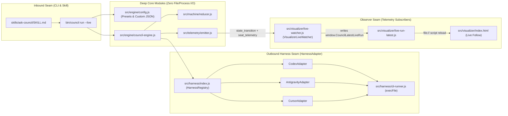

# Design Specification: Live Multi-Harness Execution, Visualizer Observer & `/ask-council` Workflow

**Date:** 2026-11-07  
**Target Branch:** `feat/council-engine`  
**Status:** Draft for User Review

---

## 1. Problem Statement & Goals

The Council consensus engine (`src/`) currently defaults to `MockAdapter` in `bin/council run` and requires an injected `spawnRunner` callback in `CodexAdapter`, `AntigravityAdapter`, and `CursorAdapter`. Additionally, the interactive HTML visualizer currently resides in `prototype/`, which violates `/prototype` Rule 6 if left in `master` alongside production code.

This design completes the live production loop for The Council across four goals:
1. **Clean Branch & Repository Hygiene (`/prototype` Rule 6)**: Keep `prototype/council-state-machine` (`954e6ef`) as the frozen throwaway prototype archive, reset local `master` to `origin/master` (`3c4510e`), remove legacy Oct 23–24 `docs/superpowers/` and `.superpowers/` files on `feat/council-engine`, and promote the visualizer into `src/visualizer/`.
2. **Direct CLI Outbound Seam (`src/harness/cli-runner.js`)**: Execute live Seat and Judge turns via `node:child_process.execFile` behind `HarnessAdapter` (`agy --print`, `codex exec`, `cursor-agent` / `agent --print`) with zero MCP or UTCP wrapper tax and zero GUI windows.
3. **Decoupled Real-Time Visual Streaming (`VisualizerLiveWatcher`)**: Subscribe a pure observer (`src/visualizer/live-watcher.js`) to `CouncilTelemetryEmitter` (`engine.getTelemetry()`) so every `state_transition` and `seat_telemetry` event atomically updates `src/visualizer/live-run-latest.js`, while `src/visualizer/index.html` polls it over `file://` in **Live Follow** mode without coupling `CouncilEngine` to file I/O.
4. **Built-In Presets & `/ask-council` Skill**: Add `--live`, `--preset <architecture | product-comparison | security-audit | argon-only>`, and `skills/ask-council/SKILL.md` so users and agents can run `/ask-council <question>` with either a named preset or a custom dynamically generated `-c <config.json>`.

---

## 2. Architecture & Seam Placement (`/codebase-design`)



### Why Direct CLI (`execFile`) Over MCP or UTCP
- **Outbound Seam (`CouncilEngine` → `HarnessAdapter`)**: `agy`, `codex`, and `cursor-agent` are local CLIs, not MCP servers. Adding `@modelcontextprotocol/sdk` or `@utcp/sdk` + `@utcp/cli` fails the `codebase-design` Deletion Test: deleting them removes external dependencies, JSON-RPC wrapper processes, and shell string-interpolation hazards (`${prompt}`) while leaving `HarnessAdapter` (`executeSeat`, `executeJudge`) deeper and zero-dependency.
- **Inbound Seam (`Caller` → `bin/council`)**: Any coding agent or terminal user can invoke `./bin/council run --live` directly via the `/ask-council` skill without running a persistent MCP server.

---

## 3. Component Specifications

### 3.1 Branch & Directory Cleanup (`feat/council-engine`)
- **Branches**:
  - `prototype/council-state-machine` (`954e6ef`): Untouched throwaway prototype archive (`/prototype` Rule 6).
  - `master`: Reset to `origin/master` (`3c4510e`).
  - `feat/council-engine`: Checked out in an isolated git worktree per `/using-git-worktrees`.
- **File Moves & Deletions on `feat/council-engine`**:
  - Promote `prototype/council-state-machine.html`, `prototype/council-machine.js`, `prototype/council-visualizer.js`, and `prototype/council-walkthroughs.js` to `src/visualizer/index.html`, `src/visualizer/council-machine.js`, `src/visualizer/council-visualizer.js`, and `src/visualizer/council-walkthroughs.js`.
  - Remove `prototype/` from `feat/council-engine` (updating `test/fixtures/walkthrough-scenarios.js`, `test/helpers/council.js`, and `src/cli/index.js` imports to `src/visualizer/`).
  - Delete legacy Oct 23–24 `docs/superpowers/` files (`2026-10-23-*`, `2026-10-24-*`, `diagrams/`) and untracked `.superpowers/`, `TEST_INFRA.md`, `TEST_READY.md`.

### 3.2 Outbound CLI Runner (`src/harness/cli-runner.js`)
A pure `node:child_process.execFile` module with zero external dependencies:
- **`parseModelAndEffort(modelString, defaultEffort = 'high')`**:
  - Parses `"gpt-6-astra (max)"` → `{ model: 'gpt-6-astra', effort: 'max', codexEffort: 'xhigh' }`.
  - Parses `"gemini-4-argon-high"` → `{ model: 'gemini-4-argon-high', effort: 'high' }`.
- **`execCli(executable, args, { signal, timeoutMs, cwd, env })`**:
  - Spawns `execFile(executable, args, { maxBuffer: 10 * 1024 * 1024, signal })`.
  - On non-zero exit or spawn error (`ENOENT`), attaches `exitCode`, `stdout`, and `stderr` to `Error` so `adapter.classifyError()` maps HTTP 429 / quota / auth / binary errors into `QuotaExhaustionError` or `HarnessExecutionError`.
- **Provider Dispatchers**:
  - **`runAntigravityCli({ executable = 'agy', model, prompt, signal })`**:
    - Args: `['--output-format', 'json', '--mode', 'plan', '--sandbox', '--disable-slash-commands', '--model', parsed.model, '--effort', parsed.effort, '--print=' + prompt]`
    - Unwraps `{ response: "..." }` JSON envelope if returned by `agy --output-format json`, falling back to raw `stdout`.
  - **`runCodexCli({ executable = 'codex', model, prompt, signal })`**:
    - Args: `['exec', '--skip-git-repo-check', '--sandbox', 'read-only', '-m', parsed.model, '-c', 'model_reasoning_effort="' + parsed.codexEffort + '"', prompt]`
  - **`runCursorCli({ executable = 'cursor-agent', model, prompt, signal })`**:
    - Args: `['--print', '--output-format', 'text', '--model', parsed.model, prompt]` (falling back to `agent` if `cursor-agent` is not found in `PATH`).

### 3.3 Prompt & Schema Hardening in Harness Adapters (`src/harness/*.js`)
- `CodexAdapter`, `AntigravityAdapter`, and `CursorAdapter` default `this.spawnRunner` to `runCodexCli`, `runAntigravityCli`, and `runCursorCli` respectively when `config.spawnRunner` is not supplied.
- All three adapters delegate prompt construction to shared prompt builders (`formatDeliberationPrompt`, `formatVotingPrompt`, and `formatJudgePrompt` in `src/seats/soul.js`) so that:
  - In `DELIBERATION`, Seats see prior broadcast clarifications, previous round `Candidate` clauses, and open `Objection`s.
  - In `VOTING`, Seats see the full current `Candidate` (`summary` + `clauses`) and the exact list of **admitted `Proof` IDs (`P1..Pn`)** so any `object` vote cites a valid admitted `proofId`.
  - In `JUDGE_AUDIT_SYNTHESIZE`, the Judge receives all round `Proof`s (`P1..Pn`) and strict instructions to return only valid JSON where every `clauses[].citedProofIds` entry references an admitted Proof ID.

### 3.4 Pure Observer for Live Visualizer (`src/visualizer/live-watcher.js` & `src/visualizer/index.html`)
- **`VisualizerLiveWatcher` (`src/visualizer/live-watcher.js`)**:
  - Subscribes to `telemetry.on('state_transition', ...)` and `telemetry.on('seat_telemetry', ...)`.
  - Maintains an in-memory walkthrough structure:
    ```js
    window.CouncilLatestLiveRun = {
      id: 'wt-live-latest',
      title: 'Live Run: <topic>',
      updatedAt: '<ISO timestamp>',
      isRunning: state.phase !== 'completed',
      initialConfig: { topic, maxRounds, minQuorum, judge, seats },
      currentState: state,
      steps: [ /* recorded transition events with labels */ ]
    };
    ```
  - Writes atomically (via temp file + `fs.renameSync`) to `src/visualizer/live-run-latest.js`.
  - `CouncilEngine` remains 100% pure and unaware of the filesystem.
- **`src/visualizer/index.html` Live Follow Mode**:
  - Includes `<script src="./live-run-latest.js" onerror=""></script>` at startup.
  - Prepends a **"Latest Live Run"** tab in `#walkthrough-tabs` whenever `window.CouncilLatestLiveRun` is present.
  - Adds a **"Live Follow (Auto-Sync)"** toggle button: when active, reloads `./live-run-latest.js?t=<Date.now()>` via a dynamic `<script>` tag every `1000ms` (works over `file://` without CORS errors) and transitions the SVG state graph, seat status badges (`THINKING`, `PROOF_SUBMITTED`, `ACCEPTED`, `OBJECTED`, `EXCUSED`), and Causal Dependency Flow arrows in real time.

### 3.5 Built-In Presets (`src/engine/config.js`) & CLI Flags (`src/cli/index.js`)
- **`COUNCIL_PRESETS` in `src/engine/config.js`**:
  1. **`architecture`**: 4 Seats (`astra-systems` on `codex`, `sol-pragmatic` on `codex`, `argon-staff` on `antigravity`, `opus-domain` on `antigravity`) + Judge `judge-opus` (`claude-opus-5-5-high` on `antigravity`).
  2. **`product-comparison`** (e.g., OS comparison or *"best phone under R\$ 1000"*): 4 Seats (`astra-specs` on `codex`, `astra-ux` on `codex`, `argon-value` on `antigravity`, `grok-skeptic` on `cursor`) + Judge `judge-opus` (`claude-opus-5-5-high` on `antigravity`).
  3. **`security-audit`**: 3 Seats (`astra-secops` on `codex`, `opus-threat` on `antigravity`, `argon-supplychain` on `antigravity`) + Judge `judge-astra` (`gpt-6-astra (max)` on `codex`).
  4. **`argon-only`** (token-saving mode): 3 Seats (`argon-systems`, `argon-pragmatic`, `argon-skeptic` all using `gemini-4-argon-high` on `antigravity` with distinct Souls) + Judge `judge-argon` (`gemini-4-argon-high` on `antigravity`).
- **CLI Flags (`src/cli/index.js`)**:
  - `--live` / `-l`: Uses `HarnessRegistry` with live CLI adapters instead of `MockAdapter`, and attaches `VisualizerLiveWatcher` writing to `src/visualizer/live-run-latest.js`.
  - `--preset <name>` / `-p <name>`: Loads one of `COUNCIL_PRESETS` (can still be overridden by `-t <topic>`, `-r <rounds>`, `-q <quorum>`, or `-c <config.json>`).
  - Prints a **`Submitted Proofs:`** section before `Candidate Clauses:` in the CLI verdict summary.

### 3.6 `/ask-council` Agent Skill (`skills/ask-council/SKILL.md`)
- Defines the workflow when the user invokes `/ask-council <question>`:
  1. Choose either a built-in `--preset` (`architecture`, `product-comparison`, `security-audit`, `argon-only`) or generate a tailored JSON config with question-specific `Soul`s (e.g., smartphone hardware reviewer, battery/display benchmarker, Brazilian retail price auditor for *"best phone under R\$ 1000"*).
  2. Open `src/visualizer/index.html` so the user can watch in **Live Follow** mode.
  3. Run `./bin/council run --live -v` with the selected preset or config.
  4. Summarize the Proof-backed Verdict, Candidate clauses, and any preserved Objections.

---

## 4. Verification & Testing Strategy

1. **Unit Tests**:
   - `test/unit/cli-runner.test.js`: Verifies `parseModelAndEffort`, `execCli` timeout/abort/exitCode handling, and `agy`/`codex`/`cursor` argument construction without making live network calls.
   - `test/unit/live-watcher.test.js`: Verifies `VisualizerLiveWatcher` subscribes to `CouncilTelemetryEmitter` and writes valid `window.CouncilLatestLiveRun` JS on `seat_telemetry` and `state_transition` events while keeping `CouncilEngine` free of file I/O.
   - `test/unit/presets.test.js`: Verifies all 4 built-in presets (`architecture`, `product-comparison`, `security-audit`, `argon-only`) and CLI `--preset` / `--live` flag resolution.
2. **Existing Suite Preservation**:
   - All 507 existing unit and E2E tests continue to pass in `<1s`.
3. **Live Smoke Test**:
   - Execute the user's 4-seat OS test configuration (`os-test-config.json`) via `./bin/council run --live -c os-test-config.json -v` and verify `src/visualizer/live-run-latest.js` + `src/visualizer/index.html`.
